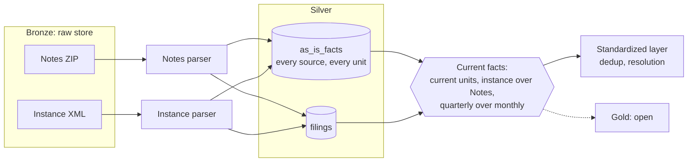

# As-Is Fact Model

| Field | Value |
| ----- | ----- |
| Status | Proposed, 2026-11-08 |
| Scope | The as-is fact model in silver, its ingestion provenance, and the read of current facts |
| Out of scope | The standardized layer, the parsers, the layout of silver ([`silver_layer.md`](../pipeline/silver_layer.md)), and gold |

## Purpose

The as-is fact model holds every fact of every SEC filing as the filing reports it. It accepts any
filer, any taxonomy (US GAAP, IFRS, `dei`, extension concepts), and every dimension. It maps
nothing and normalizes nothing.

Both ingestion paths write into the silver dataset `as_is_facts`. The backfill writes Notes rows.
The new-filing path writes instance XML. The standardized layer reads from it. This document names the
boundary to that layer and does not design it.

The `xbrl` crate fixes the contract types `AsIsFact` and `Filing` (`xbrl/DESIGN.md`, "Contract
Types and Parsing"). The silver layer design ([`silver_layer.md`](../pipeline/silver_layer.md))
fixes where the facts live, the write unit, and the replays. This document decides what silver
leaves open for the fact model. Gold is out of scope, see [Open Points](#open-points).

## Decisions

| Question | Decision | Section |
| -------- | -------- | ------- |
| Where facts live | In silver, in the dataset `as_is_facts` | [Where Facts Live](#where-facts-live) |
| Value key | The key of `xbrl/DESIGN.md`, "Value Key", is confirmed without change | [Value Key](#value-key) |
| Ingestion provenance | The seven columns of the silver sketch are confirmed without change | [Ingestion Provenance](#ingestion-provenance) |
| One fact from two sources | Silver keeps both. A read takes the instance over Notes for a whole filing | [Current Facts](#current-facts) |
| One filing in two Notes files | A read takes the quarterly file over the monthly file | [Current Facts](#current-facts) |
| Ingestion mode | Each row copies the mode of its own source document. Silver needs no function that maps mixed modes | [Ingestion Mode](#ingestion-mode) |
| Company key | `EntityId` of the filing, the CIK for the SEC. No lookup before a write | [The Fact Row](#the-fact-row) |
| Dedup | Not in `as_is_facts`. "More precise wins" and "newest filing wins" are rules of the standardized layer | [Boundary to the Standardized Layer](#boundary-to-the-standardized-layer) |

**Point-in-time stays open.** Five rules keep it open:

- Every fact keeps `filed`, and `accepted` where the source gives it.
- Silver changes and deletes no row.
- "Which value wins" is a read.
- Company attributes come from the `Filing` of each filing.
- Silver keeps its rows after the raw file changes.

## The Fact Row

A row of `as_is_facts` is one `AsIsFact`, as `xbrl/DESIGN.md` defines it, plus its ingestion
provenance. The columns are those of `as_is_facts` in
[`silver_layer.md`](../pipeline/silver_layer.md).

- `entity` is the `EntityId` of the filing: the scheme and the ID. For the SEC, the ID is the CIK.
  The parser reads it from the source, so a write needs no lookup.
- `filed` and `accepted` sit on every row. A point-in-time read filters on them.
- Silver keeps every copy of a fact: each `copy_rank`, the original filing, and each amendment.
  It also keeps each source and each replay.

### Value Key

The value key of `xbrl/DESIGN.md`, "Value Key", fits `as_is_facts` without change:

`filing`, `concept`, `taxonomy_version`, exact period end, length in quarters (0 for an instant),
`unit`, `dimensions`, `copy_rank`.

- The key is unique within one filing, because the parser numbers the copies.
- In silver, the key is unique within one filing and one unit. A filing on both paths has one set
  of rows per source, and a replay adds a set in a new unit.
- `taxonomy_version` is never empty for a Notes or instance fact. Notes and the instance both give it. Only
  `sec_api` facts lack it, and silver does not load `sec_api` facts.
- `unit` is empty for a text fact. The key treats two empty units as equal.

### Fields and the Parse Rules

The segment findings of 2026-10-18 measured seven rules that make a Notes row equal to an instance
fact. The table shows where each rule lands in the as-is row. Some rules change, because
silver keeps every value and leaves dedup to the standardized layer.

| # | Rule in the findings | In the as-is row |
| - | -------------------- | ---------------- |
| 1 | Shorten axis and member names the way the SEC does | `dimensions` holds the pairs without prefixes, as `xbrl/DESIGN.md` says |
| 2 | Keep a typed member as written | `dimensions` keeps the content of the typed member |
| 3 | Notes drops `/shares` from a per-share unit | The Notes parser restores `/shares`. `unit` holds the full unit |
| 4 | The exact end date is `ddate` minus `datp` days | `period` holds the exact end. The start is set only if the source gives it |
| 5 | A fact reported twice is two rows, keep the higher `dcml` | Both rows stay. The parser numbers them in `copy_rank`, in the `iprx` order. `decimals` holds `dcml`, and 32767 becomes `Infinite` |
| 6 | Skip a nil fact | A nil fact stays, as `FactValue::Nil` |
| 7 | Drop a value with a `coreg`. Keep a value only if every axis is on the list | Every value stays. `coreg` becomes the legal entity axis in `dimensions`. The list of segment axes is a read rule |

`value` holds a decimal number, a text, or nil. `footnotes` holds the footnotes as the source gives
them.

### Both Inputs

| Field | Notes data set | Instance XML |
| ----- | -------------- | ------------ |
| `filing` | `sub.adsh` | The accession number of the filing |
| `entity` | `sub.cik` | The entity identifier of the context |
| `concept` | `num.tag` with the namespace of `num.version` | The element name |
| `taxonomy_version` | `num.version` | The schema reference of the filing |
| `period` | `ddate` minus `datp`, and `qtrs` | The period of the context |
| `unit` | `num.uom`, with `/shares` restored | The unit of the fact |
| `dimensions` | `dim.segments` through `num.dimh`, and `coreg` | The members of the context |
| `value` | `num.value` or `txt.value`. An empty value is nil | The content of the fact, or `xsi:nil` |
| `decimals` | `num.dcml` | The `decimals` attribute |
| `copy_rank` | Assigned by the parser in the order of `num.iprx` | Assigned by the parser in the SEC order of `iprx` |
| `footnotes` | `num.footnote` | The footnote links |
| `filed`, `accepted` | `sub.filed`, `sub.accepted` | The filed date of the filing. `accepted` is empty |

Notes loses data in 7.8% of the facts that both sources hold: per-share units, non-ASCII text,
footnotes, and rounding (`sec/design/pipeline/ingestion_paths.md`, "Measured Result"). The read
rule of [Current Facts](#current-facts) picks the instance for this reason.

## Where Facts Live

Silver holds the as-is facts first, in the dataset `as_is_facts`, with `filings` next to it. The
silver layer design fixes the format, the write unit, the paths, and the replays:

- A write unit is a Notes file (`notes_file`) or the new filings of one day (`filing_day`).
- Silver never changes a file. A replay or a corrected Notes file adds a new unit next to the old
  one.
- The current unit of a unit key is the one with the latest `written_at`. A default read takes
  only current units.

Silver keeps the history: every source, every replay, and every corrected file.

## Ingestion Provenance

The provenance record of the silver sketch is confirmed without change:

| Column | Meaning |
| ------ | ------- |
| `source_kind` | `notes` or `instance` |
| `source_key`, `source_sha256` | The raw document of the row and its digest |
| `ingestion_mode` | `backfill` or `incremental`, from the raw metadata of the document |
| `transform_version` | The version of the parser output |
| `execution_id` | The run that wrote the row |
| `loaded_at` | The time of the write |

- Every row of `as_is_facts` carries these columns.
- The URL and the retrieval time of each raw document sit in `silver_files`, as the silver design
  says.
- The record is the ingestion provenance. The filing provenance (accession number, form, fiscal
  year and period, filed date, period end) is on `Filing`. It is the same for both paths, so the
  two stay apart.
- In Rust, `IngestionProvenance` lives in `storage`, next to `IngestionMode`. It is not on
  `AsIsFact`, because `xbrl` does not depend on `storage`.

## Current Facts

A filing can sit in more than one current unit of silver: once per source, and in a monthly and a
quarterly Notes file after the SEC merges a quarter. The read of current facts takes one unit per
filing:

1. Take only current units. This is the rule of the silver design.
2. If an instance unit holds the filing, take it.
3. Otherwise, take the Notes unit of the quarterly file over the Notes unit of the monthly file.

The rule depends only on the source and the Notes period, never on the order of runs. A filing has
one filed date and sits in one month and one quarter, so the rule always leaves one unit.

- **Instance over Notes.** Both sources hold the same facts with the same value keys
  (`ingestion_paths.md`, "Measured Result"). The instance keeps the units, the text, and the
  footnotes that Notes loses. A filing that only Notes delivered keeps the Notes form of these
  facts. The comparison of the sources recommended the same preference at write time (option 2).
  Silver keeps every copy, so the preference is a read (option 3 of "Path Independence").
- **Quarterly over monthly.** The SEC builds the quarterly file after the monthly files, and
  removes the monthly files at the merge (`ingestion_paths.md`, assumption A4).
- **Accepted time.** The instance path gives `filed` only. If the current Notes `filings` row of
  the same filing has `accepted`, the read copies it onto the filing and each fact. This is the only
  value the read takes from the other source. Silver keeps the instance rows as they are.
- The same rule picks the unit of `candidates` per filing, so the series step gets one candidate
  per filing and standard concept.

The rule runs as a view over silver. The other reads of the
silver design ("as public on day D", "as silver held it at time T") apply this rule after their own
filter.

## Ingestion Mode

Each row of silver copies `ingestion_mode` from the raw metadata of its own document, so no row
mixes modes. The owner decided this for silver on 2026-11-08, so silver needs no function that
maps mixed modes. A standardized fact reaches the modes of its sources through `inputs`.

- Notes ZIPs come from the backfill, so a Notes row is `backfill`.
- An instance from the catch-up of the backfill is `backfill`. An instance from `daily_filings` is
  `incremental`.
- A replay keeps the mode of the source. `transform_version` and `loaded_at` show the replay.

## Diagram

## Boundary to the Standardized Layer

- The standardized layer reads current facts. It never writes to `as_is_facts`.
- It owns `core/dedup/more-precise@1` and `core/dedup/newest-filing@1` (`xbrl/DESIGN.md`, "Dedup
  Rules"). Silver keeps every copy that these rules choose from.
- It can rebuild from silver at any time, with no download and no parse.
- Its concepts are our own set, so a later source such as ESEF maps into the same concepts. The
  as-is model of that source is a separate design.

## Open Points

| Point | Owner |
| ----- | ----- |
| Gold: its tables, the write rule ("upsert-by-full-grain" against `DO NOTHING`), the replay of a filing, and dedup for direct reads by the API or a BI tool | A later gold design |
| The replacement of `FactStore::upsert(&CompanyId, &FactSet)` in `storage_traits_design.md`. `FactSet` is not a storage type, and the port writes gold | A later gold design |
| When transform runs on a Notes file that the SEC corrects | The transform design |
| The acceptance time on the new-filing path, from a machine-readable source | Extraction |
| The signatures of the reads | The read methods of `storage`, when the screener needs them |

Inputs for the gold design, decided by the owner on 2026-11-08:

- The `/v1` API serves as-is facts as well as standardized facts.
- Gold is ready for direct reads by the API or by other business uses, for example a BI tool.

## Feature Tickets

1. **Provenance type in `storage`.** `IngestionProvenance`, next to `IngestionMode`, with the
   seven columns of [Ingestion Provenance](#ingestion-provenance).
2. **Current-facts read over silver.** The view with the three steps of
   [Current Facts](#current-facts), and the copy of `accepted`. Tests for both sources, a monthly
   and a quarterly Notes file, a replay, and an amendment.
