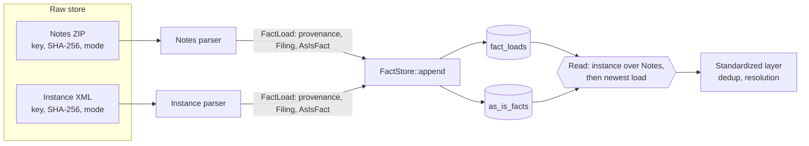

# As-Is Fact Store

| Field | Value |
| ----- | ----- |
| Status | Proposed, 2026-11-07 |
| Scope | The as-is fact model, the ingestion provenance, the write and read rules, and the `FactStore` port |
| Out of scope | The standardized layer, the parsers, the physical tier (see [Where Facts Live](#where-facts-live)) |

## Purpose

The as-is fact store holds every fact of every SEC filing as the filing reports it. It accepts any
filer, any taxonomy (US GAAP, IFRS, `dei`, extension concepts), and every dimension. It maps
nothing and normalizes nothing.

Both ingestion paths load into this store. The backfill loads Notes rows. The new-filing path
loads instance XML. A standardized layer reads from the store later. This document names the
boundary to that layer and does not design it.

The `xbrl` crate fixes the contract types `AsIsFact` and `Filing` (`xbrl/DESIGN.md`, "Contract
Types and Parsing"). This store keeps them as they are.

## Decisions

| Question | Decision | Section |
| -------- | -------- | ------- |
| Value key | The key of `xbrl/DESIGN.md`, "Value Key", is confirmed without change | [Value Key](#value-key) |
| Unit of write | A load: the facts of one filing from one source document, read by one parser version | [Loads](#loads) |
| Write rule | Append a load. A load that exists already changes nothing. No row is ever updated or deleted | [Write Rule](#write-rule) |
| Source document in the grain | Yes. The load ID holds the source format, the SHA-256 of the source, and the parser version | [Loads](#loads) |
| One fact from two sources | Both loads stay. A read takes the instance load of a filing over its Notes load | [One Filing From Two Sources](#one-filing-from-two-sources) |
| Replay after a parser fix | A new parser version gives a new load. The read takes the newest load | [Replay After a Parser Fix](#replay-after-a-parser-fix) |
| Notes file that the SEC corrects | A corrected file has a new SHA-256, so a load of it is a new load. The old load stays | [Corrected Notes File](#corrected-notes-file) |
| Ingestion mode of a load | The mode of its source document | [Ingestion Mode of a Load](#ingestion-mode-of-a-load) |
| Company key | `EntityId` of the filing, the CIK for the SEC. No lookup before a write | [The Fact Row](#the-fact-row) |
| Dedup | Not in the store. "More precise wins" and "newest filing wins" are rules of the standardized layer | [Boundary to the Standardized Layer](#boundary-to-the-standardized-layer) |
| Port | `FactStore::append(&FactLoad)` replaces `FactStore::upsert(&CompanyId, &FactSet)` | [The `FactStore` Port](#the-factstore-port) |
| Physical tier | Open until the silver layer design lands. A Postgres sketch is below | [Where Facts Live](#where-facts-live) |

**Keep point-in-time open.** Every fact keeps `filed` and `accepted`, no write changes or deletes
a row, "which value wins" is a read, company attributes come from the `Filing` of each load, and a
load keeps its values after the raw file changes.

## The Fact Row

A row of the store is one `AsIsFact`, as `xbrl/DESIGN.md` defines it, plus the ID of the load that
wrote it. The load holds the ingestion provenance. See [Loads](#loads).

- `entity` is the `EntityId` of the filing: the scheme and the ID. For the SEC, the ID is the CIK.
  The parser reads it from the source, so a write needs no lookup.
- `filed` and `accepted` sit on every row. A point-in-time read filters on them.
- The store keeps every copy of a fact: each `copy_rank`, the original filing, and each amendment.

### Value Key

The value key of `xbrl/DESIGN.md`, "Value Key", fits the store without change:

`filing`, `concept`, `taxonomy_version`, exact period end, length in quarters (0 for an instant),
`unit`, `dimensions`, `copy_rank`.

- The key is unique within one filing, because the parser numbers the copies.
- A row key in the store is the load ID plus the value key. The load fixes the filing, the source
  document, and the parser version.
- `taxonomy_version` is never empty in the store. Notes and the instance both give it. Only
  `sec_api` facts lack it, and the store does not load `sec_api` facts.
- `unit` is empty for a text fact. The key treats two empty units as equal.
- `dimensions` can be long. The key uses the SHA-256 of the canonical text of `Dimensions`, and the
  row keeps the pairs next to it.

### Fields and the Parse Rules

The segment findings of 2026-10-18 measured seven rules that make a Notes row equal to an instance
fact. The table shows where each rule lands in the as-is row. Some rules change, because the
store keeps every value and leaves dedup to the standardized layer.

| # | Rule in the findings | In the as-is row |
| - | -------------------- | ---------------- |
| 1 | Shorten axis and member names the way the SEC does | `dimensions` holds the pairs without prefixes, as `xbrl/DESIGN.md` says |
| 2 | Keep a typed member as written | `dimensions` keeps the content of the typed member |
| 3 | Notes drops `/shares` from a per-share unit | The Notes parser restores `/shares`. `unit` holds the full unit |
| 4 | The exact end date is `ddate` minus `datp` days | `period` holds the exact end. The start is set only if the source gives it |
| 5 | A fact reported twice is two rows, keep the higher `dcml` | Both rows stay. The parser numbers them in `copy_rank`, in the `iprx` order. `decimals` holds `dcml`, and 32767 becomes `Infinite` |
| 6 | Skip a nil fact | A nil fact stays, as `FactValue::Nil` |
| 7 | Drop a value with a `coreg`. Keep a value only if every axis is on the list | Every value stays. `coreg` becomes the legal entity axis in `dimensions`. The list of segment axes is a read rule |

`value` holds a decimal number, a text, or nil. `footnotes` holds the footnotes as the source gives
them.

### Both Inputs

| Field | Notes data set | Instance XML |
| ----- | -------------- | ------------ |
| `filing` | `sub.adsh` | The accession number of the filing |
| `entity` | `sub.cik` | The entity identifier of the context |
| `concept` | `num.tag` with the namespace of `num.version` | The element name |
| `taxonomy_version` | `num.version` | The schema reference of the filing |
| `period` | `ddate` minus `datp`, and `qtrs` | The period of the context |
| `unit` | `num.uom`, with `/shares` restored | The unit of the fact |
| `dimensions` | `dim.segments` through `num.dimh`, and `coreg` | The members of the context |
| `value` | `num.value` or `txt.value`. An empty value is nil | The content of the fact, or `xsi:nil` |
| `decimals` | `num.dcml` | The `decimals` attribute |
| `copy_rank` | Assigned by the parser in the order of `num.iprx` | Assigned by the parser in the SEC order of `iprx` |
| `footnotes` | `num.footnote` | The footnote links |
| `filed`, `accepted` | `sub.filed`, `sub.accepted` | The filed date of the filing. `accepted` is empty |

Notes loses data in 7.8% of the facts that both sources hold: per-share units, non-ASCII text,
footnotes, and rounding (`sec/design/pipeline/ingestion_paths.md`, "Measured Result"). The read
rule of [One Filing From Two Sources](#one-filing-from-two-sources) picks the instance for this
reason.

## Loads

A load is the unit of write. It holds the facts of one filing, read from one source document by
one parser version, and the ingestion provenance of that read.

```text
FactLoad {
    provenance: IngestionProvenance
    filing:     Filing              // as this source reads it
    facts:      Vec<AsIsFact>       // every fact has filing.id as its filing
}

IngestionProvenance {
    mode:           IngestionMode   // Backfill | Incremental, from the source metadata
    source:         SourceDocument
    execution_id:   Uuid            // the run that wrote the load, as in DocumentMetadata
    loaded_at:      DateTime<Utc>
    parser_version: ParserVersion   // for example "notes@0.3.0"
}

SourceDocument {
    format:        SourceFormat     // Notes | Instance
    key:           DocumentKey      // the key in the raw store
    sha256:        Sha256Digest     // of the stored bytes
    requested_url: Option<String>   // the SEC URL, from the raw metadata
}
```

- **The load ID** is a UUID v5 of four fields: the filing ID, the source format, the SHA-256 of the
  source, and the parser version. Any run computes the same ID from the same inputs, so a write
  needs no lookup.
- **The ingestion provenance sits next to each fact.** Each row holds the load ID, and the load ID
  names one provenance. It is not on `AsIsFact`, because `IngestionMode` lives in `storage`.
- **The filing provenance** of `xbrl` (accession number, form, fiscal year and period, filed date,
  period end) is on `Filing`. It is the same for both paths. The ingestion provenance differs by
  path, so the two stay apart.
- **A Notes source** is the Notes ZIP that holds the filing. Its key and SHA-256 name the whole
  file, not the rows of the filing.
- **The Filing of a load** is the filing as this source reads it. Notes rounds `period` to a month
  end and `accepted` to the minute. The instance path has no `accepted`. Each load keeps its own
  values.

### Write Rule

`FactStore::append` writes one load in one transaction:

1. Insert the load. If a load with the same ID exists, do nothing.
2. Insert the facts. If a fact with the same load ID and value key exists, do nothing.

So the store is append-only. A rerun with the same inputs computes the same load ID and adds no
row. `execution_id` and `loaded_at` keep the values of the first write, as the run fields of the
raw store do.

This rule settles two earlier texts:

- `storage_traits_design.md` named the fact write "upsert-by-full-grain". The full grain is now the
  load ID plus the value key.
- `ingestion_paths.md` named it `ON CONFLICT … DO NOTHING` on the accession number and the value
  key. The rule keeps `DO NOTHING`, and the load ID takes the place of the accession number.

`DO NOTHING` cannot drop a different value. Two writes with the same load ID read the same bytes
with the same parser, so they hold the same facts. A different value comes from a different source
or a different parser version, so it gets a different load ID.

### Replay After a Parser Fix

A parser fix must change the parser version. The replay then computes a new load ID and appends a
new load. The old load stays. The read takes the newest load of the filing and source format. See
[Reads](#reads).

- No write deletes a fact, so `FactStore` needs no delete.
- If a parser changes its output and keeps its version, the replay changes nothing. A test must
  catch this case. See [Feature Tickets](#feature-tickets).
- Each full replay adds a copy of every fact. Estimate: 168,528 facts in 622 filings give about 270
  facts per filing. The 29,598 S&P 500 filings from 2011 to September 2026 then hold about 8
  million facts per source. A prune of loads that no read takes is a later choice. See
  [Open Points](#open-points).

### Corrected Notes File

The SEC corrects old Notes files about once a year (`ingestion_paths.md`, assumption A4). A
corrected file has a new SHA-256. A load of it is a new load, and the old load stays. So the store
keeps the old values after the raw store replaces the file.

The store does not decide when a corrected file gets loaded. Today the backfill does not fetch a
stored file again. Extraction owns the detection. See [Open Points](#open-points).

### One Filing From Two Sources

A filing reaches the store twice in two cases: the overlap of one day at the cut-over, and a
backfill after the new-filing path. The store keeps both loads. A read takes one source per
filing:

- If the filing has an instance load, the read takes it.
- Otherwise, the read takes the Notes load.

The read takes a whole filing from one source, never a mix of facts. Both sources hold the same
facts with the same value keys (`ingestion_paths.md`, "Measured Result"). The instance keeps the
units, the text, and the footnotes that Notes loses. A filing that only Notes delivered keeps the
Notes form of these facts.

This is option 3 of `ingestion_paths.md`, "Path Independence": both copies with their provenance,
and a read picks one. The order of arrival never decides a value. The comparison of the two sources
recommended option 2, the same preference applied at write time. Option 2 drops the Notes copy,
and the store keeps every copy, so the preference moves to the read.

### Ingestion Mode of a Load

A load carries the mode of its source document, from `DocumentMetadata::ingestion_mode()` of that
document. Other inputs of the transform, such as the label file or `submissions`, do not change
it.

- Notes ZIPs come from the backfill, so a Notes load is `Backfill`.
- An instance from the catch-up of the backfill is `Backfill`. An instance from `daily_filings` is
  `Incremental`.
- A replay keeps the mode of the source. The parser version and `loaded_at` show the replay.

So a load never has mixed modes. The mode of a standardized output that joins many loads is a
question of the standardized layer. See [Open Points](#open-points).

## Reads

The store answers three reads. Their signatures wait for the read methods of `storage`.

| Read | Rule |
| ---- | ---- |
| Current facts | Per filing, take one load: the instance load over the Notes load, then the newest `loaded_at`, then the highest load ID |
| As of filed date D | The current facts of the filings with `filed` on or before D |
| As known at time T | The same rule as current facts, over the loads with `loaded_at` on or before T |

- "As known at time T" is not in the MVP. The data for it is in the store from the first load.
- A read never collapses two copies within one filing or across filings. The standardized layer
  does that.
- The segment view is a read: it keeps a fact only if every axis on it is on the list of segment
  axes.

## The `FactStore` Port

`FactStore::upsert(&CompanyId, &FactSet)` in `storage_traits_design.md` changes. `FactSet` is a
working set of resolution in `xbrl`, not a storage type. `CompanyId` is not needed, because each
fact carries its `EntityId`.

```rust
// store/facts.rs
#[async_trait]
pub trait FactStore: Backend {
    /// Appends one load. A load that the store holds already changes nothing.
    async fn append(&self, load: &FactLoad) -> Result<(), WriteError>;
}
```

- `FactLoad`, `IngestionProvenance`, `SourceDocument`, `SourceFormat`, and `ParserVersion` live in
  `storage`. `AsIsFact` and `Filing` come from `xbrl`, which `storage` already depends on.
- `FactLoad::new` checks that every fact names the filing of the load. A fact of another filing is
  an error, not a dropped row.
- `SecRepository::persist` calls `self.facts.append(&record.facts)`. `FilingRecord` loses its
  `company` field.

## Where Facts Live

Open. The silver layer design decides if as-is facts live in silver Parquet first, with Postgres as
the gold layer that loads from them. Decided with the owner on 2026-11-07: this design stays
neutral to the tier. A load maps to both tiers without a change to the model:

- **Postgres** (ADR 0001): one table of loads, one table of facts, and the write path below.
- **Silver Parquet**: one load is one file, or one partition, of the as-is dataset. The load ID is
  a column on each row. Append-only fits a store of files, because no file changes after a write.
  The silver layer design picks the format, the partitions, and the manifest.

### Postgres Schema Sketch

```sql
CREATE TABLE fact_loads (
    load_id          uuid        PRIMARY KEY,  -- UUID v5 of the four load fields
    filing_id        text        NOT NULL,     -- 'sec:0000320193-26-000001'
    source_format    text        NOT NULL CHECK (source_format IN ('notes', 'instance')),
    source_sha256    bytea       NOT NULL,
    parser_version   text        NOT NULL,
    ingestion_mode   text        NOT NULL CHECK (ingestion_mode IN ('backfill', 'incremental')),
    source_key       text        NOT NULL,
    source_url       text,
    execution_id     uuid        NOT NULL,
    loaded_at        timestamptz NOT NULL,
    -- Filing, as this source reads it
    entity_scheme    text        NOT NULL,
    entity_id        text        NOT NULL,     -- the CIK for the SEC
    form             text        NOT NULL,
    is_amendment     boolean     NOT NULL,
    filed            date        NOT NULL,
    accepted         timestamptz,
    period_of_report date,
    fiscal_year      smallint,
    fiscal_period    text,
    company_name     text,
    sic              text,
    ticker           text,
    exchange         text,
    fiscal_year_end  text,
    UNIQUE (filing_id, source_format, source_sha256, parser_version)
);

CREATE TABLE as_is_facts (
    load_id           uuid        NOT NULL REFERENCES fact_loads,
    filing_id         text        NOT NULL,
    entity_scheme     text        NOT NULL,
    entity_id         text        NOT NULL,
    concept_family    text        NOT NULL,  -- 'us-gaap', 'dei', or an extension prefix
    concept_name      text        NOT NULL,
    taxonomy_version  text        NOT NULL,
    period_start      date,
    period_end        date        NOT NULL,
    quarters          smallint    NOT NULL,  -- 0 for an instant
    unit              text,                  -- empty for text
    dimensions        jsonb       NOT NULL,  -- sorted axis and member pairs
    dimensions_sha256 bytea       NOT NULL,
    copy_rank         integer     NOT NULL,
    value_numeric     numeric,
    value_text        text,
    is_nil            boolean     NOT NULL,
    decimals          smallint,
    decimals_infinite boolean     NOT NULL,
    footnotes         text[]      NOT NULL,
    filed             date        NOT NULL,
    accepted          timestamptz,
    UNIQUE NULLS NOT DISTINCT (load_id, concept_family, concept_name, taxonomy_version,
                               period_end, quarters, unit, dimensions_sha256, copy_rank),
    CHECK (num_nonnulls(value_numeric, value_text) + is_nil::int = 1)
);

CREATE INDEX ON as_is_facts (entity_scheme, entity_id, concept_family, concept_name, period_end);
CREATE INDEX ON fact_loads (filing_id, source_format, loaded_at);

-- Current facts: one load per filing, see "Reads".
CREATE VIEW current_fact_loads AS
SELECT DISTINCT ON (filing_id) *
FROM fact_loads
ORDER BY filing_id, (source_format = 'instance') DESC, loaded_at DESC, load_id DESC;
```

- `UNIQUE NULLS NOT DISTINCT` needs Postgres 15. Supabase runs Postgres 15 or later.
- `entity_*`, `filing_id`, `filed`, and `accepted` repeat on each fact, so a read by company and
  time needs no join.
- The schema keeps no `companies` table. Company attributes come from the `Filing` of each load.
  The company node of the graph tier keeps its own rule (`ingestion_paths.md`, "Idempotent
  Writes").

### Write Path

ADR 0001 runs the graph and fact writes of one filing in one Postgres transaction. The fact part
of that transaction is:

```sql
INSERT INTO fact_loads (...) VALUES (...)
ON CONFLICT (load_id) DO NOTHING;

INSERT INTO as_is_facts (...)
SELECT ... FROM unnest($1::uuid[], $2::text[], ...)
ON CONFLICT DO NOTHING;
```

- The order in the transaction stays: company, then filing, then facts. The load row is the filing
  of the fact store.
- No statement reads before it writes.
- The backfill can load through `COPY` into a temporary table and then the same `INSERT … ON
  CONFLICT DO NOTHING`. The rule and the result stay the same.

## Diagram



## Boundary to the Standardized Layer

- The standardized layer reads current facts. It never writes to the as-is store.
- It owns `core/dedup/more-precise@1` and `core/dedup/newest-filing@1` (`xbrl/DESIGN.md`, "Dedup
  Rules"). The store keeps every copy that these rules choose from.
- It can rebuild from the store at any time, with no download and no parse.
- Its concepts are our own set, so a later source such as ESEF maps into the same concepts. The
  as-is store of that source is a separate design.

## Open Points

| Point | Owner |
| ----- | ----- |
| Where facts live: Postgres only, or silver Parquet first with Postgres as gold | The silver layer design |
| When to prune loads that no read takes | The lead, after the first full replay shows the size |
| How extraction detects a Notes file that the SEC corrects, and when transform loads it | Extraction |
| The ingestion mode of a standardized output that joins loads of mixed modes | The transform design |
| The signatures of the three reads | The read methods of `storage`, when the screener needs them |

## Feature Tickets

1. **Provenance types in `storage`.** `IngestionProvenance`, `SourceDocument`, `SourceFormat`,
   `ParserVersion`, and `FactLoad` with its ID and the filing check. Tests for the load ID and for
   a fact of another filing.
2. **`FactStore::append`.** Replace `upsert` on the port, update `SecRepository` and
   `FilingRecord`, and add an in-memory fake with the write rule. Tests for a rerun, a new parser
   version, and a second source.
3. **Parser version guard.** A test per parser that compares its output on fixed filings with a
   stored result, and fails if the output changes while the version stays.
4. **Postgres fact tier.** The migration for `fact_loads` and `as_is_facts`, and `append` in the
   Postgres store, inside the transaction of ADR 0001. Starts after the silver layer design
   confirms the tier.
5. **Current-fact read.** The read of current facts and the read as of a filed date, with tests for
   both sources, a replay, and an amendment.
