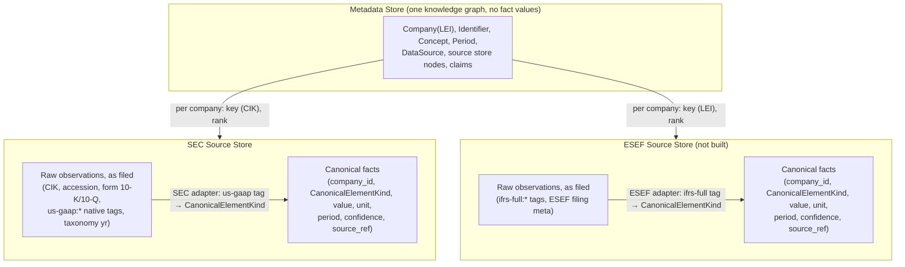
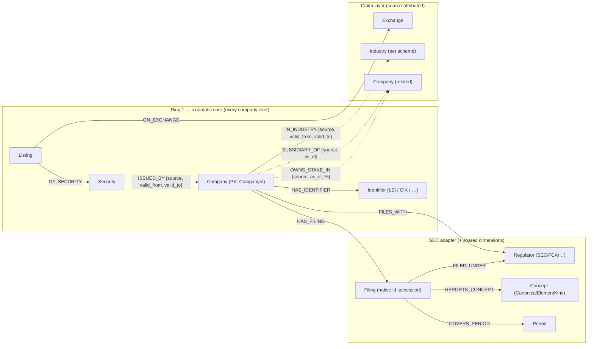
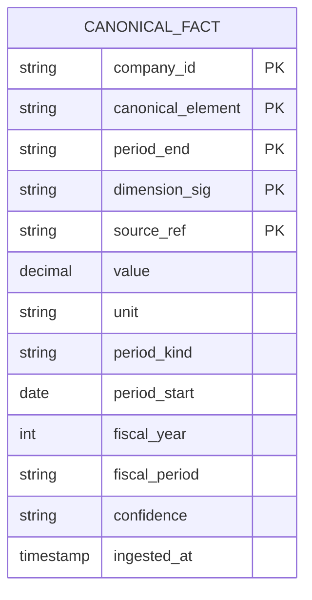
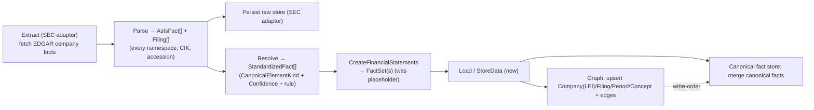

# Universal Company Data Model — Canonical Core + Regulator Adapters

> **SPIKE findings for [STA-130](https://linear.app/state-machine/issue/STA-130/spike-design-hybrid-data-model-graph-knowledge-base-analytical-data).**
> Status: findings complete — logical model settled (§2–§12); **physical deployment deliberately
> deferred (decision 2026-08-08): storage is fully abstracted behind the `storage` crate's ports
> (§14.F), and the physical choice waits for a measured trigger (§14).**
> Owner: Damir Catovic. Date: 2026-07-21 (rev. 2026-08-08).

## 1. Context & Guiding Requirements

`arkad` normalizes company financial data and serves screeners, dashboards, and
data-quality checks. This SPIKE decides the **persistence data model**. Three
requirements drive the design:

1. **A universal, regulator- and jurisdiction-independent model** that works for *any*
   company worldwide — not SEC-specific, not US-GAAP-specific. This is the **source of
   truth**.
2. **Regulator-specific data (SEC/EDGAR first, later FCA, BaFin, ESEF/IFRS) connects to
   the universal core and stays independently queryable** — CIK, accession numbers, native
   `us-gaap` tags, and form types are first-class *within their adapter*, joinable to the
   universal model but never leaking into it.
3. **Accounting correctness** — normalization obeys the element definitions of FASB Concepts
   Statement 8, Chapter 4, and the four accounting identities; every
   normalized fact is traceable back to the raw filing tag it came from.

### 1.1 The current codebase is an immature seed, not the target

The design below is a **redesign**, not a preservation of what exists. Today the workspace
has two parallel, non-integrated models and one raw-document store:

- `sec` crate (live): `ParseCompanyFacts` calls `xbrl::adapter::edgar::company_facts::parse` and
  emits `CompanyData { Cik, EntityName, Vec<AsIsFact>, Vec<Filing> }`. Identity is
  **`Cik`-centric** (SEC-specific). No concept is resolved yet.
  [ADR 0026](../../../docs/adr/0026-sec-uses-xbrl-fact-types.md) records why `sec` uses the `xbrl`
  types with no wrapper, and its Amendment 1 sets the check of the required concepts.
- `xbrl` crate: `ParseCompanyFacts` calls its parser. The crate also holds `CanonicalElementKind` (36
  standard concepts, nested by statement), `StandardizedFact` (with a `Confidence` ladder, a `rule`, and `inputs`), `FactSet`,
  `Invariant` validation, and a graph-engine **TODO stub**. No state reads them yet.
- The stream runs **Extract** only and ends after `StoreCompanyFacts`. `CreateFinancialStatements` emits a placeholder
  unit struct; the entire **Load SuperState is an empty file**.

What to carry forward vs. change (detail in §10):

| Existing artifact | Verdict |
| --- | --- |
| `xbrl::CanonicalElementKind` (the standard concepts) | **Keep & promote** — this *is* the universal concept layer, but decouple it from the `us_gaap` module so it is standard-neutral |
| `xbrl::StandardizedFact` + `Confidence` + `rule` + `inputs` | **Keep & promote** — becomes the universal `CanonicalFact`, minus SEC specifics |
| `xbrl::Invariant` (accounting identities) | **Keep** — universal validation |
| `us_gaap::mappings` (tag → CanonicalElementKind) | **Reframe** — this is *one adapter* (SEC/US-GAAP), not the core |
| `sec::Cik`-centric identity, `AccessionNumber` and `Form` | **Scope to the SEC adapter** — `Cik` stays first-class: it is the adapter's primary key and the natural entry point of SEC pipelines (§11); *core* identity keys on **`CompanyId`** (internal key, §4), resolved at load time |
| `sec::CompanyData` (the `xbrl` as-is facts and filings) | **Replace** — `FactSet` supersedes it (§10, step 5) |

## 2. Architectural Spine — Metadata Store Over Source Stores

The model serves one goal: a **company brain** in gold. One metadata store covers all data sources.
It is a knowledge graph of the companies and their identifiers (§5), the canonical concepts (§3),
and the data sources and their source stores. It resolves entities. For each company, it lists the
sources that hold data about it and names the preferred one. Each source store holds the records of
one data source, such as the SEC facts (§7) as filed and as canonical facts, with the provenance of each
record (§8.2). A query starts in the metadata store and finds the stores and the keys to read.
[ADR 0007](../../../docs/adr/0007-gold-company-brain.md) records the decision.



**Principle:** An adapter loads one data source. It writes two things:

1. The source store of that data source. The store holds the records as the source publishes them,
   and the canonical facts that the adapter resolves from them, each with its provenance.
2. The entries of the metadata store: the company, its identifiers, its filings, and an edge from
   the company to the source store. The edge carries the kind of information and the key. Its rank
   follows ADR 0007, Decision 5: a default rank until a person sets one. A load never changes a
   rank that a person set.

The metadata store holds no fact values (ADR 0007, Decision 3). A company that files nowhere still
exists in the metadata store, with its identifiers and relationships. A company that files with
three regulators has its records in three source stores, each with its own canonical facts. The
metadata store lists all three for that company.

**What resolves and what stays as filed:** an observation becomes a canonical fact only if it
resolves to a `CanonicalElementKind` at a known `Confidence`. An observation with no canonical meaning,
such as a `us-gaap` disclosure tag with no mapping to a `CanonicalElementKind`, stays in the source
store as filed. A caller can query it there. This meets the requirement to connect to and query
regulator-specific data.

### 2.1 Two Rings: Axiomatic Identity and Derived Data (Multi-Source Rule)

"Source of truth" has two rings with different standing (review resolution, 2026-08-08):

- **Axiomatic ring: identity and structure.** This ring is a part of the metadata store: `Company`,
  its `Identifier`s, and the bridges to each data source. It holds only what a person can check
  against an authoritative registry. For example, GLEIF says that an LEI exists, and EDGAR says
  that a filing exists. §8 means this ring when it says "graph = source of truth."
- **Derived ring: normalized data.** The canonical facts (§6) of each source store, and the
  completeness edges of the metadata store, are computed from the records of a data source. They
  are never axiomatic. Each datum carries provenance (`source_ref`, `confidence`), and a replay rebuilds all of it (§8).
  So a value, a unit, or a period of a canonical fact is a normalized projection of a record in its
  source store, and it traces back to that record.
- **Query routing works in both directions** (§7.1). A caller can query a source store directly by
  its native key, such as a `Cik` in the SEC store. A caller can also query a `Company` by
  `CompanyId` or LEI. The metadata store then routes the query to the source stores that hold data
  for it.

A value that a person sets is in neither ring: a rank, a home market, the trust of a source, or a
verdict on an item of the review queue (ADR 0007, Decisions 3 and 5). No registry checks it, and no
replay rebuilds it. So a rebuild of the metadata store must keep it. §8, "Recoverability", does not
cover such a value. ADR 0007, "Open Questions", leaves open how the metadata store records who set
a rank and when.

**Multi-source rule:** if several source stores hold canonical facts for the same company, no load
merges them. Each source store keeps its own canonical facts (ADR 0007, Decision 4). Example: a
dual-listed filer reports FY2024 revenue in a 10-K (`us-gaap`, SEC store) and in an ESEF report
(`ifrs-full`, ESEF store). Each of the two stores then holds one row for (company, `Revenue`,
FY2024).

Which value a caller reads is a read-time policy, never a write-time overwrite. The metadata store
names the preferred source store for each company, and a caller can name another (ADR 0007,
Decision 5). The graph keeps conflicting relationship claims in the same way (§5.2).

Agreement across sources raises the confidence of a value. A divergence is a data-quality finding.
Both need a check that reads two source stores for one company. ADR 0007, "Open Questions", leaves
open where this check runs and where the confidence from agreement lives, and assigns both to the
gold design.

## 3. Universal Canonical Concept Model

The universal vocabulary is the **`CanonicalElementKind`** set: the lines of the roll-up trees
of the three statements and the disclosures, listed in `xbrl/src/core/elements/`. Its top lines
rest on the elements of Concepts Statement 8, Chapter 4, plus totals such as `NetIncome`.
`xbrl/DESIGN.md`, "Roll-Up Tree", gives each tree. Concepts Statement 8 is a
US document, but its ten elements are **definitional, not standard-specific** — IFRS's
Conceptual Framework defines assets, liabilities, equity, income, and expenses in
substantially the same terms. So the roots are a legitimate *cross-standard* canonical
layer; US-GAAP and IFRS are two **dialects** that resolve into it.

### 3.1 Standard-neutrality — how divergences are handled

- **Top lines always map.** Assets/Liabilities/Equity/Revenue/NetIncome/OCI/
  ComprehensiveIncome/{Operating,Investing,Financing}CashFlow hold under both US GAAP and IFRS.
- **Lower lines may diverge** (e.g. IFRS bars LIFO inventory; development costs may
  be capitalized under IFRS but expensed under US GAAP; statement groupings differ). Rule:
  where a dialect concept has no faithful canonical line, it is **not** force-fitted —
  it stays a raw adapter observation (queryable) and, if material, motivates a new
  `CanonicalElementKind` variant added deliberately (via the accounting checklist), never an
  overload of an existing one.
- **Invariant:** never map two different concepts to the same `CanonicalElementKind` for the
  same period/dimension.

### 3.2 Universal validation (accounting identities)

The core enforces four identities as data-quality checks (`xbrl::Invariant`):

1. Assets = Liabilities + Equity
2. Comprehensive Income = Net Income + OCI
3. ΔEquity = Comprehensive Income + Investments − Distributions
4. Operating CF + Investing CF + Financing CF ≈ ΔCash

Identity #1 failing is always a system bug, never valid company data. Balance-sheet
elements are **Instant**; flow elements are **Duration** — this classification is intrinsic
to the `CanonicalElementKind`, not to any regulator.

### 3.3 Resolution & confidence (the adapter mechanism, made universal)

Each adapter resolves a raw tag → `CanonicalElementKind` via the 4-tier ladder, tagging the
resulting fact with its `Confidence`:

| Tier | Confidence | Mechanism |
| --- | --- | --- |
| 1 | `Exact` | direct canonical concept match |
| 2 | `Synonym` | alias list (dialect-specific, e.g. `Revenues`, `SalesRevenueNet`), or a part with no other part reported |
| 3 | `Derived` | accounting identity / calculation-linkbase children (`parent = Σ childᵢ·weightᵢ`) |
| 4 | `Computed` | full taxonomy linkbase graph traversal |

`rule` and `inputs` record the trace (which tag(s), which derivation) so any canonical fact
is explainable back to the regulator dialect it came from.

### 3.4 Dimensions

XBRL facts can be dimensionally qualified (segment, geography, product). The canonical fact
grain therefore includes an optional **dimension signature** (a set of
axis→member pairs). The unqualified (consolidated total) fact has an empty signature.
Dimensional members are themselves adapter-specific vocabularies that may later gain
canonical mappings; the core stores the signature so screeners can request totals or a
specific segment without the adapter.

## 4. Universal Identity

[`identifier_model.md`](./identifier_model.md) describes the identifiers of companies, securities,
and listings as rows of `(scheme, value)` with a source and a validity
([ADR 0009](../../../docs/adr/0009-three-levels-of-identity.md)).

- **Primary key: `company_id`, an opaque internal key.** The load assigns it once and never
  reuses or changes it ([ADR 0001](../../../docs/adr/0001-mvp-database.md), "Design Rules" 4).
  Facts, graph nodes, and provenance key on it.
- **The company is not the legal entity.** One listed company can span several legal entities
  over time, each with its own LEI. One CIK can name several legal entities in turn. So neither the
  LEI nor the CIK is the key (Linear document "Entity Resolution: the Company Key, LEI, and Dated
  CIKs: Findings").
- **`cik` and `lei` are dated identifiers of a company.** Each is a row of `(scheme, value)` with a
  source and a validity (ADR 0001, "Design Rules" 1). A validated `Lei` newtype checks the format
  and the ISO 17442 check digits, next to the existing `Cik`.
- **LEI cannot be presupposed for every entity — concrete gaps:** LEIs are mandatory mainly
  for entities party to regulated financial transactions (EMIR/MiFID-style obligations); many
  SEC registrants (smaller reporting companies, some foreign private issuers, trusts/shells)
  have never obtained one; issued LEIs **lapse** when annual renewal stops; and private
  companies appearing only in ownership claims (§5.2) often have no LEI at all. A company with no
  LEI keeps its `company_id` and its CIKs.
- **The CIK is the entry point of the SEC adapter.** The adapter resolves a filing by its CIK and
  its period end to a `company_id` (§11). A new LEI adds an identifier row and rewrites no fact.

## 5. Universal Knowledge Graph (Knowledge-Base Layer)

Models **identity, structure, and relationships** for every company worldwide. Reworked per
PR review (2026-08-08): built **from the minimal axiomatic core outward** — start with the
non-negotiables that hold for *every company ever*, then the SEC adapter, then the bridge
between them. Everything not independently verifiable (classifications, relationships) enters
as a **source-attributed claim** (§5.2), never as core truth. Keep the model minimal but
extensible.

### 5.1 Nodes — three rings

| Node | Ring | Key | Notes |
| --- | --- | --- | --- |
| `Company` | **core — axiomatic** | `company_id` (§4) | *the* non-negotiable node; entity_name, country, status |
| `Identifier` | **core — axiomatic** | `(scheme, value)` e.g. `(LEI, …)`, `(CIK, …)` | identity records attached to `Company`; each verifiable against its issuing registry (GLEIF, EDGAR) |
| `Concept` | core — ours by construction | `CanonicalElementKind` | our own vocabulary — axiomatic because *we* define it (enables "which concepts expected/missing") |
| `Period` | shared dimension | `(kind, key)` e.g. `FY2024`, `Q3-2024` | deterministic calendar construct (Instant/Duration) — verifiable by arithmetic, safe to share |
| `Regulator`/`DataSource` | adapter-bridge | `code` (SEC, FCA, BaFin, ESMA) | |
| `Filing` | adapter | `regulator + native_id` (SEC: accession) | form, filed_date, period_end, taxonomy version |
| `Security` | core | `security_id` | one instrument that a company issues, such as a share class or a bond. Identifiers `(scheme, value)`, such as `(figi_share_class, …)` ([`identifier_model.md`](./identifier_model.md)) |
| `Listing` | core | `listing_id` | one security on one exchange. Identifiers `(scheme, value)`, such as `(us_ticker, GOOGL)` ([`identifier_model.md`](./identifier_model.md)) |
| `Exchange` | reference data | `mic` (ISO 10383) | the list is a verifiable standard. A listing names one exchange |
| `Industry`/`Sector` | **claim layer — not core** | `scheme+code` (SIC/NAICS/NACE) | classifications are source-owned opinions (SIC is the SEC's), multi-label, and disagree across schemes — attached only via source-attributed `IN_INDUSTRY` claims. The stores keep no GICS code ([ADR 0010](../../../docs/adr/0010-identifier-schemes-by-licence.md)) |

**Build order (review directive):** ring 1 (`Company` + `Identifier`) → the SEC adapter
(`Regulator`, `Filing` + structural edges) → the bridge (`HAS_FILING` via CIK→`CompanyId`
resolution, §11). Claim-layer nodes enter only as their sources are onboarded.

### 5.2 Edges — structural vs claims

**Structural edges** — adapter-verifiable (a filing either exists in EDGAR or it doesn't):

| Edge | From → To | Properties |
| --- | --- | --- |
| `HAS_IDENTIFIER` | Company, Security, or Listing → Identifier | since, status (active / lapsed) |
| `OF_SECURITY` | Listing → Security | |
| `ON_EXCHANGE` | Listing → Exchange | |
| `HAS_FILING` | Company → Filing | (Filing is adapter-owned but hangs off the core company) |
| `FILED_UNDER` | Filing → Regulator | |
| `FILES_WITH` | Company → Regulator | first_filed |
| `COVERS_PERIOD` | Filing → Period | |
| `REPORTS_CONCEPT` | Filing → Concept | resolved confidence (structural completeness) |

**Relationship edges — source-attributed claims.** A relationship assertion is only as good
as its source, and sources disagree: `A OWNS_STAKE_IN B: 42% as of 2026-01-31 per S1` can
coexist with `… 53% as of 2026-01-16 per S2` (different `as_of` — a legitimate time series,
not a conflict) *and* with `… 53% as of 2026-01-31 per S2` (same `as_of` — a genuine
conflict). So every relationship edge carries a uniform **claim envelope** beside its payload:

- `source` — which adapter/dataset asserted it (provenance, §8.2)
- `as_of` — the date the assertion is *about*; `observed_at` — when we ingested it
- `verifiability` — `Verified` (regulatory filing / official registry) · `Reported`
  (reputable aggregator or data vendor) · `Alleged` (news, unconfirmed)

| Edge (claim) | From → To | Payload |
| --- | --- | --- |
| `ISSUED_BY` | Security → Company | valid_from, valid_to |
| `IN_INDUSTRY` | Company → Industry | scheme, valid_from, valid_to |
| `SUBSIDIARY_OF` | Company → Company | since |
| `OWNS_STAKE_IN` | Company → Company | percentage |

Rules: the load derives each claim from the records of its source on each run
([ADR 0007](../../../docs/adr/0007-gold-company-brain.md), Decision 3). The history of a claim
lives in the dated records that silver keeps. `valid_from` is the start of the first record that
gives the payload: the `accepted` time of a filing, or `filed` if `accepted` is null. `valid_to` is
the start of the next record of the same source and subject that gives another payload, or the
end that a rule of [`identifier_model.md`](./identifier_model.md) sets. Claims are
**never destructively merged** — conflicting claims
coexist; which one "wins" is **read-time policy** (most-recent `as_of`, highest
verifiability, or "show all with sources"); cross-source **agreement upgrades confidence**,
divergence is itself a data-quality signal to surface — the same posture as the fact store's
multi-adapter rule (§2.1).

**Data-quality checks per element** (anchoring the review ask "how do we check consistency
for each of these"):

| Element | Check |
| --- | --- |
| `Company` | has one `company_id`; has ≥ 1 `Identifier` row valid at each point in its life; no orphan companies |
| `Identifier` | validates against its scheme (LEI check digit, CIK format); LEI: GLEIF status current (issued, not lapsed) |
| `HAS_FILING` / `Filing` | filing exists verbatim in the adapter raw store (§8 drift check) |
| `COVERS_PERIOD` | period arithmetic consistent (dates ↔ fiscal year; four quarters ≈ FY, §5.4) |
| `REPORTS_CONCEPT` | expected-concept set for the form type covered (completeness, §5.4) |
| ownership claims | `percentage ∈ (0, 100]`; `as_of ≤ observed_at`; conflict detector: same edge + same `as_of`, different payloads |

### 5.3 Diagram



### 5.4 Two workloads under one "graph" label

The knowledge-graph *modeling* lens covers two very different **query shapes**, and conflating
them oversells the need for a graph *engine*. Separating them sharpens the storage decision
(§13–§14):

**(a) Structural completeness — relational-shaped (bounded, shallow).** Despite the "graph"
framing, these are set/aggregate operations, not traversals — a row store does them *better*
than a graph engine:

- _"Which companies are missing a Q3-2024 quarterly report?"_ → an **anti-join**.
- _"Does FY2024 have all four quarters?"_ → a **GROUP BY / count**.
- _"Which required concepts did this filing fail to report?"_ → a **set difference** between
  expected `Concept`s and the filing's `REPORTS_CONCEPT` edges.

  1-hop edges (`HAS_FILING`, `COVERS_PERIOD`, `REPORTS_CONCEPT`) are just indexed joins. This
  is the **completeness engine**, and it stays comfortable in Postgres at the stated scale.

**(b) Relationship traversal — genuinely graph-shaped (deep, variable-depth).** The
`SUBSIDIARY_OF` / `OWNS_STAKE_IN` edges form corporate ownership networks:

- _"Ultimate parent of company X"_, _"full beneficial-ownership tree"_, _"all cross-holdings
  between two groups"_ → **recursive, multi-hop** traversals.

  Here a native graph engine (index-free adjacency, Cypher) materially beats recursive CTEs,
  which grow verbose and degrade with depth/branching.

**Consequence for the decision:** completeness (a) does *not* justify a graph database;
relationship traversal (b) is the only workload that does. So the §14 trigger for adopting a
dedicated graph store is specifically *"when multi-hop ownership/relationship analysis becomes
central,"* not the data-quality checks.

## 6. Canonical Facts of a Source Store (Analytical Layer)

Each source store holds its canonical facts in a columnar fact table, one row per canonical
observation. The table holds the canonical facts of one data source only
([ADR 0007](../../../docs/adr/0007-gold-company-brain.md), Decision 4). The columns below are the
logical model. ADR 0007, "Open Questions", leaves the gold tables to the gold design. **Grain:** `(company_id, canonical_element, period, dimension_signature, source_ref)`.

| Column | Type | From | Notes |
| --- | --- | --- | --- |
| `company_id` | string | internal key (§4) | partition/cluster key |
| `canonical_element` | enum | `CanonicalElementKind` | universal concept |
| `value` | decimal | `StandardizedFact.value` | exact decimal, as reported |
| `unit` | string | `Unit` | ISO 4217 currency, `shares`, `pure`, … |
| `period_kind` | enum | `Period` | Instant / Duration |
| `period_start` | date? | `Period::Duration.start` | null for Instant |
| `period_end` | date | `Period` | Instant.end or Duration.end |
| `fiscal_year` | int | `FiscalYear` | reporting entity's fiscal calendar |
| `fiscal_period` | enum | `FiscalPeriod` | Q1..Q4 / FY |
| `dimension_sig` | string? | dimension signature | null/empty = consolidated total |
| `confidence` | enum | `Confidence` | Exact/Synonym/Derived/Computed |
| `rule`, `inputs` | string, list<struct> | `StandardizedFact.rule`, `StandardizedFact.inputs` | traceability |
| `source_ref` | string | (generic) | **opaque handle to the filing as filed** in the same source store, for example `sec:accession` |
| `ingested_at` | timestamp | (load) | idempotency/audit |

The table has no `cik`, `form`, or `accession_number` column, and no `us-gaap` tag. A single
`source_ref` points to the filing as filed in the same source store (§7), and the filing holds
those fields.



### 6.1 Yes — this *is* the time series (long form)

The review asks whether facts are "better modeled as a time series" — they **are** one: the
fact table is the standard **long/tidy form** of a time series, and a series is a *view* on
it. `WHERE company_id = ? AND canonical_element = 'Revenue' AND dimension_sig = '' ORDER BY
period_end` *is* Apple's revenue over time. Long form is chosen over per-series containers
(one array/table per company × concept) because:

- **Heterogeneous & sparse** — thousands of concepts × dimensions, most absent for most
  companies; per-series containers multiply empty structures.
- **Restatements are vintages** — `source_ref` in the grain lets original and amended values
  for the same (element, period) coexist; an array-per-series cannot represent overlapping
  vintages without reinventing exactly this table.
- **Columnar engines are built for long form** — §12b's lakehouse / `pg_duckdb` path is
  precisely the "scan a long fact table" workload; time-series-native access patterns
  (per-concept series, rolling windows) are cheap projections over it.

Materialized per-concept series (wide tables for hot screener paths) are **read-side
projections built on demand — never the storage of record.**

## 7. Regulator Adapter Layer (SEC/EDGAR concrete)

Each adapter loads one data source and owns three things. Each is **independently queryable**,
and a caller joins it to the metadata store by `company_id` and `source_ref`:

1. **Raw observation store** — every native fact as filed, verbatim:
   `cik`, `accession_number`, `form` (10-K/10-Q/8-K/20-F), `filed_date`, `period_end`,
   `taxonomy_version`, `native_tag` (e.g. `us-gaap:RevenueFromContractWithCustomerExcludingAssessedTax`),
   `value`, `unit`, `period`, `dimensions`. This is the replay source and the "SEC-specific
   query" surface.
2. **Resolution map** — dialect tag → `CanonicalElementKind` with priority-ordered aliases
   (today's `us_gaap/mappings.rs`, reframed as the SEC adapter's map). The adapter resolves
   raw observations into the canonical facts of the same source store (§6).
3. **Filing metadata → graph** — creates the `Filing` node + `HAS_FILING`/`FILED_UNDER`/
   `COVERS_PERIOD`/`REPORTS_CONCEPT` edges and resolves CIK→LEI to attach the filing to its `Company` in the metadata store.

### 7.1 Querying in Both Directions

- **From a company to a source store:** start from any `Company` in the metadata store. The
  metadata store lists the source stores that hold its facts, with the key for each, and names the
  preferred store (§2.1). Read the canonical facts from that store. Then follow `source_ref` to the
  SEC filing and the native `us-gaap` tag that produced a number. Example: "Which tag did the
  FY2024 revenue of Apple come from?"
- **From a source store to a company:** start from an SEC concept in the SEC store, by CIK, by form,
  or by `us-gaap` tag. The SEC store holds the canonical facts next to the raw observations. Example:
  "Every company that reported `us-gaap:Goodwill`, as canonical `Goodwill`." Resolve each CIK to its
  `Company` in the metadata store. The metadata store lists the other source stores that hold data
  on that company.

## 8. Consistency Model & Layer Hierarchy

> **Note (2026-11-08):** [Amendment 1 of ADR 0001](../../../docs/adr/0001-mvp-database.md#amendment-1-load-reads-silver) has Postgres load from silver, not from
> the raw store. The write order then becomes raw store, silver, Postgres, and Postgres rebuilds from
> silver. A failed load runs again from a ledger of loaded silver units, so the MVP needs no
> reconciliation job that replays projections. The drift report below stays a data check.

- **Graph = source of truth** for identity, structural metadata, and completeness. It holds the
  relationship claims per source (§5.2), derived from the records of each source on each load,
  rather than merged into one "true" relationship.
- **Canonical fact store = authoritative** for canonical numeric values/time-series.
- **Adapter raw store = the replay source** (system of record for what was actually filed).
- **Write order:** adapter raw ingested → graph nodes/edges upserted → canonical facts
  written. A canonical fact may only reference a `source_ref`/company the graph already knows.
- **Recoverability:** the graph and the canonical fact store are both **rebuildable from the
  adapter raw stores** by replaying resolution. So the raw stores are the durable system of
  record; core layers are materializations that can be dropped and rebuilt (a major
  simplifier for schema evolution and for trusting the normalization).
- **Drift handling:** reconciliation compares graph `Filing`s vs. distinct `source_ref`s in
  the fact store vs. the adapter raw set; the symmetric difference is the drift report.
  Canonical facts with no known filing are quarantined; filings with no canonical facts are a
  completeness gap (surfaced by traversal).

### 8.1 Data-Quality Model (completeness + invariants + confidence)

Data quality is enforced on **two independent axes**, mapping onto the two core tiers:

1. **Structural completeness — graph tier.** Expected structure is modeled, so gaps are
   *absences in a traversal*: missing filings/periods/concepts (§5.4). Store mechanics:
   Postgres → recursive CTE / anti-join; graph DB → a Cypher/traversal pattern that fails to
   match; lakehouse → not its job (completeness stays in the graph tier).
2. **Value-level invariants — canonical fact tier.** The four accounting identities
   (`xbrl::Invariant`), rollup consistency (`parent ≈ Σ childᵢ·weightᵢ` within a threshold),
   and confidence/traceability. Failure kinds mirror `ValidationErrorKind`:
   `IncompleteData` and `InconsistentIdentity`. A failed roll-up check is a finding, not an
   error. Identity #1
   (Assets = Liabilities + Equity) failing is always a system bug, never valid data.

Where checks run: (a) **at load** — post-materialization validation before facts are marked
`published`; (b) **as scheduled audits** — over the whole store; (c) **on drift** — the §8
reconciliation. On failure, facts are **quarantined** (not deleted) and, because the raw
store is the rebuildable SoT, can be recomputed after a resolution/mapping fix. Every fact
carries `confidence`, `rule`, and `inputs`, so a data-quality report is explainable down to the
native tag it came from.

Storage mechanics by option: **Postgres** → SQL aggregate checks + CHECK-style assertions +
materialized views for scheduled audits; **graph DB** → completeness natively, invariants
still computed at the fact tier; **Iceberg** → invariant/rollup batch jobs via DataFusion /
DuckDB / any lakehouse engine (see §12a on polyglot access).

### 8.2 Provenance Model

Provenance is the platform's highest-value metadata — it is what makes every number
trustworthy, auditable, and independently verifiable. It splits into **two kinds** with
different natural homes:

1. **Source provenance** — *which filing* a fact came from: accession, form, `filed_date`,
   regulator, native `us-gaap` tag, taxonomy version. **Tabular** (one origin per observation).
2. **Derivation provenance** — *how* a canonical fact was computed: `confidence`, `rule`, and
   `inputs`. For `Exact`/`Synonym` it is a single tag; for `Derived`/`Computed` it is
   a **DAG** (e.g. `Liabilities = LiabilitiesCurrent(+1) + LiabilitiesNoncurrent(+1)`, each
   from a specific accession) — i.e. the calculation-linkbase structure itself.

Insight: derivation provenance is **graph-shaped**, so the graph tier is its natural home;
source provenance is happiest as flat rows/columns.

**Hot-path rule.** The canonical fact row carries only `confidence` (a low-cardinality filter
column) + `source_ref` (an opaque pointer into the adapter). Full provenance is a **drill-down**,
never scanned during analytical aggregation — keeping screener scans lean.

**Storage shape by option:**

| | Postgres | Lakehouse (columnar) | Graph DB |
| --- | --- | --- | --- |
| Source provenance | `source_ref` FK → `raw_observation`/`filing` tables (normalized) | can be **inlined denormalized** — repeated accessions **dictionary/RLE-compress to ~nothing**; wide flat fact tables are idiomatic | edge property / `(Fact)-[:FROM]->(Filing)` |
| Derivation (`rule`, `inputs`) | JSONB column or `fact_input` join table (fact ↔ inputs, weight+role) | nested/list Parquet column or lineage table | **native** — `(Fact)-[:DERIVED_FROM {weight}]->(Observation)` |

A genuine difference falls out: **columnar is *better* at inlining source provenance** (its
repetition compresses for free), while **the graph is *better* at derivation lineage**;
Postgres is the balanced middle.

**Population.** Provenance is a **write-once byproduct** of the raw-first order (§8): the raw
observation *is* the source provenance (written first); the fact references it in the same
transaction/commit; the resolution engine emits `rule`/`inputs`/`confidence` as it resolves.
Provenance is **append-only and immutable** — a fact's origin never changes; a restatement is a
*new* fact with *new* provenance, the old retained for audit (amendment supersedes,
accession-keyed). Immutability means no UPDATE churn (Postgres) and no merge-on-read
(lakehouse) — the one place lakehouse writes are easy.

**Querying & performance.** Point drill-down ("provenance of this fact") is cheap everywhere.
Reverse/analytical queries ("all `Derived` revenue", "all facts from filing X") index
`confidence`/`source_ref`; columnar predicate-pushdown on `confidence` excels. "What breaks if
filing X is restated?" walks `DERIVED_FROM` backward — the payoff for storing derivation as a
graph. Deep multi-hop lineage for `Computed` facts is the only expensive case, and it is a
drill-down, not a hot path.

**Maintenance & retention.** Append-only → low churn, but it grows unboundedly (an audit
trail). Partition/archive by period; and because the raw store is the rebuildable SoT (§8),
detailed lineage may be treated as **reproducible** rather than stored forever. Provenance is
also a **compliance asset** — "where did this number come from, and how was it derived" is
exactly the auditability financial data requires.

**Serving (API).** Expandable, not default: `GET /facts/{id}` → `{value, unit, confidence}`;
`GET /facts/{id}/provenance` → full lineage (filing + native tag from the adapter raw store,
plus the derivation DAG from the graph). The endpoint **composes across tiers** — a local join
in Option A (single Postgres), a cross-store stitch in Option B. Product-facing, this is an
**explainability/trust surface**: *"FY2024 Revenue is `Synonym`-matched from
`us-gaap:SalesRevenueNet` in accession 0000320193-24-…, filed 2024-11-01."* Because it grounds
in the polyglot raw SoT (§12a), it is independently verifiable. (Provenance drill-down being a
local join is a mild point toward Option A.)

## 9. Mapping the Transform Pipeline Onto the Model

Today: `ParseCompanyFacts → CompanyData`; `CreateFinancialStatements → placeholder`; Load absent.



- **Resolution moves earlier and becomes the adapter boundary:** `ParseCompanyFacts` emits
  `AsIsFact`s and `Filing`s in `CompanyData`, from `xbrl::adapter::edgar::company_facts::parse`. A new
  resolve step turns them into `StandardizedFact`s. `CreateFinancialStatements` stops emitting a
  placeholder and emits `FactSet`s (the intermediate representation — no extra DTO needed).
- **Load/`StoreData`** is the dual-writer: raw store (adapter) → graph → canonical facts.
- `sec::CompanyData` is **retired** in favor of `xbrl::FactSet`.

## 10. Migration From the Current (Immature) Skeleton

| Step | Action |
| --- | --- |
| 1 | Promote `xbrl::core` (CanonicalElementKind, StandardizedFact, FactSet, Confidence, Invariant, Period, Unit) to the **standard-neutral core**; decouple `CanonicalElementKind` from the `us_gaap` module namespace. |
| 2 | Reframe `xbrl::us_gaap` as the **SEC/US-GAAP adapter** (raw parse + resolution map + filing metadata). Keep `adapter::edgar::company_facts::parse`. |
| 3 | Add `Lei` domain concept + the internal `CompanyId` key type under `shared/`; add CIK→LEI translation to the SEC adapter. |
| 4 | Implement the resolution engine (`xbrl::core::graph` TODO stub) — the 4-tier ladder + calc-linkbase derivation. |
| 5 | Wire `CreateFinancialStatements` to emit `FactSet`s; retire `sec::CompanyData`. |
| 6 | Implement the **Load SuperState / `StoreData`** as the dual-writer over the chosen storage tech (§11–12). |

## 11. LEI & CIK↔LEI Translation (SEC-adapter concern)

- **Obtain LEI:** GLEIF public API / bulk "golden copy"; SEC does not key on LEI, so the
  adapter maintains CIK→LEI.
- **Minimal viable → automated:** (1) static hardcoded map now (mirrors the sample CIKs in
  `cik/constants.rs`); (2) batch cross-reference GLEIF golden-copy × SEC ticker/CIK map;
  (3) on-demand GLEIF API lookup at ingest with cache. Ambiguous or missing → resolve
  by CIK, flag for review, add the LEI later as an identifier row.
- **SEC pipelines start from `Cik`, and that is fine.** The ETL takes a `Cik` as input;
  identity resolution to `CompanyId` happens **at the Load step** — Extract/Transform stay
  purely SEC-native and are never blocked on LEI availability.
- **What the LEI actually does at ingestion time** (the review question), concretely:
  1. **Resolve** — `(Cik, period end) → company_id` (§4).
  2. **Attach** — upsert the core `Company` node and hang the new `Filing` off it; the
     resolved id is the graph attach point — this is what keeps one canonical company across
     regulators instead of one shadow company per adapter.
  3. **Check** — data quality at the identity seam (§5.2 table): LEI check digit, GLEIF
     status (issued vs lapsed), entity-name cross-check between the GLEIF record and the
     filing.
  4. **Degrade gracefully** — a missing/ambiguous mapping never blocks ingestion: proceed,
     flag for review, add the LEI later as an identifier row (§4).

## 12. Batch vs. Incremental

Both modes idempotent, raw→graph→canonical ordered:

- **Batch (backfill):** for a company set, ingest all historical filings into the adapter
  raw store, then materialize graph + canonical facts. Dedupe on natural key
  `(company_id, canonical_element, period_end, dimension_sig, source_ref)`.
- **Incremental:** triggered by a newly detected filing (SEC EDGAR `submissions`/RSS feed;
  polling first, push later). Adapter ingests the new filing; graph gains the `Filing` node
  + edges (flipping any completeness gap to satisfied); canonical facts merge.
- **Restatements/amendments:** a new accession → new raw + canonical rows; prior rows retained
  for audit; "latest" resolved by `filed_date` (amendment supersedes original — a domain
  invariant from the accounting skill).

## 12a. Design Principle — Language-Agnostic Data Layer

The ingestion/normalization **application** is Rust, but the **persisted data must not be
Rust-locked**. The maturity risks surfaced in §13 are really *Rust-binding* risks (pre-1.0
crates, an embedded engine tied to the Rust process). They are avoided by choosing **open
formats and standard wire protocols** for the data layer, so the data is readable by many
engines and languages — and outlives any single binding:

- **Open table format (Iceberg / Parquet)** — data in object storage, readable by Rust,
  Python (PyIceberg), DuckDB, DataFusion, Spark, Trino, Snowflake, BI tools. The Rust crate
  being pre-1.0 does not lock the data in; a screener frontend, a Python notebook, or a future
  service can read the same tables directly.
- **Standard SQL wire protocol (Postgres)** — drivers in every language; the store is not
  hostage to one library's maturity.
- **Avoid embedded Rust-only engines** for the SoT (e.g. an in-process graph tied to the Rust
  binary) — they are language- and process-locked.

Consequence: the **canonical fact store's intended destination is an Iceberg lakehouse**
(open, polyglot, columnar), with Postgres as the low-burden on-ramp; the raw stores and any
graph tier should likewise favor polyglot-accessible stores over Rust-embedded ones.

## 12b. Workload Profile & Serving Layer

Population (writes) and querying (reads) are **different workloads**, and each physical option
optimizes a different one. The "raw = source of truth, graph + facts = rebuildable
materializations" shape (§8) is effectively **CQRS**: write once into raw, project into
read-optimized shapes. This section characterizes both sides and how they sit behind an API.

### 12b.1 Write path (population)

Bursty, batch-or-incremental, driven by the **Rust ETL — not user traffic**. Two modes:
**backfill** (bulk) and **incremental** (one filing ≈ a few hundred rows). Idempotent upserts;
restatements are point corrections (new fact, accession-keyed).

### 12b.2 Read path (querying)

User-facing, read-heavy, three shapes: **point lookups** ("Apple's FY2024 revenue"),
**analytical scans** ("all software companies with ROE > 15%"), **traversals** ("ultimate
parent of X").

### 12b.3 Per-store behaviour

| Workload | Postgres (row) | Lakehouse (Iceberg/Parquet, columnar) | Graph DB |
| --- | --- | --- | --- |
| Backfill (bulk write) | good (`COPY`) | **excellent** (big appends) | ok (bulk import) |
| Incremental (small write) | **excellent** (`INSERT … ON CONFLICT`) | **weak** — tiny commits → many small files → compaction | good (`MERGE`) |
| Restatement / point update | **trivial** (`UPDATE`) | **expensive** (merge-on-read / rewrite) | good |
| Point-lookup read | excellent (indexed) | good | good |
| Analytical scan / aggregation | ok at low-millions, degrades | **excellent** (columnar, 10–100×) | poor |
| Deep traversal | weak (recursive CTE) | poor | **excellent** |

Headline tension: **the lakehouse is the best reader for screeners but the worst writer for
incremental filings.** Resolution: don't point incremental ETL at Iceberg — land small writes
somewhere write-friendly (Postgres or raw Parquet staging) and **compact into Iceberg on a
schedule** (medallion pattern). This is *why* the raw store and the analytical store can be
different engines.

### 12b.4 Maintenance burden

- **Postgres (single store):** one system — autovacuum/bloat, index upkeep, `pg_dump`/WAL
  backups, easy migrations. Lowest total maintenance.
- **Lakehouse:** more parts — **file compaction**, snapshot expiration, orphan-file cleanup, a
  **catalog** to run — but as *scheduled jobs*, not live tuning; schema evolution/time-travel
  are first-class.
- **Graph DB:** own backup/restore, memory sizing, upgrades, plus Rust-driver-maturity risk
  (§13).
- **Multi-store:** adds **reconciliation jobs** + dual-write coordination (§8 drift detection
  becomes standing maintenance) — the main cost argument against day-one Option B. Mitigated
  because materializations are replay-rebuildable from raw, lowering the stakes of any single
  read-store's maintenance.

### 12b.5 Serving behind a REST/GraphQL API

The API is **decoupled from storage by design**, and the write side and read side are separate
programs:

```
ETL binary (Rust) ──writes──▶ raw SoT ──projects──▶ [ graph tier | canonical facts ]
                                                              ▲ reads
                                       API binary (Rust, axum/actix) ──REST/GraphQL──▶ clients
```

- **Repository trait per read model** (`FactRepository`, `CompletenessRepository`,
  `OwnershipRepository`). Handlers call traits, never SQL/Cypher directly — so swapping
  Postgres→Iceberg for facts, or adding a graph DB for ownership, is a **new impl behind the
  same trait**; the REST contract does not move (this is the §14.D storage-abstraction trait on
  the read side).
- **Endpoints compose across tiers** (the "start in graph, end in analytical" of §6):
  `/companies/{lei}/facts` → `FactRepository` (columnar scan);
  `/companies/{lei}/completeness` → `CompletenessRepository` (Postgres anti-join);
  `/companies/{lei}/ownership-tree` → `OwnershipRepository` (recursive CTE now, graph DB later,
  API unchanged); `/screener` → fans out (resolve candidate set → fetch numbers).
- **Read-mostly ⇒ cacheable.** Append-mostly data + provenance means aggressive caching
  (HTTP/Redis/materialized read-views), invalidated on new filings — hiding slow scans behind
  warm caches regardless of backing store.
- **Polyglot bonus (§12a):** because facts live in an open format, a Python/BI consumer can
  read the same Iceberg tables directly, bypassing the Rust API, while the product API stays
  Rust-over-trait.
- **Per option:** Option A = one pool, local joins, transactional reads (`pg_duckdb` gives
  columnar execution through the same connection). Option B = the API becomes a
  **federation/composition layer** holding a graph client *and* an analytical client, owning
  cross-store read consistency (may read a fact whose graph node hasn't projected yet) — more
  powerful for traversal endpoints, more complex.

**Net:** the trait-based design, split by capability, lets you **start with Option A behind the REST API
and evolve the backing stores without changing the API surface** — the strongest practical
argument against over-committing the physical store on day one.

## 13. Storage Technology Decision

The **logical** model (§2–§12) is storage-independent. This section chooses the **physical**
store(s). Findings below are from a mid-2026 primary-source review (crates.io, GitHub,
official license pages; 25 claims adversarially verified, 0 refuted). All version/maintenance
figures are point-in-time (mid-2026) and drift quickly.

### 13.1 Graph database candidates

| Option | Rust driver | Query lang | License | Deploy | Verdict |
| --- | --- | --- | --- | --- | --- |
| **Neo4j** | `neo4rs` — **community/labs** (neo4j-labs), pre-1.0 (0.9.0-rc.10), async | Cypher | Apache-2.0/MIT (driver) | server | Mature engine, but Rust driver unofficial + feature-incomplete |
| **Memgraph** | `rsmgclient` — official but **non-async C wrapper** (mgclient), C build deps | Cypher | Apache-2.0 (client) / **BSL** (server) | server (in-mem) | Weak Rust story (no async) |
| **TypeDB** | under-evidenced | TypeQL (steep) | — | server | Insufficient primary-source signal; not recommended without more research |
| **SurrealDB** | `surrealdb` — **official**, actively released (v3.2.1) | SurrealQL | **BSL 1.1** engine (DBaaS restriction; 4-yr→Apache) | embedded/server | Best Rust support; multi-model; but BSL + documented 3.0-beta query-planner regressions (since fixed, PR #7018) |
| **KùzuDB** | `kuzu` (v0.11.3) | Cypher | **MIT** | **embedded** (columnar+vectorized) | Architecturally ideal, **but repo archived Oct 2025 (Apple acquisition)** — abandoned upstream; forks unproven. Disqualified day-one |

### 13.2 Analytical store candidates

| Option | Rust support | License | Fit | Verdict |
| --- | --- | --- | --- | --- |
| **Apache Iceberg** | official `iceberg` crate, active (~1–2 mo cadence), **pre-1.0/unstable API** | Apache-2.0 | lakehouse: schema evolution, time-travel, partitioning | Right for scale-out prod; API not yet stable; heavier ops |
| **PostgreSQL** | mature (`sqlx`, `tokio-postgres`) | permissive | JSONB (semi-structured), recursive CTEs (graph-style traversal), relational facts | **Lowest operational burden**; single system for OLTP + adapter raw + graph-lite |
| **DuckDB** | `duckdb` crate; **`pg_duckdb` (MIT)** embeds it *in* Postgres | MIT | embedded columnar OLAP, Parquet-native | Excellent dev/local + in-Postgres OLAP without Parquet export |

### 13.3 Multi-model / single-store consolidation

- **SurrealDB** — genuine multi-model, but BSL + query-planner-risk signals argue against
  betting the core on it now.
- **Postgres + Apache AGE** (graph extension) — **under-evidenced**; no primary source found
  evaluating it for this workload. Recursive CTEs are the better-evidenced Postgres graph path.
- **Embedded Kùzu + DuckDB** — the most architecturally elegant "graph + analytics, both
  embedded" pairing, but Kùzu's archival removes it as a day-one dependency.

### 13.4 The core trade-off (evidence)

At **low-millions-of-rows** scale for a **small Rust team**, a day-one two-store hybrid's
**dual-write + cross-store reconciliation** cost is not yet justified (cross-store reads are
never a consistent snapshot; every store adds ops surface). No Rust graph driver is
simultaneously official, mature, and permissively licensed. Therefore the *physical* split
should be **deferred and migration-gated**, even though the *logical* hybrid is correct.

**Caveats (from the research):** no independent benchmark compares these engines on this
workload — fit is architectural inference, not measured. SurrealDB perf figures come from a
single reporter's pre-GA beta (since fixed). Kùzu forks' viability is unproven. Postgres+AGE
is under-researched. BSL "Database Service" scope for a specific SaaS model is a legal
question for counsel.

## 14. Architecture Options — Physical Deployment (decision: deferred behind the ports)

> **Decision (2026-08-08): no physical deployment option is chosen at this stage — deliberately.**
> The team decision is to **abstract physical storage completely** behind the `storage` crate's
> ports (§14.F, `storage_traits_design.md`): the pipeline is built against those traits only, and
> the physical choice — Option A, Option B, or any per-tier mixture — is deferred until a measured
> trigger (§14.A table) forces it. Options A/B below are retained as the decision framework for
> that later moment, not as a pending question. Next step: a **[DESIGN] ticket finalizing the
> `storage` crate design**, then implementation (STA-139).

The **logical** model (§2–§12) is settled and storage-independent. Both options below implement
the *same* three-tier logical hybrid; they differ only in whether the tiers live in one store or
several from day one. The trade-offs are laid out as the framework for the (deferred) physical
decision.

### 14.A Option A — Postgres-centric, migration-gated split

One PostgreSQL instance implements all three logical tiers initially:

- **Adapter raw store** — table per regulator (or JSONB): verbatim observations (CIK,
  accession, native `us-gaap` tag, taxonomy version). Durable **system of record**.
- **Canonical fact store** — normalized `canonical_fact` table (§6 grain); add **`pg_duckdb`
  (MIT)** for in-process columnar OLAP when screener scans warrant it (no Parquet export).
- **Knowledge graph** — nodes/edges as relational tables; completeness traversals (§5.4)
  via **recursive CTEs**.

Then split a tier out to a specialist store **only when a measured trigger appears**:

| Trigger (measured) | Action |
| --- | --- |
| CTE completeness/relationship traversals become a latency bottleneck, or ownership queries grow multi-hop-heavy | Move the KB tier to a dedicated graph DB; re-evaluate Rust drivers then |
| Fact volume outgrows single-node Postgres, or lakehouse features needed (time-travel, columnar scan over 10⁸⁺ rows) | Move canonical facts to an **Iceberg** lakehouse (re-check the `iceberg` crate is ≥1.0) |
| Multi-region / heavy concurrent ingest | Reconsider store topology holistically |

| Pros | Cons |
| --- | --- |
| Lowest operational burden (one store, one backup/migration story) | Recursive-CTE graph queries are more verbose than Cypher/SurrealQL |
| Dual-write is a **non-issue** — the tiers share one transaction | Defers building real graph-DB/lakehouse expertise |
| Permissive licensing end-to-end (PostgreSQL/MIT) | May need a migration later (mitigated: raw store is rebuildable, §8) |
| Mature async Rust drivers (`sqlx`, `tokio-postgres`) | Single-node scaling ceiling eventually |
| Split is cheap/reversible — replay resolution from the raw SoT | |

### 14.B Option B — Day-one physical hybrid (separate stores)

Stand up distinct stores per tier immediately: a **graph DB** for the KB + an **analytical
store** for canonical facts (+ raw in either). Concrete pairings, with the research caveats:

- **SurrealDB (graph/multi-model) + Postgres/DuckDB (facts)** — only *officially maintained*
  async Rust graph SDK; but engine is **BSL 1.1** (DBaaS restriction; legal review advised)
  and showed 3.0-beta query-planner regressions (since fixed).
- **Neo4j (graph) + Postgres/DuckDB (facts)** — most mature graph *engine* + Cypher, but the
  Rust driver `neo4rs` is **community/labs, pre-1.0, feature-incomplete**.
- **Memgraph (graph) + …** — fast in-memory + Cypher, but Rust client is a **non-async C
  wrapper** and the server is BSL.
- (KùzuDB, the ideal embedded graph, is **excluded** — repo archived Oct 2025.)

| Pros | Cons |
| --- | --- |
| Purpose-built graph traversals (Cypher/SurrealQL) from day one | **Dual-write + cross-store reconciliation** cost immediately (§8); cross-store reads aren't a consistent snapshot |
| No later migration for the graph tier | No Rust graph driver is simultaneously official + mature + permissively licensed |
| Builds graph-DB operational expertise early | Higher ops surface (≥2 systems, 2 backup/consistency stories) for a small team |
| Clean physical separation of concerns | Licensing nuance (BSL) or maturity risk (neo4rs) depending on pick |

### 14.C Decision criteria & neutral framing

Weigh against: Rust driver maturity, licensing safety (AGPL/BSL/SSPL), operational burden,
fit at low-millions-growing scale, embedded local-dev story, query ergonomics. At the stated
**current** scale (thousands of companies, low-millions of facts), Option A minimizes burden
and risk; Option B pays complexity now to avoid a future migration and to gain native graph
ergonomics. Because the raw stores are the rebuildable system of record (§8), **the physical
choice is reversible either way** — so this can be revisited without endangering the source
of truth. The team should pick based on appetite for operational surface vs. desire for
native graph tooling up front.

### 14.D Implementation order (identical under both options)

1. Build **canonical core types** (`CanonicalElementKind`, `CanonicalFact`/`StandardizedFact`,
   `FactSet`, `Lei`/`CompanyId`, `Invariant`) — storage-agnostic domain layer.
2. Build the **SEC adapter** (raw parse + resolution map + CIK→LEI).
3. Implement **`Load`** behind the storage ports (**§14.F**). Option A or B, or a later split,
   swaps the backend behind the ports. The pipeline does not change. Under Option A, Load writes
   the rows of one silver unit in one Postgres transaction (ADR 0001, Amendment 1).
4. Persist raw first (system of record), then materialize graph + canonical facts.

> **Note:** under either option, an **Iceberg lakehouse is the expected long-term home for
> the canonical fact store** (§12a) — open, polyglot, columnar. Option A simply reaches it via
> a migration trigger; a team that wants it from the start can adopt Iceberg for facts on day
> one while keeping the graph tier in Postgres (a partial Option B). Gate on the `iceberg`
> crate reaching ≥1.0, or write facts via a non-Rust path (PyIceberg/DataFusion) if needed
> sooner.

### 14.E Migration approach (why a later split is low-risk)

Migration between physical options is a **replay, not a data migration of the source of
truth** — the design isolates the risk:

1. The **adapter raw stores are the rebuildable SoT**; graph + canonical facts are
   materializations.
2. To move a tier (e.g. canonical facts Postgres → Iceberg): implement the new writer behind
   the storage trait; **backfill by replaying** raw → resolve → write into the new store.
3. **Verify parity:** row counts, all accounting identity checks, and the §8 drift reconciliation
   (which doubles as migration verification) between old and new stores.
4. Optionally **dual-write** during a transition window, then cut reads over and decommission
   the old tier.

Effort is proportional to writing one new writer + a backfill job, not to a risky migration of
the system of record. The storage-abstraction trait (§14.D.3) keeps the pipeline untouched.

### 14.F Storage abstraction — trait design

The trait layer that makes §14.D.3 real. The storage overview,
[`storage_traits_design.md`](./storage_traits_design.md), gives the crates, the ports, and the
planned tiers, and links the detailed designs.

**Design pattern.** The pipeline writes and reads through the ports of the `storage` crate, as in
the Repository pattern. A new store is a new implementation behind the same ports, never a pipeline
change. The ports split by access capability (`WriteRepository`, `ReadRepository`,
`ListRepository`), so a read-only caller cannot write
([`capability_split_trait_hierarchy.md`](../../../storage/design/data_model/capability_split_trait_hierarchy.md)).
This is the same ports-and-adapters shape as `SecClient`.

**Errors.** A read method returns `ReadError`, and a write method returns `WriteError`. Both are
value types in the shape of the `sec` error hierarchy
([ADR 0006](../../../docs/adr/0006-storage-error-hierarchy.md)).

**Write path to Postgres.** Ingest writes the raw store only. A load step reads silver and writes
the graph rows and the fact rows of one silver unit in one Postgres transaction, by
[Amendment 1](../../../docs/adr/0001-mvp-database.md#amendment-1-load-reads-silver) of ADR 0001.
See also the note at the top of §8.

**Crate topology.** `storage` holds the ports and depends on no database driver. The Postgres
backend goes into `storage-postgres`, and only a composition root names it
([ADR 0005](../../../docs/adr/0005-storage-ports-crate.md)). This makes the reversible-storage
property of §12a a compile-time check.

> Open: a port for a bulk write, as opposed to one record per call, waits for a backfill or
> migration consumer (§12).

## 15. Open Questions / Risks

- **Cross-standard concept coverage:** the lower lines of the canonical set are US-GAAP-shaped; IFRS
  onboarding will surface concepts needing deliberate new `CanonicalElementKind` variants.
- **Dimensional explosion:** segment/geography dimensions multiply fact rows; the
  `dimension_sig` grain must be indexed carefully.
- **LEI coverage** for smaller/foreign filers — CIK fallback must be first-class.
- **Dual-write consistency** without distributed transactions — mitigated by raw stores as
  replay source + graph-first ordering; reconciliation cadence needs tuning. For the MVP silver
  load, see the note at the top of §8.
- **Single-store vs hybrid** — resolved in §13/§14 from research, with the raw-store-as-SoT
  design keeping the storage choice reversible.
- **Ontology layer / axiomatic enforcement on graph data** — deliberately deferred, but
  mapped out: see `ontology_guardrails.md` for the arkad ↔ ontology correspondence (claims ≈
  Wikidata statements, invariants ≈ OWL axioms), the reuse targets (FIBO, GLEIF Level 2,
  SKOS), and the concrete adoption triggers. Reread it when the graph tier materializes, the
  claim layer is finalized, or an agent layer lands on top.
