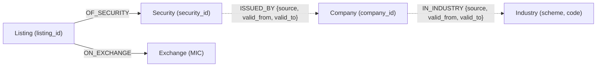

# Identifiers and Classifications

This document describes how the metadata store of gold holds the identifiers and the
classification codes of companies, securities, and listings. It extends `hybrid_data_model.md`
§4, §5.1, and §5.2.

- [ADR 0009](../../../docs/adr/0009-three-levels-of-identity.md) records why identity has three
  levels.
- [ADR 0010](../../../docs/adr/0010-identifier-schemes-by-licence.md) records which schemes the
  stores keep, and the licence of each.
- [ADR 0001](../../../docs/adr/0001-mvp-database.md), "Design Rules", fixes the identifier row and
  the grouping rules. This document applies them to each level.
- [ADR 0007](../../../docs/adr/0007-gold-company-brain.md) puts the identifiers and the claims in
  the metadata store of gold.

## Terms

- **Scheme**: the namespace of an identifier or a code, for example `cik` or `sic`.
- **Identifier**: a `(scheme, value)` pair that names one subject at one point in time. The issuer
  of the scheme gives each value to one holder at a time.
- **Code**: a `(scheme, value)` pair of a classification, for example `(sic, 3571)`. Many companies
  share one code, so a code is not an identifier.
- **Subject**: a company, a security, or a listing.
- **Record**: a dated row of a data source that silver keeps, for example one row of `filings`.
- **Claim**: a statement of the metadata store that one record supports, with the source of the
  record and its date.

## Three Levels

| Level | What it is | Key | Schemes |
| ----- | ---------- | --- | ------- |
| Company | The business a user screens. It can span several legal entities over time | `company_id` | `cik`, `lei` |
| Security | One instrument that a company issues, such as a share class or a bond | `security_id` | `figi_share_class` |
| Listing | One security that trades on one exchange | `listing_id` | `us_ticker`, `figi` |

Each key is internal. The load assigns it once and never reuses or changes it, as ADR 0001, "Design
Rules" 4, says for `company_id`.

Example: Alphabet is one company. Its class A shares and its class C shares are two securities.
`GOOGL` on Nasdaq and `GOOG` on Nasdaq are two listings, one for each security. A bond of Alphabet
is a third security with no listing.

### Links Between the Levels

| Edge | From → To | Kind | Changes over time |
| ---- | --------- | ---- | ----------------- |
| `OF_SECURITY` | Listing → Security | Structural | No. A listing names one security for its whole life |
| `ON_EXCHANGE` | Listing → Exchange | Structural | No. A move to another exchange is a new listing |
| `ISSUED_BY` | Security → Company | Claim | Yes, with a source and a validity |
| `IN_INDUSTRY` | Company → Industry | Claim | Yes, with a source and a validity |

### Rules

1. **A scheme belongs to one level.** A `cik` names a company and never a listing. The FIGI
   standard has a FIGI per share class and a FIGI per exchange, so they are two schemes:
   `figi_share_class` at the security and `figi` at the listing.
2. **Grouping uses exact keys only,** at every level, as ADR 0001, "Design Rules" 3, says. Two
   listings join only if an exact identifier links them, such as one `figi`.
3. **A ticker change with no exact link gives a new listing.** When Meta changed `FB` to `META`, the
   filings name no key that both tickers share. If a later `figi` claim links them, the two
   listings join. The older `listing_id` survives, and the other gets a dated `same_as` event, as
   ADR 0001, "Design Rules" 4, says for companies.
4. **With SEC data only, each new listing gets its own security.** The security has no identifier
   row. Its `ISSUED_BY` claim comes from the CIK of the filing. If a later `figi_share_class` claim
   names two such securities, they join: the older `security_id` survives, and the other gets a
   dated `same_as` event. The `ISSUED_BY` claim of such a security ends when its listing ends.
5. **A listing with no exchange takes the first exchange that a later filing names for its
   ticker.** It has no `ON_EXCHANGE` edge until then.
6. **A code is a claim on a company.** The SEC gives the SIC to the registrant, not to a security.

## Rows as Filed and as Resolved

### As Filed: Silver

Silver keeps every value as the source writes it, with no internal key
([`silver_layer.md`](../pipeline/silver_layer.md)). The SEC values sit in `filings`:

| Value | Column of `filings` | Scheme |
| ----- | ------------------- | ------ |
| CIK | `entity_scheme`, `entity_id` | `cik` |
| Ticker and exchange | `tickers`: one `(symbol, exchange)` per share class | `us_ticker`, and the exchange code |
| SIC | `industry_scheme`, `industry_code` | `sic` |

A row as filed has a start and no end. The start is the `accepted` time of its filing, or `filed`
if `accepted` is null.

### As Resolved: the Metadata Store

The load resolves each record to its subject and writes one row per identifier or code. The rows
follow ADR 0001, "Design Rules" 1, with the key of the level in place of `company_id`. The gold
tables stay open (ADR 0007, "Open Questions"), so the columns below are the logical model.

| Column | Meaning |
| ------ | ------- |
| `company_id`, `security_id`, or `listing_id` | The subject, one column per row set |
| `scheme`, `value` | The identifier, or the code for a classification row |
| `valid_from` | The start of the record that gives the value |
| `valid_to` | The start of the next record of the same source and subject with another value, or the end that the ticker list rule or Rule 4 sets. Null while neither exists |
| `source` | The data source, for example `sec` |
| `verifiability` | `Verified` for a registry, or for a filing of the subject or of its issuer. `Reported` for a value that a third party files about the subject, such as an LEI in a fund's SEC N-PORT filing (`hybrid_data_model.md` §5.2) |
| `record` | The key of the record in silver: the unit and the filing |

The row sets are `company_identifiers`, `security_identifiers`, `listing_identifiers`, and
`company_classifications`.

- **Validity is per source.** If two sources give different values for one subject and scheme,
  the metadata store keeps both rows (ADR 0007, Decision 6). The claim resolution spec of ADR 0001,
  "Open Questions", fixes which row a reader gets.
- **A null value ends nothing.** A filing with no ticker keeps the previous ticker valid, as in
  "Company Attributes Over Time" of `silver_layer.md`.
- **A ticker matches an open listing of the same company and source with the same symbol and
  exchange.** A ticker with no exchange matches each open listing with its symbol, and changes
  nothing. An open listing with no exchange matches a ticker with its symbol, and takes the
  exchange of that ticker (Rule 5). If several tickers of one filing match it, it takes the
  exchange whose MIC sorts first, and each other ticker gives a new listing. A ticker that
  matches no open listing gives a new listing. So one symbol on
  two exchanges gives two listings.
- **A ticker list ends the listings it omits.** If a filing of a company has a non-empty `tickers`
  list, each open listing of that company and source that no ticker of the list matches ends at the start
  of that filing. So `FB` ends at the first filing that lists `META` only. In a move to another
  exchange, the old listing ends, because the new list names the symbol on the new exchange only.
  An empty or null list ends nothing.
- **The CIK range table keeps its own axis.** The SEC adapter resolves a filing by its CIK and its
  period end (Linear document "Entity Resolution: the Company Key, LEI, and Dated CIKs: Findings",
  Decision 2). The `cik` rows of the metadata store use the start of the record, as every other
  scheme does.
- **An exchange code maps to a MIC.** `dei:SecurityExchangeName` holds an EDGAR exchange code, for
  example `NASDAQ`. A reference table maps each code to its MIC (ISO 10383), for example `XNAS`.
  Silver keeps the code as filed.

### Claims Come From Records That Silver Keeps

The load derives every claim from the records of its source on each run (ADR 0007, Decision 3).
A replay of silver rebuilds every claim. So a claim has history only if silver keeps a dated record for each value:

| Scheme | Record in silver | History |
| ------ | ---------------- | ------- |
| `cik` | `filings` | Per filing |
| `us_ticker` | `filings.tickers` | Per filing. Between two filings, no record exists |
| `sic` | `filings.industry_*` | Per filing. The SIC of a new filing is the value of `submissions` on the day of the fetch |
| `lei`, `figi`, `figi_share_class` | None | None until a silver dataset holds the records of their source |

A file that gives only current values, such as `company_tickers.json`, keeps history only if silver
stores each fetch as a dated row.

## Schemes of the MVP

| Scheme | Level | Source |
| ------ | ----- | ------ |
| `cik` | Company | SEC filings |
| `lei` | Company | SEC N-PORT as a seed, marked `Reported`. GLEIF as the source of truth |
| `us_ticker` | Listing | `dei:TradingSymbol` of SEC filings |
| `figi`, `figi_share_class` | Listing, security | OpenFIGI |
| `sic` | Company, as a code | SEC filings and `submissions` |
| MIC | Exchange, as reference data | The ISO 10383 list |

The stores keep no CUSIP, no ISIN, and no GICS code. ADR 0010 holds the licence of each scheme
and the date of each check.

A new scheme is new data: a new value of `scheme` in the rows above. For example, a European
source writes `(lei, …)` and `(nace, C26.2)`, and a Korean source writes `(dart_corp_code, …)` and
`(ksic, …)`. No column changes.

## Silver `filings`

`filings` does not change. Its replay cost is zero.

- One SEC filing names one SIC. A DART filing names one KSIC. A second code for a company comes
  from a second record, so it is a second row in the metadata store, not a second column pair.
- `tickers` already holds one `(symbol, exchange)` per share class.
- If a filing source names two codes in one filing, `industry_scheme` and `industry_code` become a
  list of `(scheme, code)` pairs. That change needs a new `schema_version` and a replay of every
  `filings` unit, which parses each Notes file and each filing day again.
- The instance names the share class of each ticker as a member of `us-gaap:StatementClassOfStockAxis`
  in the context of `dei:TradingSymbol`. `Ticker` keeps the symbol and the exchange only. So silver
  cannot tie a ticker to a security as filed, and the security level takes its keys from FIGI.

## Point-in-Time Reads

A read "as of day D" takes each row with `valid_from` on or before D and `valid_to` null or after
D. The standing rule of the epic MVP Data Pt. 2 holds:

| Point of the rule | How this design meets it |
| ----------------- | ------------------------ |
| Keep the acceptance time on every attribute from a filing | `valid_from` is the `accepted` time of the filing, or `filed` |
| Keep every filing side by side | Each record gives its own row. A load overwrites no record |
| Take company attributes per filing, as filed | Silver keeps them per filing. The rows derive from them |
| Do not depend on old raw files | The rows derive from silver, not from raw versions. The SIC of a new filing is the value on the day of the fetch (`sic_retrieved_at`) |

## Not Covered

- Which source sets the attributes of a `Company` node, such as the name and the country, when two
  source stores disagree: ADR 0007, "Open Questions".
- Which row a reader gets when two sources disagree: the claim resolution spec of ADR 0001, "Open
  Questions".
- Values that a person sets. They are stored apart from the records, and their layer is not part
  of this design.
- The gold tables: ADR 0007, "Open Questions".
- How often a filing tags only part of its 12(b) table. The ticker list rule ends each listing that
  the list omits, so a partial table ends a listing by mistake. Nobody measured it.
- Ownership and parent links, such as `SUBSIDIARY_OF`: `hybrid_data_model.md` §5.2.
- Whether bronze can keep a file that holds ISINs, such as the GLEIF and ANNA map from LEI to ISIN:
  ADR 0010, "Open Questions".
