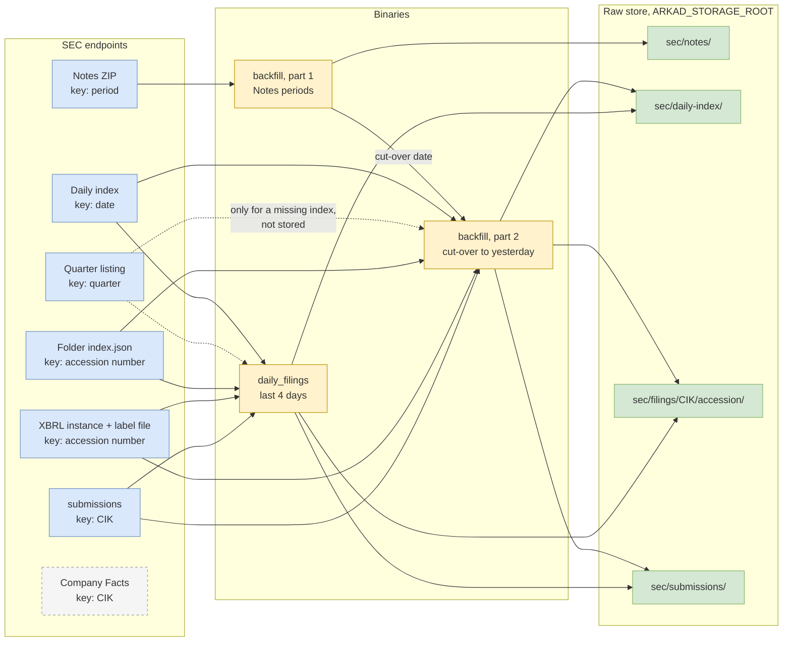
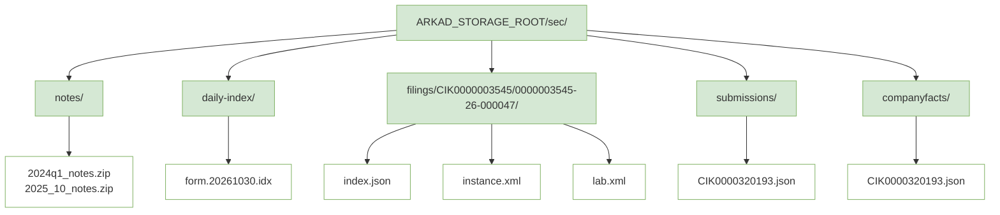
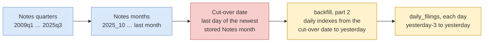
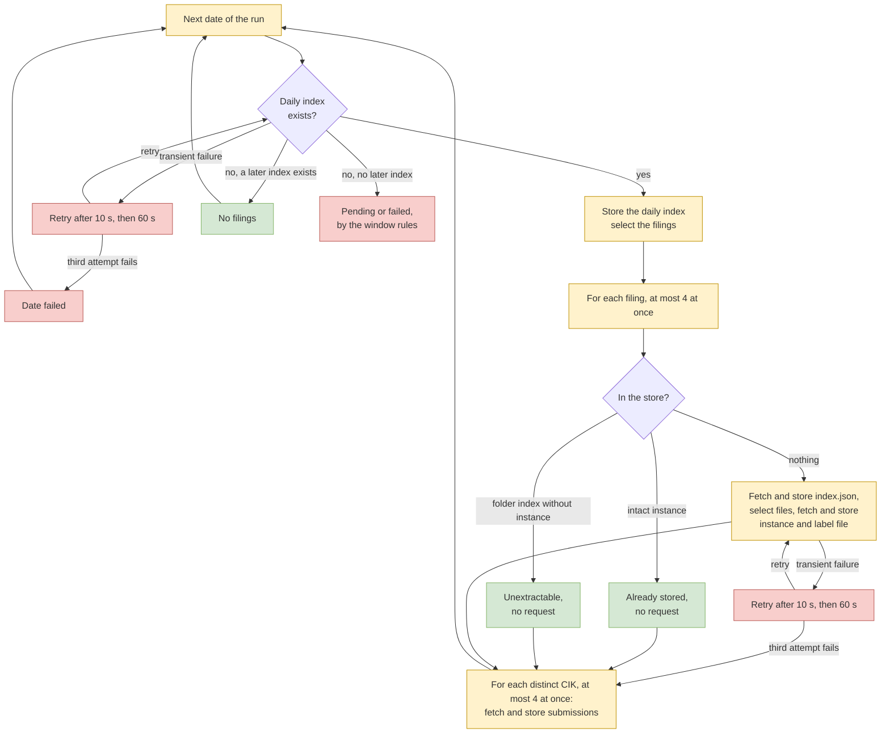

# Extraction Overview

Extraction downloads the SEC files that every later step needs and stores them unchanged in the
raw store.

The goal is independence: after extraction, transform, replay, and checks never call the SEC
again. Two paths fill the store. The backfill reads the Notes files of the past, and the daily run
reads the new filings of each day. This document describes both paths as the code on `main` runs
them today. The decisions behind them are in [`ingestion_paths.md`](ingestion_paths.md).

## What: The Step in One Picture

Extraction has two parts. Each part has its own SEC sources:

- **History.** One Notes file per quarter or month holds the values of every filing in that period.
- **New filings.** One daily index per day lists the filings of that day. For each selected filing,
  the run fetches the folder `index.json`, the XBRL instance, and the label file. For each company
  of those filings, it fetches `submissions`.

The cut-over date joins the two parts. It is the last day of the newest Notes file in the store.

The dashed box marks an endpoint with working code that no production run calls. See
[Overlap of the Data](#overlap-of-the-data).

### What Works Today

| Capability | Today | How | Notes |
| ---------- | ----- | --- | ----- |
| Backfill of history (Notes files from 2009 to last month) | Yes | `backfill` binary, part 1, on demand | The `backfill` image exists. No Cloud Run job runs it yet |
| Catch-up from the cut-over date to yesterday | Yes | `backfill` binary, part 2, on demand | One daily index per day. The quarterly full index needs fewer requests |
| New filings each day | Yes | `daily_filings` binary with `ARKAD_FROM=yesterday-3` | The `daily-filings` image exists. No schedule yet |
| Company data (`submissions`) | Partly | Part 2 of `backfill` and `daily_filings`: one file per company of the day | No run stores `submissions` for a company that appears only in the Notes files. The facade has `backfill().submissions()` and `backfill().all()` for this. Only a binary is missing |
| Company Facts | No, but the code exists | Only `stream_etl` (469 S&P 500 companies) and the `extraction` demo call it | Company Facts drops every value with a dimension |
| Rerun without duplicate work | Yes | A run skips each stored file that passes its size and SHA-256 check | The daily index and `submissions` are fetched again on each run |
| Continue after a long pause | Partly | A hand-set `ARKAD_FROM` | The scheduled window covers 4 days |
| Integrity check of the whole store | No | A run checks one key at a time | Proposed as the check mode of a separate binary |
| Reconciliation against the SEC | No | None | Proposed. See [Integrity and Reconciliation](#integrity-and-reconciliation) |
| Removals at the SEC | No | None | Proposed as a recorded event. The store never deletes a file |
| History of changed files | No | The store keeps one version per key | Needs an append-only store |
| Run as of a past date D | No | The periods and the catch-up always end at today | See [Configurability and Time Travel](#configurability-and-time-travel) |
| Compressed transfer | No | The client does not ask the SEC for gzip | Measured with gzip: Company Facts 3.8 MB to 272 KB, `submissions` 164 KB to 28 KB, the daily index 1.16 MB to 101 KB. Stored bytes stay the same |

## Why: The Goal

After extraction, the pipeline depends on no third party. The raw store holds every input of
transform. Transform, replay, and checks run with no network access.

The [list of extraction properties](https://linear.app/state-machine/issue/STA-407) names how each
part of this goal is measured: self-sufficiency, completeness, composition independence,
idempotency, replayability, integrity, provenance, recoverability, freshness, and continuability.
This document states for each property what the code does today. It does not repeat the
measurements.

Raw files stay as the SEC sent them. A parser fix then reruns transform on the stored bytes and
needs no new download.

## Who: Binaries and Facade Calls

Every binary except the `extraction` demo builds its machines through the `Extraction` facade
(`sec/src/lib/implementations/extraction/`). `Extraction::backfill()` starts a backfill run, and
`Extraction::incremental()` starts an incremental run. Each call creates a new `execution_id`. The
facade writes the ingestion mode, `backfill` or `incremental`, into the metadata of each document.

| Binary | Facade calls | Started by | Stores |
| ------ | ------------ | ---------- | ------ |
| `backfill` | `backfill().notes()`, then `incremental().daily_filings()` from the cut-over date to yesterday, with the same `execution_id` | An operator, on demand | Notes files, then everything `daily_filings` stores |
| `daily_filings` | `incremental().daily_filings()` for the dates of `ARKAD_FROM` to `ARKAD_TO` | An operator today. A daily schedule is planned | Daily indexes, folder indexes, instances, label files, `submissions` |
| `stream_etl` | `backfill().company_facts()` per CIK, for a fixed list of 469 CIKs | An operator, for tests | Company Facts |
| `extraction` | None. It runs the Company Facts states one by one for CIK 1067983 | An operator, as a demo | Company Facts |

Two deprecated examples in `sec/examples/` still compile: `notes_backfill` (replaced by `backfill`)
and `stream_extract` (Company Facts). The `Dockerfile` builds one image for `backfill` and one
for `daily_filings`. No image holds an example.

`backfill().all()` exists in the facade. It runs the Notes periods, then stores `submissions` for
each CIK of the stored Notes files. No binary calls it.

## Where: The Raw Store

All files go to a `FilesystemRepository` under `ARKAD_STORAGE_ROOT`. Each document has a metadata
file beside it, with the suffix `.meta.json`.

| Document | Document type | Key |
| -------- | ------------- | --- |
| Notes ZIP | `raw_notes_archive` | `sec/notes/<SEC file name>` |
| Daily index | `raw_daily_index` | `sec/daily-index/form.YYYYMMDD.idx` |
| Folder index | `raw_filing_index` | `sec/filings/CIK##########/<accession number>/index.json` |
| XBRL instance | `raw_xbrl_instance` | `sec/filings/CIK##########/<accession number>/instance.xml` |
| Label file | `raw_xbrl_labels` | `sec/filings/CIK##########/<accession number>/lab.xml` |
| `submissions` | `raw_submissions` | `sec/submissions/CIK##########.json` |
| Company Facts | `raw_company_facts` | `sec/companyfacts/CIK##########.json` |

The CIK in a key has 10 digits with leading zeros. The accession number keeps its dashes. The
instance and the label file get fixed names, so a reader finds them without a listing.

### Metadata of Each Document

Every metadata file has the same top-level fields:

| Field | Meaning | Kind |
| ----- | ------- | ---- |
| `metadata_version` | Version of this layout, 1 today | Content |
| `document_type`, `document_type_version` | The raw source, for example `raw_xbrl_instance`, version 1 | Content |
| `media_type` | The content type that the SEC sent | Content |
| `bytes`, `sha256` | Size and digest of the stored document | Content |
| `inputs` | The documents this one came from, each with its key and SHA-256 | Content |
| `context` | The request: `requested_url`, `final_url`, `http_status`, `user_agent`. For a filing document, also `filing`: `filed_date`, `form`, `is_amendment` | Content |
| `produced_at` | The time of the write | Run field |
| `execution_id` | The run that wrote the document | Run field |
| `ingestion_mode` | `backfill` or `incremental` | Run field |
| `producer` | The code that wrote it: name, crate version, git commit | Run field |

The instance and the label file name the daily index that listed the filing in `inputs`. The
folder index, the Notes file, `submissions`, and Company Facts name no input.

### How a Write Works

1. The write repository compares the new metadata with the stored metadata, without the four run
   fields. It also compares the SHA-256 of the stored document.
2. If both match, the repository skips the write. The stored run fields stay, so they name the first run
   that stored these bytes.
3. Otherwise, the repository writes both files to temporary files, then renames the metadata into
   place, then the document. A document on disk always has its metadata.

So a key holds one version. If the bytes change, the new bytes replace the old ones.

## When: Backfill, Cut-Over, and the Daily Window

### Backfill, Part 1: Notes Files

- The periods run from `2009q1` to `2025q3` as quarters, then from `2025_10` as months.
- The run asks for every period up to last month. On 2026-10-31 this is 79 periods.
- Early in a month the SEC has not yet published last month. The run then counts that period as
  unpublished, and stores everything before it.
- The run skips each period whose stored file passes the size and SHA-256 check.

### The Cut-Over Date

The cut-over date is the last day of the newest stored Notes month. `cut_over_date()` on the run
summary returns it. It fails if a period failed or if no period is stored. A failed period means a
gap, so the backfill must run again before the catch-up starts.

The cut-over day is in both paths. Its filings reach the store as Notes rows and as instances.

### Backfill, Part 2: Catch-Up

The second part runs the daily path for every date from the cut-over date to yesterday. It uses
the same `execution_id` as part 1, with the ingestion mode `incremental`.

### The Daily Run and Its Window

All dates are days in New York (`America/New_York`). The SEC publishes the daily index of a day
in the evening of that day or later. The daily index of 2026-10-27 appeared at 22:16 New York time
(02:16 UTC on 2026-10-28).

The scheduled run sets `ARKAD_FROM=yesterday-3`, so it reads 4 days: yesterday and the 3 days
before it.

- A date with a daily index is processed.
- A date without an index, with a later index in the quarter listing, counts as a day without
  filings.
- A date without an index and without a later one is pending if it is from `yesterday-2` to
  yesterday and is not the first date of the run. A pending date does not fail the run. The next
  run reads it again.
- Every other missing index fails the run.

The longest regular closure is 3 days, a weekend with a Monday holiday. So 4 days let each closed
day leave the window as "no filings". After a pause longer than the window, an operator sets
`ARKAD_FROM` by hand.

## How: Endpoints and Runs

### SEC Endpoints

Each request kind in `sec/src/lib/shared/request/implementations/sec_request/kind.rs` maps to one
endpoint. Sizes are bodies without gzip, measured on 2026-11-02 unless the table says otherwise.

| Endpoint | URL pattern | Key | Data it offers | Code | Used today | Stored | Size |
| -------- | ----------- | --- | -------------- | ---- | ---------- | ------ | ---- |
| Notes ZIP | `www.sec.gov/files/dera/data/financial-statement-notes-data-sets/<period>_notes.zip` | Notes period | All values of all filings in the period, with dimensions and text. One filing row each: CIK, name, SIC, form, period, filed date | `NotesFile` | `backfill`, part 1 | Yes | 619 MB for `2024q1`. The largest file is 0.85 GB. All 79 files: 27.7 GB |
| Daily index | `www.sec.gov/Archives/edgar/daily-index/YYYY/QTRn/form.YYYYMMDD.idx` | Date | One row per filing of the day: form, company name, CIK, date, path | `DailyIndex` | `backfill`, part 2, and `daily_filings` | Yes | 1.16 MB for 2026-10-30, 187 rows of the selected forms |
| Quarter listing | `www.sec.gov/Archives/edgar/daily-index/YYYY/QTRn/index.json` | Quarter | The names and dates of the index files of the quarter | `DailyIndexListing` | Only when a daily index is missing | No | 14 KB |
| Folder index | `www.sec.gov/Archives/edgar/data/<cik>/<accession>/index.json` | Accession number | The files of one filing: name, size, last-modified | `FilingIndex` | `backfill`, part 2, and `daily_filings` | Yes | 8 KB for a 10-Q with 86 files |
| XBRL instance | `www.sec.gov/Archives/edgar/data/<cik>/<accession>/<name>_htm.xml` | Accession number and file name | All values of one filing, with dimensions | `FilingDocumentSet` | `backfill`, part 2, and `daily_filings` | Yes | 3.9 MB for one 10-Q. 2.8 KB for one small filer |
| Label file | `www.sec.gov/Archives/edgar/data/<cik>/<accession>/<name>_lab.xml` | Accession number and file name | The labels the company gave to its concepts | `FilingDocumentSet` | `backfill`, part 2, and `daily_filings` | Yes | 0.88 MB for the same 10-Q |
| `submissions` | `data.sec.gov/submissions/CIK##########.json` | CIK | Name, SIC and its description, tickers, exchanges, former names, EIN, fiscal year end, addresses. It has an `lei` field, but the field was `null` for all 5 companies checked on 2026-11-02, among them JPMorgan Chase and Goldman Sachs. The last 1,000 filings with form, dates, and XBRL flags | `Submissions` | `backfill`, part 2, and `daily_filings`: one per company of the day | Yes | 164 KB for CIK 320193 |
| Company Facts | `data.sec.gov/api/xbrl/companyfacts/CIK##########.json` | CIK | All values of all filings of one company, without dimensions. The entity name | `CompanyFacts` | Only `stream_etl` and the `extraction` demo | Yes, when called | 3.8 MB for CIK 320193 |
| Full index | `www.sec.gov/Archives/edgar/full-index/YYYY/QTRn/form.idx` and `xbrl.idx` | Quarter | One row per filing of the quarter: form, company name, CIK, date filed, path. `xbrl.idx` lists only filings with XBRL | None | No | No | `form.idx` for 2026 Q3: 47.2 MB, or 4.8 MB as `form.gz`. `xbrl.idx`: 5.1 MB |

`FilingDocument` fetches one file of a folder. The filing machine uses `FilingDocumentSet`, which
fetches the instance and the label file of one filing.

### Overlap of the Data

Several endpoints offer the same kind of data. The pipeline picks one source for each kind:

| Data | Sources | Source the pipeline uses | Reason |
| ---- | ------- | ------------------------ | ------ |
| Values of the past | Notes ZIP, Company Facts | Notes ZIP | Company Facts drops every value with a dimension |
| Values of a new filing | XBRL instance, Company Facts, the next Notes file | XBRL instance | It holds every value, and it is ready the day after the filing |
| Labels of a company | Label file, `tag.tsv` in the Notes ZIP | Both, one per path | Each path stores the labels of its own source |
| List of filings | Daily index, full index, `sub.tsv` in the Notes ZIP, `submissions` | Daily index after the cut-over, `sub.tsv` before it | One request per day lists every filing of the day |
| Filed date and form | Daily index, full index, `sub.tsv`, `submissions` | The daily index, written into the metadata of each filing | The run reads it from the row that selected the filing |
| Company name | Daily index, `sub.tsv`, XBRL instance (`dei:EntityRegistrantName`), `submissions`, Company Facts | `sub.tsv` before the cut-over, the XBRL instance after it | Each filing keeps the name as filed |
| SIC code | `sub.tsv` (at filing time), `submissions` (current) | `sub.tsv` before the cut-over, `submissions` after it | The XBRL instance has no SIC. The SIC from `submissions` is the SIC on the day of the fetch. `daily_filings` fetches one day after the filing, and the catch-up of `backfill` fetches later |
| Tickers and exchanges | `txt.tsv` in the Notes ZIP and the XBRL instance (`dei:TradingSymbol`, `dei:SecurityExchangeName`), `submissions` | `txt.tsv` before the cut-over, the XBRL instance after it | Each filing keeps the ticker and exchange as filed |
| Former names | `sub.tsv` (one former name), `submissions` (all) | The names as filed, in the order of the filings | A change of name shows as a new name in a later filing |
| Fiscal year end | `sub.tsv` (`fye`), XBRL instance (`dei:CurrentFiscalYearEndDate`), `submissions` | `sub.tsv` before the cut-over, the XBRL instance after it | Each filing keeps the fiscal year end as filed. `sub.tsv` rounds it to the nearest month end, and the XBRL instance gives the real day. So the value of a 52/53-week year can change at the cut-over, and its day moves each year in the instance. Apple has `0930` in `sub.tsv` for fiscal 2025. The instance of the same 10-K has `--09-27`, and a 10-Q of fiscal 2026 has `--09-26`. A year that ends in the first days of a month rounds to the month before. Costco has `0831` in `sub.tsv` and `--09-01` in the instance of its 10-K of fiscal 2024. `submissions` has only the current value |
| LEI | None found | None. GLEIF is the planned source | `submissions` has the field, but it was `null` for all 5 companies checked |

Every value keeps its source. The metadata of each stored document names its URL, its SHA-256,
and the time of the write, so a value downstream can be traced to the document it came from.

`submissions` stays in the daily path. It is the only source of the SIC of a new filing. It also
lets a check reconcile one company against its stored filings.

### Endpoint by Endpoint

#### Notes ZIP

1. Key: a `NotesPeriod`, for example `2024q1` or `2025_10`. The period list comes from today.
2. Request: one GET for the whole file. At most 2 files download at once, set by
   `ARKAD_FILES_IN_FLIGHT`.
3. Response: a ZIP with ten members: eight tables (`sub`, `tag`, `dim`, `num`, `txt`, `ren`, `pre`,
   `cal`), a readme, and `notes-metadata.json`. The run checks the content length against the body.
4. Stored as `RawNotesArchive`, unchanged. The store state is `StoreSecResponse<NotesFile, R>`.
5. Provenance: the metadata of the request, ingestion mode `backfill`, no input.

#### Daily Index

1. Key: an `IndexDate`. The date gives the year, the quarter folder, and `YYYYMMDD`.
2. Request: one GET. A missing index answers 404, or 403 with an S3 `AccessDenied` body.
3. Response: fixed-width text, one row per filing.
4. Stored as `RawDailyIndex` by its own state, `StoreDailyIndex`. A day without filings stores no
   file.
5. Provenance: the metadata of the request, ingestion mode `incremental`, no input.
6. `SelectFilings` keeps one `FilingRef` per accession number for the selected forms. See
   [Filings We Select](#filings-we-select).

#### Quarter Listing

1. Key: the quarter of a date.
2. Request: one GET, only when a daily index is missing. For a date at the end of a quarter, the
   run can also read the listing of the next quarter.
3. Response: JSON with the files of the quarter folder.
4. Not stored. It decides only whether a missing index means "no filings" or "not yet published".
   The stored daily indexes of later dates carry the same information.

#### Folder Index

1. Key: the `FilingRef`. The URL holds the CIK without leading zeros and the accession number
   without dashes.
2. Request: one GET. A missing folder answers 404 or 503.
3. Response: JSON with every file of the filing folder.
4. Stored as `RawFilingIndex`, before the selection of the files. A filing without an instance
   keeps this file as the record that it is unextractable.
5. Provenance: the metadata of the request, the `filing` fields, no input.
6. `SelectFilingDocuments` picks the instance and the label file:
   - The instance is the file that ends in `_htm.xml`. If none exists, it is the one `.xml` file
     that is not `FilingSummary.xml` and not a linkbase.
   - The label file ends in `_lab.xml`. A filing without one stores the instance only.
   - A rule that matches two files fails the filing with `AmbiguousFilingDocument`.

#### XBRL Instance and Label File

1. Key: the accession number and the file names from the folder index.
2. Request: one GET per file.
3. Response: XML.
4. Stored as `RawXbrlInstance` under `instance.xml` and `RawXbrlLabels` under `lab.xml`. The
   metadata keeps the SEC file name in `requested_url`.
5. Provenance: the `filing` fields, and the daily index that listed the filing as the input.

#### `submissions`

1. Key: a CIK.
2. Request: one GET per distinct CIK of the filings of one date. It runs for the CIK of a failed
   filing too.
3. Response: JSON with the company data and its recent filings.
4. Stored as `RawSubmissions`. The store state is `StoreSecResponse<Submissions, R>`. A new
   version replaces the old one.
5. Provenance: the metadata of the request, the ingestion mode of the run, no input.

#### Company Facts

1. Key: a CIK.
2. Request: one GET.
3. Response: JSON with every value of the company, grouped by taxonomy (`dei`, `us-gaap`).
4. Stored as `RawCompanyFacts`, with ingestion mode `backfill`.
5. No production run calls it.

### Filings We Select

Both paths keep the same forms: `SELECTED_FORMS` in `sec/src/lib/shared/financial/form/mod.rs`.

- 10-K, 10-Q, 20-F, and 40-F, and the amendment of each (`/A`).
- The filings of all companies, with no company list.
- Foreign filers of 20-F and 40-F can report in IFRS.

The daily path selects these forms from the daily index. The Notes files hold every form, so
transform drops the others. Measured on `2024q1`:

| | 4 forms and their amendments | All other forms |
| - | ---------------------------- | --------------- |
| Filings | 5,762 (24%) | 18,602 (76%) |
| Values in `num.tsv` | 8.36 million (92%) | 0.75 million (8%) |

Not selected today, and the candidates to add later:

- 8-K: 16,701 filings with amendments hold about 4,500 values in `2024q1`.
- 6-K: the interim reports of foreign filers.
- 10-KT and 10-QT: transition reports after a change of fiscal year.
- S-1, S-4, and DEF 14A: values of offerings and proxy statements.

### One Daily Run

All machines of one run share one `execution_id`. The dates run one after another. A `submissions`
machine and the detection of a date retry the same way as a filing. A transient failure is a
502, a 503, a 504, a 429, a failed or timed-out request, or a failed or timed-out read of the
body. A Notes
period of `backfill` retries too, and downloads the whole file again.

## Guarantees: Before and After a Run

### Before a Run

- `ARKAD_STORAGE_ROOT` names the store. The binary creates the folder if it is missing.
- `ARKAD_SEC_USER_AGENT` names the caller, as the SEC requires. If it is unset, the binary sends a
  placeholder and logs a warning.
- `daily_filings` needs `ARKAD_FROM`. `backfill` needs no date.
- The store can be empty, or hold any earlier result. No run reads a bookmark.

### After a Run on an Empty Store

A `backfill` run that finishes without a failure leaves:

- One Notes file for each published period, 79 on 2026-10-31.
- One daily index for each date with filings, from the cut-over date to yesterday.
- For each selected filing of those dates: `index.json`, and `instance.xml` and `lab.xml` if the
  folder has them.
- One `submissions` file for each company of those filings.
- A metadata file beside each document. All of them carry the same `execution_id`. The Notes
  files carry `backfill`, the rest carry `incremental`.

### After a Rerun

A rerun with the same dates sends requests only for work that is not done:

| Document | Rerun behaviour |
| -------- | --------------- |
| Notes file | Skipped if the stored file passes the size and SHA-256 check. No request |
| Daily index | Fetched again. The repository skips the write if the bytes are equal |
| Filing | Skipped if the stored instance passes the check, or if the stored folder index lists no instance. No request |
| `submissions` | Fetched again. The repository skips the write if the bytes are equal, and replaces the file otherwise |

A skipped write keeps the run fields of the first run. So `execution_id` and `produced_at` name
the run that first stored the bytes.

### After a Later Run

- A later `backfill` stores the new Notes months. Their filings are already in the store as
  instances, so the overlap grows. Extraction stores both forms. Transform does not exist yet, and
  [Composition and Parity](#composition-and-parity) states the rule it needs.
- A Notes file that the SEC replaced is not fetched again, because the stored file passes its
  check. The store keeps the old version.
- A changed `submissions` file replaces the old one. The old version is lost.

## Composition and Parity

A filing reaches the store in one of two forms: as rows in a Notes file, or as its instance. The
cut-over date decides which form a filing gets.

### What a Different Cut-Over Date Changes

Take one Notes month more, for example a `backfill` run on 9 November instead of 1 November:

- The filings of that month come as Notes rows, not as instances.
- The catch-up starts one month later. So it stores one month less of daily indexes, folder
  indexes, instances, and label files.
- It also stores fewer `submissions` files. Only companies with a filing after the cut-over date
  get one.

One Notes month less moves the same filings the other way.

### Are the Facts the Same?

A comparison of 622 filings that exist in both forms gave this result (measured on 2026-10-31,
see [Measured Result](ingestion_paths.md#measured-result)):

- 168,528 instance facts pair one to one with Notes rows. No fact is on one side only.
- No numeric value differs beyond the rounding of Notes to 4 decimals.
- 13,069 facts (7.8%) differ in form. Almost all are losses on the Notes side:
  - Notes drops `/shares` from per-share units: 5,856 facts.
  - Notes drops or replaces non-ASCII characters in text: 6,527 facts.
  - Notes drops footnotes that no statement shows: 473 facts.
  - Notes rounds to 4 decimal places: 139 facts.
- 11 filings hold a second instance, the filing-fee exhibit. Notes leaves out its facts.

The provenance always differs: the ingestion mode, the source document, and the `execution_id`.

### Do We Need to Care?

Yes, for the 7.8%. For these facts, the result depends on the cut-over date unless transform
applies a fixed rule. The recommendation in [Path Independence](ingestion_paths.md#path-independence)
is a fixed precedence of instance over Notes, applied by an upsert. The rule needs a value key that
is unique per filing first.

Extraction itself needs no change. It stores both forms unchanged, so transform can apply any rule
later.

## Volume

Every request goes through one rate limiter per process. It allows one request each 110 ms, about
9 per second. The SEC limit is 10 per second.

Two limits set the run time. By the arithmetic below, the filing documents hit the rate limit
first, even the instances of large filers. This is not measured. The Notes ZIPs, up to 0.85 GB
each, hit the network first. So the time of a Notes file measured on one machine does not hold on
another. Each time below names where it was measured.

### Measurement Environments

| Environment | Network | Hardware | Bottleneck | Used for |
| ----------- | ------- | -------- | ---------- | -------- |
| Cloud container | About 23 to 25 MB/s to the SEC on 2026-10-29, through the container's proxy. The spike of 2026-10-16 reached about 32 MB/s | Intel Xeon at 2.10 GHz, 4 cores, x86-64 Linux | The network for the Notes files. The run reaches the curl speed. CPU, memory, and the rate limit are not the limit for them | The MVP decision spike (2026-10-16), the files-in-flight runs (2026-10-29), and the endpoint sizes of this document (2026-11-02) |
| The lead's Mac | About 90 to 95 MB/s to the SEC, on Wi-Fi | Not recorded | The network, most likely the Wi-Fi or the network adapter. Four parallel curl streams reached about 102 MB/s, about the same as one | The files-in-flight runs (2026-10-29) |
| Cloud Run | Not measured | Not measured | Not measured | Nothing yet. The planned jobs run here |

The numbers of 2026-10-29 are in
[notes_backfill Network and Stream Cut-Off: Findings](https://linear.app/state-machine/document/notes-backfill-network-and-stream-cut-off-findings-2238f0c1e060).
Sizes and request counts do not depend on the environment. Times do.

### Requests, Time, and Bytes

| Run | Requests | Time | Bytes | Bottleneck | Where and source |
| --- | -------- | ---- | ----- | ---------- | ---------------- |
| `backfill`, part 1, empty store | 79 | 14 minutes (about 32 MB/s) in the cloud container. Estimate: about 19 to 20 minutes in the cloud container at 23 to 25 MB/s, 5 to 8 minutes on the lead's Mac | 27.7 GB | Network | Cloud container, MVP decision spike. Estimates from the findings of 2026-10-29 |
| `backfill`, part 1, rerun | 0 | Reads every stored file once for the check: about 0.43 s of hashing per 619 MB | 0 | Disk read and SHA-256, about 1.4 GB/s per core | Code. Hash time measured in the cloud container |
| 4 Notes files, 2.15 GB, 2 in flight | 4 | 95 to 107 s in the cloud container, 23.6 to 25.2 s on the lead's Mac | 2.15 GB | Network. More files in flight do not lower the total time | Findings of 2026-10-29 |
| One Notes file | 1 | 25 s for `2024q1` (619 MB) | 0.62 GB | Network | [Download](ingestion_paths.md#download), 2026-10-28. Environment not recorded. The speed, about 25 MB/s, matches the cloud container |
| One new filing | 3, plus 1 for its company | Not measured | 4.8 MB for one 10-Q. 25 KB for one small filer | Rate limit. Not measured for a large filer | Code. Sizes measured in the cloud container on 2026-11-02 |
| One date, about 90 filings | About 360 | About 40 s at the rate limit alone | About 1 MB of daily index, plus the filings | Rate limit, if each request ends within 440 ms | Estimate from 90 filings per business day in `2024q1` |
| One peak date, 295 filings | About 1,200 | About 2 minutes at the rate limit alone. [Window](ingestion_paths.md#window) estimates 9 minutes. Under 1 minute on a reread | Not measured | Rate limit or network, not measured | Estimate |
| `backfill`, part 2, 40 business days | About 14,000 | About 26 minutes at the rate limit alone | Not measured | Rate limit, if each request ends within 440 ms | Estimate, [Dates](ingestion_paths.md#dates) |
| `daily_filings`, 4 dates | 1 new date plus 3 rereads | Under 10 minutes on a peak day, inside the 30-minute timeout under both estimates | About 4.6 MB of daily indexes | Rate limit or network, not measured | Estimate |

The estimates "at the rate limit alone" assume that each request ends within 4 × 110 ms, because 4
filing machines run at once and each machine sends its requests in series. A 3.9 MB instance takes
about 0.16 s at 25 MB/s, so bandwidth alone does not slow a day of large filers. A round trip longer
than 440 ms per request can. The gap between 2 and 9 minutes is not explained and not measured.

The selected rows per day were 77 on 2026-10-27, 197 on 2026-03-02, and 295 on 2026-08-10
(measured). The bytes per day are not measured. One 10-Q of a large filer is 1,000 times larger
than the instance of a small filer, so a day can range from tens to hundreds of MB.

Where the runs execute: on any machine with a mounted store. The plan is a Cloud Run job per
binary with the bucket mounted: `backfill` on demand with 6 to 8 GiB of memory, and `daily_filings`
once a day with 1 GiB and a timeout of 30 minutes. These sizes are estimates. The `Dockerfile`
builds one image per binary. No Cloud Run job exists yet.

## Configurability and Time Travel

### What a Run Lets You Set

| Variable | Binaries | Effect | Default |
| -------- | -------- | ------ | ------- |
| `ARKAD_STORAGE_ROOT` | All | The root folder of the store | `data` |
| `ARKAD_SEC_USER_AGENT` | All | The `User-Agent` sent to the SEC | A placeholder, with a warning |
| `ARKAD_FILES_IN_FLIGHT` | `backfill` | Notes files that download at once | 2 |
| `ARKAD_FROM` | `daily_filings` | The first date: `YYYY-MM-DD`, `yesterday`, or `yesterday-N` | Required |
| `ARKAD_TO` | `daily_filings` | The last date, before today in New York | `yesterday` |

The facade also takes the number of machines in flight and the retry delays. No binary exposes
them.

### Request Timeouts

`ReqwestClient::new` sets two timeouts on the HTTP client of every binary. No variable changes them.

| Timeout | Value | Limits |
| ------- | ----- | ------ |
| `CONNECT_TIMEOUT` | 10 s | The wait to open a connection |
| `READ_TIMEOUT` | 60 s | The wait for the next bytes of a response. It starts again after each read of the body |

There is no total timeout. A total timeout must allow for the slowest download. The largest Notes
file is 0.85 GB, and it takes about 80 s with 2 files in flight (estimate from the 4-file run).
Both values are proposals and are not measured.

A timeout fails the request with `TimedOutRequest`, or with `TimedOutBodyRead` while the body is
read. `FailedSecRequest::is_timed_out` returns `true` for both. The run retries a timeout as a
transient failure (see [One Daily Run](#one-daily-run)).

### Can a Run Rebuild the State as of a Date D?

No. A "state as of date D" means every Notes file up to D, then the cut-over, then the daily path
up to D. Today:

| Part | Exists | Missing |
| ---- | ------ | ------- |
| Daily path up to D | `daily_filings` with `ARKAD_TO=D` | Nothing |
| Notes files up to D | No | The period list always ends at last month |
| Catch-up up to D | No | The catch-up always ends at yesterday |
| The SEC files as they were on D | No | The SEC serves only its latest Notes files, and the store keeps one version per key |

Two changes close this gap:

1. An end date for `backfill`. This gives today's SEC data, cut at D.
2. An append-only store that keeps every version with its `produced_at`. This gives the data as
   the pipeline saw it on D.

## Integrity and Reconciliation

Today a run checks one key at a time, before it skips a file. Nothing checks the whole store, and
nothing compares the store with the SEC.

A full check has two parts:

- **Integrity.** Walk the metadata files. Compare the size and the SHA-256 of each document. Find
  a document without metadata, metadata without a document, and temporary files that a killed run
  left.
- **Reconciliation.** Compare each source with a list that the SEC publishes:

| Source | SEC list | Requests |
| ------ | -------- | -------- |
| Notes files | The SEC data-sets page, plus a header-only request per file for its size and last-modified date. This finds files the SEC replaced | About 80 |
| Daily indexes | The quarter listing `index.json` | 1 per quarter |
| Filings after the cut-over | The full index `form.idx` against the stored accession numbers | 1 per quarter |
| `submissions` | The CIKs of the stored filings against the stored `submissions` files | 0 |

The store never deletes a file because the SEC removed it. A removal becomes a recorded event, and
transform decides what it means.

The proposal is one binary with a read-only check mode and a repair mode. The repair mode fetches
each gap through the facade calls that exist. A weekly job in the same container image runs it.

## Known Gaps

| Gap | Effect today |
| --- | ------------ |
| No Cloud Run job for `backfill` and `daily_filings` | Both images exist, but no job runs them and no scheduled run exists |
| One version per key | A changed `submissions` file or daily index replaces the old one. A replaced Notes file is never fetched again |
| No end date for `backfill` | No run rebuilds the state as of a past date |
| No full-store check and no reconciliation | A missing or broken file stays unnoticed until a run reads its key |
| The window covers 4 days | A pause longer than 4 days needs a hand-set `ARKAD_FROM` |
| One daily index per day in the catch-up | A long catch-up sends one request per day. The full index needs one per quarter |
| `backfill().all()` and the `backfill` binary each cover a different part | `all()` runs the Notes periods and `submissions`, but no catch-up. The binary runs the Notes periods and the catch-up, but no `submissions` for the companies that appear only in the Notes files. These companies have their ticker, name, and SIC as filed in the Notes files. They get no current data from `submissions` until they file again. The screener does not need current data |
| No gzip | The three measured files (Company Facts, `submissions`, the daily index) transfer 6 to 14 times more bytes than with gzip |
| One run of `daily_filings` has a 30-minute timeout | A hand-set `ARKAD_FROM` fits in one run for about 10 business days by the [Window](ingestion_paths.md#window) estimate, or about 40 at the rate limit alone. Neither is measured |
| A replaced daily index | The `inputs` SHA-256 of each stored instance that it listed names bytes the store no longer holds |
| The filing skip checks only the instance | A missing or broken `lab.xml` beside an intact instance is never fetched again |

## See Also

- [`ingestion_paths.md`](ingestion_paths.md): the decisions and measurements behind each section.
- [`storage_traits_design.md`](../data_model/storage_traits_design.md): the design of the store ports.
- `sec/src/lib/implementations/extraction/`: the facade.
- `sec/src/bin/`: the binaries.
- `sec/src/lib/shared/raw_source/implementations/`: the raw sources.
- `storage/src/implementations/repository/filesystem/`: the filesystem repository.
