# Ingestion Paths: Extraction

> **Status:** draft for review, STA-328. Round 1 of 3. Round 2 designs the SEC fact model and the
> fact store (STA-331). Round 3 designs transform for both paths (STA-332).
>
> **Marks:** "Measured" means checked against the SEC website or a downloaded file on 2026-10-28.
> "Estimate" means not measured. "Proposed" means not yet accepted by the lead.

## Reading Guide

- [Sources](#sources) and [Extraction Overview](#extraction-overview) give the frame and the
  diagram. Read them first.
- [Backfill Extract](#backfill-extract) carries the decisions of the lead from 2026-10-28. The
  subsection [Notes ZIP Findings](#notes-zip-findings) is new and changes three of them: the file
  name, the content type check, and the table parser.
- [New-Filing Extract](#new-filing-extract) is new and fully proposed. It needs the most scrutiny.
- [Calling the Machines](#calling-the-machines) and the ingestion mode in the metadata are new and
  decided.
- [Repository in the Machines](#repository-in-the-machines) is new. The lead accepted its three
  decisions on 2026-10-31 (STA-398).
- [Cut-Over Between the Paths](#cut-over-between-the-paths) and
  [Idempotent Writes](#idempotent-writes) list their assumptions. Check them first.
- [Path Independence](#path-independence) is new and proposed. It states what transform must
  guarantee when a filing can come from either path. [STA-402 measured the sources](#measured-result)
  and recommends option 2. The lead decides.
- [Raw Store](#raw-store), [Handover to Transform](#handover-to-transform),
  [Deployment](#deployment), and [Implementation Tickets](#implementation-tickets) are new and
  proposed.
- [Open Questions](#open-questions) lists what the lead must decide.

## Sources

The MVP decisions (STA-284) chose these SEC sources:

| Source | Path | Use |
| ------ | ---- | --- |
| Financial Statement and Notes files | Backfill | All values of all filings since 2009, with dimensions |
| XBRL instance and `_lab.xml` of each filing | New filing | The values and the company labels of one new filing |
| `submissions` JSON | Both | Company data: name, SIC code, tickers, former names |
| `companyfacts` JSON | Neither | Cross-check only. It drops every value with a dimension. |

The pipeline extracts only `companyfacts` today. `ExtractCompanyFactsSuperState` runs
`ValidateCikFormat` → `PrepareSecRequest` → `ExecuteSecRequest` → `StoreCompanyFacts`
(`sec/src/lib/implementations/states/extract/`).

## Extraction Overview

Each path has its own extract SuperStates. One machine handles one unit of work: one Notes file,
one filing, or one company. A binary loops over the units with `join_all`, as `stream_extract`
loops over CIKs today. Fork and join replaces the loops later (STA-329).

```mermaid
flowchart TB
    classDef reused fill:#d9ead3,stroke:#38761d
    classDef new fill:#fff2cc,stroke:#bf9000

    subgraph CF["ExtractCompanyFactsSuperState (exists, renamed)"]
        direction LR
        CF1["ValidateCikFormat"]:::reused --> CF2["PrepareSecRequest"]:::reused --> CF3["ExecuteSecRequest"]:::reused --> CF4["StoreSecResponse&lt;CompanyFacts&gt;"]:::reused
    end

    subgraph BF["Backfill: ExtractNotesSuperState, one per Notes file"]
        direction LR
        N1["ValidateNotesPeriod"]:::new --> N2["PrepareSecRequest"]:::reused --> N3["ExecuteSecRequest"]:::reused --> N4["StoreSecResponse&lt;NotesFile&gt;"]:::reused
    end

    subgraph DT["New filing: DetectFilingsSuperState, one per day"]
        direction LR
        D1["ValidateIndexDate"]:::new --> D2["PrepareDailyIndexRequest"]:::new --> D3["DownloadDailyIndex"]:::new --> D4["StoreDailyIndex"]:::new --> D5["SelectFilings"]:::new
    end

    subgraph FL["New filing: ExtractFilingSuperState, one per filing"]
        direction LR
        F1["PrepareFilingIndexRequest"]:::new --> F2["ExecuteSecRequest"]:::reused --> F3["SelectFilingDocuments"]:::new --> F4["PrepareSecRequest"]:::reused --> F6["ExecuteSecRequest"]:::reused --> F5["StoreFilingDocuments"]:::new
    end

    subgraph SB["Both paths: ExtractSubmissionsSuperState, one per company"]
        direction LR
        S1["ValidateCikFormat"]:::reused --> S2["PrepareSecRequest"]:::reused --> S3["ExecuteSecRequest"]:::reused --> S4["StoreSecResponse&lt;Submissions&gt;"]:::reused
    end

    BF -- "NotesArchiveRef" --> TB["Transform, backfill (STA-332)"]
    DT -- "FilingRef per filing" --> FL
    FL -- "FilingDocumentsRef" --> TN["Transform, new filing (STA-332)"]
    FL -- "CIK" --> SB
    SB -- "SubmissionsRef" --> TN
```



Green states exist today. `PrepareSecRequest`, `ExecuteSecRequest`, and `StoreSecResponse` are
generic over the request kind, and a path reuses them with its kind. Each kind implements the trait
the state bounds: `RequestKind` for `PrepareSecRequest`, `RespondsWith` for `ExecuteSecRequest`,
and `StoredAs` for `StoreSecResponse`. See [Store Step](#store-step). The Notes path uses
`PrepareSecRequest` with the `NotesFile` kind, under the alias `PrepareNotesRequest`. The
Submissions path reuses all three with the `Submissions` kind.
Yellow states are new.

### Store Step

`StoreSecResponse<E, R>` writes the response to a request of kind `E` as one raw document
(STA-383). `sec_request/kind.rs` defines `StoredAs`. Each kind implements it in its store module,
for example `store_company_facts/mod.rs` and `store_notes_archive/mod.rs`:

```rust
pub trait StoredAs: HasResponse {
    type Source: RawSource;
    type Output: StateData + Display + Serialize;
    const STATE_NAME: &'static str;
    const INPUT_LABEL: &'static str;
    fn store(response: &Self::Response, request_input: &Self::Input, requested_url: &Url,
             user_agent: &UserAgent, run: RunFields) -> (RawDocument<Self::Source>, Self::Output);
}
```

- The state bounds its repository by `RawRepository<E::Source>`. A repository of another source
  does not compile.
- `STATE_NAME` is the name in `state_name()`, in the stream, and in the producer of the document.
- The context holds the request input, the `execution_id`, the ingestion mode, and the repository.
  The input holds the response in an `Arc`, the requested URL, and the `User-Agent`. The run sets
  the mode, because `submissions` runs in both modes. STA-384 moved the mode into the context.
- One generic transition moves `ExecuteSecRequest<E, C>` into `StoreSecResponse<E, R>`. It takes
  the `execution_id`, the ingestion mode, and the repository from the run.
- `StoreCompanyFacts<R>` is an alias of `StoreSecResponse<CompanyFacts, R>`.
  `StoreNotesArchive<R>` is an alias of `StoreSecResponse<NotesFile, R>`.
  `StoreSubmissions<R>` is an alias of `StoreSecResponse<Submissions, R>`.

| Store state | Kind | Status |
| ----------- | ---- | ------ |
| `StoreCompanyFacts` | `CompanyFacts` | `StoredAs` impl (STA-383) |
| `StoreNotesArchive` | `NotesFile` | `StoredAs` impl (STA-384) |
| `StoreSubmissions` | `Submissions` | `StoredAs` impl (STA-408) |
| `StoreDailyIndex` | `DailyIndex` | Own state. Its input and output are `Option`s, because `DownloadDailyIndex` turns a 404 into `None`. A follow-up can give it its own transition into `StoreSecResponse<DailyIndex, R>`. |
| `StoreFilingDocuments` | `FilingDocumentSet` | Own state. It writes two sources, and `StoredAs` names one. |

### Ingestion Mode

Each run has an ingestion mode: `backfill` or `incremental`. The backfill runs in mode `backfill`.
The new-filing path runs in mode `incremental`. The enum `IngestionMode` in `storage` holds the
two values. Decided by the lead on 2026-10-29.

### Calling the Machines

One facade, `Extraction`, builds every extract SuperState. Decided by the lead on 2026-10-28. The
first call picks the ingestion mode. The second call picks the source. A typestate builder then
asks for the inputs of that source:

```rust
Extraction::backfill().notes().period(p).sec_client(c).repository(r).build()
Extraction::backfill().submissions().cik(cik).sec_client(c).repository(r).build()
Extraction::incremental().daily_index().date(d).sec_client(c).repository(r).build()
Extraction::incremental().filing().filing_ref(f).sec_client(c).repository(r).build()
Extraction::incremental().submissions().cik(cik).sec_client(c).repository(r).build()
```

- `backfill()` offers only `notes()` and `submissions()`. `incremental()` offers only
  `daily_index()`, `filing()`, and `submissions()`. A call such as
  `Extraction::incremental().notes()` does not compile.
- Each `build()` returns the concrete SuperState, for example `ExtractNotesSuperState`. There is no
  generic SuperState.
- The ingestion mode reaches the metadata of each raw document. See [Raw Store](#raw-store). While
  `backfill()` is the only mode, `ExtractNotesSuperState` passes the mode `backfill` from one constant.
  The facade passes the mode to the SuperState once `incremental()` exists (lead, 2026-10-29).
- `Extraction::backfill()` creates one `execution_id` per run. Every SuperState built from the same
  handle carries it. `Extraction::backfill().execution_id(id)` replaces it (lead, 2026-10-29).
  `Backfill::id()` returns it, so a binary can name the run in its logs.
- The facade lives in `sec/src/lib/implementations/extraction/`. Only `backfill().notes()` exists
  today (STA-343).
- `companyfacts` stays outside the facade. It is a cross-check only. `StoreCompanyFacts` writes
  the mode `backfill`.

### Repository in the Machines

> **Status:** accepted by the lead on 2026-10-31 (STA-398), with all three decisions. The first
> paragraph and the subsection "Why the Repository Sat in the States" describe `main` before
> STA-398. The code PRs of STA-398 change `main` step by step.

Before STA-398, `PrepareSecRequest<K, R>` and `ExecuteSecRequest<E, R, C>` bound `K: StoredAs` and
`R: RawRepository<K::Source>`. Neither state read the repository. STA-398 removes the bound and the
parameter `R`, so a kind that is only read, such as `FilingIndex`, runs through both states.

#### Why the Repository Sat in the States (Before STA-398)

Paths start at `sec/src/lib/implementations/`. Each place in the table holds or moves the repository.
None of them reads it. Only the store states at the end of each machine read it.

| Place | File and line | What it does with the repository |
| ----- | ------------- | -------------------------------- |
| `PrepareSecRequestContext` | `states/extract/prepare_sec_request/context/mod.rs:66` | Holds it. The updater can replace it. |
| `ExecuteSecRequestContext` | `states/extract/execute_sec_request/context/mod.rs:66` | Holds it. The updater can replace it. |
| `ValidateCikFormatContext` | `states/extract/validate_cik_format/context/mod.rs:67` | Holds it for the company facts and submissions machines. |
| `ValidateNotesPeriodContext` | `states/extract/validate_notes_period/context/mod.rs:23` | Holds it for the Notes machine. |
| Validate → prepare | `transitions/from/validate_cik_format/prepare_sec_request.rs:54`, `transitions/from/validate_notes_period/prepare_notes_request.rs:43` | Moves it from the validate context into the prepare context. |
| Validate date → prepare | `transitions/from/validate_index_date/prepare_daily_index_request.rs:38` | Takes it from the super-state and puts it into the prepare context. |
| Prepare → execute | `transitions/from/prepare_sec_request/execute_sec_request.rs:62` | Moves it from the prepare context into the execute context. |
| Prepare → download | `transitions/from/prepare_sec_request/download_daily_index.rs:38` | Drops it. `DownloadDailyIndex` has no repository. |
| Execute → store | `transitions/from/execute_sec_request/store_sec_response.rs:94` | Moves it from the execute context into the store context. |
| Download → store | `transitions/from/download_daily_index/store_daily_index.rs:42` | Takes it from the super-state. |
| `ExtractCompanyFactsSuperStateContext` | `states/extract/company_facts/mod.rs:124` | Holds a second copy. No transition reads it. |
| `DetectFilingsSuperStateContext` | `states/extract/daily_index/mod.rs:111` | Holds it and passes a clone to two transitions (lines 373 and 435). |
| `ExtractNotesSuperStateContext`, `ExtractSubmissionsSuperStateContext` | `states/extract/notes/mod.rs:109`, `states/extract/submissions/mod.rs:110` | Hold no repository. |

So the only job of the repository in the validate, prepare, and execute states is to reach the store
state.

The daily index machine does half of this. Its super-state holds the repository and gives it to
`StoreDailyIndex`. It also puts a clone into `PrepareSecRequest`, which drops it at the download.

#### Decision 1: Where the Repository Goes

The super-state context holds the repository. The transition into the store state takes it from the
super-state as a tuple member, as `StoreDailyIndex::try_from((state, execution_id, repository))`
does today. The prepare, execute, and validate states hold no repository.

The two options of the ticket are not exclusive. A transition is a function with no state, so it
cannot keep the repository between two steps. Some value must own the repository from `build()` to
the store step. The super-state is the only value that lives that long. The transition is the place
that hands it over.

Reasons:

- The SEC client takes the same path since STA-352 and STA-353. The super-state context holds it,
  and the transition into `ExecuteSecRequest` takes a clone. STA-386 finishes this for the client.
  The repository then follows one rule with the client.
- The daily index machine already gives the repository to its store state this way. The company
  facts super-state already holds a copy.
- A state context holds only what the state reads. A store state reads the repository, so only the
  store contexts keep it.

Cost for the existing machines:

- `ExtractNotesSuperState<S, C>` and `ExtractSubmissionsSuperState<S, C>` get a parameter `R`, as
  `<S, R, C>`. This matches `ExtractCompanyFactsSuperState` and `DetectFilingsSuperState`. Callers
  that only call `builder()` do not change. Code that writes the type out changes: the `build()`
  return types, `implementations/extraction/mod.rs:114`, the super-state tests, and about 20 impl
  headers in each of `notes/mod.rs` and `submissions/mod.rs`.
- The three execute → store transitions take `R` in their tuple. The super-state passes a clone.
- Transition tests that assert "the repository moves from the source context" now assert that the
  repository moves from the tuple. Their expected values stay. Machine tests, builder tests, and
  state tests keep their assertions. Test setup that builds a context with a repository changes.

#### Decision 2: Order with STA-373

Decided: STA-398 lands first, with the bounds of `main`. `ExecuteSecRequest<E, C>` binds
`E: RespondsWith` and the pinned `C: SecClient<Response<E::Body> = SecResponse<E::Body>, Error =
FailedSecRequest>`. STA-373 then swaps these bounds for `E: HasResponse` and `C: Executes<E>`.

- STA-398 stays a removal. It adds no trait and needs no review of design 5 code.
- `HasResponse` and `Executes<K>` belong to STA-373. Its Definition of Done lists them with their
  tests and the kinds that use them.
- The swap in STA-373 touches about ten lines of bounds: the `State`, `SMState`, and `Display` impls
  of `ExecuteSecRequest`, and the transition from `PrepareSecRequest`.
- The DoD of both tickets stays as written. The DoD of STA-373 already names `C: Executes<E>` and
  `K: HasResponse` without `R`.

The other order puts the two traits into STA-398 and moves part of STA-373 into a refactor ticket.
That breaks the scope of both tickets and gives no gain on the critical path, because STA-373 waits
for STA-398 in both orders.

#### Decision 3: `RawFilingIndex`

Decided: drop it. STA-376 does not store `index.json`.

- The lead chose to store it (option 2 of STA-376) because `FilingIndex` had to satisfy
  `StoredAs`. After STA-398 that reason is gone.
- The metadata of each stored document keeps the SEC file name in `requested_url`, so the result of
  the selection is on record.
- A new fetch of `index.json` gives the member list that the rules saw, if the folder did not change
  after the SEC accepted the filing. This is an assumption, not measured. If the SEC edits a folder
  later, for example to remove a document, the stored record does not show the old list.
- The lead accepted this risk on 2026-10-31, against the cost of the write.
- Without the write, STA-376 needs no second store step, no new `RawSource`, and no super-state
  field that keeps the folder index response.

#### Plan for the Code

Each step is one PR on a stack, and `main` compiles after each. Line counts are estimates of
reviewable lines.

1. The super-states own the repository. Notes and submissions get `R` in their context. The three
   execute → store transitions take the repository from the tuple. About 200 lines.
2. `ExecuteSecRequest<E, C>` and `ExecuteSecRequestContext<E>` lose `R` and `StoredAs`. The
   transition from `PrepareSecRequest` drops the repository. About 250 lines.
3. `PrepareSecRequest<K>` and its context, updater, and builder lose `R` and `StoredAs`. The three
   transitions into it drop the repository. About 300 lines.
4. `ValidateCikFormat` and `ValidateNotesPeriod` lose `R`. About 250 lines. If STA-386 lands first,
   this PR merges `main` first, because both PRs edit `ValidateCikFormatContext`.

Steps 2 and 3 each add a doctest that shows `FilingIndex` runs through the state:
`ExecuteSecRequest<FilingIndex, SecClient>` and `PrepareSecRequest<FilingIndex>` implement `State`.
This guards the bound. A doctest that only shows an old parameter is gone describes the past, so
the steps add none (lead, 2026-10-31).

The steps also change `compile_fail` doctests that exist on `main`. A changed type or tuple can make
such a doctest fail for another reason than the property it names, and it then stays green. A
default type parameter, such as `C = SecClient`, can also absorb a dropped parameter, so the error
code stays the same. So each step follows one rule:

- For each `compile_fail` doctest that the step touches, make its kinds match and compile the body
  as a plain doctest. It must compile. Then the guard fails only for its own property.

The cases known today:

- Step 1: the doctests at `execute_sec_request/store_submissions.rs:18` and
  `execute_sec_request/store_notes_archive.rs:19` call `try_from` without a repository. After step
  1 no `TryFrom` takes that tuple, so they fail for any kind. Step 1 adds the repository to their
  tuple. STA-384 and STA-408 later deleted both files. The doctest at
  `execute_sec_request/store_sec_response.rs:15` now guards the kind of every store transition.
- Step 2: the doctest at `prepare_sec_request/execute_sec_request.rs:15` names `ExecuteSecRequest`
  with three parameters, and the two store doctests name `ExecuteCompanyFactsRequest<R, SecClient>`.
  Step 2 drops `R` from all three.
- Step 3: the doctests at `prepare_sec_request/execute_sec_request.rs:21` and
  `validate_cik_format/prepare_sec_request.rs:19` write `PrepareCompanyFactsRequest<R>` and
  `PrepareNotesRequest::<R>`. These aliases lose `R`, so step 3 drops it from both.
- Step 3: `prepare_sec_request/builder.rs` holds three `compile_fail,E0599` doctests.
  - `:42` (no input) then fails because `.repository` is gone. Step 3 drops `.repository(...)` and
    its hidden setup from it.
  - `:61` (no repository) names a property that no longer exists. Step 3 deletes it.
  - `:72` (the repository must store the source of the kind) names a property that moves to the
    super-state builders, whose `build()` keeps the bound `R: RawRepository<…>`. Step 3 moves it to
    `notes/builder.rs` as a `compile_fail,E0599` doctest that builds `ExtractNotesSuperState` with
    a Company Facts repository.
- Step 4: the doctest at `validate_cik_format/prepare_sec_request.rs:14` wrote
  `ValidateCikFormat<R>`. Step 4 rewrote it to `ValidateCikFormat<SecClient>`. STA-386 later
  removed `C`, so the doctest now names `ValidateCikFormat`.
- The builders of `ValidateCikFormat` and `ValidateNotesPeriod` hold no `compile_fail` doctests.

Each step updates the docs that its change makes false. Examples: the module docs of
`notes/mod.rs` and `submissions/mod.rs` ("Each state holds its own clone of the storage
repository"), the context doc in `company_facts/mod.rs:116`, and the module docs of the transitions
into the store states and into `ExecuteSecRequest`.

## Backfill Extract

### Shape

One state machine handles one Notes file. It mirrors the `companyfacts` machine:

| Today (`companyfacts`) | Backfill (Notes) |
| ---------------------- | ---------------- |
| One machine = one CIK | One machine = one Notes file |
| The run loops over the `CIKS` list with `join_all` | The run loops over a list of Notes periods, with a cap on files in flight |
| `ValidateCikFormat`: raw string → `Cik` | `ValidateNotesPeriod`: raw string → `NotesPeriod` |
| `SecRequest::builder().all_company_facts().cik(cik).build()` | `SecRequest::builder().notes_file().period(period).build()` |
| `ExecuteSecRequest` reads a JSON body | `ExecuteSecRequest<NotesFile, …>` reads a binary body of up to 0.85 GB |
| `StoreCompanyFacts` writes `sec/companyfacts/CIK##########.json` | `StoreNotesArchive` writes `sec/notes/<file name>` |

A separate REFACTOR renames the existing `ExtractSuperState` to `ExtractCompanyFactsSuperState`.

### States

1. `ValidateNotesPeriod` parses a raw string such as `2024q1` or `2025_10` into a `NotesPeriod`.
2. `PrepareNotesRequest`, the alias of `PrepareSecRequest<NotesFile>`, builds
   `SecRequest::builder().notes_file().period(p).build()`. The transition into
   `ExecuteSecRequest` takes the client from the super-state context.
3. `ExecuteSecRequest<NotesFile, C>` sends the request and reads the whole body into memory.
   Its state name is "Execute SEC Request", as for every kind. The stream data names the kind
   through the `notes_period` field of the context. It runs the transport checks of [Validation](#validation), layer 1. Its output holds the
   `SecResponse<ZipBody>` in an `Arc`, because the state traits require `Clone`. The transition
   into `StoreNotesArchive` takes the `execution_id` from the super-state context.
4. `StoreNotesArchive`, the alias of `StoreSecResponse<NotesFile, R>`, writes the bytes as a
   `RawDocument<RawNotesArchive>` and outputs a `NotesArchiveRef`.

`ExtractNotesSuperState::run_to_archive` runs the stream, hands each item to the caller, and
returns the `NotesArchiveRef` as a typed value. The caller never parses the JSON of a stream item
(lead, 2026-10-29).

### `NotesPeriod`

`NotesPeriod` is a domain type in `sec/src/lib/shared/`. It holds either a quarter (year and
quarter) or a month (year and month).

- Quarters run from 2009q1 to 2025q3. Months run from 2025_10 onward. Measured on the SEC page.
- Construction rejects a quarter after 2025q3, a month before 2025_10, and a year before 2009.
- `NotesPeriod::file_name()` returns the SEC file name. See [File Names](#file-names).
- `NotesPeriod::all_through(date)` lists every period that ends in or before the month of
  `date`, in increasing order. `notes_backfill` calls it with today minus one month (STA-361).
  Early in a month, the SEC has not posted the file of the last month yet. If the last period gets
  403 or 404, the run counts it as unpublished, not as failed, and the next run asks for it again.
  Every other 403 or 404 stays a failure, so a run that the SEC refuses in full fails.
- Before each download, `notes_backfill` reads the stored file of the period. If the file passes
  the size and SHA-256 check, the run skips the download (STA-400). So a rerun downloads only the
  files that are missing or that the store cannot verify. If the store cannot verify a file, the
  run summary marks the new download as `replaced`. A file that the SEC replaces after the run stored it stays old.
- `sec::shared::financial::quarter::Quarter` (Q1 to Q4) holds the quarter part. The month part
  needs its own type.

The 2009q1 file holds the table headers and no rows (SEC readme, section 2). The run keeps it in
the list, because it tests the empty case at the cost of one request of 28 KB.

### File Names

The URL is `https://www.sec.gov/files/dera/data/financial-statement-notes-data-sets/` plus the file
name. Measured: all 79 links on the SEC page use this prefix.

Most file names follow the period: `2024q1_notes.zip`, `2025_10_notes.zip`. Three do not:

| Period | Linked file (Last-Modified) | File the pattern gives (Last-Modified) |
| ------ | --------------------------- | -------------------------------------- |
| 2010q1 | `2010q1_notes_1.zip` (2024-09-25) | `2010q1_notes.zip` (2020-12-22) |
| 2010q2 | `2010q2_notes_0.zip` (2024-09-25) | `2010q2_notes.zip` (2020-12-22) |
| 2010q3 | `2010q3_notes_0.zip` (2024-09-25) | `2010q3_notes.zip` (2020-12-22) |

Both names return HTTP 200, so the pattern downloads an old version of the data without an error.
So `NotesPeriod::file_name()` reads a table of overrides in `constants.rs`. A unit test
asserts all 79 names against the list measured on 2026-10-28.

Risk: if the SEC adds a suffix to another file, the run downloads the old version without an
error. A later improvement can compare the list with the SEC page.

### Request

- `SecRequestType` gets a second variant next to `FetchAllCompanyFacts { cik }`:
  `FetchNotesFile { period: NotesPeriod }`.
- The builder gets the same typestate pattern. `notes_file()` returns `NotesFileBuilder<NoPeriod>`.
  `.period(p)` returns `NotesFileBuilder<NotesPeriod>`. Only that type has `build()`.
- The request carries its kind: `SecRequest<K: RequestKind = CompanyFacts>`. The kind names the
  input and builds the `SecRequestType`:

  ```rust
  pub trait RequestKind {
      type Input;
      fn request_type(input: Self::Input) -> SecRequestType;
  }
  ```

  - `CompanyFacts` has `Input = Cik`. `NotesFile` has `Input = NotesPeriod`.
  - The builder sets the kind. `.all_company_facts().cik(c).build()` returns
    `SecRequest<CompanyFacts>`, and `.notes_file().period(p).build()` returns `SecRequest<NotesFile>`.
  - Generic code builds a request without the builder: `SecRequest::<K>::new(input)`, with
    `input: K::Input`. A wrong input does not compile.
  - The request knows nothing about responses. The client maps each request kind, an SEC
    endpoint, to its body kind, see "Download".

### Download

The run downloads the whole file, not HTTP range reads.

- The SEC limit counts requests, not bytes. A whole file is one request.
- STA-284 downloaded all 79 files in 14 minutes, about 32 MB/s. The session of 2026-10-28
  downloaded `2024q1_notes.zip` (619 MB) in 25 seconds.
- A local file can seek, so the `zip` crate reads it directly.

The download goes through the existing layers: `SecRequest` → `SecClient` → `InnerClient`.
`SecResponse<B>` is generic over its body kind `B`. The body kind sets the checks and stores the
body. `SecResponse<JsonBody>`, the default, holds a Company Facts, a `submissions`, or a filing
folder index reply. `SecResponse<ZipBody>` holds a Notes file or a daily index as raw bytes.

The `RespondsWith` trait on the client side maps each SEC endpoint to its body kind, once for
every client. `CompanyFacts`, `DailyIndexListing`, `Submissions`, and `FilingIndex` have
`Body = JsonBody`.
`NotesFile` and `DailyIndex` have `Body = ZipBody`. This
keeps `shared::request` independent of `shared::response`.

The `SecClient` trait has one method for every endpoint. Its default body waits on the rate limiter,
sends the request through the inner client, and builds the response:

```rust
async fn execute_sec_request<E>(
    &self,
    request: SecRequest<E>,
) -> Result<Self::Response<E::Body>, Self::Error>
where
    E: RespondsWith;
```

`E` is the SEC endpoint the request queries. `RespondsWith::Body` of `E` sets the response type,
so the caller does not choose it.
`Response<B>` is a generic associated type, so the trait names no `reqwest` or `http` type. The
concrete `SecClient` sets `Response<B> = SecResponse<B>`. A Notes request gives an
`SecResponse<ZipBody>`. Code that expects an `SecResponse<JsonBody>` from it does not compile.

`SecResponse<B>` holds the URL, the headers, the content type, the status code, the body, and the
SHA-256 of the body. `ZipBody` accepts only status 200 and the content types `application/octet-stream`
and `application/zip`. If the `Content-Length` header is present, the byte count must match it.
Each later file kind gets its own body kind, for example the XML files of the new-filing path.
The daily index is the exception: it reuses `ZipBody`, because the SEC sends it as
`application/octet-stream` and the store keeps it as raw bytes. Decided in STA-369.

### Storage

- `StoreNotesArchive` reuses `FilesystemRepository` unchanged. `RawDocument` and
  `RawDocumentMetadataContext` get a constructor from `SecResponse<ZipBody>`. The key is
  `sec/notes/<file name>`, for example `sec/notes/2024q1_notes.zip`.
- The repository writes temp files and renames them. If the stored pair matches the new bytes, it
  skips the write. If the bytes differ, the new bytes replace the old.
- The comparison includes the `Producer` with its git commit. So a rerun after a new deploy
  rewrites every file, 27.7 GB for the backfill, even if the bytes are equal.
- The files live on the Cloud Storage bucket mounted into the Cloud Run job. The states read the
  ZIP from there.
- Storing all 79 files takes 27.7 GB, under $1 a month (estimate).

To check during implementation:

- How the mount handles a large write before upload. It can stage the file locally, and on Cloud
  Run local disk counts as memory.
- The read speed of the ZIP through the mount.
- A rename on the mount is not atomic.

### Memory and the Cap on Files in Flight

The rate limiter limits requests per second. It does not limit downloads in flight, so it does not
bound memory. The run caps the Notes files in flight, with `buffer_unordered` instead of
`join_all`. The cap is 2 by default (`DEFAULT_FILES_IN_FLIGHT`). The environment variable
`ARKAD_FILES_IN_FLIGHT` sets another positive integer per machine, with no rebuild (STA-404). An
invalid value stops the run at startup.

The default stays at 2. Measured on 2026-10-29 in a cloud container (not Cloud Run) and on a Mac on
Wi-Fi, the network limits the download. More files in flight make each file slower and raise the
peak memory, but the total time stays the same. Measure once on Cloud Run before you change the
cap. The numbers are in
[notes_backfill Network and Stream Cut-Off: Findings](https://linear.app/state-machine/document/notes-backfill-network-and-stream-cut-off-findings-2238f0c1e060).
The method is in
[`network.md`](../../../.claude/skills/performance/references/profiling/network.md) of the
`performance` skill.

`ZipBody` and `RawDocument` hold the body as `bytes::Bytes`. `RawDocument::from_file` borrows the
`SecResponse<ZipBody>` and shares its body buffer, so the response body and the `RawDocument` bytes
are one copy. A clone of a `RawDocument` also shares the buffer. A rerun adds a second copy: the
stored file that `persist` reads to compare digests. The measured peaks confirm this: about one copy
of each body in flight on a first run, plus about 0.4 GB for the rest of the process. The largest
file is 0.85 GB, so two of the largest files in flight need about 2.1 GB on a first run and about
3.8 GB on a rerun (estimates from the measured peaks). The findings document holds the measured
peaks.

Each SHA-256 of a file body runs on the blocking thread pool through
`Sha256Digest::of_owned_async`, so the task polls other futures during the hash. This covers the
digest in `SecResponse::<ZipBody>::from_inner`, the content check in `persist` and `get`, and the
digest check of a stored file on a rerun. `RawDocument::from_file` takes the digest of the response
and does not hash the body again.

The run gives each period its own task. STA-344 added this split after two periods in one task
failed twice, and blamed the hash of one file for stopping the body read of the other. Later, 8
runs with one shared task passed, on the code before and after the hash moved off the task. So the
failure did not reproduce, and its cause is open. Whether the run keeps the split is an open
decision (STA-360).

The output of `ExecuteSecRequest<NotesFile, …>` holds the response in an `Arc`. The transition to
`StoreNotesArchive` moves the `Arc` into the input of `StoreNotesArchive`. The state builds the
document from a borrow of the response. A second clone of the `Arc` does not stop the write, but
it keeps the body buffer alive, so a transition must never keep one.

### Archive Metadata

- The repository records the size and SHA-256 of the whole file, as for every raw document.
- The table list from the ZIP index (name, sizes, CRC-32) goes into the output of the first
  transform state, which opens the ZIP anyway. A SHA-256 per table needs every table unzipped.

### Notes ZIP Findings

Measured on 2026-10-28 against `2024q1_notes.zip`, `2012q1_notes.zip`, and `2026_09_notes.zip`,
and the SEC readme (`https://www.sec.gov/files/aqfsn_1.pdf`).

**Transport.** `2024q1_notes.zip` returned HTTP 200 with `Content-Type: application/octet-stream`,
not `application/zip`. `Content-Length` was 619,443,584 and equaled the bytes received. Every
Notes file checked with `HEAD` returned `application/octet-stream`.

**Members.** Each ZIP holds ten members, all compressed with deflate (method 8):

| Member | Zipped 2024q1 | Unzipped 2024q1 | Rows 2024q1 | Content |
| ------ | ------------- | --------------- | ----------- | ------- |
| `sub.tsv` | 1.6 MB | 7.4 MB | 24,364 | One row per filing: `adsh`, CIK, form, period, filed date, SIC |
| `tag.tsv` | 27.7 MB | 189.0 MB | 1,012,939 | Tag metadata and labels |
| `dim.tsv` | 32.7 MB | 102.3 MB | 703,169 | Dimension hash to segments |
| `num.tsv` | 134.7 MB | 1,423.5 MB | 9,101,360 | Numeric values |
| `txt.tsv` | 298.2 MB | 1,290.2 MB | 1,443,193 | Text values |
| `ren.tsv` | 15.1 MB | 123.2 MB | 519,609 | Rendering of each report |
| `pre.tsv` | 100.2 MB | 799.2 MB | 6,279,813 | Position of each value in the statements |
| `cal.tsv` | 9.2 MB | 117.4 MB | 878,377 | Calculation relationships |
| `readme.htm` | under 0.1 MB | 0.3 MB | | The readme |
| `notes-metadata.json` | under 0.1 MB | 0.1 MB | | Table schema in the W3C CSVW format |

Total for 2024q1: 0.619 GB zipped, 4.052 GB unzipped. The readme names the tables with `.txt`. The
files use `.tsv`.

**Headers.** The column headers of all eight tables are identical in 2012q1, 2024q1, and 2026_09.
The SEC regenerated the 2012q1 file on 2024-09-20, so this result does not prove that the format
never changed. `notes-metadata.json` lists the columns, their types, and the primary key of each
table.

**Quoting.** A field can be in double quotes and hold a tab. Two rows of `dim.tsv` in 2024q1 do
this. A split on every tab reads them with 4 fields instead of 3. A reader that follows the CSVW
default dialect (tab delimiter, `"` as quote) reads all rows of all eight tables in 2024q1 with the
expected field count. No field holds a newline. No line ends with CRLF. All tables decode as
UTF-8.

**Content of `sub.tsv`.** 2024q1 holds 24,364 filings of 6,587 companies, filed from 2024-01-02 to
2024-03-29. The most common forms are 8-K (16,272), 10-K (3,987), and 10-Q (1,044). The column
`instance` names the XBRL instance file of each filing, for example `ae-20240221_htm.xml`.

**Publication.** The SEC page reads "January 2009 - September 2026". The page says that the SEC
has updated the data sets monthly since November 2020. The file list still has quarterly files up
to 2025q3 and monthly files from 2025_10. Filings after 5:30 PM Eastern on the last day of the month go
into the next file. The Last-Modified dates of recent monthly files:

| File | Last-Modified |
| ---- | ------------- |
| `2025_10_notes.zip` | 2025-12-01 |
| `2026_07_notes.zip` | 2026-08-05 |
| `2026_08_notes.zip` | 2026-09-08 |
| `2026_09_notes.zip` | 2026-10-07 |

A monthly file appears in the first 8 days of the next month, from three samples. The SEC also
replaces old files: `2025q3_notes.zip` has a Last-Modified of 2026-10-07, and `2024q1_notes.zip` of
2025-07-03. So a rerun of the backfill can download different bytes for the same period.

### Validation

Four layers, each in the state that first sees the data. Layers 1 to 3 fail the file. Layer 4
quarantines the row or the filing, and the file goes on.

1. **Transport**, in `SecResponse<ZipBody>`, which `ExecuteSecRequest<NotesFile, …>` gets from
   `SecClient::execute_sec_request`: HTTP 200, a content type of `application/octet-stream` or
   `application/zip`, and a byte count equal to `Content-Length` if the header is present.
2. **Container**, in the first transform state: the bytes start with the ZIP signature `PK\x03\x04`,
   the ZIP index parses, all eight tables and `notes-metadata.json` are present, every member uses
   deflate, every member name has no path separator, and the unzipped size stays under a limit.
   Proposed limit: 16 GB unzipped per file, and 50 times the zipped size per member. Measured
   maximum ratio in 2024q1: 12.8 (`cal.tsv`).
3. **Table format**, in each read state: UTF-8, a quote-aware tab-separated reader, a header equal
   to the columns in `notes-metadata.json`, the same field count in every row, and the CRC-32 of
   the member.
4. **Row content**, in the map state: types and references between tables. Round 3 (STA-332)
   designs this layer.

### Tests

- Unit tests for `NotesPeriod`: the range limits, the parse of both forms, and all 79 file names.
- Unit tests for the builder: the URL of a quarterly file, a monthly file, and an override.
- State tests with a fake `SecClient` that returns a small ZIP fixture, as the `companyfacts`
  states do today.
- A fixture ZIP of a few KB with all ten members and one quoted field with a tab. It never holds
  real SEC data larger than a few rows.
- `DownloadDailyIndex`: a 403 or 404 for a date that a quarter listing has passed gives an empty
  list. A 403 or 404 for any other date fails the run.
- `SelectFilings`: two rows with one accession number give one `FilingRef`. `10-K/A`, `20-F`, and
  `40-F` are kept. `8-K` and `10-KT` are dropped.
- `SelectFilingDocuments`: the fallback rule without `_htm.xml`, a filing without `_lab.xml`, and a
  filing without an instance.
- No state or SuperState test downloads from the SEC. The integration test of `notes_backfill`
  downloads the two smallest Notes files, 2009q1 and 2009q2, as the other integration tests in
  `sec/tests/` call live services (lead, 2026-10-29).

### Later Improvements

Out of MVP scope. Recorded in the MVP Data project, "Later: Notes download improvements":

- Skip and change detection with `HEAD` or a conditional `GET`.
- A completion marker instead of a rename.
- Streaming the download to the file instead of holding it in memory.

## New-Filing Extract

> **Status:** detection, forms, and companies decided by the lead on 2026-10-28. The rest is
> proposed.

### Detection

The SLA for the start is T+1: a filing is in the raw store on the morning after its filed date.
Decided by the lead on 2026-10-28. To meet it, the job reads the EDGAR daily index
`form.YYYYMMDD.idx` once a day, not the latest-filings feed every 2 minutes.

| | Daily index | Latest-filings feed |
| - | ----------- | ------------------- |
| URL | `https://www.sec.gov/Archives/edgar/daily-index/YYYY/QTRn/form.YYYYMMDD.idx` | `https://www.sec.gov/cgi-bin/browse-edgar?action=getcurrent&type=10-Q&output=atom` |
| Requests | 1 per day | 1 per poll and form, plus paging |
| Complete | Yes, all filings of the day | 100 entries per page at most |
| Gaps after an outage | None. Read the missed days. | Entries older than the feed window are lost. |
| Delay | The index of 2026-10-27 appeared at 02:16 UTC on 2026-10-28 | Minutes |
| Format | Fixed-width text, `application/octet-stream` | Atom XML |

`DetectFilingsSuperState` runs `ValidateIndexDate` → `PrepareSecRequest<DailyIndex>` →
`DownloadDailyIndex` → `StoreDailyIndex` → `SelectFilings`. Its context holds the repository,
because `ValidateIndexDate` and `DownloadDailyIndex` hold none. `run_to_filings` returns the
selected `FilingRef` list (STA-374).

`ValidateIndexDate` turns a raw `YYYY-MM-DD` string into an `IndexDate`. The `IndexDate` gives the
three date parts of the URL: the year, the quarter folder `QTR1` to `QTR4`, and `YYYYMMDD`. The state
rejects two ranges of dates:

- A date before 1998-05-18. Until 1998-05-17, the SEC named the daily index `form.YYMMDD.idx`.
  The SEC quarter listings showed this on 2026-10-30.
- A date after the current UTC date. This rejects typos and dates in the future. It does not reject
  every date that the SEC has not yet published: the SEC dates the index in Eastern time and
  publishes it after the day ends. Such a date reaches the 404 rule below and fails with
  `MissingDailyIndex`, the same as a rerun that starts before the SEC publishes.

The MVP has no requirement for a delay of minutes. The daily index needs no cursor, and a missed
day needs only a rerun for that date. The feed can come later for a shorter delay, and the daily
index then fills its gaps.

Rows for the selected forms, measured: 77 on 2026-10-27, 197 on 2026-03-02, and 295 on
2026-08-10. Other peak days are not measured.

A day without filings, such as a weekend, has no index file. An index that the SEC has not yet
published has no file either. For both, the SEC returns 404, or 403 with an S3 `AccessDenied` body.
The SEC returned 403 for the missing `form.20261025.idx` on 2026-10-30. `DownloadDailyIndex` tells
the two cases apart with the listing of the quarter, `daily-index/YYYY/QTRn/index.json`, which
costs one request, and a second one for the listing of the next quarter in the last case below:

- If the SEC sends no listing (403 or 404), the listing has no dates, or it names the date, the
  run fails with `MissingDailyIndex`, and Cloud Run retries it. The SEC also answers 403 when it
  refuses a request, for example at its rate limit. A listed date means the file exists, so the
  403 or 404 came from a refused request.
- If the listing has an index for a later date, the day had no filings. The result is an empty
  list.
- Otherwise, once the next quarter has started, any index in its listing shows that the day had no
  filings. This covers a quarter that ends on days without filings, such as 2024-03-30 and
  2024-03-31. If the next quarter has not started, or its listing is empty or refused, the run
  fails with `MissingDailyIndex`.

This rule needs no list of SEC holidays.

### Daily Index Storage

`StoreDailyIndex` writes the index as one `RawDocument<RawDailyIndex>` under
`sec/daily-index/form.YYYYMMDD.idx`, with the ingestion mode `incremental`. It builds the
document with `RawDocument::from_file`, as `StoreNotesArchive` does. That constructor takes the body
as `Bytes`, so the state copies no bytes.
Decided in STA-370:

- The output holds the key and the index text as `bytes::Bytes`. The text shares the body buffer
  of the response. `SelectFilings` parses it.
- For a day without filings, the state writes no file, and the output holds no index.
- The state reads the response from its input and does not take it. The index is tens of KB, so
  the input can keep it. A taken response would leave `None` behind, which means a day without
  filings, so a second run would skip the write.

### Filing Selection

`SelectFilings` keeps the rows whose form is 10-K, 10-Q, 20-F, or 40-F, or an amendment of one of
them (`/A`). It keeps the filings of all companies, with no company list. Both decided by the lead
on 2026-10-28. The backfill also covers all companies, because each Notes file holds every filer.
Foreign filers of 20-F and 40-F can report in IFRS, and transform must handle this taxonomy
(STA-332).

Both paths keep the same forms. Decided by the lead on 2026-10-28. The Notes files hold every
form, so transform of the backfill drops the other forms (STA-332). Measured on 2024q1:

| | 4 forms and their amendments | All other forms |
| - | ---------------------------- | --------------- |
| Filings | 5,762 (24%) | 18,602 (76%) |
| Values in `num.tsv` | 8.36 million (92%) | 0.75 million (8%) |

The 8-K filings (16,701 with amendments) hold about 4,500 values. The other forms with values are
mostly S-1, S-4, 6-K, and DEF 14A.

One shared constant holds the form list. Each entry is a `Form` value, not a string:

```rust
/// The forms that both ingestion paths keep.
pub const SELECTED_FORMS: [Form; 4] = [Form::TenK, Form::TenQ, Form::TwentyF, Form::FortyF];
```

- `SelectFilings` and the transform of the backfill both read `SELECTED_FORMS`.
- `Form::from_sec_str` parses the SEC form text into a `ParsedForm`. A form with `/A` matches its
  base form and sets `is_amendment`. Any other text returns an `UnsupportedForm` error.
- The `companyfacts` cross-check still keeps only 10-K and 10-Q, with no amendments. STA-332
  decides whether to widen it, and how to handle the facts that amendments duplicate.
- To widen the list later, add a variant to `Form` and to `SELECTED_FORMS`. The raw store already
  holds all forms of the backfill in the Notes ZIPs, and the stored daily indexes list the skipped
  filings. So widening needs no new download of the Notes files.

A filing with several filers has one row per filer in the index. `SelectFilings` keeps one
`FilingRef` per accession number: the first row. It outputs one `FilingRef` per kept filing:

```rust
pub struct FilingRef {
    cik: Cik,
    accession_number: AccessionNumber,
    form: Form,
    is_amendment: bool,
    filed_date: NaiveDate,
}
```

`AccessionNumber` and `Form` exist in `sec/src/lib/shared/financial/`. `Form` has only `TenK` and
`TenQ` today. It gets the variants `TwentyF` and `FortyF`. `is_amendment` marks the `/A` forms, so
amendments need no extra variants.

`parse_daily_index` (`shared/daily_index_row`) reads the index into one `DailyIndexRow` per row:
the form text, the CIK, the date filed, and the accession number from the file name. It reads the
form from its 17-character column, and the last three fields from the end of the line. An invalid
CIK returns `InvalidDailyIndexCik` with its line number and the `CikError` as its source. Any other
malformed line returns `InvalidDailyIndexLine` with its line number. `FilingRef::try_from` converts
a row whose form parses with `Form::from_sec_str` and is in `SELECTED_FORMS`, and returns
`UnsupportedForm` for any other form.

Decided in STA-372:

- The input of `SelectFilings` is the `Option<StoredDailyIndex>` of the `StoreDailyIndex` output.
  `None` gives an empty list.
- The state reads the index bytes with `String::from_utf8_lossy`. Six real indexes from 2020 to
  2026 hold no byte outside ASCII, so the call copies nothing. A replaced byte can only sit in a
  company name, which the parser does not read.
- The state keeps the rows that `FilingRef::try_from` accepts, and then the first row of each
  accession number. It adds no second form filter.
- An index that does not parse fails the state with `InvalidDailyIndex`, which wraps the
  `DailyIndexError`. The state skips no line, because a skipped line drops filings without a trace.

### Fetch of Each Filing

One `ExtractFilingSuperState` runs per `FilingRef`. It sends three requests:

1. The folder index `https://www.sec.gov/Archives/edgar/data/<cik>/<accession without dashes>/index.json`.
   This is JSON, so `ExecuteSecRequest` reads it unchanged. The kind `FilingIndex` has
   `Input = FilingRef` and `Body = JsonBody`. The URL holds the CIK without leading zeros, as the
   daily index writes it. `Cik::unpadded` gives this form. Measured: the padded form answers
   with a redirect (301).
2. The XBRL instance.
3. The `_lab.xml` label file.

`SelectFilingDocuments` picks the two file names from the folder index:

- The instance is the member that ends in `_htm.xml`. If none exists, it is the one `.xml` member
  that is not `FilingSummary.xml` and does not end in `_cal.xml`, `_def.xml`, `_lab.xml`, or
  `_pre.xml`.
- The label file is the member that ends in `_lab.xml`. If a filing has none, the machine stores
  the instance only, and `labels_key` is `None`.
- If a filing has no instance, the machine fails with an error that names the accession number.

Decided in STA-371:

- `FolderIndex` in `shared::filing_documents` holds the member names of the folder.
  `FolderIndex::try_from(&SecResponse)` parses the `index.json`. The transition from
  `ExecuteSecRequest` calls it, so a body that does not parse fails there with
  `FailedOutputConversion`, before `SelectFilingDocuments` runs. Its `InvalidFolderIndex` names
  the URL, which holds the CIK and the accession number.
- `FolderIndex::select_documents` holds the rules. The state calls it.
- Input: the accession number and the `FolderIndex`. Output: `FilingDocuments`, the instance
  name and an optional label file name.
- A rule that matches more than one member fails with `AmbiguousFilingDocument`. The state picks
  no member by chance.
- The rules compare ASCII letters without case.
- A failed selection is `StateError::FailedDocumentSelection`, which wraps a
  `FilingDocumentsError` with the accession number: `MissingXbrlInstance` or
  `AmbiguousFilingDocument`.

Measured on one filing (`0000003545-26-000047`): the folder holds `alco-20260908_htm.xml` and
`alco-20260908_lab.xml`, both served as `text/xml`. The `instance` column of `sub.tsv` uses the
same names. The fallback rule is measured on one filing without inline XBRL
(`0000320193-17-000070`, a 10-K of 2017). Its folder holds `aapl-20170930.xml` and four
linkbases, so the rule picks `aapl-20170930.xml`.

The machine fetches the instance, and the label file if one exists. The files are small (2.8 KB
and 22.8 KB for this filing), so the run caps filings by the rate limiter only.

STA-390 proposes design 5: the client runs each request kind through its own implementation. The
filing documents then pass through the generic `PrepareSecRequest` and `ExecuteSecRequest`, as one
request of the kind `FilingDocumentSet`. The lead accepted this design on 2026-10-31, together with
the change to the types of `ExecuteSecRequest` that it needs.

At commit `6af78fb`, before STA-373, these places limited a request to one HTTP call. Paths start
at `sec/src/lib/`, and the line numbers refer to that commit.

| Place | File and line | What it limits |
| ----- | ------------- | -------------- |
| `SecRequest<K>` | `shared/request/implementations/sec_request/mod.rs:53` | The field `inner` holds one `reqwest::Request`. `new` (line 124) builds one URL. `Serialize`, `PartialEq`, `Hash`, and `Ord` (lines 59 to 210) read that URL. |
| `SecRequest` trait | `shared/request/traits/sec_request.rs:32` | `inner` returns one inner request. |
| `SecClient::execute_sec_request` | `shared/http_client/traits/sec_client.rs:87` | One rate-limiter turn (line 94), one round trip (line 96), and one `from_inner` (line 101). |
| `RespondsWith` | `shared/http_client/traits/responds_with.rs:18` | One body kind for each endpoint. |
| `SecResponse<B>` | `shared/response/implementations/sec_response/mod.rs:47` | One URL, one status code, one content type, one body, and one digest. |
| `ResponseBody` | `shared/response/implementations/sec_response/body/mod.rs:45` | `check_status_and_content_type` and `from_raw` (line 55) check one reply. |
| `FailedSecRequest` | `shared/http_client/implementations/sec_client/error.rs:19` | Holds no URL, so it does not name the file that failed. |
| `PrepareSecRequest` | `implementations/states/extract/prepare_sec_request/mod.rs:170` | Builds one `SecRequest<K>` from one `K::Input`. |
| `ExecuteSecRequest` | `implementations/states/extract/execute_sec_request/mod.rs:177` | Pins `C::Response<E::Body>` to `SecResponse<E::Body>`, and sends one request (line 189). |
| `ExecuteSecRequestOutput<E>` | `implementations/states/extract/execute_sec_request/data/output/mod.rs:48` | Holds one `Arc<SecResponse<E::Body>>`. |
| `ensure_request_matches_input` | `implementations/transitions/from/execute_sec_request/request_check.rs:23` | Compares one URL (line 29), and names one URL in its error (line 34). |

Before STA-398, both generic states also bound `K: StoredAs` (prepare line 163, execute line 175).
A kind has one `StoredAs::Source`, but the two files go to two sources, `RawXbrlInstance` and
`RawXbrlLabels`. STA-398 removes this bound. See [Repository in the Machines](#repository-in-the-machines).

STA-390 compares five designs:

1. **Execution on the request.** `RespondsWith` gets a default method `fetch`, and
   `execute_sec_request` calls `E::fetch`. The default sends one call. A new kind
   `FilingDocumentSet` overrides `fetch` and sends one or two calls.
2. **Batch request.** `SecRequest<K>` holds a list of `reqwest::Request`.
   `execute_sec_request` sends the calls in order, and one response holds every reply.
3. **Hook on the kind.** A trait `Executes` on the kind sets the output type of
   `ExecuteSecRequest`. Each kind implements it.
4. **Thin state.** A kind `FilingDocument` names one file. A new state `DownloadFilingDocuments`
   calls `execute_sec_request` for the instance, and once more if a label file exists.
5. **Client generic over the kind.** The client implements `Executes<K>` for each kind. One blanket
   impl covers every kind with one call. The kind `FilingDocumentSet` gets its own impl, which sends
   one or two calls.

```rust
// 1. Execution on the request.
#[async_trait]
pub trait RespondsWith: RequestKind {
    type Body: ResponseBody;

    async fn fetch<C: SecClient>(
        client: &C,
        request: SecRequest<Self>,
    ) -> Result<C::Response<Self::Body>, C::Error> {
        client.execute_one_call(request).await // the body of execute_sec_request today
    }
}
// `FilingDocumentSet` overrides `fetch`. `ExecuteSecRequest` pins the result to one
// `SecResponse<FilingFilesBody>`, so the URL and the status code describe the instance call only.

// 2. Batch request.
pub struct SecRequest<K: RequestKind> {
    calls: Vec<Request>, // a list of one for each of the six kinds today
    kind: PhantomData<K>,
}

// 3. Hook on the kind. `ExecuteSecRequestOutput<E>` becomes `E::Output`.
#[async_trait]
pub trait Executes: RespondsWith {
    type Output: StateData;

    async fn execute<C: SecClient>(
        client: &C,
        request: SecRequest<Self>,
    ) -> Result<Self::Output, C::Error>;
}

// 4. Thin state.
async fn compute_output_data_async(&mut self) -> Result<(), StateError> {
    let instance = self.download(self.input.documents.instance()).await?;
    let labels = match self.input.documents.label_file() {
        Some(file_name) => Some(self.download(file_name).await?),
        None => None,
    };
    self.output = Some(DownloadFilingDocumentsOutput::new(instance, labels));
    Ok(())
}

// 5. Client generic over the kind.
pub trait HasResponse: RequestKind {
    // The traits of a state output, because `ExecuteSecRequestOutput` holds the response.
    type Response: Debug + Display + Eq + Ord + Hash + Serialize + Send + Sync;
}

impl<K: RespondsWith> HasResponse for K {
    type Response = SecResponse<K::Body>;
}

impl HasResponse for FilingDocumentSet {
    type Response = FilingDocumentResponses;
}

#[async_trait]
pub trait Executes<K: HasResponse> {
    async fn execute(&self, request: SecRequest<K>) -> Result<K::Response, FailedSecRequest>;
}

// Every kind with one call: the body of `execute_sec_request` today.
impl<C, K> Executes<K> for C
where
    K: RespondsWith,
    C: SecClient<Response<K::Body> = SecResponse<K::Body>, Error = FailedSecRequest>,
{ /* … */ }

// The filing documents: one call for the instance, and one more for the label file if it
// exists. Each call goes through `execute_sec_request`.
impl<C> Executes<FilingDocumentSet> for C
where
    C: SecClient<Response<XmlBody> = SecResponse<XmlBody>, Error = FailedSecRequest>,
{ /* … */ }
```

| Design | Files it touches | Cost for the existing kinds |
| ------ | ---------------- | --------------------------- |
| 1 | `responds_with.rs`, `sec_client.rs`, a composite body under `sec_response/body/`, a new `ErrorReason` variant | None in the kind impls. Every request passes through `E::fetch`. |
| 2 | `sec_request/mod.rs`, `sec_client.rs`, `sec_response/`, `request_check.rs` | Every request holds a list of one. `Serialize`, `PartialEq`, and the request check change for all six kinds. |
| 3 | `execute_sec_request/` with its output, the three store transitions, `responds_with.rs` | Each of the six kinds writes `type Output` and `execute`. |
| 4 | New: the kind `FilingDocument`, `XmlBody`, the state `DownloadFilingDocuments`, one `StateError` variant | None. |
| 5 | New: `HasResponse` and `Executes` under `shared/http_client/traits/`, the kinds `FilingDocument` and `FilingDocumentSet`, `XmlBody`, `FilingDocumentResponses` with the traits of a state output, one `ErrorReason` variant. Changed: `sec_request/mod.rs` (the request keeps its input), the bounds and the output of `ExecuteSecRequest` with its updater, and the bound `K: RespondsWith` of the transition from `PrepareSecRequest` (`transitions/from/prepare_sec_request/execute_sec_request.rs:42`) | None. The blanket impls cover the six kinds and every client whose response is `SecResponse`: `SecClient`, `AlwaysRespondingSecClient`, and `RoutingSecClient`. `FakeSecClient` stays out, as it does for `ExecuteSecRequest` today. |

| Question | 1. Execution on the request | 2. Batch request | 3. Hook on the kind | 4. Thin state | 5. Client generic over the kind |
| -------- | --------------------------- | ---------------- | ------------------- | ------------- | ------------------------------- |
| `ExecuteSecRequest` unchanged? | Yes. The types under it change. | Yes, if one `SecResponse` holds the batch. Else its output changes. | No | Yes. It does not run the downloads. | Its logic stays: one call to `client.execute(request)`. Its bounds and its output type change. |
| One rate-limiter turn for each call? | Yes, if `fetch` sends each file through the one-call path | Yes, one `await_turn` for each entry | Yes, inside `execute` | Yes, through `execute_sec_request` | Yes, through `execute_sec_request` |
| Optional label file | `fetch` reads an `Option` from the request input | A list of one or two calls. The position marks the label file. | `execute` reads an `Option` | `match` on `FilingDocuments::label_file` | `match` on `FilingDocuments::label_file`, inside the impl |
| Does an error name the file? | Only with a new `ErrorReason` variant | Only with a new `ErrorReason` variant | Only with a new error | Yes, with a new `StateError` variant | Yes, with a new `ErrorReason` variant |
| Compiles on Rust 1.90? | Yes. A default method is stable. | Yes | Yes, but only because each kind writes its `Output` | Yes | Yes. The impls do not overlap, because `FilingDocumentSet` does not implement `RespondsWith`. |
| Code of the six existing kinds stays the same? | Yes | The kind impls stay. The shared request code changes. | No | Yes | Yes |
| Needs STA-398? | Yes, two sources for one kind | Yes, two sources for one kind | Yes, two sources for one kind | No. `FilingDocument` has no `StoredAs`. | Yes, two sources for one kind |
| New state for each later kind with several calls? | No | No | No | Yes | No |

The proposal is design 5, for these reasons:

- The client drives every HTTP call. The request says what to fetch, and the impl for its kind says
  how.
- The machine reuses `PrepareSecRequest` and `ExecuteSecRequest`, with no new state. Design 4 adds
  one state now, and one more for each later kind with several calls. Measured on `main`, a
  scaffolded state with its tests has 998 lines (`SelectFilingDocuments`) to 2,116 lines
  (`ExecuteSecRequest`).
- Each reply stays one `SecResponse`. Designs 1 and 2 put two replies into one `SecResponse` with
  the URL and the status code of one.
- The existing kinds and the clients need no new code.

The costs:

- The bounds and the output type of `ExecuteSecRequest` change. The state binds `C: Executes<E>`
  in place of the pinned `SecResponse<E::Body>`. `ExecuteSecRequestOutput<E>` holds
  `Arc<E::Response>`. For the six existing kinds, `E::Response` is `SecResponse<E::Body>`, so their
  transitions keep their code.
- STA-373 waits for STA-398, because `FilingDocumentSet` writes two documents to two sources.
- Two new traits: `HasResponse` on the kind, and `Executes<K>` on the client. A new trait is needed
  because only a trait impl can give one kind its own `execute`. A generic `SecClient<K>` does the
  same job, but then every `C: SecClient` bound takes a `K`, and each client writes the impl for
  `FilingDocumentSet` again.

The shape of design 5:

- `FilingDocument` is a kind for one file. Its `Input` holds the `FilingRef` and one file name. It
  builds `FetchFilingDocument` with the URL
  `https://www.sec.gov/Archives/edgar/data/<cik>/<accession without dashes>/<file name>`, with the
  CIK from `Cik::unpadded`. It has `Body = XmlBody`. Only the impl for `FilingDocumentSet` uses it.
- `FilingDocumentSet` is the kind that the machine runs. Its `Input` holds the `FilingRef` and the
  `FilingDocuments` that `SelectFilingDocuments` picked. It builds `FetchFilingDocumentSet` with the
  URL of the filing folder. It has no `RespondsWith`, and its `HasResponse::Response` is
  `FilingDocumentResponses`.
- The `Input` of `FilingDocument` is `FilingDocumentRef`, and the `Input` of `FilingDocumentSet` is
  `FilingDocumentSetRef`. Both live in `shared::filing_documents` and implement `Display`,
  `Serialize`, `Ord`, and `Hash`, as `RequestKind::Input` requires.
- `SecRequest<K>` keeps the input it was built from. The impl for `FilingDocumentSet` reads the file
  names from it. Equality, hashing, and ordering compare the input. For `FilingIndex`, this is
  stricter than the comparison of the URL today, because the URL does not hold the form, the
  amendment flag, or the date filed. The order of requests also changes. The URL holds the CIK
  without zeros in front, so it sorts `"1067983"` before `"320193"`. `Cik` holds ten digits, so it
  puts the CIKs in numeric order. The request check in `request_check.rs` then also compares the form, the amendment flag,
  and the date filed.
- `XmlBody` checks status 200, the content type `text/xml` or `application/xml`, and the
  `Content-Length` header, as `ZipBody` does. Its content is `[u8]`.
- The impl for `FilingDocumentSet` downloads the instance first. A failed instance call ends the
  request before the label call. The `ErrorReason` variant `FailedFilingDocument` wraps the failure
  with the file name.
- `StoreFilingDocuments` receives `FilingDocumentResponses`: `instance: SecResponse<XmlBody>` and
  `labels: Option<SecResponse<XmlBody>>`, behind the `Arc` of `ExecuteSecRequestOutput`. The
  transition moves the `Arc`, as the transition into `StoreNotesArchive` moves its one.
- `StoreFilingDocuments<I, L>` holds two repositories, `I: RawRepository<RawXbrlInstance>` and
  `L: RawRepository<RawXbrlLabels>`. A `WriteRepository` has one `Record` type, so one repository
  cannot write both sources (STA-375).
- The state writes the instance first, then the label file. If the label write fails, the
  instance stays stored and the state returns `FailedDocumentWrite` with no output. A new run
  stores the same instance bytes, which `persist` skips, and writes the label file.

Two items stay with STA-376:

- `SelectFilingDocuments` holds the accession number, not the `FilingRef`. The transition into
  `PrepareSecRequest<FilingDocumentSet>` needs the `FilingRef`. The super-state or the context of
  `SelectFilingDocuments` carries it.
- STA-376 does not write `index.json`. See Decision 3 of
  [Repository in the Machines](#repository-in-the-machines).

### Company Data

`ExtractSubmissionsSuperState` mirrors the `companyfacts` machine and reuses three of its states:
`ValidateCikFormat`, `PrepareSecRequest` with the kind `Submissions`, and `ExecuteSecRequest`.
`StoreSubmissions`, the alias of `StoreSecResponse<Submissions, R>`, writes the JSON.

- The kind `Submissions` has `Input = Cik`, builds `FetchSubmissions { cik }`, and has
  `Body = JsonBody`. `SecRequest::builder().submissions().cik(cik).build()` builds the request.
- `StoreSubmissions` writes one `RawDocument<RawSubmissions>` and outputs its key. Its repository
  bound is `RawRepository<RawSubmissions>`.
- Both paths run the machine, so the context of `StoreSubmissions` holds the ingestion mode, and
  the state writes it into the metadata. `StoreCompanyFacts` always writes `backfill`.
- The builder of `ExtractSubmissionsSuperState` takes the ingestion mode, so a caller without the
  facade can set it. The machine returns no `SubmissionsRef` yet. `SubmissionsRef` and a
  `run_to_…` method come with the first caller that reads the stored key.

- URL: `https://data.sec.gov/submissions/CIK##########.json`. Measured: it holds `sic`,
  `sicDescription`, `name`, `tickers`, `exchanges`, `formerNames`, and the recent filings.
- New-filing path: one run per distinct CIK of the day's filings.
- Backfill: one run per distinct CIK in all Notes files. 2024q1 alone has 6,587 companies. The
  total over all files is not measured. `sub.tsv` already holds the SIC code and the name at
  filing time, so the backfill needs `submissions` only for the current company data.

### Cut-Over Between the Paths

The backfill runs by hand, up to the last published Notes file. Decided by the lead on
2026-10-28. After the backfill, the new-filing path catches each new filing. No step checks
whether a company or a filing already exists. See [Idempotent Writes](#idempotent-writes).

Since STA-361, the backfill computes its periods from today, so it can run on any date. It asks
for every period up to last month. Early in a month, the SEC has not posted last month yet. The
run then counts that period as unpublished and stores everything before it. So the newest stored
Notes month depends on the day of the run, not on a fixed constant.

Rules:

1. The new-filing path starts at the daily index of the last day of the newest stored Notes
   month. That day is in both paths. The overlap of one day covers assumption A2 below.
2. The first `daily_filings` run reads every day from the start date up to yesterday. Each later
   run reads one day.
3. A missed day is a rerun for that date.
4. A filing that reaches both paths writes no duplicate row, because every write is idempotent.
   Which copy holds the value is open. See [Path Independence](#path-independence).
5. Rule 1 leaves no gap only if the backfill stored every period up to the newest stored Notes
   month. To check, confirm that no entry in the run summary has a `failed_state`. If one does,
   rerun the backfill (rule 8). Then read the newest period in the run summary with the status
   `downloaded`, `already_stored`, or `replaced`. That period is the newest stored Notes month of
   rule 1. Do not rely on the calendar. In three samples, the SEC posted a month in the first 8
   days of the next month. But `2025_10_notes.zip` has a Last-Modified of 2025-12-01 (see
   [Notes ZIP Findings](#notes-zip-findings)).
6. If a later backfill run stores newer months, those months overlap the new-filing path. Rule 4
   keeps the overlap free of duplicate rows.
7. STA-378 decides how `daily_filings` picks its dates. Its start date must follow rule 1, after
   the check of rule 5.
8. A backfill run can repeat. It skips each stored file that passes the size and SHA-256 check
   (STA-400), so a repeat downloads only the files that are missing or that the store cannot
   verify.

Assumptions:

| Id | Assumption | Status | If it is false |
| -- | ---------- | ------ | -------------- |
| A1 | A monthly Notes file holds every filing of the selected forms with a filed date in that month | Measured for `2026_09`: its `sub.tsv` runs from 2026-09-01 to 2026-09-30 | A filing before the start date is lost. To check, compare `sub.tsv` with the daily indexes of that month. |
| A2 | A filing after 5:30 PM Eastern on the last day of a month gets the next business day as its filed date, and the daily index of that day lists it | Unverified | The overlap of one day covers a filing on the last day of the month. A longer gap needs a longer overlap. |
| A3 | The daily index lists every filing of its day, and the SEC does not change it after publication | Unverified | A late change is lost. A rerun of that date picks it up. |
| A4 | The SEC replaces old Notes files after the backfill, for example `2025q3` on 2026-10-07 | Measured | The backfill does not pick up the change. An amendment reaches the new-filing path as its own filing (10-K/A, 10-Q/A). |
| A5 | CIK and accession number never change and are never reused | Unverified, SEC practice | Idempotent writes on these keys merge two different things |

### Idempotent Writes

> **Input for STA-331.** Decided as a direction by the lead on 2026-10-28. The fact store design
> (round 2) fixes the schema.

An upsert is one statement that inserts a row, or updates it if a row with the same key exists. In
Postgres, it is `INSERT … ON CONFLICT (key) DO UPDATE` or `DO NOTHING`. The database makes the
check and the write one atomic step, so two runs cannot both insert the same row.

```sql
INSERT INTO companies (cik, name, sic, as_of)
VALUES ('0000320193', 'Apple Inc.', '3571', '2026-10-28')
ON CONFLICT (cik) DO UPDATE
  SET name = excluded.name, sic = excluded.sic, as_of = excluded.as_of
  WHERE excluded.as_of >= companies.as_of;
```

`excluded` is the row that the statement tried to insert. The table name and the columns are an
example. STA-331 fixes the schema.

Rules:

- **No read before a write.** No step asks "does this company exist?" and then creates it. Every
  write is an upsert on a natural key.
- **Companies** are keyed by CIK: `ON CONFLICT (cik) DO UPDATE`. The first filing of a company
  creates the row. A later one updates it.
- **Company data only moves forward.** The update has a guard:
  `WHERE excluded.as_of >= companies.as_of`. Without it, a Notes file loaded late overwrites newer
  company data with older data.
- **Filings** are keyed by accession number: `ON CONFLICT (accession_number) DO NOTHING`.
- **Facts** hold the CIK and the accession number directly, not a surrogate id from a lookup. A
  fact is keyed by its accession number and its value key (STA-331): `DO NOTHING`.
- **One transaction per filing.** The load writes the company, then the filing, then its facts.

So the order of Notes files, the order of days, a rerun, and an overlap do not create a duplicate.
Today, if the two sources differ for a fact, the first copy wins. See
[Path Independence](#path-independence).

Open for STA-331: its draft keys the fact store by `company_id`. If `company_id` is a surrogate
id, each write needs a lookup first, and this rule breaks. The id must come from the filing itself,
for example the CIK.

### Path Independence

> **Proposed.** Requested by the lead on 2026-10-31. Input for STA-331 and STA-332. STA-402
> measured the sources on 2026-10-31. See [Measured Result](#measured-result).

A filing can reach the fact store by two paths: as rows in a Notes file, or as its instance XML.
Which path delivers a filing depends on how the backfill was split. Three cases:

- Notes files up to the newest stored Notes month, then daily indexes from the last day of that
  month. This is the plan. See rule 1 of [Cut-Over Between the Paths](#cut-over-between-the-paths).
- A possible later split: daily indexes back to 2009, with no Notes file.
- Both paths for the same filing: the overlap of one day in rule 1 of
  [Cut-Over Between the Paths](#cut-over-between-the-paths), or a backfill run after the
  new-filing path ran.

The goal: the fact store holds the same facts in all three cases. Same means the same value key
and the same value. Provenance (rule 5) differs between the cases by design.

Rules:

1. **The unit of transform is the filing, not the period or the day.** The Notes transform splits
   a file into its filings by `adsh` in `sub.tsv`. From then on, a Notes filing and an instance
   filing take the same steps.
2. **Two parsers, one output.** A Notes parser and an instance parser each map their input to the
   as-is facts of STA-331. Every step after the parser is shared and does not know the source.
3. **Same filing, same facts.** A test runs both parsers on filings that are in both sources. A
   difference in parser logic fails the test. A difference in the source data is a finding for
   rule 4, not a test failure.
4. **Order never decides a value.** Today the fact write uses `DO NOTHING` (see
   [Idempotent Writes](#idempotent-writes)), so the first copy wins. If the sources differ for a
   fact, the store needs a rule that does not depend on arrival. The options are in the table
   below.
5. **Provenance on every fact.** The DoD of STA-331 lists these fields: the ingestion path
   (`ingestion_mode` in the raw metadata, `backfill` or `incremental`), the source document
   (Notes file or instance, with its key and SHA-256), the `execution_id`, the load time, and the
   parser version.
6. **Transform replays from the raw store.** A change to a parser or a rule reruns transform. It
   does not need a new extract. Two limits apply today:
   - A replay must replace the facts of the filing from the replayed source. With `DO NOTHING`,
     the store keeps the old facts, so a parser fix never lands. STA-331 decides how a replay
     writes. A delete and an insert of the filing and source in one transaction is one way. It
     needs a delete on `FactStore`, which the STA-145 freeze does not have.
   - The raw store keeps only the latest version of a Notes file (see [Raw Store](#raw-store)),
     and the SEC replaces old files (assumption A4). So a replay of a Notes filing reads the
     latest version, which can differ from the first run.

Rule 4 removes the order from the result. It does not remove the split. If the sources differ for
a fact in any way, the fact store differs between the cases under every option. Example: in the
case "Notes only" the store holds the Notes value, and in the case "daily indexes only" it holds
the instance value. Only agreement between the sources gives the same result in every case.
[Measured Result](#measured-result) gives how often the sources differ.

The fact store design already has a rule for two sources (STA-145, see
`sec/design/data_model/storage_traits_design.md`, `FactStore::upsert`, and
`hybrid_data_model.md` §2.1). It keys canonical facts by `source_ref` and never merges two sources
into one row. "Which value wins" is a read-time choice. Today `source_ref` names the filing
(`sec:accession`), so a Notes copy and an instance copy of the same filing share it. The freeze
points to option 3, but does not decide this case. STA-331 decides.

| Option | Rule | Same result across the cases? | Pro | Con |
| ------ | ---- | ----------------------------- | --- | --- |
| 1 | The sources agree, so `DO NOTHING` keeps one copy | Only for the 92.2% of facts that are identical in both sources | No extra rule | Fails on any difference |
| 2 | A fixed precedence, for example instance over Notes, applied by an upsert | No, for the 7.8% of facts that differ in form | One copy per fact, order-free within a case | Drops the other copy. Picks the value at write time, while the STA-145 rule picks it at read time |
| 3 | Both copies with their provenance, and reads pick one | No, for the 7.8% of facts that differ in form | Nothing is lost, fits the STA-145 rule | Every read needs the rule, and `source_ref` must name the source document |

#### Measured Result

STA-402 compared 622 filings in both sources on 2026-10-31. The set holds every filing of the last
two days of `2026_09`, and a spread of forms from `2026_09` and `2026_03`. The findings are in the
Linear document
[Notes Rows vs Instance XML: Findings](https://linear.app/state-machine/document/notes-rows-vs-instance-xml-findings-5d8b4e5d0abf).

- **Same facts.** The 168,528 facts of the instance that `sub.tsv` names pair one to one with Notes
  rows. None of these facts is on one side only. A second instance of the same filing is the
  exception, see "Instance selection" below.
- **No conflict.** No numeric value differs beyond the 4-decimal rounding of Notes. No text differs
  in content, except 11 text facts that the comparison could not check. See the second list below.
- **Key not unique.** In 395 cases, the provisional value key of STA-331 holds two instance facts
  of one filing with different values. So `DO NOTHING` on this key depends on order even with one
  source.
- **Filing row.** Form and filed date agree in all 622 filings. `sub.tsv` rounds `period` to a
  month end and `accepted` to a minute. `DocumentPeriodEndDate` equals the period of report in all
  579 filings that carry both.
- **Instance selection.** 11 filings hold a second instance, the filing-fee exhibit. Notes leaves
  out its facts. The new-filing path must read only the instance that `sub.tsv` names.

13,069 facts (7.8%) differ in form. A fact can show more than one kind, so the counts add up to
13,074. These kinds are losses on the Notes side:

- Notes drops `/shares` from per-share units: 5,856 facts.
- Notes drops or replaces non-ASCII characters in text: 6,527 facts.
- Notes drops footnotes that no statement page shows: 473 facts.
- Notes rounds to 4 decimal places: 139 facts.
- Notes reads an empty text fact as nil: 4 facts.

These kinds are not losses, or the comparison cannot tell whether they are:

- Notes writes the same dimension pairs as a different string: 49 facts.
- Two copies of one fact have the same value but differ in `decimals`, and the comparison pairs
  them in an ambiguous way: 10 facts.
- The text differs in a way the comparison did not explain: 11 facts.
- The footnotes differ in how Notes joins them: 5 facts.

Recommendation, for STA-331 to decide: option 2, instance over Notes, applied by an upsert with a
fixed rank. Two conditions apply:

- The rank works only on a unique key. STA-331 must first widen the value key, so that the 395
  cases above hold one fact per key.
- Today `source_ref` names the filing, so both copies have the same grain, and the upsert keeps one
  row per fact. But option 2 picks the value at write time. The STA-145 freeze picks "which
  value wins" at read time. STA-331 must accept that change, or take option 3.

A filing that only Notes delivered keeps the Notes form of its lossy facts.

## Raw Store

All documents use `FilesystemRepository` and `RawDocument<S>`. Each source gets its own
`RawSource` marker and `SecDocumentType` variant. Every marker in this table exists. The XBRL
instance and the label file arrive as `XmlBody`, and `RawDocument::from_file` builds their
documents:

| Document | `RawSource` marker | Document type | Key |
| -------- | ------------------ | ------------- | --- |
| Company Facts JSON | `RawCompanyFacts` | `raw_company_facts` | `sec/companyfacts/CIK##########.json` |
| Notes ZIP | `RawNotesArchive` | `raw_notes_archive` | `sec/notes/<file name>`, for example `sec/notes/2010q1_notes_1.zip` |
| Daily index | `RawDailyIndex` | `raw_daily_index` | `sec/daily-index/form.YYYYMMDD.idx` |
| XBRL instance | `RawXbrlInstance` | `raw_xbrl_instance` | `sec/filings/CIK##########/<accession>/instance.xml` |
| Label file | `RawXbrlLabels` | `raw_xbrl_labels` | `sec/filings/CIK##########/<accession>/lab.xml` |
| `submissions` JSON | `RawSubmissions` | `raw_submissions` | `sec/submissions/CIK##########.json` |

- The accession number in a key keeps its dashes, for example `0000003545-26-000047`.
- The instance and the label file get fixed names, so transform finds them without a listing.
  The metadata keeps the SEC file name in `requested_url`.
- The daily index is stored so that detection can run again without the SEC.
- A new fetch of `submissions` replaces the old file. The raw store holds the latest company data
  only. The same holds for a replaced Notes file.
- The metadata records the content type that the SEC sent, as `ContentType` names it. For example,
  a Notes ZIP keeps `application/octet-stream`, and an XML file sent as `text/xml` gets
  `application/xml`.

### Ingestion Mode in the Metadata

The metadata of each raw document records the ingestion mode of the run that created it, as
`"ingestion_mode": "backfill"` or `"ingestion_mode": "incremental"`. Decided by the lead on
2026-10-28, with this key name.

- `ingestion_mode` is a run field in `DocumentMetadata`, next to `execution_id` and
  `produced_at`. Its type is the enum `IngestionMode` in `storage`, so `storage` does not depend
  on `sec`, and `sec` uses the same enum.
- `ingestion_mode` is required. Metadata without a mode does not compile. A stored file without
  the field, with `null`, or with any text other than `backfill` or `incremental` fails to read.
  Decided by the lead on 2026-10-29.
- `companyfacts` runs as a backfill, so `StoreCompanyFacts` writes `backfill`.
- `METADATA_VERSION` stays 1 until the MVP. Files written before the MVP do not need to stay
  readable.
- `persist` leaves `ingestion_mode` out of the comparison, as it does with `execution_id` and
  `produced_at`. If a run stores the same bytes again, the write is skipped and the stored run
  fields stay. A stored file without a valid mode fails the check of the run fields, so `persist`
  rewrites it.
- So the metadata names the run that created the document. `submissions` serves both modes. If
  `ingestion_mode` were part of the comparison, each run in the other mode would rewrite the file.
- Transform copies the mode onto each fact (STA-331).

## Handover to Transform

Each extract machine outputs a small reference, not the bytes. Transform reads the bytes from the
raw store.

```rust
/// Backfill: one stored Notes file.
pub struct NotesArchiveRef {
    period: NotesPeriod,
    key: DocumentKey,
    size_in_bytes: u64,
    sha256: Sha256Digest,
}

/// New filing: the two stored files of one filing.
pub struct FilingDocumentsRef {
    filing: FilingRef,
    instance_key: DocumentKey,
    labels_key: Option<DocumentKey>,
}

/// Both paths: the stored company data of one company.
pub struct SubmissionsRef {
    cik: Cik,
    key: DocumentKey,
}
```

`DetectFilingsSuperState` outputs a `Vec<FilingRef>`. The binary starts one
`ExtractFilingSuperState` per entry.

## Deployment

Proposed for MVP Operations. Both paths run as Cloud Run jobs with the bucket mounted, as
`stream_extract` does. Neither path needs a service.

| Path | Binary | Trigger | Size (estimate) |
| ---- | ------ | ------- | --------------- |
| Backfill | `notes_backfill` | By hand, once. Rerun by hand. | 6 to 8 GiB memory, task timeout of 1 hour |
| New filing | `daily_filings` | Cloud Scheduler, once a day at 07:13 UTC | 1 GiB memory, task timeout of 30 minutes |

- `daily_filings` reads a start date and an end date from environment variables. If they are
  unset, the job reads yesterday in Eastern time. The first run and a rerun for missed days set
  them.
- `daily_filings` runs the three new-filing machines in order: detection, then one filing machine
  per `FilingRef`, then one `submissions` machine per distinct CIK.
- If one machine fails, the job logs the failure and runs the other machines. At the end, the job
  exits with an error if any machine failed, and Cloud Run retries it. The retry is safe, because
  every write is idempotent.
- `notes_backfill` runs the `submissions` machine for each distinct CIK after the Notes files.
- `notes_backfill` reads `ARKAD_FILES_IN_FLIGHT` for the number of Notes files in flight. Unset, it
  uses 2. STA-379 measures the value for Cloud Run.
- Both jobs share the SEC client, the User-Agent, and the storage root through
  `sec/src/bin/shared/`.

## Implementation Tickets

Each ticket fits one PR under 400 reviewable lines (estimate). Proposed. The order follows the
decision "backfill first".

Backfill:

1. REFACTOR: rename `ExtractSuperState` to `ExtractCompanyFactsSuperState`.
2. FEATURE: the required run field `ingestion_mode` in `DocumentMetadata` (`storage`), of the
   type `IngestionMode` (`storage`), left out of the comparison in `persist`.
3. FEATURE: `NotesPeriod`, with the range checks and the file names with overrides.
4. FEATURE: `SecRequestType::FetchNotesFile` and the builder `notes_file().period(p)`.
5. FEATURE: `SecResponse<ZipBody>` and the Notes request through
   `SecClient::execute_sec_request`, with the transport checks of layer 1.
6. FEATURE: `RawNotesArchive`, its `SecDocumentType` variant, and the constructors of
   `RawDocument` and `RawDocumentMetadataContext` from `SecResponse<ZipBody>`.
7. FEATURE: the states `ValidateNotesPeriod` and `PrepareNotesRequest`.
8. FEATURE: the state `DownloadNotesArchive`.
9. FEATURE: the state `StoreNotesArchive` and `NotesArchiveRef`.
10. FEATURE: `ExtractNotesSuperState`, its transitions, and its builder.
11. FEATURE: the facade `Extraction` with `backfill().notes()`.
12. FEATURE: the binary `notes_backfill`, with `buffer_unordered(2)` over the Notes periods.

New filing and company data:

1. FEATURE: the `Form` variants `TwentyF` and `FortyF`, the `/A` parse, and `SELECTED_FORMS`.
2. FEATURE: `FilingRef` and the parser for `form.YYYYMMDD.idx`.
3. FEATURE: the request variants `FetchDailyIndex`, `FetchDailyIndexListing`, `FetchFilingIndex`,
   `FetchFilingDocument`, `FetchFilingDocumentSet`, and `FetchSubmissions`.
4. FEATURE: `RawDailyIndex`, `RawXbrlInstance`, `RawXbrlLabels`, and `RawSubmissions`.
5. FEATURE: the states `ValidateIndexDate` and `PrepareDailyIndexRequest`.
6. FEATURE: the state `DownloadDailyIndex`, with the 404 rule.
7. FEATURE: the state `StoreDailyIndex`.
8. FEATURE: the state `SelectFilings`.
9. FEATURE: `DetectFilingsSuperState`, its transitions, and its builder.
10. FEATURE: the states `PrepareFilingIndexRequest` and `SelectFilingDocuments`.
11. FEATURE: the traits `HasResponse` and `Executes<K>`, `XmlBody`, and the kinds `FilingDocument`
    and `FilingDocumentSet`.
12. FEATURE: the state `StoreFilingDocuments` and `FilingDocumentsRef`.
13. FEATURE: `ExtractFilingSuperState`, its transitions, and its builder.
14. FEATURE: `StoreSubmissions`.
15. FEATURE: `ExtractSubmissionsSuperState`, its transitions, and its builder. `SubmissionsRef`
    and a `run_to_…` method come with the first caller that reads the stored key.
16. FEATURE: the facade calls `incremental()`, `daily_index()`, `filing()`, and `submissions()`.
17. FEATURE: the binary `daily_filings`.
18. FEATURE: the `submissions` run in `notes_backfill`.

MVP Operations owns the Cloud Run jobs and the schedule. These tickets are not in this list.

## Open Questions

Decided by the lead on 2026-10-28:

- The SLA for the start is T+1, met with the daily index.
- Both paths extract 10-K, 10-Q, 20-F, 40-F, and their amendments, from one shared constant. All
  companies, with no company list.
- The backfill runs once, by hand.
- The `Extraction` facade, and `ingestion_mode` in the metadata.

A later SLA under one hour polls the latest-filings feed every 15 minutes and keeps the daily index
to fill gaps. Detection outputs only a `Vec<FilingRef>`, so the filing machine does not change.

Still open from the findings: GLEIF access, detail depth, the `-xbrl.zip` and the inline parser, and
how the fact store treats amendments (STA-331).

Still open from [Path Independence](#path-independence): the rule for a fact from two sources
(STA-402 recommends option 2, STA-331 decides), and how a replay writes (STA-331).
