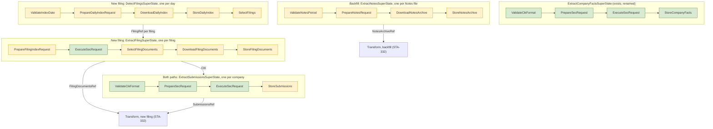

# Ingestion Paths: Extraction

> **Status:** draft for review, STA-328. Round 1 of 3. Round 2 designs the SEC fact model and the
> fact store (STA-331). Round 3 designs transform for both paths (STA-332).
>
> **Marks:** "Measured" means checked against the SEC website or a downloaded file on 2026-10-28.
> "Estimate" means not measured. "Proposed" means not yet accepted by the lead.

## Reading Guide

- [Sources](#sources) and [Extraction Overview](#extraction-overview) give the frame and the
  diagram. Read them first.
- [Backfill Extract](#backfill-extract) carries the decisions of the lead from 2026-10-28. The
  subsection [Notes ZIP Findings](#notes-zip-findings) is new and changes three of them: the file
  name, the content type check, and the table parser.
- [New-Filing Extract](#new-filing-extract) is new and fully proposed. It needs the most scrutiny.
- [Calling the Machines](#calling-the-machines) and the ingestion mode in the metadata are new and
  decided.
- [Cut-Over Between the Paths](#cut-over-between-the-paths) and
  [Idempotent Writes](#idempotent-writes) list their assumptions. Check them first.
- [Raw Store](#raw-store), [Handover to Transform](#handover-to-transform),
  [Deployment](#deployment), and [Implementation Tickets](#implementation-tickets) are new and
  proposed.
- [Open Questions](#open-questions) lists what the lead must decide.

## Sources

The MVP decisions (STA-284) chose these SEC sources:

| Source | Path | Use |
| ------ | ---- | --- |
| Financial Statement and Notes files | Backfill | All values of all filings since 2009, with dimensions |
| XBRL instance and `_lab.xml` of each filing | New filing | The values and the company labels of one new filing |
| `submissions` JSON | Both | Company data: name, SIC code, tickers, former names |
| `companyfacts` JSON | Neither | Cross-check only. It drops every value with a dimension. |

The pipeline extracts only `companyfacts` today. `ExtractCompanyFactsSuperState` runs
`ValidateCikFormat` → `PrepareSecRequest` → `ExecuteSecRequest` → `StoreCompanyFacts`
(`sec/src/lib/implementations/states/extract/`).

## Extraction Overview

Each path has its own extract SuperStates. One machine handles one unit of work: one Notes file,
one filing, or one company. A binary loops over the units with `join_all`, as `stream_extract`
loops over CIKs today. Fork and join replaces the loops later (STA-329).



Green states exist today. `PrepareSecRequest` is generic over the request kind, so the Submissions
path reuses it with a new kind. The Notes path builds its request in its own state, `PrepareNotesRequest`.
Yellow states are new.

### Ingestion Mode

Each run has an ingestion mode: `backfill` or `incremental`. The backfill runs in mode `backfill`.
The new-filing path runs in mode `incremental`. The enum `IngestionMode` in `storage` holds the
two values. Decided by the lead on 2026-10-29.

### Calling the Machines

One facade, `Extraction`, builds every extract SuperState. Decided by the lead on 2026-10-28. The
first call picks the ingestion mode. The second call picks the source. A typestate builder then
asks for the inputs of that source:

```rust
Extraction::backfill().notes().period(p).sec_client(c).repository(r).build()
Extraction::backfill().submissions().cik(cik).sec_client(c).repository(r).build()
Extraction::incremental().daily_index().date(d).sec_client(c).repository(r).build()
Extraction::incremental().filing().filing_ref(f).sec_client(c).repository(r).build()
Extraction::incremental().submissions().cik(cik).sec_client(c).repository(r).build()
```

- `backfill()` offers only `notes()` and `submissions()`. `incremental()` offers only
  `daily_index()`, `filing()`, and `submissions()`. A call such as
  `Extraction::incremental().notes()` does not compile.
- Each `build()` returns the concrete SuperState, for example `ExtractNotesSuperState`. There is no
  generic SuperState.
- The ingestion mode reaches the metadata of each raw document. See [Raw Store](#raw-store). While
  `backfill()` is the only mode, `StoreNotesArchive` writes the mode `backfill` as a fixed value.
  The facade passes the mode to the SuperState once `incremental()` exists (lead, 2026-10-29).
- `Extraction::backfill()` creates one `execution_id` per run. Every SuperState built from the same
  handle carries it. `Extraction::backfill().execution_id(id)` replaces it (lead, 2026-10-29).
  `Backfill::id()` returns it, so a binary can name the run in its logs.
- The facade lives in `sec/src/lib/implementations/extraction/`. Only `backfill().notes()` exists
  today (STA-343).
- `companyfacts` stays outside the facade. It is a cross-check only. `StoreCompanyFacts` writes
  the mode `backfill`.

## Backfill Extract

### Shape

One state machine handles one Notes file. It mirrors the `companyfacts` machine:

| Today (`companyfacts`) | Backfill (Notes) |
| ---------------------- | ---------------- |
| One machine = one CIK | One machine = one Notes file |
| The run loops over the `CIKS` list with `join_all` | The run loops over a list of Notes periods, with a cap on files in flight |
| `ValidateCikFormat`: raw string → `Cik` | `ValidateNotesPeriod`: raw string → `NotesPeriod` |
| `SecRequest::builder().all_company_facts().cik(cik).build()` | `SecRequest::builder().notes_file().period(period).build()` |
| `ExecuteSecRequest` reads a JSON body | `DownloadNotesArchive` reads a binary body of up to 0.85 GB |
| `StoreCompanyFacts` writes `sec/companyfacts/CIK##########.json` | `StoreNotesArchive` writes `sec/notes/<file name>` |

A separate REFACTOR renames the existing `ExtractSuperState` to `ExtractCompanyFactsSuperState`.

### States

1. `ValidateNotesPeriod` parses a raw string such as `2024q1` or `2025_10` into a `NotesPeriod`.
2. `PrepareNotesRequest` builds `SecRequest::builder().notes_file().period(p).build()`.
3. `DownloadNotesArchive` sends the request and reads the whole body into memory. It runs the
   transport checks of [Validation](#validation), layer 1. Its output holds the
   `SecResponse<ZipBody>` in an `Arc`, because the state traits require `Clone`.
4. `StoreNotesArchive` takes the response out of its input, writes the bytes as a
   `RawDocument<RawNotesArchive>`, and outputs a `NotesArchiveRef`.

`ExtractNotesSuperState::run_to_archive` runs the stream, hands each item to the caller, and
returns the `NotesArchiveRef` as a typed value. The caller never parses the JSON of a stream item
(lead, 2026-10-29).

### `NotesPeriod`

`NotesPeriod` is a domain type in `sec/src/lib/shared/`. It holds either a quarter (year and
quarter) or a month (year and month).

- Quarters run from 2009q1 to 2025q3. Months run from 2025_10 onward. Measured on the SEC page.
- Construction rejects a quarter after 2025q3, a month before 2025_10, and a year before 2009.
- `NotesPeriod::file_name()` returns the SEC file name. See [File Names](#file-names).
- `sec::shared::financial::quarter::Quarter` (Q1 to Q4) holds the quarter part. The month part
  needs its own type.

The 2009q1 file holds the table headers and no rows (SEC readme, section 2). The run keeps it in
the list, because it tests the empty case at the cost of one request of 28 KB.

### File Names

The URL is `https://www.sec.gov/files/dera/data/financial-statement-notes-data-sets/` plus the file
name. Measured: all 79 links on the SEC page use this prefix.

Most file names follow the period: `2024q1_notes.zip`, `2025_10_notes.zip`. Three do not:

| Period | Linked file (Last-Modified) | File the pattern gives (Last-Modified) |
| ------ | --------------------------- | -------------------------------------- |
| 2010q1 | `2010q1_notes_1.zip` (2024-09-25) | `2010q1_notes.zip` (2020-12-22) |
| 2010q2 | `2010q2_notes_0.zip` (2024-09-25) | `2010q2_notes.zip` (2020-12-22) |
| 2010q3 | `2010q3_notes_0.zip` (2024-09-25) | `2010q3_notes.zip` (2020-12-22) |

Both names return HTTP 200, so the pattern downloads an old version of the data without an error.
So `NotesPeriod::file_name()` reads a table of overrides in `constants.rs`. A unit test
asserts all 79 names against the list measured on 2026-10-28.

Risk: if the SEC adds a suffix to another file, the run downloads the old version without an
error. A later improvement can compare the list with the SEC page.

### Request

- `SecRequestType` gets a second variant next to `FetchAllCompanyFacts { cik }`:
  `FetchNotesFile { period: NotesPeriod }`.
- The builder gets the same typestate pattern. `notes_file()` returns `NotesFileBuilder<NoPeriod>`.
  `.period(p)` returns `NotesFileBuilder<NotesPeriod>`. Only that type has `build()`.
- The request carries its kind: `SecRequest<K: RequestKind = CompanyFacts>`. The kind names the
  input and builds the `SecRequestType`:

  ```rust
  pub trait RequestKind {
      type Input;
      fn request_type(input: Self::Input) -> SecRequestType;
  }
  ```

  - `CompanyFacts` has `Input = Cik`. `NotesFile` has `Input = NotesPeriod`.
  - The builder sets the kind. `.all_company_facts().cik(c).build()` returns
    `SecRequest<CompanyFacts>`, and `.notes_file().period(p).build()` returns `SecRequest<NotesFile>`.
  - Generic code builds a request without the builder: `SecRequest::<K>::new(input)`, with
    `input: K::Input`. A wrong input does not compile.
  - The request knows nothing about responses. The client maps each request kind, an SEC
    endpoint, to its body kind, see "Download".

### Download

The run downloads the whole file, not HTTP range reads.

- The SEC limit counts requests, not bytes. A whole file is one request.
- STA-284 downloaded all 79 files in 14 minutes, about 32 MB/s. The session of 2026-10-28
  downloaded `2024q1_notes.zip` (619 MB) in 25 seconds.
- A local file can seek, so the `zip` crate reads it directly.

The download goes through the existing layers: `SecRequest` → `SecClient` → `InnerClient`.
`SecResponse<B>` is generic over its body kind `B`. The body kind sets the checks and stores the
body. `SecResponse<JsonBody>`, the default, holds a Company Facts reply. `SecResponse<ZipBody>`
holds a Notes file or a daily index as raw bytes.

The `RespondsWith` trait on the client side maps each SEC endpoint to its body kind, once for
every client. `CompanyFacts` and `DailyIndexListing` have `Body = JsonBody`. `NotesFile` and `DailyIndex` have
`Body = ZipBody`. This
keeps `shared::request` independent of `shared::response`.

The `SecClient` trait has one method for every endpoint. Its default body waits on the rate limiter,
sends the request through the inner client, and builds the response:

```rust
async fn execute_sec_request<E>(
    &self,
    request: SecRequest<E>,
) -> Result<Self::Response<E::Body>, Self::Error>
where
    E: RespondsWith;
```

`E` is the SEC endpoint the request queries. `RespondsWith::Body` of `E` sets the response type,
so the caller does not choose it.
`Response<B>` is a generic associated type, so the trait names no `reqwest` or `http` type. The
concrete `SecClient` sets `Response<B> = SecResponse<B>`. A Notes request gives an
`SecResponse<ZipBody>`. Code that expects an `SecResponse<JsonBody>` from it does not compile.

`SecResponse<B>` holds the URL, the headers, the content type, the status code, the body, and the
SHA-256 of the body. `ZipBody` accepts only status 200 and the content types `application/octet-stream`
and `application/zip`. If the `Content-Length` header is present, the byte count must match it.
Each later file kind gets its own body kind, for example the XML files of the new-filing path.
The daily index is the exception: it reuses `ZipBody`, because the SEC sends it as
`application/octet-stream` and the store keeps it as raw bytes. Decided in STA-369.

### Storage

- `StoreNotesArchive` reuses `FilesystemRepository` unchanged. `RawDocument` and
  `RawDocumentMetadataContext` get a constructor from `SecResponse<ZipBody>`. The key is
  `sec/notes/<file name>`, for example `sec/notes/2024q1_notes.zip`.
- The repository writes temp files and renames them. If the stored pair matches the new bytes, it
  skips the write. If the bytes differ, the new bytes replace the old.
- The comparison includes the `Producer` with its git commit. So a rerun after a new deploy
  rewrites every file, 27.7 GB for the backfill, even if the bytes are equal.
- The files live on the Cloud Storage bucket mounted into the Cloud Run job. The states read the
  ZIP from there.
- Storing all 79 files takes 27.7 GB, under $1 a month (estimate).

To check during implementation:

- How the mount handles a large write before upload. It can stage the file locally, and on Cloud
  Run local disk counts as memory.
- The read speed of the ZIP through the mount.
- A rename on the mount is not atomic.

### Memory and the Cap on Files in Flight

The rate limiter limits requests per second. It does not limit downloads in flight, so it does not
bound memory. The run caps the Notes files in flight at 2, with `buffer_unordered(2)` instead of
`join_all`.

The cap stays at 2. Measured on 2026-10-29 in a cloud container (not Cloud Run) and on a Mac on
Wi-Fi, the network limits the download. More files in flight make each file slower and raise the
peak memory, but the total time stays the same. Measure once on Cloud Run before you change the
cap. The numbers are in
[notes_backfill Network and Stream Cut-Off: Findings](https://linear.app/state-machine/document/notes-backfill-network-and-stream-cut-off-findings-2238f0c1e060).
The method is in
[`network.md`](../../../.claude/skills/performance/references/profiling/network.md) of the
`performance` skill.

`ZipBody` and `RawDocument` hold the body as `bytes::Bytes`. `RawDocument::from_file` borrows the
`SecResponse<ZipBody>` and shares its body buffer, so the response body and the `RawDocument` bytes
are one copy. A clone of a `RawDocument` also shares the buffer. A rerun adds a second copy: the
stored file that `persist` reads to compare digests. The measured peaks confirm this: about one copy
of each body in flight on a first run, plus about 0.4 GB for the rest of the process. The largest
file is 0.85 GB, so two of the largest files in flight need about 2.1 GB on a first run and about
3.8 GB on a rerun (estimates from the measured peaks). The findings document holds the measured
peaks.

Each SHA-256 of a file body runs on the blocking thread pool through
`Sha256Digest::of_owned_async`, so the task polls other futures during the hash. This covers the
digest in `SecResponse::<ZipBody>::from_inner`, the content check in `persist` and `get`, and the
digest check of a stored file on a rerun. `RawDocument::from_file` takes the digest of the response
and does not hash the body again.

The run gives each period its own task. STA-344 added this split after two periods in one task
failed twice, and blamed the hash of one file for stopping the body read of the other. Later, 8
runs with one shared task passed, on the code before and after the hash moved off the task. So the
failure did not reproduce, and its cause is open. Whether the run keeps the split is an open
decision (STA-360).

The output of `DownloadNotesArchive` holds the response in an `Arc`. The transition to
`StoreNotesArchive` moves the `Arc` into the input of `StoreNotesArchive`, which holds it as
`Option<Arc<SecResponse<ZipBody>>>`. The state takes the `Arc` out of the input and builds the
document from a borrow of the response. A second clone of the `Arc` does not stop the write, but
it keeps the body buffer alive, so a transition must never keep one. A failed write consumes the
response, so a retry needs a new input from `DownloadNotesArchive`.

### Archive Metadata

- The repository records the size and SHA-256 of the whole file, as for every raw document.
- The table list from the ZIP index (name, sizes, CRC-32) goes into the output of the first
  transform state, which opens the ZIP anyway. A SHA-256 per table needs every table unzipped.

### Notes ZIP Findings

Measured on 2026-10-28 against `2024q1_notes.zip`, `2012q1_notes.zip`, and `2026_09_notes.zip`,
and the SEC readme (`https://www.sec.gov/files/aqfsn_1.pdf`).

**Transport.** `2024q1_notes.zip` returned HTTP 200 with `Content-Type: application/octet-stream`,
not `application/zip`. `Content-Length` was 619,443,584 and equaled the bytes received. Every
Notes file checked with `HEAD` returned `application/octet-stream`.

**Members.** Each ZIP holds ten members, all compressed with deflate (method 8):

| Member | Zipped 2024q1 | Unzipped 2024q1 | Rows 2024q1 | Content |
| ------ | ------------- | --------------- | ----------- | ------- |
| `sub.tsv` | 1.6 MB | 7.4 MB | 24,364 | One row per filing: `adsh`, CIK, form, period, filed date, SIC |
| `tag.tsv` | 27.7 MB | 189.0 MB | 1,012,939 | Tag metadata and labels |
| `dim.tsv` | 32.7 MB | 102.3 MB | 703,169 | Dimension hash to segments |
| `num.tsv` | 134.7 MB | 1,423.5 MB | 9,101,360 | Numeric values |
| `txt.tsv` | 298.2 MB | 1,290.2 MB | 1,443,193 | Text values |
| `ren.tsv` | 15.1 MB | 123.2 MB | 519,609 | Rendering of each report |
| `pre.tsv` | 100.2 MB | 799.2 MB | 6,279,813 | Position of each value in the statements |
| `cal.tsv` | 9.2 MB | 117.4 MB | 878,377 | Calculation relationships |
| `readme.htm` | under 0.1 MB | 0.3 MB | | The readme |
| `notes-metadata.json` | under 0.1 MB | 0.1 MB | | Table schema in the W3C CSVW format |

Total for 2024q1: 0.619 GB zipped, 4.052 GB unzipped. The readme names the tables with `.txt`. The
files use `.tsv`.

**Headers.** The column headers of all eight tables are identical in 2012q1, 2024q1, and 2026_09.
The SEC regenerated the 2012q1 file on 2024-09-20, so this result does not prove that the format
never changed. `notes-metadata.json` lists the columns, their types, and the primary key of each
table.

**Quoting.** A field can be in double quotes and hold a tab. Two rows of `dim.tsv` in 2024q1 do
this. A split on every tab reads them with 4 fields instead of 3. A reader that follows the CSVW
default dialect (tab delimiter, `"` as quote) reads all rows of all eight tables in 2024q1 with the
expected field count. No field holds a newline. No line ends with CRLF. All tables decode as
UTF-8.

**Content of `sub.tsv`.** 2024q1 holds 24,364 filings of 6,587 companies, filed from 2024-01-02 to
2024-03-29. The most common forms are 8-K (16,272), 10-K (3,987), and 10-Q (1,044). The column
`instance` names the XBRL instance file of each filing, for example `ae-20240221_htm.xml`.

**Publication.** The SEC page reads "January 2009 - September 2026". The page says that the SEC
has updated the data sets monthly since November 2020. The file list still has quarterly files up
to 2025q3 and monthly files from 2025_10. Filings after 5:30 PM Eastern on the last day of the month go
into the next file. The Last-Modified dates of recent monthly files:

| File | Last-Modified |
| ---- | ------------- |
| `2025_10_notes.zip` | 2025-12-01 |
| `2026_07_notes.zip` | 2026-08-05 |
| `2026_08_notes.zip` | 2026-09-08 |
| `2026_09_notes.zip` | 2026-10-07 |

A monthly file appears in the first 8 days of the next month, from three samples. The SEC also
replaces old files: `2025q3_notes.zip` has a Last-Modified of 2026-10-07, and `2024q1_notes.zip` of
2025-07-03. So a rerun of the backfill can download different bytes for the same period.

### Validation

Four layers, each in the state that first sees the data. Layers 1 to 3 fail the file. Layer 4
quarantines the row or the filing, and the file goes on.

1. **Transport**, in `SecResponse<ZipBody>`, which `DownloadNotesArchive` gets from
   `SecClient::execute_sec_request`: HTTP 200, a content type of `application/octet-stream` or
   `application/zip`, and a byte count equal to `Content-Length` if the header is present.
2. **Container**, in the first transform state: the bytes start with the ZIP signature `PK\x03\x04`,
   the ZIP index parses, all eight tables and `notes-metadata.json` are present, every member uses
   deflate, every member name has no path separator, and the unzipped size stays under a limit.
   Proposed limit: 16 GB unzipped per file, and 50 times the zipped size per member. Measured
   maximum ratio in 2024q1: 12.8 (`cal.tsv`).
3. **Table format**, in each read state: UTF-8, a quote-aware tab-separated reader, a header equal
   to the columns in `notes-metadata.json`, the same field count in every row, and the CRC-32 of
   the member.
4. **Row content**, in the map state: types and references between tables. Round 3 (STA-332)
   designs this layer.

### Tests

- Unit tests for `NotesPeriod`: the range limits, the parse of both forms, and all 79 file names.
- Unit tests for the builder: the URL of a quarterly file, a monthly file, and an override.
- State tests with a fake `SecClient` that returns a small ZIP fixture, as the `companyfacts`
  states do today.
- A fixture ZIP of a few KB with all ten members and one quoted field with a tab. It never holds
  real SEC data larger than a few rows.
- `DownloadDailyIndex`: a 403 or 404 for a date that a quarter listing has passed gives an empty
  list. A 403 or 404 for any other date fails the run.
- `SelectFilings`: two rows with one accession number give one `FilingRef`. `10-K/A`, `20-F`, and
  `40-F` are kept. `8-K` and `10-KT` are dropped.
- `SelectFilingDocuments`: the fallback rule without `_htm.xml`, a filing without `_lab.xml`, and a
  filing without an instance.
- No state or SuperState test downloads from the SEC. The integration test of `notes_backfill`
  downloads the two smallest Notes files, 2009q1 and 2009q2, as the other integration tests in
  `sec/tests/` call live services (lead, 2026-10-29).

### Later Improvements

Out of MVP scope. Recorded in the MVP Data project, "Later: Notes download improvements":

- Skip and change detection with `HEAD` or a conditional `GET`.
- A completion marker instead of a rename.
- Streaming the download to the file instead of holding it in memory.

## New-Filing Extract

> **Status:** detection, forms, and companies decided by the lead on 2026-10-28. The rest is
> proposed.

### Detection

The SLA for the start is T+1: a filing is in the raw store on the morning after its filed date.
Decided by the lead on 2026-10-28. To meet it, the job reads the EDGAR daily index
`form.YYYYMMDD.idx` once a day, not the latest-filings feed every 2 minutes.

| | Daily index | Latest-filings feed |
| - | ----------- | ------------------- |
| URL | `https://www.sec.gov/Archives/edgar/daily-index/YYYY/QTRn/form.YYYYMMDD.idx` | `https://www.sec.gov/cgi-bin/browse-edgar?action=getcurrent&type=10-Q&output=atom` |
| Requests | 1 per day | 1 per poll and form, plus paging |
| Complete | Yes, all filings of the day | 100 entries per page at most |
| Gaps after an outage | None. Read the missed days. | Entries older than the feed window are lost. |
| Delay | The index of 2026-10-27 appeared at 02:16 UTC on 2026-10-28 | Minutes |
| Format | Fixed-width text, `application/octet-stream` | Atom XML |

`DetectFilingsSuperState` runs `ValidateIndexDate` → `PrepareDailyIndexRequest` →
`DownloadDailyIndex` → `StoreDailyIndex` → `SelectFilings`.

`ValidateIndexDate` turns a raw `YYYY-MM-DD` string into an `IndexDate`. The `IndexDate` gives the
three date parts of the URL: the year, the quarter folder `QTR1` to `QTR4`, and `YYYYMMDD`. The state
rejects two ranges of dates:

- A date before 1998-05-18. Until 1998-05-17, the SEC named the daily index `form.YYMMDD.idx`.
  The SEC quarter listings showed this on 2026-10-30.
- A date after the current UTC date. This rejects typos and dates in the future. It does not reject
  every date that the SEC has not yet published: the SEC dates the index in Eastern time and
  publishes it after the day ends. Such a date reaches the 404 rule below and fails with
  `MissingDailyIndex`, the same as a rerun that starts before the SEC publishes.

The MVP has no requirement for a delay of minutes. The daily index needs no cursor, and a missed
day needs only a rerun for that date. The feed can come later for a shorter delay, and the daily
index then fills its gaps.

Rows for the selected forms, measured: 77 on 2026-10-27, 197 on 2026-03-02, and 295 on
2026-08-10. Other peak days are not measured.

A day without filings, such as a weekend, has no index file. An index that the SEC has not yet
published has no file either. For both, the SEC returns 404, or 403 with an S3 `AccessDenied` body.
The SEC returned 403 for the missing `form.20261025.idx` on 2026-10-30. `DownloadDailyIndex` tells
the two cases apart with the listing of the quarter, `daily-index/YYYY/QTRn/index.json`, which
costs one request:

- If the SEC refuses that listing, or the listing names the date, the run fails with
  `MissingDailyIndex`, and Cloud Run retries it. The SEC also answers 403 when it refuses a
  request, for example at its rate limit. A listed date means the file exists, so the 403 or 404
  came from a refused request.
- If the listing has an index for a later date, the day had no filings. The result is an empty
  list.
- Otherwise, once the next quarter has started, any index in its listing shows that the day had no
  filings. This covers a quarter that ends on days without filings, such as 2024-03-30 and
  2024-03-31. If the next quarter has not started, or its listing is empty or refused, the run
  fails with `MissingDailyIndex`.

This rule needs no list of SEC holidays.

### Filing Selection

`SelectFilings` keeps the rows whose form is 10-K, 10-Q, 20-F, or 40-F, or an amendment of one of
them (`/A`). It keeps the filings of all companies, with no company list. Both decided by the lead
on 2026-10-28. The backfill also covers all companies, because each Notes file holds every filer.
Foreign filers of 20-F and 40-F can report in IFRS, and transform must handle this taxonomy
(STA-332).

Both paths keep the same forms. Decided by the lead on 2026-10-28. The Notes files hold every
form, so transform of the backfill drops the other forms (STA-332). Measured on 2024q1:

| | 4 forms and their amendments | All other forms |
| - | ---------------------------- | --------------- |
| Filings | 5,762 (24%) | 18,602 (76%) |
| Values in `num.tsv` | 8.36 million (92%) | 0.75 million (8%) |

The 8-K filings (16,701 with amendments) hold about 4,500 values. The other forms with values are
mostly S-1, S-4, 6-K, and DEF 14A.

One shared constant holds the form list. Each entry is a `Form` value, not a string:

```rust
/// The forms that both ingestion paths extract.
pub const SELECTED_FORMS: [Form; 4] = [Form::TenK, Form::TenQ, Form::TwentyF, Form::FortyF];
```

- `SelectFilings` and the transform of the backfill both read `SELECTED_FORMS`.
- `Form::from_sec_str` parses the SEC form text. A form with `/A` matches its base form and sets
  `is_amendment`.
- To widen the list later, add a variant to `Form` and to `SELECTED_FORMS`. The raw store already
  holds all forms of the backfill in the Notes ZIPs, and the stored daily indexes list the skipped
  filings. So widening needs no new download of the Notes files.

A filing with several filers has one row per filer in the index. `SelectFilings` keeps one
`FilingRef` per accession number: the first row. It outputs one `FilingRef` per kept filing:

```rust
pub struct FilingRef {
    cik: Cik,
    accession_number: AccessionNumber,
    form: Form,
    is_amendment: bool,
    filed_date: NaiveDate,
}
```

`AccessionNumber` and `Form` exist in `sec/src/lib/shared/financial/`. `Form` has only `TenK` and
`TenQ` today. It gets the variants `TwentyF` and `FortyF`. `is_amendment` marks the `/A` forms, so
amendments need no extra variants.

### Fetch of Each Filing

One `ExtractFilingSuperState` runs per `FilingRef`. It sends three requests:

1. The folder index `https://www.sec.gov/Archives/edgar/data/<cik>/<accession without dashes>/index.json`.
   This is JSON, so `ExecuteSecRequest` reads it unchanged.
2. The XBRL instance.
3. The `_lab.xml` label file.

`SelectFilingDocuments` picks the two file names from the folder index:

- The instance is the member that ends in `_htm.xml`. If none exists, it is the one `.xml` member
  that is not `FilingSummary.xml` and does not end in `_cal.xml`, `_def.xml`, `_lab.xml`, or
  `_pre.xml`.
- The label file is the member that ends in `_lab.xml`. If a filing has none, the machine stores
  the instance only, and `labels_key` is `None`.
- If a filing has no instance, the machine fails with an error that names the accession number.

Measured on one filing (`0000003545-26-000047`): the folder holds `alco-20260908_htm.xml` and
`alco-20260908_lab.xml`, both served as `text/xml`. The `instance` column of `sub.tsv` uses the
same names. The rule for older filings without inline XBRL is unverified.

`DownloadFilingDocuments` fetches both files with `SecClient::execute_sec_request`, through a
request kind whose body kind holds an XML file. The files are
small (2.8 KB and 22.8 KB for this filing), so the run caps filings by the rate limiter only.

### Company Data

`ExtractSubmissionsSuperState` mirrors the `companyfacts` machine and reuses three of its states:
`ValidateCikFormat`, `PrepareSecRequest` with a new kind for `FetchSubmissions { cik }`, and
`ExecuteSecRequest`. A new `StoreSubmissions` writes the JSON.

- URL: `https://data.sec.gov/submissions/CIK##########.json`. Measured: it holds `sic`,
  `sicDescription`, `name`, `tickers`, `exchanges`, `formerNames`, and the recent filings.
- New-filing path: one run per distinct CIK of the day's filings.
- Backfill: one run per distinct CIK in all Notes files. 2024q1 alone has 6,587 companies. The
  total over all files is not measured. `sub.tsv` already holds the SIC code and the name at
  filing time, so the backfill needs `submissions` only for the current company data.

### Cut-Over Between the Paths

The backfill runs once, by hand, up to the last published Notes file, `2026_09`. Decided by the
lead on 2026-10-28. After that, the new-filing path catches each new filing. No step checks
whether a company or a filing already exists. See [Idempotent Writes](#idempotent-writes).

Rules:

1. The new-filing path starts at the daily index of 2026-09-30, one day before the end of the
   last Notes file. The overlap of one day covers assumption A2 below.
2. The first `daily_filings` run reads every day from the start date up to yesterday. Each later
   run reads one day.
3. A missed day is a rerun for that date.
4. A filing that reaches both paths changes nothing, because every write is idempotent.

Assumptions:

| Id | Assumption | Status | If it is false |
| -- | ---------- | ------ | -------------- |
| A1 | `2026_09` holds every filing of the selected forms with a filed date up to 2026-09-30 | Measured: its `sub.tsv` runs from 2026-09-01 to 2026-09-30 | A filing before 2026-09-30 is lost. To check, compare `sub.tsv` with the daily indexes of September. |
| A2 | A filing after 5:30 PM Eastern on the last day of a month gets the next business day as its filed date, and the daily index of that day lists it | Unverified | The overlap of one day covers a filing on 2026-09-30. A longer gap needs a longer overlap. |
| A3 | The daily index lists every filing of its day, and the SEC does not change it after publication | Unverified | A late change is lost. A rerun of that date picks it up. |
| A4 | The SEC replaces old Notes files after the backfill, for example `2025q3` on 2026-10-07 | Measured | The backfill does not pick up the change. An amendment reaches the new-filing path as its own filing (10-K/A, 10-Q/A). |
| A5 | CIK and accession number never change and are never reused | Unverified, SEC practice | Idempotent writes on these keys merge two different things |

### Idempotent Writes

> **Input for STA-331.** Decided as a direction by the lead on 2026-10-28. The fact store design
> (round 2) fixes the schema.

An upsert is one statement that inserts a row, or updates it if a row with the same key exists. In
Postgres, it is `INSERT … ON CONFLICT (key) DO UPDATE` or `DO NOTHING`. The database makes the
check and the write one atomic step, so two runs cannot both insert the same row.

```sql
INSERT INTO companies (cik, name, sic, as_of)
VALUES ('0000320193', 'Apple Inc.', '3571', '2026-10-28')
ON CONFLICT (cik) DO UPDATE
  SET name = excluded.name, sic = excluded.sic, as_of = excluded.as_of
  WHERE excluded.as_of >= companies.as_of;
```

`excluded` is the row that the statement tried to insert. The table name and the columns are an
example. STA-331 fixes the schema.

Rules:

- **No read before a write.** No step asks "does this company exist?" and then creates it. Every
  write is an upsert on a natural key.
- **Companies** are keyed by CIK: `ON CONFLICT (cik) DO UPDATE`. The first filing of a company
  creates the row. A later one updates it.
- **Company data only moves forward.** The update has a guard:
  `WHERE excluded.as_of >= companies.as_of`. Without it, a Notes file loaded late overwrites newer
  company data with older data.
- **Filings** are keyed by accession number: `ON CONFLICT (accession_number) DO NOTHING`.
- **Facts** hold the CIK and the accession number directly, not a surrogate id from a lookup. A
  fact is keyed by its accession number and its value key (STA-331): `DO NOTHING`.
- **One transaction per filing.** The load writes the company, then the filing, then its facts.

So the order of Notes files, the order of days, a rerun, and an overlap do not change the result.

Open for STA-331: its draft keys the fact store by `company_id`. If `company_id` is a surrogate
id, each write needs a lookup first, and this rule breaks. The id must come from the filing itself,
for example the CIK.

## Raw Store

All documents use `FilesystemRepository` and `RawDocument<S>`. Each source gets its own
`RawSource` marker and `SecDocumentType` variant. Proposed for all rows except the first two:

| Document | `RawSource` marker | Document type | Key |
| -------- | ------------------ | ------------- | --- |
| Company Facts JSON | `RawCompanyFacts` | `raw_company_facts` | `sec/companyfacts/CIK##########.json` (exists) |
| Notes ZIP | `RawNotesArchive` | `raw_notes_archive` | `sec/notes/<file name>`, for example `sec/notes/2010q1_notes_1.zip` |
| Daily index | `RawDailyIndex` | `raw_daily_index` | `sec/daily-index/form.YYYYMMDD.idx` |
| XBRL instance | `RawXbrlInstance` | `raw_xbrl_instance` | `sec/filings/CIK##########/<accession>/instance.xml` |
| Label file | `RawXbrlLabels` | `raw_xbrl_labels` | `sec/filings/CIK##########/<accession>/lab.xml` |
| `submissions` JSON | `RawSubmissions` | `raw_submissions` | `sec/submissions/CIK##########.json` |

- The accession number in a key keeps its dashes, for example `0000003545-26-000047`.
- The instance and the label file get fixed names, so transform finds them without a listing.
  The metadata keeps the SEC file name in `requested_url`.
- The daily index is stored so that detection can run again without the SEC.
- A new fetch of `submissions` replaces the old file. The raw store holds the latest company data
  only. The same holds for a replaced Notes file.
- The metadata records the content type that the SEC sent, for example `application/octet-stream`
  for a Notes ZIP.

### Ingestion Mode in the Metadata

The metadata of each raw document records the ingestion mode of the run that created it, as
`"ingestion_mode": "backfill"` or `"ingestion_mode": "incremental"`. Decided by the lead on
2026-10-28, with this key name.

- `ingestion_mode` is a run field in `DocumentMetadata`, next to `execution_id` and
  `produced_at`. Its type is the enum `IngestionMode` in `storage`, so `storage` does not depend
  on `sec`, and `sec` uses the same enum.
- `ingestion_mode` is required. Metadata without a mode does not compile. A stored file without
  the field, with `null`, or with any text other than `backfill` or `incremental` fails to read.
  Decided by the lead on 2026-10-29.
- `companyfacts` runs as a backfill, so `StoreCompanyFacts` writes `backfill`.
- `METADATA_VERSION` stays 1 until the MVP. Files written before the MVP do not need to stay
  readable.
- `persist` leaves `ingestion_mode` out of the comparison, as it does with `execution_id` and
  `produced_at`. If a run stores the same bytes again, the write is skipped and the stored run
  fields stay. A stored file without a valid mode fails the check of the run fields, so `persist`
  rewrites it.
- So the metadata names the run that created the document. `submissions` serves both modes. If
  `ingestion_mode` were part of the comparison, each run in the other mode would rewrite the file.
- Transform copies the mode onto each fact (STA-331).

## Handover to Transform

Each extract machine outputs a small reference, not the bytes. Transform reads the bytes from the
raw store.

```rust
/// Backfill: one stored Notes file.
pub struct NotesArchiveRef {
    period: NotesPeriod,
    key: DocumentKey,
    size_in_bytes: u64,
    sha256: Sha256Digest,
}

/// New filing: the two stored files of one filing.
pub struct FilingDocumentsRef {
    filing: FilingRef,
    instance_key: DocumentKey,
    labels_key: Option<DocumentKey>,
}

/// Both paths: the stored company data of one company.
pub struct SubmissionsRef {
    cik: Cik,
    key: DocumentKey,
}
```

`DetectFilingsSuperState` outputs a `Vec<FilingRef>`. The binary starts one
`ExtractFilingSuperState` per entry.

## Deployment

Proposed for MVP Operations. Both paths run as Cloud Run jobs with the bucket mounted, as
`stream_extract` does. Neither path needs a service.

| Path | Binary | Trigger | Size (estimate) |
| ---- | ------ | ------- | --------------- |
| Backfill | `notes_backfill` | By hand, once. Rerun by hand. | 6 to 8 GiB memory, task timeout of 1 hour |
| New filing | `daily_filings` | Cloud Scheduler, once a day at 07:13 UTC | 1 GiB memory, task timeout of 30 minutes |

- `daily_filings` reads a start date and an end date from environment variables. If they are
  unset, the job reads yesterday in Eastern time. The first run and a rerun for missed days set
  them.
- `daily_filings` runs the three new-filing machines in order: detection, then one filing machine
  per `FilingRef`, then one `submissions` machine per distinct CIK.
- If one machine fails, the job logs the failure and runs the other machines. At the end, the job
  exits with an error if any machine failed, and Cloud Run retries it. The retry is safe, because
  every write is idempotent.
- `notes_backfill` runs the `submissions` machine for each distinct CIK after the Notes files.
- Both jobs share the SEC client, the User-Agent, and the storage root through
  `sec/src/bin/shared/`.

## Implementation Tickets

Each ticket fits one PR under 400 reviewable lines (estimate). Proposed. The order follows the
decision "backfill first".

Backfill:

1. REFACTOR: rename `ExtractSuperState` to `ExtractCompanyFactsSuperState`.
2. FEATURE: the required run field `ingestion_mode` in `DocumentMetadata` (`storage`), of the
   type `IngestionMode` (`storage`), left out of the comparison in `persist`.
3. FEATURE: `NotesPeriod`, with the range checks and the file names with overrides.
4. FEATURE: `SecRequestType::FetchNotesFile` and the builder `notes_file().period(p)`.
5. FEATURE: `SecResponse<ZipBody>` and the Notes request through
   `SecClient::execute_sec_request`, with the transport checks of layer 1.
6. FEATURE: `RawNotesArchive`, its `SecDocumentType` variant, and the constructors of
   `RawDocument` and `RawDocumentMetadataContext` from `SecResponse<ZipBody>`.
7. FEATURE: the states `ValidateNotesPeriod` and `PrepareNotesRequest`.
8. FEATURE: the state `DownloadNotesArchive`.
9. FEATURE: the state `StoreNotesArchive` and `NotesArchiveRef`.
10. FEATURE: `ExtractNotesSuperState`, its transitions, and its builder.
11. FEATURE: the facade `Extraction` with `backfill().notes()`.
12. FEATURE: the binary `notes_backfill`, with `buffer_unordered(2)` over the Notes periods.

New filing and company data:

1. FEATURE: the `Form` variants `TwentyF` and `FortyF`, the `/A` parse, and `SELECTED_FORMS`.
2. FEATURE: `FilingRef` and the parser for `form.YYYYMMDD.idx`.
3. FEATURE: the request variants `FetchDailyIndex`, `FetchDailyIndexListing`, `FetchFilingIndex`,
   `FetchFilingDocument`, and `FetchSubmissions`.
4. FEATURE: `RawDailyIndex`, `RawXbrlInstance`, `RawXbrlLabels`, and `RawSubmissions`.
5. FEATURE: the states `ValidateIndexDate` and `PrepareDailyIndexRequest`.
6. FEATURE: the state `DownloadDailyIndex`, with the 404 rule.
7. FEATURE: the state `StoreDailyIndex`.
8. FEATURE: the state `SelectFilings`.
9. FEATURE: `DetectFilingsSuperState`, its transitions, and its builder.
10. FEATURE: the states `PrepareFilingIndexRequest` and `SelectFilingDocuments`.
11. FEATURE: the state `DownloadFilingDocuments`.
12. FEATURE: the state `StoreFilingDocuments` and `FilingDocumentsRef`.
13. FEATURE: `ExtractFilingSuperState`, its transitions, and its builder.
14. FEATURE: `StoreSubmissions` and `SubmissionsRef`.
15. FEATURE: `ExtractSubmissionsSuperState`, its transitions, and its builder.
16. FEATURE: the facade calls `incremental()`, `daily_index()`, `filing()`, and `submissions()`.
17. FEATURE: the binary `daily_filings`.
18. FEATURE: the `submissions` run in `notes_backfill`.

MVP Operations owns the Cloud Run jobs and the schedule. These tickets are not in this list.

## Open Questions

Decided by the lead on 2026-10-28:

- The SLA for the start is T+1, met with the daily index.
- Both paths extract 10-K, 10-Q, 20-F, 40-F, and their amendments, from one shared constant. All
  companies, with no company list.
- The backfill runs once, by hand.
- The `Extraction` facade, and `ingestion_mode` in the metadata.

A later SLA under one hour polls the latest-filings feed every 15 minutes and keeps the daily index
to fill gaps. Detection outputs only a `Vec<FilingRef>`, so the filing machine does not change.

Still open from the findings: GLEIF access, detail depth, the `-xbrl.zip` and the inline parser, and
how the fact store treats amendments (STA-331).
