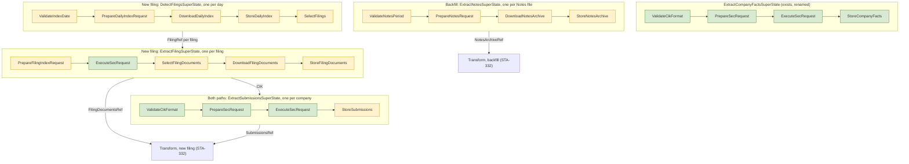

# Ingestion Paths: Extraction

> **Status:** draft for review, STA-328. Round 1 of 3. Round 2 designs the SEC fact model and the
> fact store (STA-331). Round 3 designs transform for both paths (STA-332).
>
> **Marks:** "Measured" means checked against the SEC website or a downloaded file on 2026-10-28.
> "Estimate" means not measured. "Proposed" means not yet accepted by the lead.

## Reading Guide

- [Sources](#sources) and [Extraction Overview](#extraction-overview) give the frame and the
  diagram. Read them first.
- [Backfill Extract](#backfill-extract) carries the decisions of the lead from 2026-10-28. The
  subsection [Notes ZIP Findings](#notes-zip-findings) is new and changes three of them: the file
  name, the content type check, and the table parser.
- [New-Filing Extract](#new-filing-extract) is new and fully proposed. It needs the most scrutiny.
- [Calling the Machines](#calling-the-machines) and the ingestion mode in the metadata are new and
  decided.
- [Raw Store](#raw-store), [Handover to Transform](#handover-to-transform),
  [Deployment](#deployment), and [Implementation Tickets](#implementation-tickets) are new and
  proposed.
- [Open Questions](#open-questions) lists what the lead must decide.

## Sources

The MVP decisions (STA-284) chose these SEC sources:

| Source | Path | Use |
| ------ | ---- | --- |
| Financial Statement and Notes files | Backfill | All values of all filings since 2009, with dimensions |
| XBRL instance and `_lab.xml` of each filing | New filing | The values and the company labels of one new filing |
| `submissions` JSON | Both | Company data: name, SIC code, tickers, former names |
| `companyfacts` JSON | Neither | Cross-check only. It drops every value with a dimension. |

The pipeline extracts only `companyfacts` today. `ExtractSuperState` runs `ValidateCikFormat` →
`PrepareSecRequest` → `ExecuteSecRequest` → `StoreCompanyFacts`
(`sec/src/lib/implementations/states/extract/`).

## Extraction Overview

Each path has its own extract SuperStates. One machine handles one unit of work: one Notes file,
one filing, or one company. A binary loops over the units with `join_all`, as `stream_extract`
loops over CIKs today. Fork and join replaces the loops later (STA-329).



Green states exist today. `PrepareSecRequest` is reused with a new `SecRequestType` variant.
Yellow states are new.

### Ingestion Mode

Each run has an ingestion mode: `backfill` or `incremental`. The backfill runs in mode `backfill`.
The new-filing path runs in mode `incremental`. In `sec`, an enum `IngestionMode` holds the two
values.

### Calling the Machines

One facade, `Extraction`, builds every extract SuperState. Decided by the lead on 2026-10-28. The
first call picks the ingestion mode. The second call picks the source. A typestate builder then
asks for the inputs of that source:

```rust
Extraction::backfill().notes().period(p).sec_client(c).repository(r).build()
Extraction::backfill().submissions().cik(cik).sec_client(c).repository(r).build()
Extraction::incremental().daily_index().date(d).sec_client(c).repository(r).build()
Extraction::incremental().filing().filing_ref(f).sec_client(c).repository(r).build()
Extraction::incremental().submissions().cik(cik).sec_client(c).repository(r).build()
```

- `backfill()` offers only `notes()` and `submissions()`. `incremental()` offers only
  `daily_index()`, `filing()`, and `submissions()`. A call such as
  `Extraction::incremental().notes()` does not compile.
- Each `build()` returns the concrete SuperState, for example `ExtractNotesSuperState`. There is no
  generic SuperState.
- The facade passes the ingestion mode to the SuperState. The store state writes it into the
  metadata of each raw document. See [Raw Store](#raw-store).
- `companyfacts` stays outside the facade. It is a cross-check only.

## Backfill Extract

### Shape

One state machine handles one Notes file. It mirrors the `companyfacts` machine:

| Today (`companyfacts`) | Backfill (Notes) |
| ---------------------- | ---------------- |
| One machine = one CIK | One machine = one Notes file |
| The run loops over the `CIKS` list with `join_all` | The run loops over a list of Notes periods, with a cap on files in flight |
| `ValidateCikFormat`: raw string → `Cik` | `ValidateNotesPeriod`: raw string → `NotesPeriod` |
| `SecRequest::builder().all_company_facts().cik(cik).build()` | `SecRequest::builder().notes_file().period(period).build()` |
| `ExecuteSecRequest` reads a JSON body | `DownloadNotesArchive` reads a binary body of up to 0.85 GB |
| `StoreCompanyFacts` writes `sec/companyfacts/CIK##########.json` | `StoreNotesArchive` writes `sec/notes/<file name>` |

A separate REFACTOR renames the existing `ExtractSuperState` to `ExtractCompanyFactsSuperState`.

### States

1. `ValidateNotesPeriod` parses a raw string such as `2024q1` or `2025_10` into a `NotesPeriod`.
2. `PrepareNotesRequest` builds `SecRequest::builder().notes_file().period(p).build()`.
3. `DownloadNotesArchive` sends the request and reads the whole body into memory. It runs the
   transport checks of [Validation](#validation), layer 1.
4. `StoreNotesArchive` writes the bytes as a `RawDocument<RawNotesArchive>` and outputs a
   `NotesArchiveRef`.

### `NotesPeriod`

`NotesPeriod` is a domain type in `sec/src/lib/shared/`. It holds either a quarter (year and
quarter) or a month (year and month).

- Quarters run from 2009q1 to 2025q3. Months run from 2025_10 onward. Measured on the SEC page.
- Construction rejects a quarter after 2025q3, a month before 2025_10, and a year before 2009.
- `NotesPeriod::file_name()` returns the SEC file name. See [File Names](#file-names).
- `xbrl::core::quarter::Quarter` (Q1 to Q4) can hold the quarter part. `sec` already depends on
  `xbrl`. The month part needs its own type.

The 2009q1 file holds the table headers and no rows (SEC readme, section 2). The run keeps it in
the list, because it tests the empty case at the cost of one request of 28 KB.

### File Names

The URL is `https://www.sec.gov/files/dera/data/financial-statement-notes-data-sets/` plus the file
name. Measured: all 79 links on the SEC page use this prefix.

Most file names follow the period: `2024q1_notes.zip`, `2025_10_notes.zip`. Three do not:

| Period | Linked file (Last-Modified) | File the pattern gives (Last-Modified) |
| ------ | --------------------------- | -------------------------------------- |
| 2010q1 | `2010q1_notes_1.zip` (2024-09-25) | `2010q1_notes.zip` (2020-12-22) |
| 2010q2 | `2010q2_notes_0.zip` (2024-09-25) | `2010q2_notes.zip` (2020-12-22) |
| 2010q3 | `2010q3_notes_0.zip` (2024-09-25) | `2010q3_notes.zip` (2020-12-22) |

Both names return HTTP 200, so the pattern downloads an old version of the data without an error.
So `NotesPeriod::file_name()` reads a table of overrides in `constants.rs`. A unit test
asserts all 79 names against the list measured on 2026-10-28.

Proposed: if the SEC adds a suffix to another file later, the run downloads the old version. A
later improvement can compare the list with the SEC page.

### Request

- `SecRequestType` gets a second variant next to `FetchAllCompanyFacts { cik }`:
  `FetchNotesFile { period: NotesPeriod }`.
- The builder gets the same typestate pattern. `notes_file()` returns `NotesFileBuilder<NoPeriod>`.
  `.period(p)` returns `NotesFileBuilder<NotesPeriod>`. Only that type has `build()`.

### Download

The run downloads the whole file, not HTTP range reads.

- The SEC limit counts requests, not bytes. A whole file is one request.
- STA-284 downloaded all 79 files in 14 minutes, about 32 MB/s. The session of 2026-10-28
  downloaded `2024q1_notes.zip` (619 MB) in 25 seconds.
- A local file can seek, so the `zip` crate reads it directly.

The download goes through the existing layers: `SecRequest` → `SecClient` → `InnerClient`.
`SecResponse` parses its body as JSON, so it cannot hold a ZIP. `SecClient` gets a sibling method
next to `execute_sec_request`:

```rust
async fn download_sec_file(&self, request: Self::Request) -> Result<SecFile, Self::Error>;
```

`SecFile` holds the URL, the headers, the content type, the status code, the bytes, and their
SHA-256. The new-filing path uses the same method for XML files and the daily index.

### Storage

- `StoreNotesArchive` reuses `FilesystemRepository` and `RawDocument` unchanged. The key is
  `sec/notes/<file name>`, for example `sec/notes/2024q1_notes.zip`.
- The repository writes temp files and renames them. If the stored pair matches the new bytes, it
  skips the write. If the bytes differ, the new bytes replace the old.
- The files live on the Cloud Storage bucket mounted into the Cloud Run job. The states read the
  ZIP from there.
- Storing all 79 files takes 27.7 GB, under $1 a month (estimate).

To check during implementation:

- How the mount handles a large write before upload. It can stage the file locally, and on Cloud
  Run local disk counts as memory.
- The read speed of the ZIP through the mount.
- A rename on the mount is not atomic.

### Memory and the Cap on Files in Flight

The rate limiter limits requests per second. It does not limit downloads in flight, so it does not
bound memory. The run caps the Notes files in flight at 2, with `buffer_unordered(2)` instead of
`join_all`.

Each file in flight holds its bytes once in memory. The largest file is 0.85 GB. Two files need
about 3 to 4 GB (estimate, measure it with the `performance` skill).

### Archive Metadata

- The repository records the size and SHA-256 of the whole file, as for every raw document.
- The table list from the ZIP index (name, sizes, CRC-32) goes into the output of the first
  transform state, which opens the ZIP anyway. A SHA-256 per table needs every table unzipped.

### Notes ZIP Findings

Measured on 2026-10-28 against `2024q1_notes.zip`, `2012q1_notes.zip`, and `2026_09_notes.zip`,
and the SEC readme (`https://www.sec.gov/files/aqfsn_1.pdf`).

**Transport.** `2024q1_notes.zip` returned HTTP 200 with `Content-Type: application/octet-stream`,
not `application/zip`. `Content-Length` was 619,443,584 and equaled the bytes received. Every
Notes file checked with `HEAD` returned `application/octet-stream`.

**Members.** Each ZIP holds ten members, all compressed with deflate (method 8):

| Member | Zipped 2024q1 | Unzipped 2024q1 | Rows 2024q1 | Content |
| ------ | ------------- | --------------- | ----------- | ------- |
| `sub.tsv` | 1.6 MB | 7.4 MB | 24,364 | One row per filing: `adsh`, CIK, form, period, filed date, SIC |
| `tag.tsv` | 27.7 MB | 189.0 MB | 1,012,939 | Tag metadata and labels |
| `dim.tsv` | 32.7 MB | 102.3 MB | 703,169 | Dimension hash to segments |
| `num.tsv` | 134.7 MB | 1,423.5 MB | 9,101,360 | Numeric values |
| `txt.tsv` | 298.2 MB | 1,290.2 MB | 1,443,193 | Text values |
| `ren.tsv` | 15.1 MB | 123.2 MB | 519,609 | Rendering of each report |
| `pre.tsv` | 100.2 MB | 799.2 MB | 6,279,813 | Position of each value in the statements |
| `cal.tsv` | 9.2 MB | 117.4 MB | 878,377 | Calculation relationships |
| `readme.htm` | under 0.1 MB | 0.3 MB | | The readme |
| `notes-metadata.json` | under 0.1 MB | 0.1 MB | | Table schema in the W3C CSVW format |

Total for 2024q1: 0.619 GB zipped, 4.052 GB unzipped. The readme names the tables with `.txt`. The
files use `.tsv`.

**Headers.** The column headers of all eight tables are identical in 2012q1, 2024q1, and 2026_09.
The SEC regenerated the 2012q1 file on 2024-09-20, so this result does not prove that the format
never changed. `notes-metadata.json` lists the columns, their types, and the primary key of each
table.

**Quoting.** A field can be in double quotes and hold a tab. Two rows of `dim.tsv` in 2024q1 do
this. A split on every tab reads them with 4 fields instead of 3. A reader that follows the CSVW
default dialect (tab delimiter, `"` as quote) reads all rows of all eight tables in 2024q1 with the
expected field count. No field holds a newline. No line ends with CRLF. All tables decode as
UTF-8.

**Content of `sub.tsv`.** 2024q1 holds 24,364 filings of 6,587 companies, filed from 2024-01-02 to
2024-03-29. The most common forms are 8-K (16,272), 10-K (3,987), and 10-Q (1,044). The column
`instance` names the XBRL instance file of each filing, for example `ae-20240221_htm.xml`.

**Publication.** The SEC page reads "January 2009 - September 2026". The page text says that the
SEC updates the data sets monthly since November 2020. The file list still has quarterly files up
to 2025q3 and monthly files from 2025_10. Filings after 5:30 PM Eastern on the last day of the month go
into the next file. The Last-Modified dates of recent monthly files:

| File | Last-Modified |
| ---- | ------------- |
| `2025_10_notes.zip` | 2025-12-01 |
| `2026_07_notes.zip` | 2026-08-05 |
| `2026_08_notes.zip` | 2026-09-08 |
| `2026_09_notes.zip` | 2026-10-07 |

A monthly file appears in the first 8 days of the next month, from three samples. The SEC also
replaces old files: `2025q3_notes.zip` has a Last-Modified of 2026-10-07, and `2024q1_notes.zip` of
2025-07-03. So a rerun of the backfill can download different bytes for the same period.

### Validation

Four layers, each in the state that first sees the data. Layers 1 to 3 fail the file. Layer 4
quarantines the row or the filing, and the file goes on.

1. **Transport**, in `DownloadNotesArchive`: HTTP 200, a content type of
   `application/octet-stream` or `application/zip`, and a byte count equal to `Content-Length`.
2. **Container**, in the first transform state: the bytes start with the ZIP signature `PK\x03\x04`,
   the ZIP index parses, all eight tables and `notes-metadata.json` are present, every member uses
   deflate, every member name has no path separator, and the unzipped size stays under a limit.
   Proposed limit: 16 GB unzipped per file, and 50 times the zipped size per member. Measured
   maximum ratio in 2024q1: 12.8 (`cal.tsv`).
3. **Table format**, in each read state: UTF-8, a quote-aware tab-separated reader, a header equal
   to the columns in `notes-metadata.json`, the same field count in every row, and the CRC-32 of
   the member.
4. **Row content**, in the map state: types and references between tables. Round 3 (STA-332)
   designs this layer.

### Tests

- Unit tests for `NotesPeriod`: the range limits, the parse of both forms, and all 79 file names.
- Unit tests for the builder: the URL of a quarterly file, a monthly file, and an override.
- State tests with a fake `SecClient` that returns a small ZIP fixture, as the `companyfacts`
  states do today.
- A fixture ZIP of a few KB with all ten members and one quoted field with a tab. It never holds
  real SEC data larger than a few rows.
- No test downloads from the SEC.

### Later Improvements

Out of MVP scope. Recorded in the MVP Data project, "Later: Notes download improvements":

- Skip and change detection with `HEAD` or a conditional `GET`.
- A completion marker instead of a rename.
- Streaming the download to the file instead of holding it in memory.

## New-Filing Extract

> **Proposed.** Not yet discussed with the lead.

### Detection

Proposed: read the EDGAR daily index `form.YYYYMMDD.idx` once a day, not the latest-filings feed
every 2 minutes.

| | Daily index | Latest-filings feed |
| - | ----------- | ------------------- |
| URL | `https://www.sec.gov/Archives/edgar/daily-index/YYYY/QTRn/form.YYYYMMDD.idx` | `https://www.sec.gov/cgi-bin/browse-edgar?action=getcurrent&type=10-Q&output=atom` |
| Requests | 1 per day | 1 per poll and form, plus paging |
| Complete | Yes, all filings of the day | 100 entries per page at most |
| Gaps after an outage | None. Read the missed days. | Entries older than the feed window are lost. |
| Delay | The index of 2026-10-27 appeared at 02:16 UTC on 2026-10-28 | Minutes |
| Format | Fixed-width text, `application/octet-stream` | Atom XML |

`DetectFilingsSuperState` runs `ValidateIndexDate` → `PrepareDailyIndexRequest` →
`DownloadDailyIndex` → `StoreDailyIndex` → `SelectFilings`.

The MVP has no requirement for a delay of minutes. The daily index needs no cursor, and a missed
day needs only a rerun for that date. The feed can come later for a shorter delay, and the daily
index then fills its gaps.

Rows for the selected forms, measured: 77 on 2026-10-27, 197 on 2026-03-02, and 295 on
2026-08-10. Other peak days are not measured. A day without filings, such as a
weekend, has no index file, and the SEC returns 404. `DownloadDailyIndex` treats a 404 as "no
filings that day", not as a failure.

### Filing Selection

`SelectFilings` keeps the rows whose form is 10-K, 10-Q, 20-F, or 40-F, or an amendment of one of
them (`/A`). Decided by the lead on 2026-10-28. The form list is a constant. Foreign filers of
20-F and 40-F can report in IFRS, and transform must handle this taxonomy (STA-332). It outputs one
`FilingRef` per kept row:

```rust
pub struct FilingRef {
    cik: Cik,
    accession_number: AccessionNumber,
    form: Form,
    filed_date: NaiveDate,
}
```

`AccessionNumber` and `Form` exist in `sec/src/lib/shared/financial/`.

### Fetch of Each Filing

One `ExtractFilingSuperState` runs per `FilingRef`. It sends three requests:

1. The folder index `https://www.sec.gov/Archives/edgar/data/<cik>/<accession without dashes>/index.json`.
   This is JSON, so `ExecuteSecRequest` reads it unchanged.
2. The XBRL instance.
3. The `_lab.xml` label file.

`SelectFilingDocuments` picks the two file names from the folder index:

- The instance is the member that ends in `_htm.xml`. If none exists, it is the one `.xml` member
  that is not `FilingSummary.xml` and does not end in `_cal.xml`, `_def.xml`, `_lab.xml`, or
  `_pre.xml`.
- The label file is the member that ends in `_lab.xml`.
- If a filing has no instance, the machine fails with an error that names the accession number.

Measured on one filing (`0000003545-26-000047`): the folder holds `alco-20260908_htm.xml` and
`alco-20260908_lab.xml`, both served as `text/xml`. The `instance` column of `sub.tsv` uses the
same names. The rule for older filings without inline XBRL is unverified.

`DownloadFilingDocuments` fetches both files with `SecClient::download_sec_file`. The files are
small (2.8 KB and 22.8 KB for this filing), so the run caps filings by the rate limiter only.

### Company Data

`ExtractSubmissionsSuperState` mirrors the `companyfacts` machine and reuses three of its states:
`ValidateCikFormat`, `PrepareSecRequest` with a new variant `FetchSubmissions { cik }`, and
`ExecuteSecRequest`. A new `StoreSubmissions` writes the JSON.

- URL: `https://data.sec.gov/submissions/CIK##########.json`. Measured: it holds `sic`,
  `sicDescription`, `name`, `tickers`, `exchanges`, `formerNames`, and the recent filings.
- New-filing path: one run per distinct CIK of the day's filings.
- Backfill: one run per distinct CIK in the selected filings. `sub.tsv` already holds the SIC code
  and the name at filing time, so the backfill needs `submissions` only for the current company
  data.

### Cut-Over Between the Paths

The last Notes file, `2026_09`, holds filings up to 2026-09-30. The backfill runs once, by hand, up
to the last published Notes file. Decided by the lead on 2026-10-28. Proposed: the new-filing path
starts at the daily index of 2026-10-01. A filing
after 5:30 PM Eastern on the last day of a month gets the filed date of the next business day
(unverified). If a filing reaches both paths, the fact store keys it by accession number
(STA-331).

## Raw Store

All documents use `FilesystemRepository` and `RawDocument<S>`. Each source gets its own
`RawSource` marker and `SecDocumentType` variant. Proposed for all rows except the first two:

| Document | `RawSource` marker | Document type | Key |
| -------- | ------------------ | ------------- | --- |
| Company Facts JSON | `RawCompanyFacts` | `raw_company_facts` | `sec/companyfacts/CIK##########.json` (exists) |
| Notes ZIP | `RawNotesArchive` | `raw_notes_archive` | `sec/notes/<file name>`, for example `sec/notes/2010q1_notes_1.zip` |
| Daily index | `RawDailyIndex` | `raw_daily_index` | `sec/daily-index/form.YYYYMMDD.idx` |
| XBRL instance | `RawXbrlInstance` | `raw_xbrl_instance` | `sec/filings/CIK##########/<accession>/instance.xml` |
| Label file | `RawXbrlLabels` | `raw_xbrl_labels` | `sec/filings/CIK##########/<accession>/lab.xml` |
| `submissions` JSON | `RawSubmissions` | `raw_submissions` | `sec/submissions/CIK##########.json` |

- The accession number in a key keeps its dashes, for example `0000003545-26-000047`.
- The instance and the label file get fixed names, so transform finds them without a listing.
  The metadata keeps the SEC file name in `requested_url`.
- The daily index is stored so that detection can run again without the SEC.
- A new fetch of `submissions` replaces the old file. The raw store holds the latest company data
  only. The same holds for a replaced Notes file.
- The metadata records the content type that the SEC sent, for example `application/octet-stream`
  for a Notes ZIP.

### Ingestion Mode in the Metadata

The metadata of each raw document records the ingestion mode of the run that created it, as
`"ingestion_mode": "backfill"` or `"ingestion_mode": "incremental"`. Decided by the lead on
2026-10-28. The key name is proposed.

- `ingestion_mode` is a run field in `DocumentMetadata`, next to `execution_id` and
  `produced_at`. `storage` holds it as a string, so `storage` does not depend on `sec`.
- `persist` leaves `ingestion_mode` out of the comparison, as it does with `execution_id` and
  `produced_at`. If a run stores the same bytes again, the write is skipped and the stored run
  fields stay.
- So the metadata names the run that created the document. `submissions` serves both modes. If
  `ingestion_mode` were part of the comparison, each run in the other mode would rewrite the file.
- Transform copies the mode onto each fact (STA-331).

## Handover to Transform

Each extract machine outputs a small reference, not the bytes. Transform reads the bytes from the
raw store.

```rust
/// Backfill: one stored Notes file.
pub struct NotesArchiveRef {
    period: NotesPeriod,
    key: DocumentKey,
    size: u64,
    sha256: Sha256Digest,
}

/// New filing: the two stored files of one filing.
pub struct FilingDocumentsRef {
    filing: FilingRef,
    instance_key: DocumentKey,
    labels_key: DocumentKey,
}

/// Both paths: the stored company data of one company.
pub struct SubmissionsRef {
    cik: Cik,
    key: DocumentKey,
}
```

`DetectFilingsSuperState` outputs a `Vec<FilingRef>`. The binary starts one
`ExtractFilingSuperState` per entry.

## Deployment

Proposed for MVP Operations. Both paths run as Cloud Run jobs with the bucket mounted, as
`stream_extract` does. Neither path needs a service.

| Path | Binary | Trigger | Size (estimate) |
| ---- | ------ | ------- | --------------- |
| Backfill | `notes_backfill` | By hand, once. Rerun by hand. | 4 to 8 GiB memory, task timeout of 1 hour |
| New filing | `daily_filings` | Cloud Scheduler, once a day at 07:13 UTC | 1 GiB memory, task timeout of 30 minutes |

- `daily_filings` reads the date from an environment variable. If it is unset, the job reads
  yesterday in Eastern time. A rerun for a missed day sets the variable.
- `daily_filings` runs the three new-filing machines in order: detection, then one filing machine
  per `FilingRef`, then one `submissions` machine per distinct CIK.
- `notes_backfill` runs the `submissions` machine for each distinct CIK after the Notes files.
- Both jobs share the SEC client, the User-Agent, and the storage root through
  `sec/src/bin/shared/`.

## Implementation Tickets

Each ticket fits one PR under 400 reviewable lines (estimate). Proposed. The order follows the
decision "backfill first".

Backfill:

1. REFACTOR: rename `ExtractSuperState` to `ExtractCompanyFactsSuperState`.
2. FEATURE (`storage`): the run field `ingestion_mode` in `DocumentMetadata`, left out of the
   comparison in `persist`.
3. FEATURE: `NotesPeriod`, with the range checks and the file names with overrides.
4. FEATURE: `SecRequestType::FetchNotesFile` and the builder `notes_file().period(p)`.
5. FEATURE: `SecFile` and `SecClient::download_sec_file`, with the transport checks of layer 1.
6. FEATURE: `RawNotesArchive`, its `SecDocumentType` variant, and `RawDocument::from_file`.
7. FEATURE: the states `ValidateNotesPeriod` and `PrepareNotesRequest`.
8. FEATURE: the state `DownloadNotesArchive`.
9. FEATURE: the state `StoreNotesArchive` and `NotesArchiveRef`.
10. FEATURE: `ExtractNotesSuperState`, its transitions, and its builder.
11. FEATURE: the facade `Extraction` with `backfill().notes()` and `IngestionMode`.
12. FEATURE: the binary `notes_backfill`, with `buffer_unordered(2)` over the Notes periods.

New filing and company data:

1. FEATURE: `FilingRef` and the parser for `form.YYYYMMDD.idx`.
2. FEATURE: the request variants `FetchDailyIndex`, `FetchFilingIndex`, `FetchFilingDocument`, and
   `FetchSubmissions`.
3. FEATURE: `RawDailyIndex`, `RawXbrlInstance`, `RawXbrlLabels`, and `RawSubmissions`.
4. FEATURE: `DetectFilingsSuperState` and its five states.
5. FEATURE: `SelectFilingDocuments`, the pick of the instance and the label file.
6. FEATURE: `ExtractFilingSuperState`, its other states, and `FilingDocumentsRef`.
7. FEATURE: `ExtractSubmissionsSuperState`, `StoreSubmissions`, and `SubmissionsRef`.
8. FEATURE: the facade calls `incremental()`, `daily_index()`, `filing()`, and `submissions()`.
9. FEATURE: the binary `daily_filings`.
10. FEATURE: the `submissions` run in `notes_backfill`.

MVP Operations owns the Cloud Run jobs and the schedule. These tickets are not in this list.

## Open Questions

For the lead:

1. Detection: the daily index once a day, or the latest-filings feed every 2 minutes (STA-284)?
2. Companies: all filers of the day, or a fixed list such as the `CIKS` of `stream_extract`?

Decided on 2026-10-28: the forms include 20-F and 40-F, the backfill runs once, by hand, the
`Extraction` facade, and `ingestion_mode` in the metadata.

Still open from the findings: GLEIF access, detail depth, the `-xbrl.zip` and the inline parser, and
amendments.
