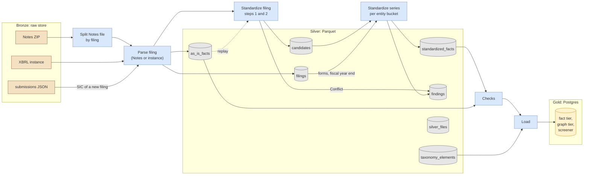

# Silver Layer

> **Status:** the owner decided three points on 2026-11-08. Silver uses plain Parquet with the
> `silver_files` list. `candidates` and `filings` are datasets of their own. The rest is proposed,
> for review by the lead. Inputs: the contract types and the transform
> integration of [`xbrl/DESIGN.md`](../../../xbrl/DESIGN.md), the raw store of
> [`ingestion_paths.md`](ingestion_paths.md), and the extraction of
> [`extraction_overview.md`](extraction_overview.md).
>
> **Marks:** "Measured" means checked on 2026-11-07 or 2026-11-08 against a downloaded SEC file. "Estimate" means
> not measured. "Decided" names a decision of the owner. Every other statement is a proposal.

Silver is the processed layer between the raw store (bronze) and Postgres (gold). This document
fixes what silver holds, in which format and layout, how provenance and time reach each row, and how
the transform fills it.

## Reading Guide

- [Layers](#layers) and [Fixed Inputs](#fixed-inputs) give the frame. Read them first.
- [Datasets](#datasets) is the data model. It holds two of the decisions of 2026-11-08.
- [Format and Table Layout](#format-and-table-layout) holds the decision of 2026-11-08 for plain
  Parquet with a file list, and the triggers to switch to a table format.
- [Units, Paths, and Replays](#units-paths-and-replays) and [Provenance](#provenance) describe how a
  write and a replay work.
- [Integrity Checks](#integrity-checks) lists how a job finds missing, stale, or wrong data.
- [Time and Duplicates](#time-and-duplicates) holds the read rules and the rule for company
  attributes over time.
- [Processing](#processing) gives the memory plan, the place of the state machine, and the sizing.
- [Open Points](#open-points) lists what this design leaves to other designs.

## Layers

| Layer | Content | Where | Written by |
| ----- | ------- | ----- | ---------- |
| Bronze | The SEC files, unchanged, each with a JSON metadata file | The raw store, a GCS bucket | Extract |
| Silver | As-is facts, filings, standardized facts, findings, and reference data, in Parquet | Its own GCS bucket | Transform, a Cloud Run job |
| Gold | The serving model of the screener and the `/v1` API | Supabase Postgres ([ADR 0001](../../../docs/adr/0001-mvp-database.md)) | Load, from silver |



Every write also adds rows to `silver_files`. The diagram leaves these edges out.

## Fixed Inputs

These decisions come from earlier designs. This design keeps them.

- Silver is the common destination of every source: the SEC now, ESEF and DART later. Silver makes
  no assumption about gold. Each load step reads what its gold target needs.
- Silver has an as-is layer, with no dedup, and a standardized layer, with dedup by named rules.
- The fact tier is append-only. "Newest filing wins" and "more precise wins" are rules of the
  standardized layer, not writes.
- Data checks gate publishing, not persisting. A failed check stops a load, not a silver write.
- The unit of transform is the filing. Two parsers, one output. Transform replays from the raw
  store ([Path Independence](ingestion_paths.md#path-independence)).
- `AsIsFact`, `Filing`, `StandardizedFact`, the value key, the rule IDs, and the dedup order come
  from [`xbrl/DESIGN.md`](../../../xbrl/DESIGN.md).

**Standing rule "Keep point-in-time open".** Every as-is fact and every filing row carries `filed`
and `accepted`. Silver keeps every filing of a fact side by side and overwrites no file. Company
attributes are columns of `filings`, one row per filing. Silver reads only the raw files that the
store holds today.

## Datasets

| Dataset | One row per | Source in bronze | Written by |
| ------- | ----------- | ---------------- | ---------- |
| `as_is_facts` | `AsIsFact` and its ingestion provenance | Notes `num.tsv`, `txt.tsv`, `dim.tsv`, or the instance | Parse filing |
| `filings` | `Filing`, with the company attributes as filed | Notes `sub.tsv` and `txt.tsv`, or the instance and `submissions` | Parse filing |
| `candidates` | Standardized candidate of one filing, blocked ones included | `as_is_facts` | Standardize filing |
| `standardized_facts` | `StandardizedFact` | `candidates` and `filings` | Standardize series |
| `findings` | `Conflict`, `Gap`, `Overlap`, `Restatement`, `SuspiciousPeriod`, `RollUpMismatch`, or `NegativeOther` finding | Both standardize steps | Standardize filing, standardize series |
| `taxonomy_elements` | Element of one taxonomy release | `Taxonomy::elements()` | A small job per release |
| `silver_files` | Written unit: its files, inputs, and run | Every write | Every writer, last |

No separate dataset holds companies, tickers, or names over time. These are columns of `filings`,
and a view builds the history (see [Company Attributes Over Time](#company-attributes-over-time)).
Labels of the taxonomy live in `taxonomy_elements`. The company labels of `lab.xml` stay out of
the MVP.

### Kinds of Values

Silver stores three kinds of values:

| Kind | Example | Where | Period columns |
| ---- | ------- | ----- | -------------- |
| Duration | Revenue of a quarter | `as_is_facts` | `period_end`, `quarters` of 1 or more, and `period_start` |
| Instant | Cash on the balance sheet date | `as_is_facts` | `period_end` is the date, `quarters` is 0, `period_start` is null |
| Company attribute | Name, ticker, exchange, industry code, fiscal year end | `filings` | None. A value holds from the `accepted` time of its filing until a later filing changes it |

- The key of a period is `period_end` and `quarters`. Notes `num.tsv` gives only these two
  (`ddate`, `qtrs`). The instance gives exact dates. So a Notes value and an instance value of the
  same period get the same key.
- `period_start` keeps the exact start of an instance value, for example a 52/53-week quarter or a
  stub period after a merger. It is null for Notes values and for instants.
- The period says which time a value describes. `accepted` says when the value became public. A
  restatement has the period of the original and a later `accepted` time.
- A ticker can change between two filings. Silver keeps the values as filed. A later design adds
  a daily table of current tickers from the SEC `company_tickers.json` file.

The column sketches below fix the shape. The Arrow types are a proposal for the prototype to
confirm. The value key of `xbrl/DESIGN.md` and the seven provenance columns below are the proposed
fields of the as-is fact model.

### `as_is_facts`

| Column | Arrow type | From |
| ------ | ---------- | ---- |
| `filing_id` | `utf8` | `AsIsFact::source.filing`, for example `sec:0000320193-26-000001` |
| `entity_scheme`, `entity_id` | `utf8`, `utf8` | `AsIsFact::context.entity` |
| `concept_family`, `concept_name` | `utf8`, `utf8` | `AsIsFact::concept` |
| `taxonomy_version` | `utf8`, nullable | `us-gaap/2026`, or the filing for an extension |
| `period_end` | `date32` | Exact end |
| `period_start` | `date32`, nullable | Exact start, if the source has it. Not a key field |
| `quarters` | `uint16` | 0 for an instant or a duration under about 45 days. Notes `qtrs` reaches 4,007 in `2024q1` (measured), so `uint8` is too small |
| `unit` | `utf8`, nullable | Canonical text, for example `USD/shares`. Null for text |
| `dimensions` | `list<struct<axis: utf8, member: utf8>>` | Sorted pairs, legal entity axis included |
| `value_kind` | `utf8` | `numeric`, `text`, or `nil` |
| `value_numeric` | `decimal128(38, 10)`, nullable | `FactValue::Numeric` |
| `value_text` | `utf8`, nullable | `FactValue::Text` |
| `decimals` | `int32`, nullable | `Decimals::Finite`. Null for text and for `Infinite` |
| `decimals_infinite` | `bool` | `Decimals::Infinite` |
| `copy_rank` | `uint16` | 0 for the first copy in one filing |
| `footnotes` | `list<utf8>` | |
| `filed` | `date32` | Filing date |
| `accepted` | `timestamp[ms, UTC]`, nullable | Acceptance time |

Ingestion provenance, on every row (see [Provenance](#provenance)):

| Column | Arrow type | Meaning |
| ------ | ---------- | ------- |
| `source_kind` | `utf8` | `notes` or `instance` |
| `source_key`, `source_sha256` | `utf8`, `utf8` | The raw document and its digest |
| `ingestion_mode` | `utf8` | `backfill` or `incremental`, from the raw metadata |
| `transform_version` | `utf8` | Version of the parser output, see [Units, Paths, and Replays](#units-paths-and-replays) |
| `execution_id` | `utf8` | The run that wrote the row |
| `loaded_at` | `timestamp[ms, UTC]` | The time of the write |

- The value key is `filing_id`, `concept_family`, `concept_name`, `taxonomy_version`, `period_end`,
  `quarters`, `unit`, `dimensions`, and `copy_rank`. The key is unique within one filing and one
  source document. The parser makes it unique by numbering the copies.
- A filing that arrives on both paths has two sets of rows, one per `source_kind`. Silver keeps
  both. A read takes the instance (see [Current Facts](#current-facts)).
- `decimal128(38, 10)` holds 28 digits before the point. In `num.tsv` of `2025q3`, a value has at
  most 24 digits before the point and 4 after it (measured). The prototype checks the instance
  values, which Notes rounds to 4 places.

### `filings`

The owner decided on 2026-11-08 that `filings` stays a dataset of its own, not columns on
`as_is_facts`. The company history reads about 250 rows per company over 70 quarters (estimate)
instead of every fact. The provenance of an attribute sits in one row per filing.
`Filing` and `AsIsFact` are separate types in `xbrl`.

| Column | Arrow type | From |
| ------ | ---------- | ---- |
| `filing_id`, `entity_scheme`, `entity_id` | `utf8` | `Filing` |
| `form`, `is_amendment` | `utf8`, `bool` | `10-K/A`, true |
| `filed`, `accepted` | `date32`, `timestamp[ms, UTC]` nullable | |
| `period_of_report` | `date32` | |
| `fiscal_year`, `fiscal_period` | `int16`, `utf8`, both nullable | As filed. Filled for 10-K, 10-Q, 20-F, and 40-F, mostly empty for other forms, see [Company Attributes Over Time](#company-attributes-over-time) |
| `company_name` | `utf8`, nullable | `Filing::company.name`: `sub.tsv` `name`, or `dei:EntityRegistrantName` |
| `industry_scheme`, `industry_code` | `utf8`, `utf8`, both nullable | `Filing::company.industry`: scheme `sic` with `sub.tsv` `sic`, or `submissions` `sic`. Another source writes its own scheme, for example `nace` |
| `tickers` | `list<struct<symbol: utf8, exchange: utf8 nullable>>` | `dei:TradingSymbol` and `dei:SecurityExchangeName`, one entry per share class |
| `fiscal_year_end_raw` | `utf8`, nullable | `0930` from `sub.tsv`, or `--09-27` from the instance |
| `fiscal_year_end_month` | `uint8`, nullable | The month of the nearest month end, see below |
| `sic_source_key`, `sic_source_sha256`, `sic_retrieved_at` | `utf8`, `utf8`, `timestamp[ms, UTC]`, nullable | The `submissions` file of a new filing. Null for a Notes filing |
| Ingestion provenance | as in `as_is_facts` | The raw document of the filing |

- Every attribute names its raw document. The name, the ticker, and the fiscal year end come from
  the raw document of the row. The SIC of a new filing comes from `submissions`, so it has its own
  three columns. The URL and the retrieval time of each raw document sit in `silver_files`.
- The raw store keeps one version of `submissions`. A later fetch replaces the bytes that
  `sic_source_sha256` names. This gap stays until the raw store keeps versions.

### `candidates`

One row per standard concept and filing, from steps 1 and 2 of the dedup order in
[`xbrl/DESIGN.md`](../../../xbrl/DESIGN.md#4a-transform-integration). The columns are those of
`standardized_facts` without `restated`, plus `filing_id`, `filed`, `accepted`, `decimals`, `blocked`,
and `entity_bucket`. Step 3 needs `decimals` to tell a restatement from a repeated comparative. A blocked candidate has a null `value` and a null `confidence`. Its `rule` names
the rule that picked the conflicting concept.

The owner decided on 2026-11-08 that `candidates` stays a dataset of its own. When a new filing arrives,
the series step runs again over every filing of the entity. It reads about 50 candidate rows per
past filing instead of about 1,000 as-is rows, and it does not run steps 1 and 2 again.

Inside a `candidates` part, rows sort by `entity_bucket`, then by `filing_id`. The writer starts a
new row group at each change of `entity_bucket`, so a series task reads only the row groups of its
bucket, by their statistics.

### `standardized_facts`

| Column | Arrow type | From |
| ------ | ---------- | ---- |
| `entity_scheme`, `entity_id` | `utf8` | |
| `concept` | `utf8` | `CanonicalElement`, for example `Revenue` |
| `period_end`, `period_start`, `quarters`, `dimensions` | as in `as_is_facts` | Dimensions are empty in the MVP |
| `unit` | `utf8` | `StandardizedFact::unit`, never null |
| `value` | `decimal128(38, 10)` | |
| `confidence` | `utf8` | `Exact`, `Synonym`, `Derived`, or `Computed` |
| `rule` | `utf8` | `RuleId`, for example `us-gaap/alias/revenue@1` |
| `release_id`, `release_checksum` | `utf8`, `utf8` | `TaxonomyRelease` |
| `inputs` | `list<struct<FactKey>>` | The value keys of the as-is facts, with every key field |
| `restated` | `bool` | |
| `change` | `utf8` | `new`, `changed`, or `removed` against the current value of the key |
| `computed_at` | `timestamp[ms, UTC]` | The start time of the series run that computed the row |
| Run columns | `transform_version`, `execution_id`, `loaded_at` | |

`concept` holds the variant name of `CanonicalElement`, such as `NetIncome`, never the label of
`Display`. Silver stores no "other" line and no statement layout. The roll-up tree of
`xbrl/DESIGN.md`, "Roll-Up Tree", computes both at read time.

`standardized_facts` is append-only, see [Series Deltas](#series-deltas). The key of a row is the
entity, `concept`, `period_end`, `quarters`, `unit`, and `dimensions`. The current value of a key is
its row with the latest `computed_at`, unless that row has `change` = `removed`.

### `findings`

| Column | Arrow type | Meaning |
| ------ | ---------- | ------- |
| `kind` | `utf8` | `Conflict`, `Gap`, `Overlap`, `Restatement`, `SuspiciousPeriod`, `RollUpMismatch`, or `NegativeOther` |
| `entity_scheme`, `entity_id` | `utf8` | |
| `concepts` | `list<utf8>` | The as-is concept, and the standard concept if a plug-in maps it. For `RollUpMismatch` and `NegativeOther`, the standard concepts of the group: the parent first, then the start of a step, then the other members in the order of the tables of `xbrl/DESIGN.md`, "Roll-Up Tree". For the balance sheet identity: `Assets`, then `LiabilitiesAndEquity` |
| `periods` | `list<struct<period_end: date32, quarters: uint16>>` | Sorted by `period_end`, then `quarters` |
| `reason` | `utf8`, nullable | For example `FiscalYearChange` or `Conflict`. For `SuspiciousPeriod`, the signals in the order of `PeriodSignal`, separated by `,`, for example `StartBeforeEarliestYear,EndFarFromReport`. For `RollUpMismatch` and `NegativeOther`, the name of the group of the roll-up tree, for example `liabilities`, or `balance-sheet` for the balance sheet identity |
| `filing_id` | `utf8`, nullable | Set for `Conflict` and `SuspiciousPeriod` |
| `confirmed_by` | `utf8`, nullable | For `SuspiciousPeriod`: the newest other filing that reports the same value for a plausible period |
| `confidence` | `utf8`, nullable | For `RollUpMismatch` and `NegativeOther`: the weakest confidence of the inputs of the check, for example `Synonym`. Null for the other kinds |
| `step` | `utf8` | `filing` or `series` |
| `change` | `utf8`, nullable | `new`, `changed`, or `resolved` for a series row. Null for a filing row |
| `computed_at` | `timestamp[ms, UTC]`, nullable | The start time of the series run. Null for a filing row |
| Run columns | `transform_version`, `execution_id`, `loaded_at` | |

The key of a finding is `kind`, the entity, `concepts`, `periods`, and `filing_id`, for a filing
row and for a series row. The series rows of `findings` are append-only like `standardized_facts`. A null `filing_id` matches a
null `filing_id` (`IS NOT DISTINCT FROM`). A finding is open from its
`new` row until a later `resolved` row of the same key. A `changed` row records a new `reason`, a new
`confirmed_by`, or a new `confidence` of an open finding.

A dataset, not a report, for three reasons:

- The checks read findings with the same reader as facts.
- A report is a query over the dataset. A dataset is not a query over a report.
- Silver keeps every finding of every run, with the time it opened and resolved.

The standardize filing step writes `Conflict`. The series step writes `Gap`, `Overlap`,
`Restatement`, and `SuspiciousPeriod`, and copies each `Conflict` of the entity, as `xbrl/DESIGN.md`, "Gap Check", asks. A
read of the report takes the rows with `step = series`.

### `taxonomy_elements`

One row per release and element: `release_id`, `release_checksum`, `concept_family`,
`concept_name`, `label`, `data_type`, `balance`, `period_type`, and `retired_in` (nullable, for
the retired elements of option C in
[`xbrl/DESIGN.md`](../../../xbrl/DESIGN.md#releases-over-time)). One file per release.

### `silver_files`

The list of written units. Readers find the current files through it, and it holds the lineage.

| Column | Arrow type | Meaning |
| ------ | ---------- | ------- |
| `dataset` | `utf8` | For example `as_is_facts` |
| `schema_version` | `uint16` | Version of the dataset schema |
| `source` | `utf8`, nullable | `notes` or `instance`. Null for the series datasets and `taxonomy_elements` |
| `unit_kind`, `unit_key` | `utf8`, `utf8` | See [Units, Paths, and Replays](#units-paths-and-replays) |
| `input_digest` | `utf8` | SHA-256 over the sorted list of input keys and digests |
| `inputs` | `list<struct<key, sha256, requested_url, produced_at>>` | Each raw document or silver file read |
| `transform_version` | `utf8` | |
| `files` | `list<struct<path: utf8, bytes: uint64, crc32c: utf8, row_count: uint64>>` | The Parquet files of the unit, in the order of the part number `<n>`, with the size and CRC32C of each object as GCS stores them |
| `row_count` | `uint64` | Rows of the unit, the sum over `files` |
| `source_rows` | `list<struct<table: utf8, rows: uint64>>` | Rows of each input table that maps row to row, counted once per unit: `num.tsv` and `txt.tsv` for `as_is_facts`, `sub.tsv` for `filings`. Under option B, the first pass counts every row of the table, not the rows of its bucket. A `filing_day` unit has two entries. For `as_is_facts`, `instance_facts` counts the elements with a `contextRef`, in a pass separate from the parser. For `filings`, `instances` counts one row per instance. Empty for the other datasets |
| `split` | `utf8`, nullable | `stream` or `buckets` for a `notes_file` unit, see [Unit of Work and Memory](#unit-of-work-and-memory). Null otherwise |
| `dropped_rows` | `list<struct<reason: utf8, rows: uint64>>` | Rows the parser dropped on purpose, by reason, for example exact duplicates |
| `content_digest` | `utf8` | SHA-256 over the list of digest group IDs and digest group hashes, sorted by digest group ID. A digest group is one filing, or the key that the list below names for rows without `filing_id`. A digest group hash is the SHA-256 over the rows of the digest group, sorted by the row key below. Each row enters in a fixed byte form, without `execution_id`, `loaded_at`, and `computed_at`. So the split, the bucket count, and the parts do not change the digest. The transform code prints the values, not the Arrow crate. An Arrow upgrade then leaves the digest as it is. The silver writer feature fixes the exact form, and a test pins it to `transform_version` |
| `computed_at` | `timestamp[ms, UTC]`, nullable | The start time of the series run, for a series unit. Null otherwise |
| `run_tasks` | `uint16`, nullable | The task count of the series run, for a series unit. Null otherwise |
| `execution_id`, `ingestion_mode`, `written_at` | `utf8`, `utf8`, `timestamp[ms, UTC]` | The job that wrote the unit. `ingestion_mode` here is the mode of the job. The `ingestion_mode` column of a data row is the mode of its raw document |

The row key of `content_digest`, by dataset:

- `as_is_facts`: the value key.
- `filings`: `filing_id`.
- `candidates`: `filing_id`, then `concept`.
- `standardized_facts` and `findings`: the key in the section of the dataset. A row without
  `filing_id` falls in the digest group of its entity.
- `taxonomy_elements`: the digest group is the release. Rows sort by `concept_family`, then by
  `concept_name`.

## Format and Table Layout

### File Format

| Option | Pro | Con |
| ------ | --- | --- |
| A. Parquet for every dataset (chosen) | Typed columns, column pruning, row-group statistics. Polars, DuckDB, and the Supabase DuckDB wrapper read it | Binary, needs a tool to read |
| B. JSON lines | Readable as text, no schema | No types for decimals and dates. About 10 times larger than Parquet. No column pruning |
| C. Parquet with a JSON sidecar per file | Sidecar readable as text, like bronze | Two objects per write, no atomic pair. The Parquet footer already holds key-value metadata |

Parquet for every dataset, because every dataset is a table. One format means one reader, one
writer, and one schema check. The footer of each file holds `dataset`, `schema_version`,
`unit_key`, and `transform_version` as key-value metadata, so a file names itself without a
sidecar.

Measured on the Notes file `2025q3` (see [Measurements](#measurements)): `num.tsv` holds 1,188.6
MB of text. Typed and sorted by filing, it writes to 59.9 MB of Parquet with zstd. Seven provenance
columns with one value per file add 0.39%. `txt.tsv` writes 954.6 MB of text to 131.4 MB.

### Plain Parquet or a Table Format

| Option | Pro | Con |
| ------ | --- | --- |
| A. Plain Parquet files and the `silver_files` list (decided) | No new dependency next to Polars. The list is a Parquet dataset itself. A unit becomes visible with one write | No transaction over many files. Each reader must read the list. Compaction and file removal need code of our own |
| B. Delta Lake through `delta-rs` | Transaction log, snapshots by version and time, `OPTIMIZE` and `VACUUM` | `deltalake` pins its own Arrow version, so it and Polars must agree on one. Concurrent writers on GCS need the conditional-write support of the object store |
| C. Apache Iceberg through `iceberg-rust` | Open standard, snapshots, hidden partitions, the Supabase Iceberg wrapper | Needs a catalog service. The Rust writer covers less than the Java one. The epic lists Iceberg as out of scope, and ADR 0001 adds Iceberg only next to Postgres, past about 50 GB |

Decided by the owner on 2026-11-08: A. Two reasons:

- **Time travel needs no table snapshot.** A point-in-time read filters on `accepted`, which every
  row carries. "What silver held at time T" filters `silver_files` on `written_at`, or, for the series
  datasets, the rows on `computed_at`. Both work with
  plain files.
- **Writes are units, not row updates.** Silver never updates a row. Each write adds a whole unit,
  and the `silver_files` row makes the unit visible. That is the one transaction silver needs.

Move to B when one of these holds:

- Two jobs must write one dataset at the same time with a shared commit.
- A reader needs a consistent snapshot over many units that `silver_files` cannot give.
- The file count makes the list slow to read.

The switch keeps the Parquet files and replaces the list with a Delta log. The epic records these
triggers, so a later design checks them.

## Units, Paths, and Replays

### The Write Unit

A unit is the smallest set of rows that one write adds, and that one replay writes again.

| Unit kind | `unit_key` | Rows | Inputs |
| --------- | ---------- | ---- | ------ |
| `notes_file` | The Notes period, for example `2024q1` | All filings of one Notes file | The Notes ZIP |
| `filing_day` | The filed date, for example `2026-11-06` | All new filings of one day | The instances of that day, and the `submissions` files they used |
| `series_base` | `base`, then the time of a new base, plus `-t<n>` for each task | The full series output of every entity | The current `candidates` and `filings` units |
| `series_delta` | The series run and the task, for example `2026-11-06T0600Z-t0` | The changed rows of one series run, for the buckets of one task | The `candidates` units written since the latest series run that counts, the units they replaced, the current `filings` units, and the current series rows of their entities |
| `release` | `us-gaap/2026` | The elements of one release | The vendored release |

A unit of the daily path holds one day, not one filing. One filing per unit gives about 90 files a
day per dataset ([Volume](extraction_overview.md#volume)). The text facts of one filing write to a
median of 7.4 KB of Parquet (measured). One day per unit gives one file a day per dataset. So the
daily path needs no compaction.

### Paths

```text
gs://<silver-bucket>/<dataset>/source=<notes|instance>/unit_key=<unit_key>/<digest>-v<transform_version>/<execution_id>-<attempt>/part-<n>.parquet
gs://<silver-bucket>/silver_files/execution=<execution_id>/task=<n>-<attempt>.parquet
```

- `<digest>` is the first 16 hex characters of `input_digest`.
- `<attempt>` is the attempt number of the Cloud Run task, with `-b` if the split switched to B. A
  retry writes to its own paths.
- The series datasets use `unit_key=<unit_key>` with no `source=` level.
- In a dataset, no column name equals a folder label of its own path: `source` or `unit_key` for
  every dataset except `silver_files`, and `execution` or `task` for `silver_files`. DuckDB reads a
  `name=value` folder as a column by default, and Polars, pyarrow, and BigQuery do so with Hive
  partitioning on. A folder label `unit` overwrote the `unit` column of every row in a DuckDB read
  (measured). A schema test of the silver writer checks this rule.
- Inside a file, except in `candidates`, rows sort by `filing_id`, then by the value key. Row groups hold about 100,000
  rows, so a read of one filing skips the other row groups by their statistics.

### Rules of a Write

1. The writer computes `input_digest` from its inputs.
2. If the current unit of the unit key has the same digest and transform version, the writer skips
   the write. An older unit with the same digest and version does not count. This mirrors the skip
   of the raw store.
3. Otherwise, the writer writes the Parquet files of the unit to their paths. Each object write
   sets the GCS precondition `ifGenerationMatch=0`, so a second write to one path fails.
4. The writer writes the `silver_files` row last, with the size and CRC32C that GCS returns for
   each file, and the counts and `content_digest` of the unit. A unit without a `silver_files` row
   does not exist for a reader.

So silver never writes to an existing path. A file is written once. Only the cleanup of unread
files below removes files. If an attempt fails
between steps 3 and 4, its files stay unread, because no `silver_files` row names them. A cleanup
can remove such files once no attempt of their execution runs.

### Replays

| Cause | Unit key | Digest | Version | Result |
| ----- | -------- | ------ | ------- | ------ |
| A rerun of the same run | same | same | same | Skipped |
| A parser fix | same | same | new | A new unit next to the old one |
| A Notes file that the SEC corrected | same | new | same | A new unit next to the old one |
| A late filing of a past day | same | new | same | A new unit with the whole day |
| A parser fix of a past day after a new fetch of `submissions` | same | new | new | A new unit. Its SIC values are those of the new fetch |
| A rollback to an earlier version or digest | same | old | old | A new unit, because step 2 compares with the current unit only |

- A unit key is the dataset, the source, the unit kind, and `unit_key`.
- The series datasets have no current unit per key: a read takes every `series_delta` of a run
  that counts, after the newest `series_base`. See [Series Deltas](#series-deltas). The rules below apply to the other
  datasets.
- The **current unit** of a unit key is the one with the latest `written_at`. A default read takes
  only current units. `written_at` gives the order of runs. Silver uses it only between units of
  one key, because they hold the same filings.
- **Every read takes its files from `silver_files`.** A data read never lists a dataset directory.
  A listing also returns the replaced units and the files of failed attempts: a listing of one
  Notes unit key returned twice its rows (measured). Rust code reads silver through one reader
  that takes its file list from `silver_files`. A view of the current units serves DuckDB and
  other analysis tools. A scheduled cleanup removes files that no `silver_files` row names, once
  no attempt of their execution runs (see [Rules of a Write](#rules-of-a-write)). Check 1 and the
  cleanup list objects on purpose. They read no data. This rule is the cost of plain Parquet: a
  Delta Lake or Iceberg log would list the current files.
- The old unit stays. A read "as silver held it at T" takes, per unit key, the latest unit written at
  or before T.
- So a replay replaces exactly the rows of its unit for a default read, and deletes nothing.
- `transform_version` changes only when the parser output changes. A golden test pins the output of
  the fixtures to the version. If the output changes and the version does not, the test fails.
- The raw store keeps one version of `submissions`. So a replay of a `filing_day` after a new fetch
  takes the SIC of the new fetch, and `sic_retrieved_at` shows it.

A Notes file that the SEC merged into a quarterly file has a new period, so it is a new unit key.
Both units stay current, and the same filing appears in both. A read takes the quarterly file, see
[Current Facts](#current-facts).

### Growth

Silver deletes no unit of any dataset. Each full replay of the backfill writes `as_is_facts`,
`filings`, and `candidates` again: about 15 GB of `as_is_facts`, plus the other two (estimate, see
[Cloud Run Sizing](#cloud-run-sizing)).

### Series Deltas

`standardized_facts` and the series rows of `findings` are append-only, like the as-is data. A
Parquet file cannot grow. So an append writes a new file of changed rows next to the old files.

- The first series run writes a `series_base` unit with every row, each with `change` = `new`. A
  new base writes each open finding again as a `new` row. The time a finding first opened is in
  the units before that base.
- A later run recomputes the entities of every `candidates` unit with a `written_at` after the
  latest `computed_at` in `silver_files` of a series run that counts. A unit written during a run
  is new for the next run too.
- A series run counts when `silver_files` holds `run_tasks` distinct `unit_key` values with its
  `execution_id`. Until then, no read takes its units, and the run does not move the recompute
  point. A retry of a task can add a second unit with the same key. A read takes, per `unit_key`
  of a run, only the unit with the latest `written_at`.
- Each task writes its unit and its `silver_files` row, also if no row changed. A unit with no
  changed row has `row_count` 0 and no Parquet file.
- The run also recomputes the entities of each `candidates` unit that a new unit replaced. So an
  entity that a replay drops gets `removed` rows.
- The run reads the current series rows of these entities, compares, and writes only the rows
  that differ to a `series_delta` unit, with `change` = `new`, `changed`, or `removed`. The run
  does not write unchanged rows again.
- A `removed` row copies every column of the row it removes, and sets `change` and `computed_at`.
  A query that reads values must drop rows with `change` = `removed`.
- `computed_at` is the start time of the series run. "After" in the rules below means a later
  `computed_at`.
- A read of the current values takes the newest `series_base` of a run that counts, and every
  `series_delta` of a run that counts after it. It keeps the row with the latest `computed_at` per
  key.
- A read "as silver held it at T" takes the same units, limited to runs with `computed_at` on or
  before T. So it reaches back to the first series run, across every new base. A run in progress
  at T enters in full once it counts. So a read as of T can change until every run that started
  before T has ended.
- A `series_base` run and a `series_delta` run never overlap. The job plan of the transform design
  enforces it.
- One series task writes one delta unit per run, sorted by entity bucket. A daily run touches a few
  dozen entities, so it uses one task (estimate).
- If a run changes most rows, for example after a new `transform_version` of a rule, it writes a new
  `series_base` instead of a delta. This adds the full series size again, about 0.3 GB or more
  (estimate). Older units stay.

The deltas are small, because a day changes the series of a few dozen entities: their new periods,
restated values, and derived values (estimate). The prototype measures the size of a daily delta.

## Provenance

| Option | Pro | Con |
| ------ | --- | --- |
| A. Columns on every row | A row names its source with no join. Rule 5 of Path Independence asks for it | Repeats the same values on many rows |
| B. Per file, in a sidecar or the footer | No repetition | A row loses its source once it leaves its file, for example in a query result |
| C. A lineage table keyed by the source document | URL, retrieval time, and inputs once per document | A row needs a join to reach them |

Proposal: A and C together.

- **On every row:** `source_kind`, `source_key`, `source_sha256`, `ingestion_mode`,
  `transform_version`, `execution_id`, and `loaded_at`. Parquet stores each as one dictionary
  entry per file. The measured overhead is 0.39%.
- **In `silver_files`:** the URL, the retrieval time (`produced_at` of the raw metadata), and the
  inputs of each unit.

**Mode is a column, never a route.** No step branches on `ingestion_mode`. The source kind picks the
parser and the unit: a Notes ZIP goes to the Notes parser and a `notes_file` unit, an instance to
the instance parser and a `filing_day` unit. The run that fetched the document does not change
this. Each row copies the mode
from the raw metadata of its own document, so no row mixes modes. A standardized fact reaches the
modes of its sources through `inputs`.

**Many raw documents in one file.** A `filing_day` unit holds the filings of many instances. Each
row keeps the key and the digest of its own instance, so its provenance does not depend on the
file. The dictionary of `source_key` then holds one entry per filing.

**Provenance of a standardized fact.** `inputs` lists the value keys of the as-is facts it came
from. A join on these keys reaches the as-is rows and their provenance.

## Integrity Checks

Bronze checks one document against the SHA-256 in its own metadata file. Silver has no metadata
file per Parquet file, so `silver_files` holds what the checks compare against. The integrity
check job of the raw store runs these checks too.

| Check | Finds | How | Cost |
| ----- | ----- | --- | ---- |
| 1. Files | A missing or corrupted Parquet file | For each unit, compare `bytes` and `crc32c` of each file in `files` with the object in GCS. GCS stores a CRC32C per object, so a listing gives both | One listing |
| 2. Coverage | A raw document with no current unit, or a unit read from older bytes | Join the raw metadata (key, SHA-256) with `inputs` of the current units | Small tables |
| 3. Row counts | Rows lost or doubled inside a unit of `as_is_facts` or `filings` | `source_rows` minus `dropped_rows` must equal `row_count`, and `row_count` must equal the rows in the Parquet footers. The derived datasets map many rows to one, so they get no row count check | Footers only |
| 4. Rebuild | A wrong value, or a parser whose output changes from run to run | Run the transform again on the raw input with the same `transform_version`, and compare the `content_digest`. Skip a unit that check 2 reports as "source replaced". For the series datasets, check 4 samples a `series_base` only. Its rebuild reads the `candidates` and `filings` files that `inputs` of its `silver_files` row lists, not the current units. A `series_delta` depends on the series state before its run | One transform per unit, so a sample of units each week |

Lineage checks join the datasets:

- Every key in the `inputs` of a current series value exists in a current unit of `as_is_facts`.
- Every `filing_id` of `candidates` and `as_is_facts` exists in `filings`.

A failed check gives a row in a report. It changes no silver file.

Limit: the raw store keeps one version per key. If the SEC replaces a Notes file, or the daily path
fetches `submissions` again, a silver row can name a SHA-256 whose bytes are gone. Check 2 reports
the unit as "source replaced". No check can restore the old bytes.

## Time and Duplicates

### Append-Only

- Silver keeps every reported value, with its filing and its source document.
- Silver drops no reported value and overwrites no file. A replay adds a unit (see [Replays](#replays)).
- "Newest filing wins" and "more precise wins" are the rules `core/dedup/newest-filing@1` and
  `core/dedup/more-precise@1`. They run in the standardize steps or in a read, never in an as-is
  write.

### Time Axes

| Axis | Columns | Question |
| ---- | ------- | -------- |
| Period | `period_end`, `quarters`, `period_start` | Which period does the value describe? |
| Public time | `filed`, `accepted` | Since when was the value public? |
| Silver time | `loaded_at`, and `written_at` in `silver_files` | Since when did silver hold the value? |

Queries this allows:

| Query | Layer | How | History |
| ----- | ----- | --- | ------- |
| The latest value of a period | As-is | A view: dedup rules over all filings | Back to 2009 |
| The latest value of a period | Standardized | Read `standardized_facts` | Back to 2009 |
| The value as public on day D | As-is | A view: dedup rules over filings with `accepted` (or `filed`) on or before D | Back to 2009 |
| The value as public on day D | Standardized | Run the series step again on the `candidates` with `accepted` (or `filed`) on or before D. Tiers 3 and 4 run only in Rust, so no view gives it | Back to 2009 |
| The value as silver held it at time T | As-is | Current units as of T, then the dedup rules | From the first silver write |
| The value as silver held it at time T | Standardized | Base and deltas with `computed_at` on or before T | From the first series run |
| Every value ever reported for a period | As-is | No dedup | Back to 2009 |

The new-filing path stores `filed` only. A point-in-time read of a new filing uses `filed`, so it
is exact to a day, not to a minute.

### Same Value in Several Places

A value of one period can appear in many rows:

| Case | Example | Silver keeps | The read that picks one |
| ---- | ------- | ------------ | ----------------------- |
| Copies in one filing | One value at `decimals = -6` and at `0` | Every copy, with `copy_rank` | `core/dedup/more-precise@1` takes rank 0 |
| Repeated comparative | Q1 revenue in the Q1 10-Q and again in the next year's Q1 10-Q | Both rows | `core/dedup/newest-filing@1` takes the newer filing |
| Restatement | A 10-K/A with another value | Both rows | `core/dedup/newest-filing@1` takes the newer filing and sets `restated` |
| One filing on both paths | A Notes row and an instance fact | Both rows, with their `source_kind` | The instance, see [Current Facts](#current-facts) |
| One filing in two Notes files | A monthly file and its merged quarterly file | Both units | The quarterly file, see [Current Facts](#current-facts) |

The as-is read for one period uses the same order as the standardized layer:
`core/dedup/more-precise@1` per filing, then `core/dedup/newest-filing@1` across filings, on the
as-is concept instead of the standard concept.

### Current Facts

A filing can sit in more than one current unit: once per source, and in a monthly and a quarterly
Notes file after the SEC merges a quarter. Every read of `as_is_facts`, `filings`, and
`candidates` runs these steps, and keeps one unit per filing:

1. Take only current units (see [Replays](#replays)). A read "as silver held it at time T" takes
   the units current at T.
2. If an instance unit and a Notes unit both hold the filing, copy `accepted` from the Notes
   `filings` row. The copy goes onto the instance filing, its facts, and its `candidates` rows. If
   two Notes units hold the filing, take the row of the quarterly file.
3. A read "as public on day D" applies its filter now. So both sources of a filing pass the filter
   of day D on the same day.
4. If an instance unit holds the filing, take it.
5. Otherwise, take the unit of the quarterly Notes file over the unit of the monthly file.

The rule depends only on the source and the Notes period, never on the order of runs. A filing has
one filed date and sits in one month and one quarter, so the rule always leaves one unit.

- **Instance over Notes.** Both sources hold the same set of facts
  ([Measured Result](ingestion_paths.md#measured-result)). The instance keeps the units, the text,
  and the footnotes that Notes loses. The comparison recommended the same preference at write time
  (option 2 of [Path Independence](ingestion_paths.md#path-independence)). Silver keeps every
  copy, so the preference is a read (option 3).
- **Quarterly over monthly.** The SEC builds the quarterly file after the monthly files, and
  removes the monthly files at the merge (assumption A4 of
  [Cut-Over Between the Paths](ingestion_paths.md#cut-over-between-the-paths)).
- **Accepted time.** The instance path gives `filed` only, so step 2 takes `accepted` from Notes.
  This is the only value the read takes from the other source. Silver keeps the instance rows as
  they are.
- **`candidates`.** The same rule picks one `candidates` unit per filing, so the series step gets
  one candidate per filing and standard concept.

### Company Attributes Over Time

Every filing row holds its attributes as filed. A view builds the history:

- Order the filings of one entity by `accepted`, then `filed`, then `filing_id`.
- A row of the history starts at each filing where an attribute differs from the previous non-null
  value. Its valid-from time is the `accepted` (or `filed`) of that filing.
- Former names are the distinct `company_name` values of the history, with their valid-from times.
- The same view "as of D" takes the latest filing accepted on or before D.

Sources per path, as decided for the company data in
[`ingestion_paths.md`](ingestion_paths.md#company-data):

| Attribute | Notes path | New-filing path |
| --------- | ---------- | --------------- |
| Name | `sub.tsv` `name` | Instance, `dei:EntityRegistrantName` |
| SIC | `sub.tsv` `sic` | `submissions` `sic` on the day of the fetch |
| Ticker, exchange | `txt.tsv`, `dei:TradingSymbol`, `dei:SecurityExchangeName` | Instance, same tags |
| Fiscal year end | `sub.tsv` `fye` (`MMDD`) | Instance, `dei:CurrentFiscalYearEndDate` (`--MM-DD`) |

Rules for the open points of the company data:

- **Fiscal year end.** Silver keeps the raw text in `fiscal_year_end_raw`. It also stores
  `fiscal_year_end_month`, the month of the month end nearest to the raw day. `sub.tsv` rounds the
  same way. Apple `--09-27` gives 9, and `sub.tsv` `0930` gives 9. Costco `--09-01` gives 8, and
  `sub.tsv` `0831` gives 8.
- **Change of fiscal year.** A change of `fiscal_year_end_month` between two filings is a change of
  the fiscal year. A day that moves within the month, as in a 52- or 53-week year, is not.
- **Missing value.** If a source has no value, for example an empty `fye` or no `dei` tag, the
  column is null. A null never starts a history row, so the previous value stays valid.
- **Change over time.** A different value in a later filing starts a new history row. It is not a
  conflict.

Measured in the Notes file `2025q3`, as the share of filings with the tag in `txt.tsv`:

| Form | Filings | `dei:TradingSymbol` | `dei:CurrentFiscalYearEndDate` |
| ---- | ------- | ------------------- | ------------------------------ |
| 10-K | 382 | 69.6% | 100% |
| 10-Q | 5,249 | 83.0% | 100% |
| 20-F | 94 | 90.4% | 100% |
| 40-F | 6 | 100% | 100% |

So the null rule for `tickers` matters: about one 10-K in three has no ticker. `sub.tsv` leaves
`fye` empty in 171 of 23,459 filings, and `fy` and `fp` in 17,158. All 5,731 filings of the forms
10-K, 10-Q, 20-F, and 40-F have `fy`, `fp`, and `fye`. The parse step counts the nulls per unit, so every backfill run reports them.

## Processing

### Unit of Work and Memory

The unit of transform is one filing. One filing is small: in the Notes file `2025q3`, a filing
with numeric values has 785 rows in `num.tsv` at the median and 27,529 at most (measured). A Notes
file is large. `2025q3` holds 1,188.6 MB of `num.tsv` and 954.6 MB of `txt.tsv` unzipped (measured).

The sort order of the tables differs between Notes files (measured on 2026-11-08):

| Notes file | `num.tsv` sorted by `adsh` | `txt.tsv` sorted by `adsh` |
| ---------- | -------------------------- | -------------------------- |
| `2010q1` | No | Yes |
| `2012q4` | No | No |
| `2020q4` | Yes | No |
| `2024q1`, `2025q3`, `2026_10` | Yes | Yes |

`sub.tsv` is not sorted in five of these six files, but it holds at most a few MB. `2009q1` holds
only the header line of each table, so it gives no filings. Option B below does not rely on the order.

| Option | Peak memory | Cost |
| ------ | ----------- | ---- |
| A. Read each table whole | 2.87 GB for an eager read of `num.tsv` of `2025q3`, 4.95 GB with `txt.tsv` after it (measured) | Simple. Needs a large task for the largest file |
| B. K passes over the ZIP stream, each keeping the rows of one hash bucket of `adsh` (fallback) | About 1/K of the rows | K times the inflate time, about 3 s per GB per pass at 330 MB/s on one core (measured) |
| C. One pass that cuts each table at each change of `adsh` (first try) | One filing: 36 MB for a pass over `num.tsv` of `2025q3` (measured) | One read. Works only for sorted tables, so not for `2010q1`, `2012q4`, or `2020q4` |

Proposal: C first, B as the fallback, per Notes file. Speed matters, because a Cloud Run task has
one hour, and each replay of the backfill runs every Notes file again.

- The split reads `sub.tsv` and `dim.tsv` whole, about 81 MB of text for `2025q3`.
- **C, the first try.** The split streams `num.tsv` and `txt.tsv` side by side and joins them by
  `adsh`, as a merge of two sorted lists. It hands one filing at a time to the parse state.
- **The switch.** If a row has a smaller `adsh` than the row before it in either table, the split
  stops C. It runs B on the same file and writes the parts of B under `<execution_id>-<attempt>-b`.
  The parts that C wrote stay unread, because no `silver_files` row names them, and the cleanup of
  unread files removes them. `split` in `silver_files` records which path wrote the unit. If the
  current unit of the key has `split` = `buckets`, a rerun starts with B and skips C.
- **B, the fallback.** It picks K so that one bucket holds about 256 MB of text of `num.tsv` and
  `txt.tsv` on average. For `2024q1`, with 2.7 GB of both, K is 11. Each pass keeps the rows where
  `xxh3_64(adsh) mod K` equals the bucket number. The hash has a fixed seed, so every pass and every
  run puts one `adsh` in the same bucket. A hasher with a random seed per instance, such as the
  default of `HashMap`, drops or doubles filings. Each pass groups its rows by `adsh` and hands one
  filing at a time to the parse state.
- **Parts.** The write state writes a Parquet part per bucket in B, and per about 256 MB of input
  text in C (`part-<n>.parquet`). It then drops the rows, so it never holds a whole Notes file.
  Inside a part, rows sort by `filing_id`.
- `candidates` sorts each part by `entity_bucket`, then by `filing_id`, and starts a new row group
  at each change of `entity_bucket`. A series task reads the row groups of its entity bucket from
  every part.

Inflate time for `2024q1`, with 2.7 GB of `num.tsv` and `txt.tsv` at about 330 MB/s on one core
(estimate): about 8 s with C, about 90 s with B. In three of the six measured files
with rows, both tables are sorted. These are the three newest.

### Time per Task

A Cloud Run task has a limit of one hour. One task transforms one Notes file, so the limit binds the
largest Notes file, not the length of the history. More history adds tasks, and the tasks run in
parallel. With 80 files and 10 parallel tasks, a full backfill takes 8 rounds of the slowest task.

- Not measured: the time of parse, map, and write for one Notes file. The silver prototype measures
  it on `2024q1`, the largest file, with C and with B.
- Target: at most 15 minutes for the largest file. The limit is then 4 times the target. The
  target applies to C and B together, because C can stop on the last row of an unsorted file.
- Units differ in size: `2009q1` holds no filings, and `2024q1` holds 2.7 GB of text. The time of
  the largest file bounds the job, not the mean. `silver_files` records `bytes` and `row_count` per
  unit, so the integrity report can list units far above the median, and the job can start the
  largest files first.
- If a file breaks the target, the transform design splits it across tasks. It also defines how
  the tasks of one unit write one `silver_files` row.

### Where the State Machine Fits

| Option | Pro | Con |
| ------ | --- | --- |
| A. A transform super-state per filing, run in batches through a facade, as `notes()` and `daily_filings()` run extract (proposed) | Typed states, typed errors per filing, the observer, the same tests as extract. Matches section "4a) Transform Integration" of `xbrl/DESIGN.md` | More code than a script. A filing is small, so the per-state overhead is a large share of the work |
| B. One Polars or DuckDB batch job per Notes file | Little code, fast columnar work | No typed per-filing errors. SQL or a DataFrame expression takes the place of the `xbrl` rules, so the rules exist twice |

Proposal: A, with Polars inside the states that move tables:

- The split state streams the ZIP, with C first and B as the fallback, and cuts it into filings, as in
  [Unit of Work and Memory](#unit-of-work-and-memory).
- The parse and standardize states call the `xbrl` crate on Rust types. Only the Rust code applies
  the rules.
- The write state turns the Rust rows of one bucket into Arrow batches and writes one Parquet part.
- The series step is a super-state per entity bucket. Inside it, Polars reads the `candidates` of
  the bucket, and the `xbrl` rules run per entity.

### Per Unit or Over Many Units

| Work | Needs | Runs as |
| ---- | ----- | ------- |
| Split, parse, map, provenance | One filing | Transform, per filing |
| `core/dedup/more-precise@1`, tiers 1 and 2 | One filing | Transform, per filing |
| `core/dedup/newest-filing@1`, tiers 3 and 4, chronology | Every filing of one entity | Transform, per entity bucket |
| Company history, as-of reads, the as-is dedup read | Every filing of one entity | A query over silver, as a view |
| Checks | One unit or one bucket | A step over silver, before load |
| Sector medians, screener tables, coverage filter | Many entities | Gold |

The series step runs again for the entities of each `candidates` unit written since the start of
the latest series run that counts. It also covers the entities of each unit that a new unit
replaced. It writes the changes as a delta, see [Series Deltas](#series-deltas).

### Schema From the Rust Types

The Rust types of `xbrl` are the source of each schema. The Arrow schema follows from them, never
the other way.

| Option | Pro | Con |
| ------ | --- | --- |
| A. `serde` on the contract types and `serde_arrow` for the batches | Little code. A new field on the type reaches the schema | Newtypes need `#[serde(transparent)]` or a custom mapping. The Arrow type of `Decimal` needs an explicit choice |
| B. A hand-written `SilverRecord` trait per dataset: `schema()`, `to_batch()`, `from_batch()` (proposed) | Full control over each column. No `arrow` dependency in `xbrl` | More code per dataset |
| C. Schema first, Rust code generated from it | One schema file | The Rust types stop being the source, which is the drift this item must prevent |

Proposal: B, in the transform crate, not in `xbrl`. Three tests keep the schema and the types in
step:

- A round trip per dataset: Rust rows to a batch and back give equal rows.
- A snapshot of each Arrow schema, checked in. A change to the snapshot needs a new
  `schema_version`.
- A reader rejects a file whose `schema_version` it does not know.

### Cloud Run Sizing

Estimates. The prototype measures them.

| Job | Tasks | Memory per task | Parallel tasks | Timeout |
| --- | ----- | --------------- | -------------- | ------- |
| Transform of the backfill | One per Notes file, 80 | 2 GiB, set by option B: one bucket of about 256 MB of text, plus `sub.tsv` and `dim.tsv` | 10 | 1 hour, see [Time per Task](#time-per-task) |
| Transform of one day | 1 | 1 GiB | 1 | 30 minutes |
| Standardize series | A first run or a new base: one per entity bucket, 64. A daily run: 1 | 2 GiB | 16 | 30 minutes |
| Checks and load | One per dataset unit | 1 GiB | 4 | 30 minutes |

Two limits set the parallel tasks: the read speed of the raw bucket, and the connections that gold
accepts. Silver itself sets none.

Size of silver (estimate): `2025q3` writes 191.5 MB of as-is Parquet, 7.8 bytes per numeric row
and 108 bytes per text row (measured). About 70 quarters of history give about 14 GB. A Q1 file
such as `2024q1` holds about 26% more text, so the total can reach about 15 GB. Without replays, the whole silver bucket stays
under 30 GB, the size of the raw store. See
[Growth](#growth) for replays and [Series Deltas](#series-deltas) for the series datasets.

## Open Points

These choices belong to other designs. Silver keeps them open: it stores every copy with its
source.

- **Gold for facts:** the gold tables, the write rule ("upsert by full grain" against
  `ON CONFLICT DO NOTHING`), the replay of a filing in gold, dedup for direct reads, and the
  replacement of `FactStore::upsert`. Silver writes units and never upserts rows. A later gold
  design decides these. They are in the fog of the epic MVP Data Pt. 2.
- **The standardize filing step per filing or per source.** The transform design decides. Silver
  accepts both. [Current Facts](#current-facts) picks one `candidates` unit per filing either way.
- **The reload of a corrected Notes file.** Silver writes a new unit only if the transform runs
  on the new bytes. The transform design decides whether a changed digest starts that run.
- **The change to ADR 0001.** ADR 0001 writes from raw to Postgres. With silver, load reads silver.
  [Amendment 1](../../../docs/adr/0001-mvp-database.md#amendment-1-load-reads-silver) of ADR 0001
  proposes this change, for the lead to accept.
- **The byte form of `content_digest`.** The silver writer feature of the transform design fixes it.
- **A filing that the parser rejects as a whole,** in a `filing_day` or a `notes_file` unit. The
  parser rules of the transform design decide whether the unit fails or lists the filing in
  `dropped_rows`.
- **The parallel plan of the transform:** threads inside a task, tasks per unit, the split of one
  Notes file across tasks, and the order of the jobs.

## Measurements

Measured on 2026-11-07 and 2026-11-08 in a cloud container (4 cores, 15 GB of memory), with
Polars 2.1.0 and the `csv` module of Python as a stand-in for the Rust crate.

Notes file `2025q3_notes.zip`:

- **Size.** 463.4 MB zipped. `num.tsv` is 1,188.6 MB with 7,697,635 rows, `txt.tsv` 954.6 MB with
  1,216,238 rows. `sub.tsv` holds 23,459 filings of 6,525 companies.
- **Order.** `num.tsv` and `txt.tsv` are sorted by `adsh`, ascending. `sub.tsv` is not. In three other
  files, `num.tsv` or `txt.tsv` is not sorted, see [Unit of Work and Memory](#unit-of-work-and-memory).
- **Rows per filing in `num.tsv`.** 7,441 filings. Mean 1,034, median 785, 95th percentile 2,848,
  maximum 27,529.
- **Memory.** An eager read of `num.tsv` took 9.7 s and peaked at 2.87 GB. With `txt.tsv` read
  after it, the process peaked at 4.95 GB. A streamed pass that cuts `num.tsv` at each change of
  `adsh` took 13.8 s and peaked at 36 MB.
- **Values.** At most 24 digits before the point and 4 after it.

- **Parquet size.** `num.tsv` typed and sorted by `adsh`, with zstd and row groups of 100,000
  rows: 59.9 MB. With seven provenance columns of one value each: 60.1 MB, 7.8 bytes per row.
  `txt.tsv` with the same columns: 131.4 MB, 108 bytes per row.
- **One file per filing.** The text facts of one filing write to a median of 7.4 KB of Parquet, at
  most 60.9 KB, over 50 filings.
- **Filings per filed date.** All forms: median 265, maximum 1,460, over 64 dates. The daily path
  selects fewer forms, about 90 filings per business day.
- **Inflate.** `num.tsv` inflates from the ZIP at 421 MB/s and `txt.tsv` at 255 MB/s on one core,
  about 330 MB/s for both.
