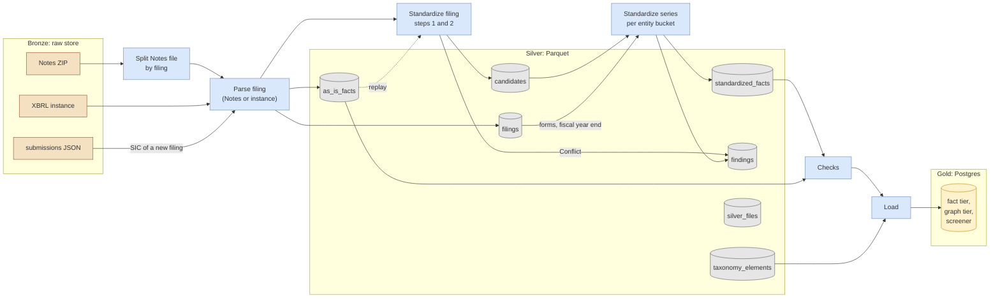

# Silver Layer

> **Status:** the table layout (plain Parquet with the `silver_files` list) was decided by the owner
> on 2026-11-08. The rest is proposed, for review by the lead. Inputs: the contract types and the transform
> integration of [`xbrl/DESIGN.md`](../../../xbrl/DESIGN.md), the raw store of
> [`ingestion_paths.md`](ingestion_paths.md), and the extraction of
> [`extraction_overview.md`](extraction_overview.md).
>
> **Marks:** "Measured" means checked on 2026-11-07 or 2026-11-08 against a downloaded SEC file. "Estimate" means
> not measured. "Decided" names a decision of the owner. Every other statement is a proposal.

Silver is the processed layer between the raw store (bronze) and Postgres (gold). This document
fixes what silver holds, in which format and layout, how provenance and time reach each row, and how
the transform fills it.

## Reading Guide

- [Layers](#layers) and [Fixed Inputs](#fixed-inputs) give the frame. Read them first.
- [Datasets](#datasets) is the data model. It carries the most decisions.
- [Format and Table Layout](#format-and-table-layout) holds the decision of 2026-11-08 for plain
  Parquet with a file list, and the triggers to switch to a table format.
- [Units, Paths, and Replays](#units-paths-and-replays) and [Provenance](#provenance) describe how a
  write and a replay work. Check them against the open choices of the fact store design.
- [Time and Duplicates](#time-and-duplicates) holds the read rules and the rule for company
  attributes over time.
- [Processing](#processing) gives the memory plan, the place of the state machine, and the sizing.
- [Open Points](#open-points) lists what this design leaves to other designs.

## Layers

| Layer | Content | Where | Written by |
| ----- | ------- | ----- | ---------- |
| Bronze | The SEC files, unchanged, each with a JSON metadata file | The raw store, a GCS bucket | Extract |
| Silver | As-is facts, filings, standardized facts, findings, and reference data, in Parquet | Its own GCS bucket | Transform, a Cloud Run job |
| Gold | The serving model of the screener and the `/v1` API | Supabase Postgres ([ADR 0001](../../../docs/adr/0001-mvp-database.md)) | Load, from silver |



Every write also adds rows to `silver_files`. The diagram leaves these edges out.

## Fixed Inputs

These decisions come from earlier designs. This design keeps them.

- Silver is the common destination of every source: the SEC now, ESEF and DART later. Silver makes
  no assumption about gold. Each load step reads what its gold target needs.
- Silver has an as-is layer, with no dedup, and a standardized layer, with dedup by named rules.
- The fact tier is append-only. "Newest filing wins" and "more precise wins" are rules of the
  standardized layer, not writes.
- Data checks gate publishing, not persisting. A failed check stops a load, not a silver write.
- The unit of transform is the filing. Two parsers, one output. Transform replays from the raw
  store ([Path Independence](ingestion_paths.md#path-independence)).
- `AsIsFact`, `Filing`, `StandardizedFact`, the value key, the rule IDs, and the dedup order come
  from [`xbrl/DESIGN.md`](../../../xbrl/DESIGN.md).

**Standing rule "Keep point-in-time open".** Every as-is fact and every filing row carries `filed`
and `accepted`. Silver keeps every filing of a fact side by side and overwrites no file. Company
attributes are columns of `filings`, one row per filing. Silver reads only the raw files that the
store holds today.

## Datasets

| Dataset | One row per | Source in bronze | Written by |
| ------- | ----------- | ---------------- | ---------- |
| `as_is_facts` | `AsIsFact` and its ingestion provenance | Notes `num.tsv`, `txt.tsv`, `dim.tsv`, or the instance | Parse filing |
| `filings` | `Filing`, with the company attributes as filed | Notes `sub.tsv` and `txt.tsv`, or the instance and `submissions` | Parse filing |
| `candidates` | Standardized candidate of one filing, blocked ones included | `as_is_facts` | Standardize filing |
| `standardized_facts` | `StandardizedFact` | `candidates` and `filings` | Standardize series |
| `findings` | `Conflict`, `Gap`, `Overlap`, or `Restatement` finding | Both standardize steps | Standardize filing, standardize series |
| `taxonomy_elements` | Element of one taxonomy release | `Taxonomy::elements()` | A small job per release |
| `silver_files` | Written unit: its files, inputs, and run | Every write | Every writer, last |

No separate dataset holds companies, tickers, or names over time. These are columns of `filings`,
and a view builds the history (see [Company Attributes Over Time](#company-attributes-over-time)).
Labels of the taxonomy live in `taxonomy_elements`. The company labels of `lab.xml` stay out of
the MVP.

The column sketches below fix the shape. The Arrow types are a proposal for the prototype to
confirm. The fact store design owns the final fields of `as_is_facts` and of its provenance record.

### `as_is_facts`

| Column | Arrow type | From |
| ------ | ---------- | ---- |
| `filing_id` | `utf8` | `AsIsFact::filing`, for example `sec:0000320193-26-000001` |
| `entity_scheme`, `entity_id` | `utf8`, `utf8` | `AsIsFact::entity` |
| `concept_family`, `concept_name` | `utf8`, `utf8` | `AsIsFact::concept` |
| `taxonomy_version` | `utf8`, nullable | `us-gaap/2026`, or the filing for an extension |
| `period_end` | `date32` | Exact end |
| `period_start` | `date32`, nullable | Exact start, if the source has it. Not a key field |
| `quarters` | `uint8` | 0 for an instant |
| `unit` | `utf8`, nullable | Canonical text, for example `USD/shares`. Null for text |
| `dimensions` | `list<struct<axis: utf8, member: utf8>>` | Sorted pairs, legal entity axis included |
| `value_kind` | `utf8` | `numeric`, `text`, or `nil` |
| `value_numeric` | `decimal128(38, 10)`, nullable | `FactValue::Numeric` |
| `value_text` | `utf8`, nullable | `FactValue::Text` |
| `decimals` | `int32`, nullable | `Decimals::Finite`. Null for text and for `Infinite` |
| `decimals_infinite` | `bool` | `Decimals::Infinite` |
| `copy_rank` | `uint16` | 0 for the first copy in one filing |
| `footnotes` | `list<utf8>` | |
| `filed` | `date32` | Filing date |
| `accepted` | `timestamp[ms, UTC]`, nullable | Acceptance time |

Ingestion provenance, on every row (see [Provenance](#provenance)):

| Column | Arrow type | Meaning |
| ------ | ---------- | ------- |
| `source_kind` | `utf8` | `notes` or `instance` |
| `source_key`, `source_sha256` | `utf8`, `utf8` | The raw document and its digest |
| `ingestion_mode` | `utf8` | `backfill` or `incremental`, from the raw metadata |
| `transform_version` | `utf8` | Version of the parser output, see [Units, Paths, and Replays](#units-paths-and-replays) |
| `execution_id` | `utf8` | The run that wrote the row |
| `loaded_at` | `timestamp[ms, UTC]` | The time of the write |

- The value key is `filing_id`, `concept_family`, `concept_name`, `taxonomy_version`, `period_end`,
  `quarters`, `unit`, `dimensions`, and `copy_rank`. The key is unique within one filing and one
  source document. The parser makes it unique by numbering the copies.
- A filing that arrives on both paths has two sets of rows, one per `source_kind`. Silver keeps
  both. Which one a read takes is open (see [Open Points](#open-points)).
- `decimal128(38, 10)` holds 28 digits before the point. In `num.tsv` of `2025q3`, a value has at
  most 24 digits before the point and 4 after it (measured). The prototype checks the instance
  values, which Notes rounds to 4 places.

### `filings`

| Column | Arrow type | From |
| ------ | ---------- | ---- |
| `filing_id`, `entity_scheme`, `entity_id` | `utf8` | `Filing` |
| `form`, `is_amendment` | `utf8`, `bool` | `10-K/A`, true |
| `filed`, `accepted` | `date32`, `timestamp[ms, UTC]` nullable | |
| `period_of_report` | `date32` | |
| `fiscal_year`, `fiscal_period` | `int16`, `utf8`, both nullable | As filed. Filled for 10-K, 10-Q, 20-F, and 40-F, mostly empty for other forms, see [Company Attributes Over Time](#company-attributes-over-time) |
| `company_name` | `utf8`, nullable | `sub.tsv` `name`, or `dei:EntityRegistrantName` |
| `sic` | `utf8`, nullable | `sub.tsv` `sic`, or `submissions` `sic` |
| `tickers` | `list<struct<symbol: utf8, exchange: utf8 nullable>>` | `dei:TradingSymbol` and `dei:SecurityExchangeName`, one entry per share class |
| `fiscal_year_end_raw` | `utf8`, nullable | `0930` from `sub.tsv`, or `--09-27` from the instance |
| `fiscal_year_end_month` | `uint8`, nullable | The month of the nearest month end, see below |
| `sic_source_key`, `sic_source_sha256`, `sic_retrieved_at` | `utf8`, `utf8`, `timestamp[ms, UTC]`, nullable | The `submissions` file of a new filing. Null for a Notes filing |
| Ingestion provenance | as in `as_is_facts` | The raw document of the filing |

- Every attribute names its raw document. The name, the ticker, and the fiscal year end come from
  the raw document of the row. The SIC of a new filing comes from `submissions`, so it has its own
  three columns. The URL and the retrieval time of each raw document sit in `silver_files`.
- The raw store keeps one version of `submissions`. A later fetch replaces the bytes that
  `sic_source_sha256` names. This gap stays until the raw store keeps versions.

### `candidates`

One row per standard concept and filing, from steps 1 and 2 of the dedup order in
[`xbrl/DESIGN.md`](../../../xbrl/DESIGN.md#4a-transform-integration). The columns are those of
`standardized_facts` without `restated`, plus `filing_id`, `filed`, `accepted`, `blocked`, and
`entity_bucket`. A blocked candidate has a null `value` and a null `confidence`. Its `rule` names
the rule that picked the conflicting concept. The standardize series step reads only this dataset
and `filings`, so it never parses again.

Inside a `candidates` part, rows sort by `entity_bucket`, then by `filing_id`. The writer starts a
new row group at each change of `entity_bucket`, so a series task reads only the row groups of its
bucket, by their statistics.

### `standardized_facts`

| Column | Arrow type | From |
| ------ | ---------- | ---- |
| `entity_scheme`, `entity_id` | `utf8` | |
| `concept` | `utf8` | `CanonicalElement`, for example `Revenue` |
| `period_end`, `period_start`, `quarters`, `dimensions` | as in `as_is_facts` | Dimensions are empty in the MVP |
| `unit` | `utf8` | `StandardizedFact::unit`, never null |
| `value` | `decimal128(38, 10)` | |
| `confidence` | `utf8` | `Exact`, `Synonym`, `Derived`, or `Computed` |
| `rule` | `utf8` | `RuleId`, for example `us-gaap/alias/revenue@1` |
| `release_id`, `release_checksum` | `utf8`, `utf8` | `TaxonomyRelease` |
| `inputs` | `list<struct<FactKey>>` | The value keys of the as-is facts, with every key field |
| `restated` | `bool` | |
| Run columns | `transform_version`, `execution_id`, `loaded_at` | |

### `findings`

| Column | Arrow type | Meaning |
| ------ | ---------- | ------- |
| `kind` | `utf8` | `Conflict`, `Gap`, `Overlap`, or `Restatement` |
| `entity_scheme`, `entity_id` | `utf8` | |
| `concepts` | `list<utf8>` | The as-is concept, and the standard concept if a plug-in maps it |
| `periods` | `list<struct<period_end: date32, quarters: uint8>>` | |
| `reason` | `utf8`, nullable | For example `FiscalYearChange` or `Conflict` |
| `filing_id` | `utf8`, nullable | Set for `Conflict` |
| `step` | `utf8` | `filing` or `series` |
| Run columns | `transform_version`, `execution_id`, `loaded_at` | |

A dataset, not a report, for three reasons:

- The checks read findings with the same reader as facts.
- A report is a query over the dataset. A dataset is not a query over a report.
- Silver keeps the findings of the series runs of the last 30 days (see [Growth](#growth)).

The standardize filing step writes `Conflict`. The series step writes `Gap`, `Overlap`, and
`Restatement`, and copies each `Conflict` of the entity, as `xbrl/DESIGN.md`, "Gap Check", asks. A
read of the report takes the rows with `step = series`.

### `taxonomy_elements`

One row per release and element: `release_id`, `release_checksum`, `concept_family`,
`concept_name`, `label`, `data_type`, `balance`, `period_type`, and `retired_in` (nullable, for
the retired elements of option C in
[`xbrl/DESIGN.md`](../../../xbrl/DESIGN.md#releases-over-time)). One file per release.

### `silver_files`

The list of written units. Readers find the current files through it, and it holds the lineage.

| Column | Arrow type | Meaning |
| ------ | ---------- | ------- |
| `dataset` | `utf8` | For example `as_is_facts` |
| `schema_version` | `uint16` | Version of the dataset schema |
| `source` | `utf8`, nullable | `notes` or `instance`. Null for the series datasets and `taxonomy_elements` |
| `unit_kind`, `unit_key` | `utf8`, `utf8` | See [Units, Paths, and Replays](#units-paths-and-replays) |
| `input_digest` | `utf8` | SHA-256 over the sorted list of input keys and digests |
| `inputs` | `list<struct<key, sha256, requested_url, produced_at>>` | Each raw document or silver file read |
| `transform_version` | `utf8` | |
| `files` | `list<utf8>` | The Parquet files of the unit |
| `row_count` | `uint64` | |
| `execution_id`, `ingestion_mode`, `written_at` | `utf8`, `utf8`, `timestamp[ms, UTC]` | The run |
| `removed_at` | `timestamp[ms, UTC]`, nullable | Set only on the row that the cleanup of [Growth](#growth) adds for a removed unit |

## Format and Table Layout

### File Format

| Option | Pro | Con |
| ------ | --- | --- |
| A. Parquet for every dataset (chosen) | Typed columns, column pruning, row-group statistics. Polars, DuckDB, and the Supabase DuckDB wrapper read it | Binary, needs a tool to read |
| B. JSON lines | Readable as text, no schema | No types for decimals and dates. About 10 times larger than Parquet. No column pruning |
| C. Parquet with a JSON sidecar per file | Sidecar readable as text, like bronze | Two objects per write, no atomic pair. The Parquet footer already holds key-value metadata |

Parquet for every dataset, because every dataset is a table. One format means one reader, one
writer, and one schema check. The footer of each file holds `dataset`, `schema_version`,
`unit_key`, and `transform_version` as key-value metadata, so a file names itself without a
sidecar.

Measured on the plain Financial Statement data set `2025q3` (see [Measurements](#measurements)):
`num.txt` holds 542 MB of text. Sorted by filing, it writes to
31.7 MB of Parquet with zstd. Seven provenance columns with one value per file add 0.4%.

### Plain Parquet or a Table Format

| Option | Pro | Con |
| ------ | --- | --- |
| A. Plain Parquet files and the `silver_files` list (decided) | No new dependency next to Polars. The list is a Parquet dataset itself. A unit becomes visible with one write | No transaction over many files. Each reader must read the list. Compaction and file removal need code of our own |
| B. Delta Lake through `delta-rs` | Transaction log, snapshots by version and time, `OPTIMIZE` and `VACUUM` | `deltalake` pins its own Arrow version, so it and Polars must agree on one. Concurrent writers on GCS need the conditional-write support of the object store |
| C. Apache Iceberg through `iceberg-rust` | Open standard, snapshots, hidden partitions, the Supabase Iceberg wrapper | Needs a catalog service. The Rust writer covers less than the Java one. The epic lists Iceberg as out of scope, and ADR 0001 adds Iceberg only next to Postgres, past about 50 GB |

Decided by the owner on 2026-11-08: A. Two reasons:

- **Time travel needs no table snapshot.** A point-in-time read filters on `accepted`, which every
  row carries. "What silver held at time T" filters `silver_files` on `written_at`. Both work with
  plain files.
- **Writes are units, not row updates.** Silver never updates a row. Each write adds a whole unit,
  and the `silver_files` row makes the unit visible. That is the one transaction silver needs.

Move to B when one of these holds:

- Two jobs must write one dataset at the same time with a shared commit.
- A reader needs a consistent snapshot over many units that `silver_files` cannot give.
- The file count makes the list slow to read.

The switch keeps the Parquet files and replaces the list with a Delta log. The epic records these
triggers, so a later design checks them.

## Units, Paths, and Replays

### The Write Unit

A unit is the smallest set of rows that one write adds, and that one replay writes again.

| Unit kind | `unit_key` | Rows | Inputs |
| --------- | ---------- | ---- | ------ |
| `notes_file` | The Notes period, for example `2024q1` | All filings of one Notes file | The Notes ZIP |
| `filing_day` | The filed date, for example `2026-11-06` | All new filings of one day | The instances of that day, and the `submissions` files they used |
| `entity_bucket` | `b07` of 64 buckets by `xxh3_64` of the entity, with a fixed seed | The series output of the entities in the bucket | The current `candidates` and `filings` units |
| `release` | `us-gaap/2026` | The elements of one release | The vendored release |

A unit of the daily path holds one day, not one filing. One filing per unit gives about 90 files a
day per dataset, with a median of 8.7 KB each (measured). One day per unit gives one file a day per
dataset. So the daily path needs no compaction.

### Paths

```text
gs://<silver-bucket>/<dataset>/source=<notes|instance>/unit=<unit_key>/<digest>-v<transform_version>/<execution_id>-<attempt>/part-<n>.parquet
gs://<silver-bucket>/silver_files/execution=<execution_id>/task=<n>-<attempt>.parquet
```

- `<digest>` is the first 16 hex characters of `input_digest`.
- `<attempt>` is the attempt number of the Cloud Run task. A retry writes to its own paths.
- The series datasets use `unit=<bucket>` with no `source=` level.
- Inside a file, except in `candidates`, rows sort by `filing_id`, then by the value key. Row groups hold about 100,000
  rows, so a read of one filing skips the other row groups by their statistics.

### Rules of a Write

1. The writer computes `input_digest` from its inputs.
2. If the current unit of the unit key has the same digest and transform version, the writer skips
   the write. An older unit with the same digest and version does not count. This mirrors the skip
   of the raw store.
3. Otherwise, the writer writes the Parquet files of the unit to their paths. Each object write
   sets the GCS precondition `ifGenerationMatch=0`, so a second write to one path fails.
4. The writer writes the `silver_files` row last. A unit without a `silver_files` row does not
   exist for a reader.

So silver never writes to an existing path. A file is written once. Only the retention rule of
[Growth](#growth) and the cleanup of unread files below remove files. If an attempt fails
between steps 3 and 4, its files stay unread, because no `silver_files` row names them. A cleanup
can remove such files once no attempt of their execution runs.

### Replays

| Cause | Unit key | Digest | Version | Result |
| ----- | -------- | ------ | ------- | ------ |
| A rerun of the same run | same | same | same | Skipped |
| A parser fix | same | same | new | A new unit next to the old one |
| A Notes file that the SEC corrected | same | new | same | A new unit next to the old one |
| A late filing of a past day | same | new | same | A new unit with the whole day |
| A parser fix of a past day after a new fetch of `submissions` | same | new | new | A new unit. Its SIC values are those of the new fetch |
| A rollback to an earlier version or digest | same | old | old | A new unit, because step 2 compares with the current unit only |

- A unit key is the dataset, the source, the unit kind, and `unit_key`.
- The **current unit** of a unit key is the one with the latest `written_at`. A default read takes
  only current units. `written_at` gives the order of runs. Silver uses it only between units of
  one key, because they hold the same filings.
- The old unit stays. A read "as silver held it at T" takes, per unit key, the latest unit written at
  or before T.
- So a replay replaces exactly the rows of its unit for a default read, and deletes nothing.
- `transform_version` changes only when the parser output changes. A golden test pins the output of
  the fixtures to the version. If the output changes and the version does not, the test fails.
- The raw store keeps one version of `submissions`. So a replay of a `filing_day` after a new fetch
  takes the SIC of the new fetch, and `sic_retrieved_at` shows it.

A Notes file that the SEC merged into a quarterly file has a new period, so it is a new unit key.
Both units stay current, and the same filing appears in both. No order of runs picks between them,
see [Open Points](#open-points).

### Growth

Silver deletes no unit of `as_is_facts`, `filings`, or `candidates`. Each full replay of the
backfill adds the size of these datasets again, about 6 GB of numeric rows (estimate).

The series datasets grow faster. A day with about 90 new filings touches about 48 of the 64
buckets, and the median day of 36.5 filings about 28. Each touched bucket writes a new unit of its
whole series output. Estimate: about 7,000
entities, 50 concepts, and 90 periods give about 32 million rows, about 0.3 GB. A row holds an `inputs`
list, so the real size is larger. The prototype measures it. A rewrite each day adds up to about
100 GB a year.

So `standardized_facts` and `findings` get a retention rule:

- A cleanup removes a superseded unit of these two datasets 30 days after a newer unit replaced it.
- The cleanup is an execution, and it adds rows and updates none. It writes its own file under the
  same path pattern as every other execution, `silver_files/execution=<execution_id>/task=<n>-<attempt>.parquet`.
- The file holds one row per removed unit. Each row copies the row of the unit, sets `removed_at`,
  and names the cleanup in `execution_id`. Then the cleanup deletes the files that `files` lists,
  not a path prefix.
- A row with `removed_at` set is never a unit, so it never counts for the latest `written_at`.
- A reader drops a unit if a `silver_files` row with `removed_at` set has the same unit key and
  `files`. Each path holds `<execution_id>-<attempt>`, so `files` is unique. Digest and version
  are not enough, because a rollback writes a second unit with both.
- A read "as silver held it at T" for these two datasets fails if T is more than 30 days ago.
- The series step can rebuild a removed unit from the `candidates` units current at the time of
  that unit, with the image of its `transform_version`. So the cleanup loses no reported value, as
  long as the container registry keeps the image of each `transform_version`.

## Provenance

| Option | Pro | Con |
| ------ | --- | --- |
| A. Columns on every row | A row names its source with no join. Rule 5 of Path Independence asks for it | Repeats the same values on many rows |
| B. Per file, in a sidecar or the footer | No repetition | A row loses its source once it leaves its file, for example in a query result |
| C. A lineage table keyed by the source document | URL, retrieval time, and inputs once per document | A row needs a join to reach them |

Proposal: A and C together.

- **On every row:** `source_kind`, `source_key`, `source_sha256`, `ingestion_mode`,
  `transform_version`, `execution_id`, and `loaded_at`. Parquet stores each as one dictionary
  entry per file. The measured overhead is 0.4%.
- **In `silver_files`:** the URL, the retrieval time (`produced_at` of the raw metadata), and the
  inputs of each unit.

**Many raw documents in one file.** A `filing_day` unit holds the filings of many instances. Each
row keeps the key and the digest of its own instance, so its provenance does not depend on the
file. The dictionary of `source_key` then holds one entry per filing.

**Provenance of a standardized fact.** `inputs` lists the value keys of the as-is facts it came
from. A join on these keys reaches the as-is rows and their provenance.

## Time and Duplicates

### Append-Only

- Silver keeps every reported value, with its filing and its source document.
- Silver drops no reported value and overwrites no file. A replay adds a unit (see [Replays](#replays)).
  The retention rule of [Growth](#growth) removes only superseded units of derived datasets.
- "Newest filing wins" and "more precise wins" are the rules `core/dedup/newest-filing@1` and
  `core/dedup/more-precise@1`. They run in the standardize steps or in a read, never in an as-is
  write.

### Time Axes

| Axis | Columns | Question |
| ---- | ------- | -------- |
| Period | `period_end`, `quarters`, `period_start` | Which period does the value describe? |
| Public time | `filed`, `accepted` | Since when was the value public? |
| Silver time | `loaded_at`, and `written_at` in `silver_files` | Since when did silver hold the value? |

Queries this allows:

| Query | Layer | How | History |
| ----- | ----- | --- | ------- |
| The latest value of a period | As-is | A view: dedup rules over all filings | Back to 2009 |
| The latest value of a period | Standardized | Read `standardized_facts` | Back to 2009 |
| The value as public on day D | As-is | A view: dedup rules over filings with `accepted` (or `filed`) on or before D | Back to 2009 |
| The value as public on day D | Standardized | Run the series step again on the `candidates` with `accepted` (or `filed`) on or before D. Tiers 3 and 4 run only in Rust, so no view gives it | Back to 2009 |
| The value as silver held it at time T | As-is | Current units as of T, then the dedup rules | From the first silver write |
| Every value ever reported for a period | As-is | No dedup | Back to 2009 |

The new-filing path stores `filed` only. A point-in-time read of a new filing uses `filed`, so it
is exact to a day, not to a minute.

### Same Value in Several Places

A value of one period can appear in many rows:

| Case | Example | Silver keeps | The read that picks one |
| ---- | ------- | ------------ | ----------------------- |
| Copies in one filing | One value at `decimals = -6` and at `0` | Every copy, with `copy_rank` | `core/dedup/more-precise@1` takes rank 0 |
| Repeated comparative | Q1 revenue in the Q1 10-Q and again in the next year's Q1 10-Q | Both rows | `core/dedup/newest-filing@1` takes the newer filing |
| Restatement | A 10-K/A with another value | Both rows | `core/dedup/newest-filing@1` takes the newer filing and sets `restated` |
| One filing on both paths | A Notes row and an instance fact | Both rows, with their `source_kind` | Open, see [Open Points](#open-points) |
| One filing in two Notes files | A monthly file and its merged quarterly file | Both units | Open, see [Open Points](#open-points) |

The as-is read for one period uses the same order as the standardized layer:
`core/dedup/more-precise@1` per filing, then `core/dedup/newest-filing@1` across filings, on the
as-is concept instead of the standard concept.

### Company Attributes Over Time

Every filing row holds its attributes as filed. A view builds the history:

- Order the filings of one entity by `accepted`, then `filed`, then `filing_id`.
- A row of the history starts at each filing where an attribute differs from the previous non-null
  value. Its valid-from time is the `accepted` (or `filed`) of that filing.
- Former names are the distinct `company_name` values of the history, with their valid-from times.
- The same view "as of D" takes the latest filing accepted on or before D.

Sources per path, as decided for the company data in
[`ingestion_paths.md`](ingestion_paths.md#company-data):

| Attribute | Notes path | New-filing path |
| --------- | ---------- | --------------- |
| Name | `sub.tsv` `name` | Instance, `dei:EntityRegistrantName` |
| SIC | `sub.tsv` `sic` | `submissions` `sic` on the day of the fetch |
| Ticker, exchange | `txt.tsv`, `dei:TradingSymbol`, `dei:SecurityExchangeName` | Instance, same tags |
| Fiscal year end | `sub.tsv` `fye` (`MMDD`) | Instance, `dei:CurrentFiscalYearEndDate` (`--MM-DD`) |

Rules for the open points of the company data:

- **Fiscal year end.** Silver keeps the raw text in `fiscal_year_end_raw`. It also stores
  `fiscal_year_end_month`, the month of the month end nearest to the raw day. `sub.tsv` rounds the
  same way. Apple `--09-27` gives 9, and `sub.tsv` `0930` gives 9. Costco `--09-01` gives 8, and
  `sub.tsv` `0831` gives 8.
- **Change of fiscal year.** A change of `fiscal_year_end_month` between two filings is a change of
  the fiscal year. A day that moves within the month, as in a 52- or 53-week year, is not.
- **Missing value.** If a source has no value, for example an empty `fye` or no `dei` tag, the
  column is null. A null never starts a history row, so the previous value stays valid.
- **Change over time.** A different value in a later filing starts a new history row. It is not a
  conflict.

Measured in the Notes file `2025q3`, as the share of filings with the tag in `txt.tsv`:

| Form | Filings | `dei:TradingSymbol` | `dei:CurrentFiscalYearEndDate` |
| ---- | ------- | ------------------- | ------------------------------ |
| 10-K | 382 | 69.6% | 100% |
| 10-Q | 5,249 | 83.0% | 100% |
| 20-F | 94 | 90.4% | 100% |
| 40-F | 6 | 100% | 100% |

So the null rule for `tickers` matters: about one 10-K in three has no ticker. `sub.tsv` leaves
`fye` empty in 171 of 23,459 filings, and `fy` and `fp` in 17,158. All 5,731 filings of the forms
10-K, 10-Q, 20-F, and 40-F have `fy`, `fp`, and `fye`. The parse step counts the nulls per unit, so every backfill run reports them.

## Processing

### Unit of Work and Memory

The unit of transform is one filing. One filing is small: in the Notes file `2025q3`, a filing
with numeric values has 785 rows in `num.tsv` at the median and 27,529 at most (measured). A Notes
file is large. `2025q3` holds 1,188.6 MB of `num.tsv` and 954.6 MB of `txt.tsv` unzipped (measured).

The sort order of the tables differs between Notes files (measured on 2026-11-08):

| Notes file | `num.tsv` sorted by `adsh` | `txt.tsv` sorted by `adsh` |
| ---------- | -------------------------- | -------------------------- |
| `2010q1` | No | Yes |
| `2012q4` | No | No |
| `2020q4` | Yes | No |
| `2024q1`, `2025q3`, `2026_10` | Yes | Yes |

`sub.tsv` is not sorted in five of these six files, but it holds at most a few MB. `2009q1` holds
only the header line of each table, so it gives no filings. Option B below does not rely on the order.

| Option | Peak memory | Cost |
| ------ | ----------- | ---- |
| A. Read each table whole | 2.87 GB for an eager read of `num.tsv` of `2025q3`, 4.95 GB with `txt.tsv` after it (measured) | Simple. Needs a large task for the largest file |
| B. K passes over the ZIP stream, each keeping the rows of one hash bucket of `adsh` (proposed) | About 1/K of the rows | K times the inflate time, about 3 s per GB per pass at 343 MB/s on one core (measured) |
| C. One pass that cuts each table at each change of `adsh` | One filing: 36 MB for a pass over `num.tsv` of `2025q3` (measured) | Works only for a sorted table, so not for `2010q1`, `2012q4`, or `2020q4` |

Proposal: B, for every Notes file, so the split has one code path:

- The split reads `sub.tsv` and `dim.tsv` whole, about 81 MB of text for `2025q3`.
- It picks K so that one bucket holds about 256 MB of text of `num.tsv` and `txt.tsv` on average.
  For `2024q1`, with 2.7 GB of both, K is 11. The 11 passes over both tables take about 1.5
  minutes of inflate time (estimate).
- Each pass keeps the rows where `xxh3_64(adsh) mod K` equals the bucket number. The hash has a
  fixed seed, so every pass and every run puts one `adsh` in the same bucket. A hasher with a
  random seed per instance, such as the default of `HashMap`, drops or doubles filings.
- Each pass groups its rows by `adsh` and hands one filing at a time to the parse state.
- The write state writes one Parquet part per bucket and dataset (`part-<k>.parquet`), then drops
  the bucket. So it never holds a whole Notes file. Inside a part, rows sort by `filing_id`.
- `candidates` sorts each part by `entity_bucket`, then by `filing_id`, and starts a new row group
  at each change of `entity_bucket`. A series task reads the row groups of its entity bucket from
  every part.

C is a later speed-up for sorted files only. It needs a check of the order and a fallback to B.

### Where the State Machine Fits

| Option | Pro | Con |
| ------ | --- | --- |
| A. A transform super-state per filing, run in batches through a facade, as `notes()` and `daily_filings()` run extract (proposed) | Typed states, typed errors per filing, the observer, the same tests as extract. Matches section "4a) Transform Integration" of `xbrl/DESIGN.md` | More code than a script. A filing is small, so the per-state overhead is a large share of the work |
| B. One Polars or DuckDB batch job per Notes file | Little code, fast columnar work | No typed per-filing errors. SQL or a DataFrame expression takes the place of the `xbrl` rules, so the rules exist twice |

Proposal: A, with Polars inside the states that move tables:

- The split state streams the ZIP in K passes and cuts each bucket into filings, as in
  [Unit of Work and Memory](#unit-of-work-and-memory).
- The parse and standardize states call the `xbrl` crate on Rust types. Only the Rust code applies
  the rules.
- The write state turns the Rust rows of one bucket into Arrow batches and writes one Parquet part.
- The series step is a super-state per entity bucket. Inside it, Polars reads the `candidates` of
  the bucket, and the `xbrl` rules run per entity.

### Per Unit or Over Many Units

| Work | Needs | Runs as |
| ---- | ----- | ------- |
| Split, parse, map, provenance | One filing | Transform, per filing |
| `core/dedup/more-precise@1`, tiers 1 and 2 | One filing | Transform, per filing |
| `core/dedup/newest-filing@1`, tiers 3 and 4, chronology | Every filing of one entity | Transform, per entity bucket |
| Company history, as-of reads, the as-is dedup read | Every filing of one entity | A query over silver, as a view |
| Checks | One unit or one bucket | A step over silver, before load |
| Sector medians, screener tables, coverage filter | Many entities | Gold |

The series step runs again for a bucket when a new current unit of `candidates` holds an entity of
that bucket.

### Schema From the Rust Types

The Rust types of `xbrl` are the source of each schema. The Arrow schema follows from them, never
the other way.

| Option | Pro | Con |
| ------ | --- | --- |
| A. `serde` on the contract types and `serde_arrow` for the batches | Little code. A new field on the type reaches the schema | Newtypes need `#[serde(transparent)]` or a custom mapping. The Arrow type of `Decimal` needs an explicit choice |
| B. A hand-written `SilverRecord` trait per dataset: `schema()`, `to_batch()`, `from_batch()` (proposed) | Full control over each column. No `arrow` dependency in `xbrl` | More code per dataset |
| C. Schema first, Rust code generated from it | One schema file | The Rust types stop being the source, which is the drift this item must prevent |

Proposal: B, in the transform crate, not in `xbrl`. Three tests keep the schema and the types in
step:

- A round trip per dataset: Rust rows to a batch and back give equal rows.
- A snapshot of each Arrow schema, checked in. A change to the snapshot needs a new
  `schema_version`.
- A reader rejects a file whose `schema_version` it does not know.

### Cloud Run Sizing

Estimates. The prototype measures them.

| Job | Tasks | Memory per task | Parallel tasks | Timeout |
| --- | ----- | --------------- | -------------- | ------- |
| Transform of the backfill | One per Notes file, 80 | 2 GiB with option B: one bucket of about 256 MB of text, plus `sub.tsv` and `dim.tsv` | 10 | 1 hour |
| Transform of one day | 1 | 1 GiB | 1 | 30 minutes |
| Standardize series | One per entity bucket, 64 | 2 GiB | 16 | 30 minutes |
| Checks and load | One per dataset unit | 1 GiB | 4 | 30 minutes |

Two limits set the parallel tasks: the read speed of the raw bucket, and the connections that gold
accepts. Silver itself sets none.

Size of silver (estimate): `2024q1` holds about 10.5 million rows in `num.tsv` and `txt.tsv`. At
about 70 quarters of history, the as-is dataset holds about 700 million rows. At 8.5 bytes per
numeric row (measured), the numeric rows take about 6 GB. Text rows take more per row. Without
replays, the whole silver bucket stays under 30 GB, the size of the raw store. See
[Growth](#growth) for replays and the series datasets.

## Open Points

These choices belong to other designs. Silver keeps them open: it stores every copy with its
source, and each choice is a read rule over silver.

- **The write rule of the fact store**, "upsert by full grain" against `ON CONFLICT DO NOTHING`. It
  applies to the gold fact tier. Silver writes units and never upserts rows.
- **One fact from two sources.** Silver keeps the Notes row and the instance row of one filing.
  The fact store design picks the read rule, for example instance over Notes.
- **Which source wins for one filing on both paths.** The transform design decides whether the
  standardize filing step runs once per filing or once per source. Silver accepts both.
- **One filing in two Notes files.** After a merge, a monthly unit and the quarterly unit both hold
  the filing, so `candidates` holds two candidates with one `filing_id`. `core/dedup/newest-filing@1`
  has no tie-break inside one `FilingId`. The series step needs one unit per filing, chosen by a
  fixed rule that does not depend on the order of runs, for example the quarterly file over the
  monthly file. The fact store design picks the rule.
- **The replay of a filing in gold.** Silver keeps the old and the new unit. The fact store design
  decides how gold replaces the rows of a replayed filing.
- **The reload of a corrected Notes file.** Silver writes a new unit only if the transform runs
  on the new bytes. The transform design decides whether a changed digest starts that run.
- **The fields of the ingestion provenance record.** The columns above are a sketch.
- **The change to ADR 0001.** ADR 0001 writes from raw to Postgres. With silver, load reads silver.
  The silver prototype drafts the amendment.

## Measurements

Measured on 2026-11-07 and 2026-11-08 in a cloud container (4 cores, 15 GB of memory), with
Polars 2.1.0 and the `csv` module of Python as a stand-in for the Rust crate.

Notes file `2025q3_notes.zip`:

- **Size.** 463.4 MB zipped. `num.tsv` is 1,188.6 MB with 7,697,635 rows, `txt.tsv` 954.6 MB with
  1,216,238 rows. `sub.tsv` holds 23,459 filings of 6,525 companies.
- **Order.** `num.tsv` and `txt.tsv` are sorted by `adsh`, ascending. `sub.tsv` is not. In three other
  files, `num.tsv` or `txt.tsv` is not sorted, see [Unit of Work and Memory](#unit-of-work-and-memory).
- **Rows per filing in `num.tsv`.** 7,441 filings. Mean 1,034, median 785, 95th percentile 2,848,
  maximum 27,529.
- **Memory.** An eager read of `num.tsv` took 9.7 s and peaked at 2.87 GB. With `txt.tsv` read
  after it, the process peaked at 4.95 GB. A streamed pass that cuts `num.tsv` at each change of
  `adsh` took 13.8 s and peaked at 36 MB.
- **Values.** At most 24 digits before the point and 4 after it.

Plain Financial Statement data set `financial-statement-data-sets/2025q3.zip`. Its `sub` and `num`
tables have the layout of the Notes tables, with fewer columns and fewer rows. The Parquet sizes and
the file counts come from it:

- **Size.** 127.8 MB zipped. `num.txt` is 542 MB with 3,720,081 rows. `sub.txt` holds 6,541
  filings of 5,909 companies.
- **Rows per filing in `num.txt`.** Mean 569, median 425, 95th percentile 1,113, maximum 24,536.
- **Order.** Unlike the Notes data set, `num.txt` is not sorted by `adsh`, `tag`, or `ddate`. The
  6,541 filings form 3,702,681 runs of adjacent rows.
- **Filings per filed date.** Median 36.5, maximum 709, over 64 dates.
- **Memory and time.** An eager read of `sub.txt` and `num.txt` as text took 2.0 s and peaked at
  1.19 GB. The same read, a cast to typed columns, and the Parquet writes of the next items peaked at
  1.79 GB in one process. A streamed conversion of `num.txt` to Parquet took 0.9 s and peaked at
  0.72 GB. A sort by `adsh` with a streamed write took 2.7 s and peaked at 1.85 GB.
- **Read of one filing.** From the sorted Parquet file with a filter on `adsh`: 473 rows, peak
  0.08 GB.
- **Parquet size.** `num.txt` as typed Parquet with zstd: 65 MB unsorted, 31.7 MB sorted by `adsh`.
  Seven provenance columns with one value per file: 31.8 MB, 8.5 bytes per row.
- **One file per filing.** The median file is 8.7 KB, the largest 60.1 KB.
- **Inflate.** `num.txt` inflates from the ZIP at 343 MB/s on one core.
