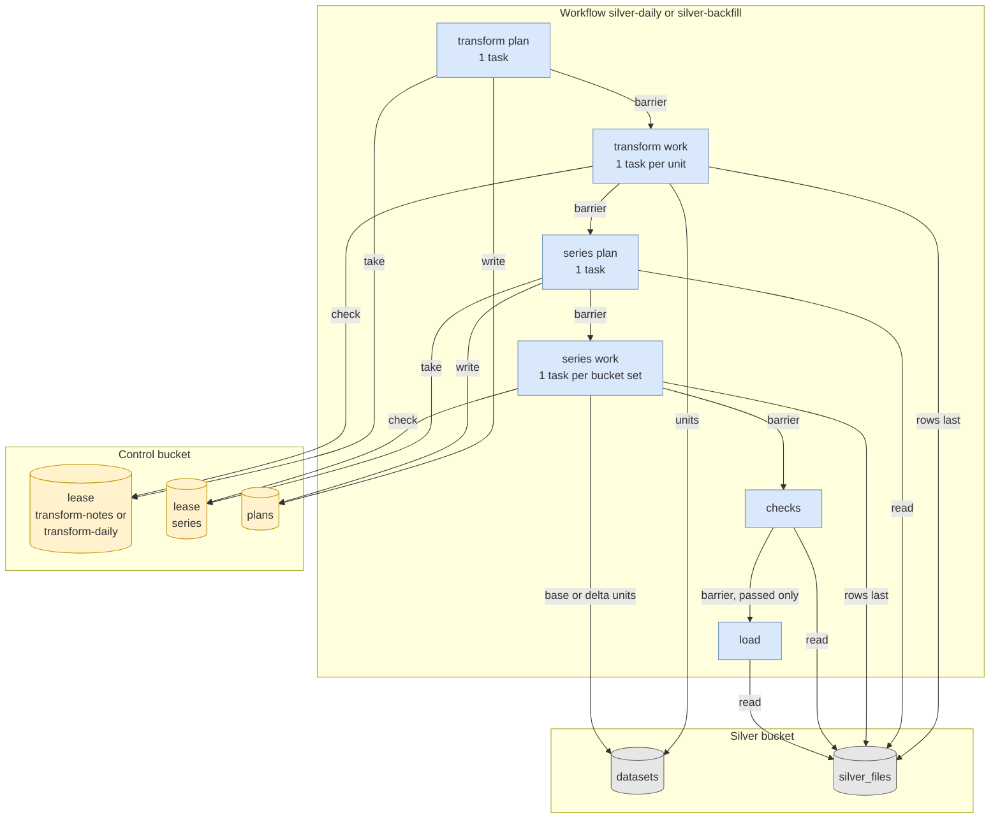
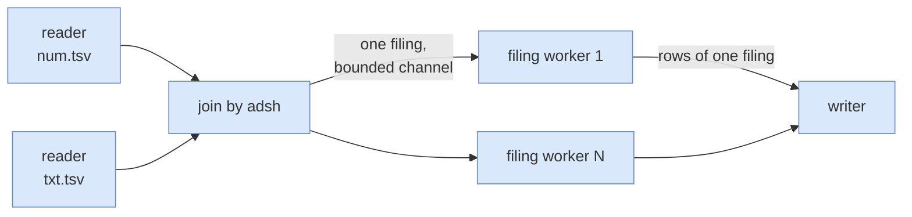

# Silver Writer and Transform Jobs

> **Status:** proposed, for review by the owner. [ADR 0032](../../../docs/adr/0032-one-writer-per-silver-unit-key.md),
> [ADR 0033](../../../docs/adr/0033-byte-form-of-content-digest.md),
> [ADR 0034](../../../docs/adr/0034-transform-jobs-chained-by-a-workflow.md),
> [ADR 0035](../../../docs/adr/0035-one-task-per-notes-file.md), and
> [ADR 0040](../../../docs/adr/0040-gcs-backend-in-storage.md) hold the decisions of this document.
>
> **Marks:** "Measured" means checked on 2026-11-08 against a downloaded SEC file, as the silver
> prototype findings record it. "Estimate" means not measured. Every other statement is a proposal.

This document sets how the code meets the silver contract of [`silver_layer.md`](silver_layer.md).
It covers how a unit reaches silver, how the series step runs, and how the jobs run and fail. It does not
change the contract. The per-filing work of the transform, its states, parsers, standardize filing,
and checks, belongs to the per-filing transform design. This document calls that work "the filing
step".

## Reading Guide

- [Overview](#overview) gives the diagram of the jobs. Read it first.
- [The Silver Writer](#the-silver-writer) and [Byte Form of `content_digest`](#byte-form-of-content_digest)
  describe the code that every writer shares.
- [The Series Step](#the-series-step) and [Series Runs and Deltas](#series-runs-and-deltas) describe
  the standardize series super-state.
- [One Writer per Unit Key](#one-writer-per-unit-key), [The Parallel Plan](#the-parallel-plan), and
  [Time per Task](#time-per-task) describe the jobs.
- [Failure Handling](#failure-handling) lists what each failure does to a unit and a run.
- [Implementation Tickets](#implementation-tickets) lists the features in their order.
- [Open Points](#open-points) lists what this design leaves open.

## Overview



- The workflow deletes each lease after the worker step of its job kind ends. The diagram leaves
  these edges out.
- `silver-daily` runs after the extract job `daily_filings`, with the kind `transform-daily`.
  `silver-backfill` runs by hand, with the kind `transform-notes`. A `RawDocumentSource` holds the
  work of both, see [Where Units Come From](#where-units-come-from).
- The checks and load have their own designs. This document sets only their place in the chain.

## The Silver Writer

### Where the Code Lives

| Part | Crate | Holds |
| ---- | ----- | ----- |
| Silver backend | `storage`, module `write_once` | `Blob`, `ListedBlob`, and `WriteOnceFilesystemRepository`, a write-once backend of the existing `WriteRepository`, `ReadRepository`, and `ListRepository`. Silver stores its Parquet parts and control objects as blobs |
| Lease port | `storage` | `LeaseRepository`, a standalone trait, with `FakeLeaseRepository` and `FilesystemLeaseRepository` |
| GCS backend | `storage`, behind the cargo feature `gcs` | A write-once repository and a `LeaseRepository` backend on the GCS JSON API, beside the filesystem backends |
| Row digest | `sec`, modules `shared::row_digest` and `shared::transform_version` | `ByteForm`, `DigestRow`, and `content_digest`, which the transform states, the writer, and the checks use, and `TRANSFORM_VERSION` |
| Silver code | `sec`, module `silver` | `SilverRecord`, the row types, the writer, the reader, the plans, `RawDocumentSource` and its listing backend, and the task runner |
| Series rules | `xbrl`, module `core::series` | `standardize_series`, the order of the rules per entity |

Only one trait of `storage` is new, `LeaseRepository`. No existing trait changes (`AGENTS.md`,
"Open-Closed Principle"):

- **Writes go through `WriteRepository::persist`.** Each write-once repository writes each blob once.
  If the blob exists, `persist` returns `WriteError::ConflictingWrite` and changes nothing. The
  raw store backend `FilesystemRepository` does not fit: it replaces a document whose bytes
  differ, and it writes a JSON metadata file next to each document.
- **The writer computes the size and the CRC32C of each part from its bytes.** The GCS backend
  sends that CRC32C with the upload, so GCS rejects a damaged upload, and the object stores the
  same CRC32C. Integrity check 1 compares the two later.
- **Reads take whole objects** through `ReadRepository`. A part holds about 25 to 60 MB. GCS can
  read a byte range of an object, so a range read can come later without a change to this
  design.
- **`LeaseRepository`** has `acquire` and `current`. The workflow deletes a lease through the GCS API.
  See [One Writer per Unit Key](#one-writer-per-unit-key).

The GCS backend sets `ifGenerationMatch=0` on each object write, and `ifGenerationMatch=<generation>`
when it replaces an expired lease. The bucket mount shows no generation, so silver does not use
it. The backend sits behind the cargo feature `gcs`. A build that turns the feature on compiles the
client into each of its binaries, the extract binaries included
([ADR 0040](../../../docs/adr/0040-gcs-backend-in-storage.md)). The backend sends its requests
through `reqwest`, which `sec` already compiles, so `cargo tree -i openssl-sys` still finds no
package.

The filesystem backend opens each file with `create_new`. Tests and local runs use it.

### `SilverRecord` and `DigestRow`

```rust
/// A row type of one silver dataset and its Arrow form.
pub trait SilverRecord: Sized {
    const DATASET: &'static str;
    const SCHEMA_VERSION: u16;
    fn schema(version: u16) -> Option<SchemaRef>;
    fn to_batch(rows: &[Self]) -> Result<RecordBatch, SilverError>;
    fn from_batch(batch: &RecordBatch, version: u16) -> Result<Vec<Self>, SilverError>;
}

/// A row that enters `content_digest`.
pub trait DigestRow {
    fn write_group_id(&self, out: &mut ByteForm);
    fn write_row_key(&self, out: &mut ByteForm);
    fn write_row(&self, out: &mut ByteForm);
}
```

- One row type per dataset: `AsIsFactRow`, `FilingRow`, `CandidateRow`, `StandardizedFactRow`,
  `FindingRow`, `TaxonomyElementRow`, and `SilverFileRow`. Each wraps the `xbrl` type and adds the
  provenance and run columns of the contract.
- `to_batch` builds the Arrow arrays column by column. It does not go through JSON. The prototype
  found that the `arbitrary_precision` feature of `serde_json`, which `xbrl` turns on, breaks the
  Arrow JSON decoder.
- `from_batch` takes the `schema_version` of the unit from its `silver_files` row. It rejects a
  batch whose fields differ from the schema of that version. Each row type keeps the schema of
  every version that a stored unit can hold, because a unit stays current until a replay.
- A field that an older version lacks is an `Option` in the row type, and `from_batch` sets it to
  `None` for a unit of that version.
- `DigestRow` is a separate trait. A type can have a digest without an Arrow form, for example the
  fixture rows of the golden test.

### Schema Tests

Each dataset has three tests:

1. **Round trip.** Rows to a batch and back give equal rows. The fixture covers a numeric value at
   38 digits, text with non-ASCII characters, `Infinite` decimals, and a row with every nullable
   field empty.
2. **Snapshot.** The schema prints as text, one line per field: name, type, and nullability. The
   printer belongs to `sec::silver`, not to the `Display` of Arrow, which changes between releases.
   The text is checked in. A change of the text needs a new `SCHEMA_VERSION`.
3. **Folder labels.** No field name equals a folder label of the path of the dataset: `source` and
   `unit_key`, or `execution` and `task` for `silver_files`.

### Rules of a Write

The writer takes the unit key, the inputs, the row stream, and the run context. It follows the four
rules of the contract in this form:

1. **Digest.** It computes `input_digest` from the sorted list of input keys and SHA-256 values.
2. **Skip.** It reads the current unit of the key through the silver reader. If that unit has the
   same `input_digest` and `transform_version`, it writes nothing and reports the unit as skipped.
3. **Parts.** It writes each part to
   `<dataset>/source=<source>/unit_key=<key>/<digest16>-v<version>/<execution_id>-<attempt>/part-<n>.parquet`
   through `WriteRepository::persist`. The series datasets leave out `source=`. Each part:
   - sorts its rows by `filing_id`, then by the value key, or by `entity_bucket`, then
     `filing_id` for `candidates`.
   - has row groups of about 100,000 rows. `candidates` starts a new row group at each change of
     `entity_bucket`.
   - uses zstd at level 3.
   - holds the footer entries `dataset`, `schema_version`, `unit_key`, and `transform_version`,
     through `WriterProperties::set_key_value_metadata`.
4. **List row.** It writes the `silver_files` row last, to
   `silver_files/execution=<execution_id>/task=<n>-<attempt>.parquet`, with the size and CRC32C of
   each part as the writer computed them. It sets `written_at` to the later of the time now and the
   `written_at` of the current unit plus 1 ms ([ADR 0032](../../../docs/adr/0032-one-writer-per-silver-unit-key.md)).

A transform task writes one unit key in each of four datasets: `as_is_facts`, `filings`,
`candidates`, and the filing rows of `findings`. A series task writes one unit key in
`standardized_facts` and one in `findings`. Each task writes the `silver_files` rows of its units
in its one list file, at its end. So the units of one task appear together, or not at all.

The writer never holds a whole unit. It flushes a part when the rows of the part reach about 256
MB of input text, and drops them. For each digest group, it keeps only the 32-byte hash.

### The Silver Reader

One reader serves every Rust caller. It reads `silver_files` and never lists a dataset folder.

- `current_units(dataset, source)` takes, per unit key, the unit with the latest `written_at`.
- `current_units_as_of(dataset, source, t)` takes the units with `written_at` at or before `t`.
- `series_units(dataset)` takes the newest `series_base` of a run that counts, and every
  `series_delta` of a run that counts after it, as "Series Deltas" of the contract says.
- `read_rows::<R>(unit, filter)` reads each part whole through `ReadRepository`, skips the row
  groups that the filter excludes by their statistics, and returns rows of type `R`.
- The current facts rule of the contract, one unit per filing, runs on top of these calls.

## Byte Form of `content_digest`

[ADR 0033](../../../docs/adr/0033-byte-form-of-content-digest.md) sets the form. The code lives in
`sec::shared::row_digest`:

- `ByteForm` is a byte buffer with one method per Arrow type of the contract, for example
  `decimal(&BigDecimal)` and `date(NaiveDate)`, plus `null()`, `list(len)`, and `struct_(fields)`.
- Each `DigestRow` writes its columns in schema order and skips `execution_id`, `loaded_at`, and
  `computed_at`.
- The writer hashes one digest group when the group is whole. The filing step hands over one whole
  filing, and the series step one whole entity. So the writer calls `group_hashes` on the rows of
  one group, and keeps the `GroupHash`: the group ID and the hash. At the end of the unit,
  `content_digest` sorts the pairs and computes the digest. If two pairs have one group ID, it
  returns `DuplicateDigestGroup`, because the digest would then depend on the split.
- The golden test holds one fixture unit and a table of `transform_version` to expected digest.
  Each dataset adds its own fixture unit when its `DigestRow` type exists. `TRANSFORM_VERSION`
  holds the version of the build.

## The Series Step

### Entity Buckets

`entity_bucket` is `xxh3_64` with seed 0 over the UTF-8 bytes of `entity_scheme`, `:`, and
`entity_id`, modulo 64. The split of a Notes file uses the same hash with a fixed seed, so no
second hash enters the code. The count 64 comes from "Cloud Run Sizing" of the contract. A run with
`n` tasks gives task `t` the buckets `b` with `b mod n = t`.

### Per Entity

`xbrl::core::series::standardize_series(candidates, filings, conflicts) -> SeriesOutcome` runs the
rules of one entity in this order:

1. `newest_filing(candidates)` gives the `Series`: step 3 of the dedup order.
2. `derive_q4(&series, filings)` gives the fourth quarters.
3. `derive_from_closed_groups(&series, &fourth_quarters)` gives the roll-up values. Steps 2 and 3
   are step 4 of the dedup order.
4. `added` is the fourth quarters, then the roll-up values.
5. `check_roll_ups(&series, &added)` gives `RollUpMismatch` and `NegativeOther` findings.
6. `check_all_sums(&series, &added)` gives `SumMismatch` findings. Steps 5 and 6 take the same
   `added`.
7. `check_chronology` runs on the series with `added` merged in, with `conflicts` as the findings of
   dedup. It gives `Gap`, `Overlap`, `Restatement`, and `SuspiciousPeriod`, then the conflicts.

`SeriesOutcome` holds the standardized facts of step 7 and the findings of steps 5, 6, and 7.
`standardize_series` returns no error, because none of the functions it calls returns one.

- `candidates` holds one `candidates` unit per filing, by the current facts rule of the contract.
- `filings` holds the `filings` rows of the entity, for the forms and the fiscal year end.
- `conflicts` holds the `Conflict` rows of `findings` with `step = filing` for the filings of
  `candidates`. The series step writes them again with `step = series`.

Segment values pass through step 1 with their dimensions. Steps 2 to 7 read only values without
dimensions, by the rules of each function. The series step never calls `segment::reconcile`, so
silver gets no line of the segment reconciliation
([ADR 0030](../../../docs/adr/0030-segment-reconciliation-per-report.md)). A test runs the series
step on a filing with segment values and asserts that no output row carries a rule that
`ReconciliationLine::role_rule` returns.

### The Super-State

The series step is a super-state per set of buckets, run once per task:

| State | Input | Output |
| ----- | ----- | ------ |
| `ReadSeriesInputs` | The plan, the task index | The candidates, filings, conflicts, and current series rows of the entities of the task |
| `StandardizeSeries` | The inputs per entity | One `SeriesOutcome` per entity |
| `CompareWithCurrent` | The outcomes and the current rows | The rows to write, with `change` and `computed_at` |
| `WriteSeriesUnit` | The rows to write | The `silver_files` row of the unit |

- `ReadSeriesInputs` reads every `candidates` part of the plan, and decodes only the row groups
  of the buckets of the task. It reads `filings` and the `Conflict` rows with a column projection, and keeps the
  rows of the entities of the task.
- `StandardizeSeries` runs `standardize_series` on N worker threads, one entity at a time.
- A bucket holds about 0.9 million candidate rows (estimate: about 450,000 filings of about 130
  candidate rows each, over 64 buckets). At about 300 bytes per row in memory, a bucket takes about
  270 MB, within the 2 GiB of a series task.

## Series Runs and Deltas

### The Series Plan

The plan step of a series run takes the lease `series`, reads `silver_files`, and writes the plan:

| Field | Meaning |
| ----- | ------- |
| `plan_id`, `computed_at` | The ID of the run, and its start time. The plan ID is the plan time, printed as `YYYY-MM-DDTHHMMSS.mmmZ`, for every job kind. For a series run, it equals `computed_at`, which every task writes |
| `mode` | `base` or `delta` |
| `run_tasks` | The task count. A delta run has `ceil(entities / 100)` tasks, at most 64. A base run has 64 |
| `transform_version` | The version of the binary |
| `inputs` | The current `candidates` and `filings` units, and the units of the current series rows, by their `files` |
| `entities` | The entities to compute, with their bucket |

Every task reads the plan, not `silver_files`. So every task of a run reads the same units, even if
a transform run writes during the series run.

### Mode

The plan step picks `base` if one of these holds. Otherwise it picks `delta`.

- No run that counts wrote a `series_base`.
- The newest `series_base` of a run that counts has another `transform_version` than the binary.
- The entity set of a delta covers more than half of all entities with a current `candidates`
  unit. A delta that rewrites most rows costs as much as a base, and the next read then starts from
  the new base.
- The operator sets `ARKAD_SERIES_MODE=base`.

A base run computes every entity with a current `candidates` unit. It writes each row with
`change = new`, and each open finding again with `change = new`. If `silver_files` holds no
`series_base` unit, the run has the unit keys `base-t<n>`. Otherwise it has
`base-<computed_at>-t<n>`, as the contract gives them. So a base that follows a failed base gets new
keys, and rule 2 of a write cannot skip its tasks. A test of the plan step covers this case.

### Entity Set of a Delta

The plan step compares two sets of `candidates` units:

- **Now:** the current units, by the current facts rule.
- **Then:** the `candidates` units in the `inputs` field of the plan of the latest run that counts.
  The plan ID of a series run is its `computed_at`, so the plan step finds that plan from the
  `computed_at` of the run in `silver_files`. The control bucket keeps every plan.

The entity set is the entities of each unit in "now" and not in "then", plus the entities of each
unit in "then" and not in "now". The second part covers a unit that a replay replaced, so an entity
that the replay drops gets `removed` rows. The plan step reads the entities of a unit from its
`entity_scheme` and `entity_id` columns only.

Each unit with a `written_at` after the `computed_at` of the latest run that counts is in "now" and
not in "then". So the set holds every unit that the contract asks for. It also holds a unit whose
`written_at` lies before that `computed_at` but whose `silver_files` row appeared after the plan
of that run read the list. A rule by time alone misses such a unit.

### Compare

`CompareWithCurrent` compares per key of the contract, for each entity of the task:

| Current row | New row | Written |
| ----------- | ------- | ------- |
| None, or `removed` | Present | The new row, `change = new` |
| Present | Present, other byte form | The new row, `change = changed` |
| Present | Present, same byte form | Nothing |
| Present | None | A copy of the current row, `change = removed` |

- Two rows have the same byte form if their bytes of [ADR 0033](../../../docs/adr/0033-byte-form-of-content-digest.md)
  are equal without the run columns, `computed_at`, and `change`.
- For `findings`, a finding is current while it is open. A new finding gives `new`. A new `reason`,
  `confirmed_by`, or `confidence` gives `changed`. An open finding that the run does not give again
  gives a copy with `change = resolved`.
- Every written row gets the `computed_at` of the plan.
- Each task writes its `series_delta` unit with the key `<computed_at>-t<n>`, also with no changed
  row. `<computed_at>` prints as `YYYY-MM-DDTHHMMSS.mmmZ`, so two runs in one minute get two keys.
- The run counts when `silver_files` holds `run_tasks` distinct unit keys of its `execution_id`.
  Until then, no read takes its units, and the next plan compares against the run before it.

## One Writer per Unit Key

[ADR 0032](../../../docs/adr/0032-one-writer-per-silver-unit-key.md) sets the rule. The parts in
the code:

- `LeaseRepository::acquire(kind, plan_id, expires_at)` creates `leases/<kind>` in the control bucket
  if absent. It replaces the object if its expiry passed. Otherwise it returns `LeaseHeld` with
  the plan that holds it.
- The plan step computes `expires_at`: the time of `acquire`, plus `ceil(units / parallel tasks)`
  times the task timeout times the attempts per task, plus 20 minutes. The 20 minutes cover the
  rest of the plan step, at most 10 minutes, and the start of the worker step. For 80 Notes files,
  10 parallel tasks, a timeout of 1 hour, and 2 attempts, that is 16 hours and 20 minutes.
- Each worker task calls `LeaseRepository::current(kind)` before its first write. It fails with
  `LeaseLost` if the lease names another plan, or if less than one task timeout plus 1 minute
  remains before the expiry. Cloud Run stops an attempt at its timeout, so the task ends before
  the expiry. The minute covers clock skew between the task and the next plan step.
- The workflow deletes the lease after the worker step, with the generation that `acquire` returned.

The control bucket holds the leases and the plans. It is not the silver bucket, so the cleanup of
unread silver files never meets a control object.

## The Parallel Plan

### Jobs and Steps

[ADR 0034](../../../docs/adr/0034-transform-jobs-chained-by-a-workflow.md) sets the chain. Three
binaries run the steps, each in its own image ([ADR 0002](../../../docs/adr/0002-static-binaries.md)):

| Binary | Step | Plan | Tasks of the worker step |
| ------ | ---- | ---- | ------------------------ |
| `transform` | `ARKAD_JOB_STEP=plan` | Lists the units, see [Where Units Come From](#where-units-come-from) | One per unit |
| `transform` | `ARKAD_JOB_STEP=work` | | Task `i` takes unit `i` of the plan |
| `series` | `ARKAD_JOB_STEP=plan` | See [The Series Plan](#the-series-plan) | `run_tasks` |
| `series` | `ARKAD_JOB_STEP=work` | | Task `t` takes its buckets |
| `checks` | One step. It writes no silver unit, so it takes no lease | | Set by the design of the checks |

- The plan of `transform-notes` sorts the Notes files by size, largest first, so the largest files
  get the lowest task indexes. With more than one parallel task, Cloud Run does not keep the index
  order ([ADR 0035](../../../docs/adr/0035-one-task-per-notes-file.md), Amendment 1). So the order
  is a hint, and the job does not rely on it.
- The workflow passes `ARKAD_PLAN`, the plan ID, to the worker step.
- `transform` and `series` read `CLOUD_RUN_TASK_INDEX`, `CLOUD_RUN_TASK_COUNT`, and
  `ARKAD_JOB_STEP`. In the worker step, the binary also reads `ARKAD_PLAN`. `transform` also reads `ARKAD_UNITS`,
  and `series` also reads `ARKAD_SERIES_MODE`. The design of the checks names the variables of
  `checks`. Each binary passes the values to the runner and to the source as arguments. The runner,
  the source, and the states read no environment variable.
- The task runner sits outside the state machine, as the facade of extract does. It starts one
  machine per filing and runs them on its threads. No machine forks or joins.

### Where Units Come From

The transform plan step takes its units through one port, `RawDocumentSource`, in
`sec::silver`. A source hands out references to stored raw documents: a `NotesArchiveRef` for each
Notes file, and a `FilingDocumentsRef` for each filing. The workflow only starts a run
([ADR 0034](../../../docs/adr/0034-transform-jobs-chained-by-a-workflow.md)).

| Backend | Hands out | Used for |
| ------- | --------- | -------- |
| Raw store listing | Each stored Notes file, or each filing of the filed dates of the window of `daily_filings`, the last four days. With `ARKAD_UNITS=all`, every stored document | Runs until the queue exists, and a full replay |
| Raw write log | The entries of the write log of the raw store: from a checkpoint or, with `ARKAD_UNITS=all`, from the start | Normal runs and a full replay |
| Queue | The messages that extract publishes for each stored document | Normal runs |

The write log keeps every write, so a replay reads it. The queue keeps a message only until a
consumer acknowledges it, so it hands out new work and holds no history. This design sets the
port, not the format of the log. The log then becomes one more backend.

A replay always builds its units from the raw store as it is now. To read the past, use the read that
the contract defines: silver as it held the data at time T.

The checkpoint of the write log is a control object `checkpoints/<job kind>` in the control
bucket. Only a normal run moves it, under the lease of its job kind. A full replay does not move
it.

A plan step runs these steps on what its source hands out:

1. **Take.** The plan step takes every reference that its source hands out for its path.
2. **Group.** Each reference names its unit key. A `NotesArchiveRef` gives its `NotesPeriod`, for
   example `2024q1`. A `FilingDocumentsRef` gives the filed date of its `FilingRef`, from the
   daily index. Each distinct key becomes one unit and one task.
3. **Carry over.** The plan step adds each unit of the latest plan of its job kind whose task did
   not succeed. A task succeeds if it wrote the unit, or skipped it by rule 2 of a write. Each
   task records its result as a write-once object `plans/<job kind>/<plan id>/done/<unit key>`
   in the control bucket, after rule 4 of a write or after a skip by rule 2. If the object exists,
   the task counts its result as recorded. The carried units go through the same grouping, so a
   key is in a plan once. So a unit that failed runs again, and a skipped unit does not.
4. **Write the plan, then acknowledge.** The plan step writes the plan, then acknowledges the
   references: it acknowledges the messages of the queue, or it moves the checkpoint of the write
   log. From then on, the plan holds the work. A run can last hours, longer than a queue keeps a
   pulled message without an acknowledgement.

A reference only names a key. The worker task builds the unit from every document of that key in
the raw store: every filing of the stored daily index `sec/daily-index/form.<YYYYMMDD>.idx` of
that day whose instance the store holds, not only the filings of the references. So the unit does
not depend on which references arrived in which batch.

The transform never waits for a day to be complete. A filing that arrives later gives a new
reference, and the next run writes its day again, with every filing of the day. The contract covers
this case in "Replays": a late filing of a past day gives a new unit of the same key. A reference
that arrives twice changes nothing, because rule 2 of a write skips a unit whose inputs did not
change. A day unit holds about 10 MB of Parquet (measured: 10.2 MB for 167 filings), so a rewrite
costs little.

### Threads Inside a Transform Task



- **One reader per table stream.** Each reader inflates one table of the ZIP. The join hands one
  whole filing to the channel. A `filing_day` unit has one reader, which reads the instances of the
  day one after the other.
- **N filing workers.** Each worker runs the filing step on one filing: parse, standardize filing,
  and the per-filing checks. N is the number of cores of the task, at least 1. Measured on one
  thread, `2024q1` took 45.6 s, so N bounds cost, not the target.
- **One writer.** It receives the rows of whole filings and writes the parts of every dataset of
  the unit. It hashes each filing when it arrives.
- **Bounded channels** of 2 × N filings cap the memory. The largest filing has 27,529 rows in
  `num.tsv` of `2025q3` (measured).
- In the bucket split, the reader sends an end-of-pass message with the count of filings of the
  pass. The writer flushes the part of the bucket when it received that many filings.

The filings arrive at the writer in any order. So the content of each part can differ between two
runs. The rows of each part are sorted, and `content_digest` does not depend on the parts.

### Barriers

| Before | After | Barrier |
| ------ | ----- | ------- |
| Extract `daily_filings` | Transform plan | End of the extract execution |
| Transform work | Series plan | End of the transform work execution, also if it failed |
| Series work | Checks | End of the series work execution |
| Checks | Load | The checks execution succeeded |

A `series_base` run and a `series_delta` run never overlap, because both take the lease `series`.

## Time per Task

[ADR 0035](../../../docs/adr/0035-one-task-per-notes-file.md) keeps one task per Notes file. The
target is 15 minutes per largest Notes file, within the task timeout of one hour. The
prototype measured about 2.4 minutes for the worst case of `2024q1`, on one thread. The print,
sort, and hash of `content_digest` add about 11 seconds per largest Notes file.
[ADR 0033, Amendment 1](../../../docs/adr/0033-byte-form-of-content-digest.md#amendment-1-the-cost-of-the-print-and-the-hash)
holds the measurement.

- Each task logs `unit_slow` when one unit runs past 15 minutes.
- If the decision reopens, the fallback splits a Notes file into T tasks by hash bucket of `adsh`.
  Each task writes its parts and a part manifest to the control bucket: its `files`, its counts,
  and the group IDs and hashes of its filings. A finalize step, after a barrier, checks that all T
  manifests exist. It merges the pairs, sums the counts, and writes the one `silver_files` row of
  the unit.

| Job | Task timeout | Memory | Parallel tasks |
| --- | ------------ | ------ | -------------- |
| `transform`, Notes | 1 hour | 2 GiB. Measured peak 714 MB with the bucket split | 10 |
| `transform`, days | 1 hour | 1 GiB | 4 |
| `series`, work | 30 minutes | 2 GiB | 16 |
| Plan steps | 10 minutes | 512 MiB | 1 |

## Failure Handling

| Failure | Example | Unit | Task and run | Retry |
| ------- | ------- | ---- | ------------ | ----- |
| Transient | GCS answers 429 or 503, a read times out, a connection drops | Fails if three attempts fail | The task exits with an error | Each request: 3 attempts, waits of 1 s and 2 s with jitter, as for SEC requests. Then Cloud Run retries the task once. A later run skips each written unit by rule 2 |
| Bad filing | The parser rejects one filing | Written without the filing. `dropped_rows` counts it as `rejected_filing` | The run summary counts it | None |
| Bad unit | The SHA-256 of the raw file differs from its metadata, the ZIP is damaged, a table is missing, too many filings rejected | Fails. Its attempt files stay unread | The task exits with an error. The run fails | Cloud Run retries the task once, and the unit fails again |
| Timeout | A unit runs past one hour | Fails. Its attempt files stay unread | Cloud Run stops the task | Cloud Run retries the task once. A second timeout fails the execution. `unit_slow` warns at 15 minutes |
| Out of memory | A task passes its memory limit | As a timeout | As a timeout | As a timeout |
| Bug, with a panic | `panic = "abort"` of the release profile ends the process | As a timeout | As a timeout. A series run with a panic never counts | As a timeout. Each later run fails the same way until a fix |
| Bug, wrong output | A rule gives a wrong value and no error | Written | Not detected by the run | A fix gets a new `transform_version`. A replay of the as-is layer writes new units, and the next series run writes a base |
| Bad silver unit in the series | A `candidates` unit cannot be read or has an unknown `schema_version` | The series unit of the task is not written | The task fails. The run never counts, and each later run fails the same way | An unknown `schema_version`: deploy a `series` binary that reads it. A unit that cannot be read: a replay with a new `transform_version`, because rule 2 skips a replay with the same digest and version |
| Lease held | Another run of the job kind is in progress | Not started | The plan step fails before any write. The workflow stops. The references stay with their source | The next run of the workflow |
| Lease lost | A worker task finds another plan in the lease, or less than one task timeout plus 1 minute before its expiry | Not started | The task fails before any write | Cloud Run retries the task once, and it fails again |

- The per-filing transform design decides which filing the parser rejects, and the share of
  rejected filings that fails a unit.
- A series task that fails leaves its run without a count. The next series run compares against the
  run before it, so it recomputes every entity of the failed run.
- A unit that fails stays in the next plan through the carry-over of
  [Where Units Come From](#where-units-come-from). The design of failure modes and dead letters
  decides after how many runs a unit leaves the plan as a dead letter, and which signal raises an
  alert.

### Run Summary

Each task logs one JSON event `task_summary` at its end, with these keys in `context`:

| Key | Meaning |
| --- | ------- |
| `job_kind`, `plan_id`, `task_index`, `attempt` | The task |
| `units_planned`, `units_written`, `units_skipped`, `units_failed` | Counts |
| `failed_units` | The unit key and the error kind of each failed unit: `transient`, `bad_unit`, or `lease` |
| `rejected_filings` | Count over the units of the task |
| `rows_written` | Per dataset |
| `slowest_unit`, `slowest_unit_seconds` | The unit with the longest time |
| `series` | For a series task: `mode`, `entities`, rows `new`, `changed`, `removed`, findings `new`, `changed`, `resolved` |

The task also logs `unit_written`, `unit_skipped`, `unit_failed`, and `unit_slow` for each unit.
The summary of a run is the set of `task_summary` events with its `plan_id`. A task exits with an
error if a unit failed. The workflow ends as failed if a step failed.

## Implementation Tickets

Each ticket fits one PR under 400 reviewable lines (estimate). Proposed. The list gives the order.

1. FEATURE: `WriteOnceFilesystemRepository`, a create-only filesystem backend of `WriteRepository`,
   `ReadRepository`, and `ListRepository`, and the port `LeaseRepository` with a fake and a
   filesystem backend.
2. FEATURE: the GCS backends of the write-once repository and `LeaseRepository`, behind the cargo
   feature `gcs`.
3. FEATURE: `ByteForm`, `DigestRow`, and `content_digest`, with the golden test.
4. FEATURE: `SilverRecord` for `as_is_facts` and `filings`, with the schema tests.
5. FEATURE: `SilverRecord` for `candidates`, `findings`, and `silver_files`.
6. FEATURE: `SilverRecord` for `standardized_facts` and `taxonomy_elements`.
7. FEATURE: the silver writer and the silver reader, with a test that reads units of two schema
   versions.
8. FEATURE: the transform plan step and task runner: `RawDocumentSource` with the raw store
   listing, one unit per task, threads, and the lease check. Tests: the listing hands out the four days of
   the window, and every stored document with `ARKAD_UNITS=all`. A skipped unit leaves the next
   plan, and a unit whose task failed before rule 4 stays in it.
9. FEATURE: failure handling and the run summary of the transform task.
10. FEATURE: `xbrl::core::series::standardize_series`.
11. FEATURE: the series plan and `compare_series`, with the keys of a base after a failed base.
12. FEATURE: the standardize series super-state per set of entity buckets, and the binary `series`.

The workflows `silver-daily` and `silver-backfill` belong to the deployment, next to the extract
jobs, and are not in this list.

## Open Points

- **Gap in the contract: the `Conflict` rows of an entity.** The series step copies the `Conflict`
  findings of each entity. `findings` sorts its filing rows by `filing_id`, with no entity bucket.
  So each task of a base run reads every `Conflict` row of silver. The prototype found 99
  `Conflict` rows in one 10-Q. The cost is not measured. The owner decides whether `findings` gets
  `entity_bucket` as `candidates` has it.
- **`MixedStarts`.** The contract lists it as a kind of `findings`. No function of `xbrl::core`
  returns it. The series step writes the findings that its functions return, so silver holds no
  `MixedStarts` row until `xbrl` has a function that returns one.
- **Cost of the byte form.** Not measured. The feature of the digest measures it on `2024q1`.
- **Time of a series task.** Not measured. Each task reads every `candidates` part whole, so a
  base run of 64 tasks reads all of `candidates` 64 times: about 75 to 150 GB (estimate: 58
  million rows at 20 to 40 bytes each). The feature of the super-state measures one base task. If
  its read takes more than a few minutes, a range read comes first.
- **The startup of an execution.** Not measured. ADR 0034 names it.
- **The mount for silver.** Not tested: whether the GCS bucket mount honors "create only if
  absent". An upload through the mount also carries no CRC32C, so GCS cannot reject a damaged
  upload, and only integrity check 1 finds it. If both are acceptable,
  `WriteOnceFilesystemRepository` can write through the mount, and only `LeaseRepository` needs the
  GCS client.
- **A signal for a rule change.** The design of the replay of the standardized layer adds a signal
  that starts a base run. The plan step reads it next to the conditions of [Mode](#mode).
- **Gold.** The load step and its ledger belong to the gold design.
