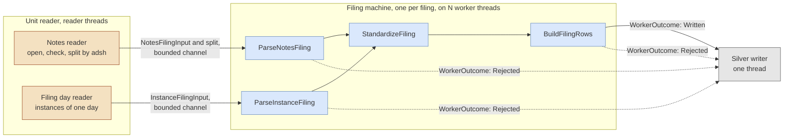

# Transform per Filing

> **Status:** proposed, for review by the owner.
> [ADR 0048](../../../docs/adr/0048-one-value-per-filing-between-transform-states.md),
> [ADR 0042](../../../docs/adr/0042-rejected-filing-and-unit-threshold.md), and
> [ADR 0043](../../../docs/adr/0043-standardize-filing-once-per-source.md) hold the decisions of
> this document.
>
> **Marks:** "Measured" means checked on 2026-11-07, 2026-11-08, or 2026-11-09 against a downloaded
> SEC file, as the Linear documents "STA-425 Findings: Data Model and Processing of the Silver
> Layer", "STA-424 Findings: Silver Parquet Layer and Polars for the Transform Step", and "Silver
> Prototype Findings" record it. "Estimate" means not measured. Every other statement
> is a proposal.

This document sets the filing step of the transform. A transform task turns one raw document into
whole filings. Each filing becomes the rows of four silver datasets. The task runner, the silver
writer, the job plan, and the series step are set in
[`silver_writer_and_jobs.md`](silver_writer_and_jobs.md). This document fills in the reader threads
of that runner, and does not change its shape. The silver contract is
[`silver_layer.md`](silver_layer.md).

## Reading Guide

- [Overview](#overview) gives the diagram and the split of the work. Read it first.
- [The Notes Reader](#the-notes-reader) and [The Filing Day Reader](#the-filing-day-reader) turn
  one unit into filings.
- [The Filing Machine](#the-filing-machine) lists the states of one filing.
- [Validation Layers](#validation-layers) and [Rejected Filings](#rejected-filings) say what fails a
  row, a filing, and a unit.
- [Where Resolve and the Checks Sit](#where-resolve-and-the-checks-sit),
  [Handover to Silver and Gold](#handover-to-silver-and-gold), and
  [Company Facts and the Old Transform](#company-facts-and-the-old-transform) place the step among
  the other designs.
- [Implementation Tickets](#implementation-tickets) and [After This Design](#after-this-design) list
  the work.

## Overview



A transform task runs one unit. The work has three parts:

| Part | Runs | Holds | Fails |
| ---- | ---- | ----- | ----- |
| Unit reader | Once per unit, on the reader threads of the task runner, outside the state machine | Every I/O of the step: the raw store reads, the ZIP, the tables, the daily index | The unit |
| Filing machine | Once per filing, on the worker threads of the task runner | No I/O. Parse, standardize filing, and the provenance of the rows | The filing only. A failed filing is a rejected filing |
| Silver writer | Once per unit, on one thread | The parts, the digest, the counts, the `unit_manifests` row | The unit |

The unit reader and the writer belong to the task runner of `silver_writer_and_jobs.md`, "Threads
Inside a Transform Task". For a Notes file, the reader has one thread per table stream of `num.tsv`
and `txt.tsv`, and a join by `adsh`. For a filing day, it is one thread. The filing machine is the
filing step that the runner takes as a function.

### One Value per Filing

The states of the filing machine pass one value: the rows, the facts, or the candidates of one
whole filing. No state outputs a stream of records. Only the unit reader streams, and it streams
whole filings through the bounded channel of the runner
([ADR 0048](../../../docs/adr/0048-one-value-per-filing-between-transform-states.md)).

- The largest filing has 27,529 rows in `num.tsv` of `2025q3` (measured). Its facts, candidates,
  and rows fit in memory many times over.
- So the MVP needs neither streamable states nor fork and join. The runner starts one machine per
  filing. No machine forks or joins.
- The runner drives each machine by its transitions in a plain loop, with a current-thread
  executor per worker. It does not read the event stream of the machine, so no state data enters
  event JSON.

## The Notes Reader

The Notes reader turns one stored Notes file into a sequence of `NotesFilingInput` values. Its
input is a `NotesArchiveRef` from the `RawDocumentSource` of the plan step. It reads the bytes through a
`ReadRepository<Record = RawDocument<RawNotesArchive>>`. The raw store checks the size and the
SHA-256 against the metadata on each read.

### Steps

1. **Open.** It reads the archive and runs the container checks of layer 2, see
   [Validation Layers](#validation-layers). It reads the metadata member for the column list of
   each table.
2. **Read the small tables whole.** It reads `sub.tsv`, `dim.tsv`, and `tag.tsv` into maps: `sub`
   by `adsh`, `dim` by `dimh`, and `tag` by `tag` and `version`. `sub.tsv` and `dim.tsv` hold about
   81 MB of text in `2025q3` (measured). The `dim.tsv` map takes most of the 463 MB peak of a read
   of `2024q1` (measured).
3. **Select filings.** It keeps the `sub` rows whose form is in `SELECTED_FORMS`, with their
   amendments. This is the same rule as the daily path
   ([`extraction_overview.md`](extraction_overview.md), "Filings We Select"). The rows of the other
   filings count in `dropped_rows` with the reason `form_not_selected`. `2024q1` drops 1,259,028
   rows this way (measured).
4. **Split by `adsh`.** It streams `num.tsv` and `txt.tsv` side by side, first in one pass, and in
   K passes over hash buckets after the first row out of order. See [The Split](#the-split).
5. **Assemble.** For each selected filing, it builds an `xbrl::adapter::edgar::notes::NotesFiling`:
   the `sub` row, the `num` and `txt` rows, the `dim` rows that the rows name through `dimh`, and
   the `tag` rows that the `num` rows name. It adds the provenance of the raw document and sends
   the filing to the channel.

`pre.tsv`, `cal.tsv`, and `ren.tsv` stay unread in the MVP. `xbrl` takes its calculation tree from
the taxonomy release, not from the filing.

### The Split

The split follows "Unit of Work and Memory" of the silver contract: the stream first, and the
bucket split as the fallback.

| Split | When | Peak for `2024q1` (measured) |
| ----- | ---- | ---------------------------- |
| Stream | Always first, unless the current unit of the key has `split = buckets` | 463 MB, 45.6 s for the whole unit |
| Buckets of 256 MB | On the first row of `num.tsv` or `txt.tsv` whose `adsh` is smaller than the `adsh` before it | 714 MB, 97.3 s with K = 11 |

- **Stream.** A merge of two sorted lists. The reader holds the rows of the current `adsh` of each
  table. When both tables move past an `adsh`, it hands that filing on.
- **Switch.** The reader thread that reads the first row out of order tells the join. The join
  stops the stream and sends a restart message to the writer. The writer drops what it holds and writes the bucket parts under
  `<execution_id>-<attempt>-b`. The parts of the stream stay unread, as the contract says.
  Rejected filings and dropped rows count again from zero.
- **The split of each filing.** Each message of the channel carries the split of its filing,
  `stream` or `buckets`. The worker pairs each outcome with the split of its input, as
  `WorkerOutcome`. Up to 2 × N stream filings can still sit in the channels and the
  workers at the restart. The writer drops each outcome of `stream` that arrives after the restart
  message, so no filing enters the bucket parts twice.
- **Buckets.** K is the text size of `num.tsv` and `txt.tsv` from the ZIP index, divided by 256 MB
  and rounded up. Each pass keeps the rows where `xxh3_64(adsh)` with seed 0, modulo K, equals the
  pass number. It groups them by `adsh` and hands one filing at a time to the channel. It ends each
  pass with the count of filings of the pass, as "Threads Inside a Transform Task" says.
- **The filings of a pass.** A pass walks the selected `sub` rows of its bucket, so a filing with
  no `num` or `txt` row appears in exactly one pass. The count of a pass includes the filings that
  the machines reject, because each one still sends an outcome to the writer.
- **Filings with no `sub` row.** A `num` or `txt` row whose `adsh` has no `sub` row counts in
  `dropped_rows` with the reason `no_sub_row`. Measured files hold no such row, so the reason
  stays for a damaged file.
- **A `sub` row with no `num` or `txt` row** still gives a filing. It writes a `filings` row and no
  fact.

### `NotesFilingInput`

```rust
/// The rows of one selected Notes filing and the raw document they came from.
pub struct NotesFilingInput {
    pub rows: NotesFiling,
    pub source: SourceDocument,
}

/// The raw document of a row, for the ingestion provenance of `silver_layer.md`.
pub struct SourceDocument {
    pub kind: SourceKind,           // Notes or Instance
    pub key: DocumentKey,
    pub sha256: Sha256Digest,
    pub ingestion_mode: IngestionMode,
}
```

The reader fills `SourceDocument` once per unit for Notes, and once per instance for a day. It
takes `ingestion_mode` from the raw metadata of the document, so no step branches on the mode.

## The Filing Day Reader

The filing day reader turns one filed date into a sequence of `InstanceFilingInput` values. Its
unit key is the filed date, as "Where Units Come From" of the job design gives it.

1. It reads the stored daily index `sec/daily-index/form.<YYYYMMDD>.idx` of the day.
2. It keeps the rows of `SELECTED_FORMS` and their amendments, as `SelectFilings` of extract does.
3. For each filing, it reads the stored instance by its key. If the store holds no instance for
   the filing, the filing is not part of the unit. A later run writes the day again when it
   arrives.
4. It reads the stored `submissions` file of each CIK of the day once, and takes `sic` from it.
5. It hands one `InstanceFilingInput` per filing to the channel.
6. It hands the writer the inputs of the unit: the key and the SHA-256 of each instance and of each
   `submissions` file it read. These enter `input_digest` by rule 1 of a write, as the `filing_day`
   row of "The Write Unit" of the contract lists them.

```rust
/// The main instance of one filing, its company data, and the raw documents they came from.
pub struct InstanceFilingInput {
    pub filing: FilingRef,
    pub document: Vec<u8>,
    pub source: SourceDocument,
    pub industry: Option<StoredIndustry>,
}

/// The SIC of the company from its stored `submissions` file.
pub struct StoredIndustry {
    pub code: IndustryCode,
    pub source: SourceDocument,
    pub retrieved_at: jiff::Timestamp,
}
```

- Extract picks the main instance and skips the filing-fee exhibit, in `SelectFilingDocuments`.
  The store holds only the main instance under `instance_key`. So the transform picks nothing.
- If the store holds no `submissions` file for the CIK, `industry` is `None`, and the `sic_*`
  columns of `filings` stay null. Extract stores the `submissions` file in the same run as the
  instance, so this case needs a failed fetch.
- A `submissions` file that arrives later changes the inputs of the day. The raw store listing
  backend hands out every filing of the window of `daily_filings`, so a run of that backend writes
  the day again with the SIC. The write log and the queue hand out no reference for a
  `submissions` file, so with them the day keeps the null until a replay. A day outside the window
  keeps the null until a replay, with every backend.
- The label file stays unread. The company labels stay out of the MVP.
- The reader reads one instance at a time. The largest unit of the prototype held 394.7 MB of XML
  for 167 filings, with a peak of 78 MB (measured).

## The Filing Machine

`TransformFilingSuperState<S>` runs one filing. It has two entry states, one per source, and a
shared part.

| State | Input | Output | Calls |
| ----- | ----- | ------ | ----- |
| `ParseNotesFiling` | `NotesFilingInput` | `ParsedFiling` | `xbrl::adapter::edgar::notes::parse` |
| `ParseInstanceFiling` | `InstanceFilingInput` | `ParsedFiling` | UTF-8 decode, then `xbrl::adapter::edgar::instance::parse` |
| `StandardizeFiling` | `ParsedFiling` | `StandardizedFiling` | `core::dedup::more_precise`, `core::alias::resolve_aliases`, `core::cadence_filter::keep_by_cadence` |
| `BuildFilingRows` | `StandardizedFiling` | `FilingRows` | The row types of `sec::datasets` |

### Data Between the States

```rust
/// The as-is output of one filing, from either parser.
pub struct ParsedFiling {
    pub facts: Vec<AsIsFact>,
    pub filing: Filing,
    pub findings: Vec<Finding>,         // UnmappedRow and UndeclaredFamily
    pub source: SourceDocument,
    pub industry_source: Option<StoredIndustry>,
    pub counts: SourceCounts,           // rows in, rows dropped by reason
}

/// The as-is output and the candidates of one filing.
pub struct StandardizedFiling {
    pub parsed: ParsedFiling,
    pub candidates: Vec<Candidate>,     // blocked ones included
    pub conflicts: Vec<Finding>,        // Finding::Conflict only
}

/// The rows of one filing for the four datasets of a transform unit.
pub struct FilingRows {
    pub filing_id: FilingId,
    pub as_is_facts: Vec<AsIsFactRow>,
    pub filing: FilingRow,
    pub candidates: Vec<CandidateRow>,
    pub findings: Vec<FindingRow>,      // step = filing
    pub counts: SourceCounts,
}
```

- The transitions only move data, as in `xbrl/DESIGN.md`, "4a) Transform Integration". Each
  `From` impl moves the output of one state into the input of the next.
- `ParseInstanceFiling` sets `Filing::company.industry` from `industry`. The instance has no
  industry code.
- `StandardizeFiling` runs once per source of a filing
  ([ADR 0043](../../../docs/adr/0043-standardize-filing-once-per-source.md)). An instance unit and
  a Notes unit of one filing each write their own `candidates` rows. "Current Facts" of the
  contract picks one unit per filing at read time.
- `BuildFilingRows` adds the run columns to each row, and the ingestion provenance to each row of
  `as_is_facts` and `filings`. It computes `entity_bucket` as "Entity Buckets" of the job design
  gives it. The provenance joins each row here, not in the parser, because `xbrl` knows no raw
  document.
- The `Conflict` findings and the parser findings `UnmappedRow` and `UndeclaredFamily` go to
  `findings` with `step = filing`
  ([ADR 0041](../../../docs/adr/0041-parser-findings-in-silver.md)). `dropped_rows` counts the
  row of each `UnmappedRow` under the reason `UnmappedRow`.

### The Filing Step

The runner calls one function per filing:

```rust
/// Runs the filing machine on one filing.
pub fn run_filing(input: FilingInput, context: &FilingContext) -> FilingOutcome;

pub enum FilingInput {
    Notes(NotesFilingInput),
    Instance(InstanceFilingInput),
}

pub enum FilingOutcome {
    Written(FilingRows),
    Rejected(RejectedFiling),
}

pub struct RejectedFiling {
    pub filing: String,                 // the adsh, or the accession number
    pub error: TransformFilingError,
    pub counts: SourceCounts,           // every source row of the filing, dropped as rejected_filing
}
```

The split is a concern of the runner, not of the machine. So the worker wraps the outcome for the
writer:

```rust
/// The outcome of one filing, as the writer receives it.
pub struct WorkerOutcome {
    pub split: Split,                   // copied from the channel message
    pub outcome: FilingOutcome,
}

/// The split of the Notes file that gave a filing. A filing day always has `Stream`.
pub enum Split {
    Stream,
    Buckets,
}
```

`run_filing` returns no `Result`. Every error of a filing machine is an error of the data of one
filing, so it rejects the filing. A bug that panics ends the process, as the failure table of the
job design says.

### The Context

`FilingContext` holds the registry, the `transform_version`, and the `execution_id`. Every state of
the machine takes it.

- The task builds one `Registry` at its start and keeps it for its whole run, as
  `&'static Registry<'static>`. The `UsGaap` plug-in is a static value, so the registry borrows
  nothing short-lived.
- `RegistryHandle` wraps the reference. Its `Eq`, `Ord`, and `Hash` compare the release IDs of the
  plug-ins, so the context has the value traits that every state context needs.
- A test passes a registry of fake plug-ins through the same handle.

A 20-F or 40-F filer can report in IFRS. The registry holds no IFRS plug-in in the MVP. The facts
of such a filing reach `as_is_facts` with an undeclared family and a `UndeclaredFamily` finding,
and give no candidate.

### Errors

Each state error follows `AGENTS.md`, "Error Display Format". The leaf is the error of `xbrl`.

| State | Error | When |
| ----- | ----- | ---- |
| `ParseNotesFiling` | `FailedNotesParse`, `Caused by:` the `ParseErrorKind` | The `sub` row breaks a rule of a core type |
| `ParseInstanceFiling` | `InvalidInstanceText`, with `Reason:` | The bytes are not UTF-8 |
| `ParseInstanceFiling` | `FailedInstanceParse`, `Caused by:` the `ParseErrorKind` | The text is not XML, or a cover fact is missing or breaks a rule |
| `StandardizeFiling` | None | The functions it calls return no error |
| `BuildFilingRows` | `FailedRowBuild`, `Caused by:` the `ArrowRowError` | A value does not fit its Arrow type, for example a decimal with more than 28 digits before the point |

`TransformFilingError` is the error of the super-state. It passes each state error through, as
`#[error(transparent)]`, and adds no segment.

## Validation Layers

The extraction design sets four layers of validation, each in the state that first sees the data
([`ingestion_paths.md`](ingestion_paths.md), "Validation"). The transform runs layers 2 to 4.

| Layer | Where | On failure |
| ----- | ----- | ---------- |
| 2. Container | The Notes reader, step 1: the ZIP signature, the ZIP index, the eight tables and one metadata member, deflate only, no path separator in a member name, the size limits | Bad unit |
| 3. Table format | The table readers of the Notes reader: UTF-8, quote-aware tab-separated fields, the header equal to the columns of the metadata member, one field count per table, the CRC-32 of each member | Bad unit |
| 4. Row content, one row | The parsers. A row that breaks a rule of a core type gives an `UnmappedRow` finding | The row: an `UnmappedRow` finding, and `dropped_rows`, reason `UnmappedRow` |
| 4. Row content, one filing | The parse states. A `sub` row or a cover fact that breaks a rule, an instance that is not XML | The filing: a rejected filing |
| 4. Row content, the unit | The Notes reader. Two `sub` rows with one `adsh` | Bad unit |
| 4. Row content, references | The Notes reader. A `num` or `txt` row with no `sub` row | The row: `dropped_rows`, reason `no_sub_row` |

The instance path has no layers 2 and 3. The daily index of the day is the one table it reads, and
extract checked it when it stored it. A daily index that does not parse is a bad unit.

## Rejected Filings

A filing is rejected when its filing machine returns an error
([ADR 0042](../../../docs/adr/0042-rejected-filing-and-unit-threshold.md)).

- The unit goes on without the filing. The filing writes no row in any dataset.
- `dropped_rows` of `as_is_facts` counts every source row of the filing with the reason
  `rejected_filing`, and `dropped_rows` of `filings` counts its `sub` row or its instance. So check
  3 of the contract, "Row counts", still holds.
- The task logs one `filing_rejected` event per filing, as `warn`, with the unit key, the filing,
  and the error text. `rejected_filings` of `task_summary` counts them.
- **The unit fails if more than 5% of its selected filings are rejected and at least 3 are, or
  if every selected filing is rejected.** The writer checks this after the last filing, before
  rule 4 of a write. The floor of 3 keeps one bad filing from failing a day of 10 filings. The
  second clause fails a day of 2 filings that a broken parser rejects in full.
- A failure of this kind is a bad unit in the failure table of the job design.

| Failure | Example | Result |
| ------- | ------- | ------ |
| Transient | A raw store read times out | The unit fails, in the reader. The machine does no I/O, so a transient error never rejects a filing |
| Bad unit | Layer 2 or 3 fails, a stored file has another SHA-256 than its metadata | The unit fails, in the reader |
| Rejected filing | A `sub` row with a broken `fye`, an instance that is not XML | The filing leaves the unit |
| Too many rejected filings | A parser change rejects most 10-Q filings | The unit fails, in the writer |
| Bug, with a panic | An index out of range | The process ends |

A rejected filing stays out of silver until its unit is written again: by new raw bytes, or by a
new `transform_version` after a parser fix. Rule 2 of a write skips the unit otherwise.

## Where Resolve and the Checks Sit

| Step | Where | Source |
| ---- | ----- | ------ |
| `resolve(cik, period_end)` | Load, as its first step. Silver keeps the entity as filed, `sec` and the CIK | The accepted findings of the entity resolution SPIKE: the load step reads the table of dated CIK ranges |
| The data checks: identity, coverage, facts, segments | Load, as its last step, and on a schedule | The accepted findings of the data expectations SPIKE: "The checks gate publishing, not persisting" |
| The roll-up and sum checks of `xbrl` | The series step | [`silver_writer_and_jobs.md`](silver_writer_and_jobs.md), "Per Entity" |
| Validation layers 2 to 4 | The transform, see [Validation Layers](#validation-layers) | This document |

The filing step runs no data check. A failed data check stops a load, never a silver write, as
"Fixed Inputs" of the contract says.

## Handover to Silver and Gold

- The as-is facts of each filing go to `as_is_facts`, and its `Filing` to `filings`. These two
  datasets are the fact store of the as-is fact model.
- Gold loads from silver
  ([ADR 0001, Amendment 1](../../../docs/adr/0001-mvp-database.md#amendment-1-load-reads-silver)).
  The load design sets the tables and the write rule.
- A replay of a rule of standardize filing runs the whole filing step again from the raw store.
  Parse costs little: the largest Notes file takes 45.6 s to split, parse, map, and write, and an
  instance takes at most 101 ms to parse (measured). So the MVP has no state that loads as-is
  facts from silver. A later design adds it if a replay of standardize filing alone becomes
  frequent.
- A Notes file that the SEC corrects has a new SHA-256. So rule 2 of a write finds a new
  `input_digest`, and the task writes a new unit.

## Company Facts and the Old Transform

The `companyfacts` JSON is a cross-check only, because it drops every value with a dimension
([ADR 0036](../../../docs/adr/0036-no-company-concept-or-frames-parser.md)). So it is no source of
silver.

- The existing transform, `ParseCompanyFacts` and `CreateFinancialStatements` behind `stream_etl`,
  maps the `companyfacts` JSON into statements. It stays as it is until the cross-check has a
  design, and gets no new state.
- The three planned tickets that store the `companyfacts` document and read it back into that
  transform end without code. The filing step reads the raw store through the unit readers above.
- The cross-check compares silver with the `companyfacts` values of a sample of companies. It is a
  check over silver, so the check design of the runner and the format owns it. It keeps 10-K and
  10-Q, as today.

## Implementation Tickets

Each ticket fits one PR under 400 reviewable lines (estimate). The list gives the order.

1. FEATURE: the Notes table reader: open the archive with the checks of layer 2, and a
   quote-aware TSV reader with the checks of layer 3.
2. FEATURE: the stream split of the Notes reader: the maps of `sub`, `dim`, and `tag`, the form
   selection, the merge of `num` and `txt` by `adsh`, `NotesFilingInput`, and the stop on the first
   row out of order.
3. FEATURE: the bucket split of the Notes reader: K, the passes, the end-of-pass message, and the
   restart message to the writer.
4. FEATURE: the filing day reader and `InstanceFilingInput`.
5. FEATURE: `ParseNotesFiling`, `ParseInstanceFiling`, `FilingContext`, and their errors.
6. FEATURE: `StandardizeFiling` and the transitions from both parse states.
7. FEATURE: `BuildFilingRows`, `run_filing`, and `FilingOutcome`.
8. FEATURE: rejected filings in the runner and the writer: the `dropped_rows` reasons, the
   threshold of the unit, and `filing_rejected`.

The end-to-end test from a raw filing to the silver datasets exists as its own ticket and follows
ticket 8.

## After This Design

Proposed for the project, in this order:

1. **Milestone "Transformation Done"** gets the eight tickets above, next to the tickets of the job
   design. Silver holds the as-is facts and the candidates of every unit when both sets are done.
2. **A design of the standardized layer for the MVP:** a thin first version with the 12 SFAC 6
   roll-ups and the screener values. It reads `candidates` and fills `standardized_facts` through
   the series step.
3. **A milestone "Load Done"** after it: the gold tables, `resolve`, the load-time checks, and the
   ledger of loaded units.

## Open Points

- **IFRS.** A filer in IFRS gets as-is facts but no candidates until an IFRS plug-in exists.
- **The share of 5% and the floor of 3** rest on no measurement of rejected filings. The
  prototype findings report no rejected filing for 167 instances and the Notes files `2024q1`,
  `2012q4`, and `2026_10`.
  The first full backfill measures the share, and ADR 0042 names the event that reopens it.
