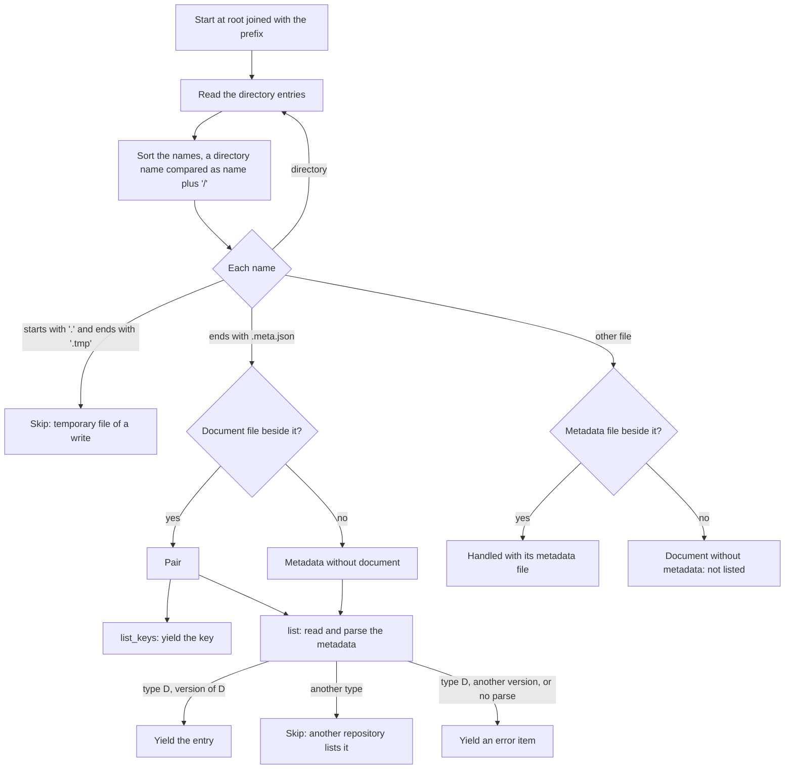
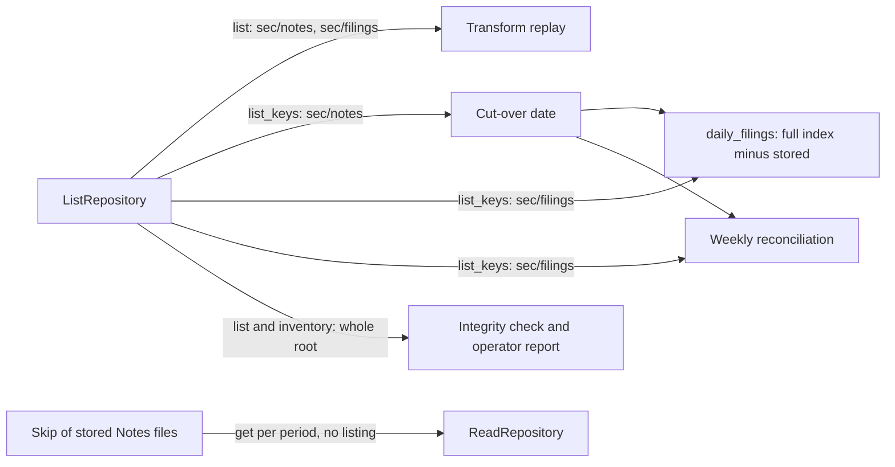

# Listing the Contents of a Repository

## Purpose

The `storage` crate reads a document by key only. A caller must know every key in advance. This
document adds a listing: a repository gives a stream of the documents it holds, as metadata, never
as bytes. It records the trait, the filesystem sketch, the ordering and consistency rules, and how
each consumer uses the listing.

Status: the code implements features 1 and 4 of [Feature Tickets](#feature-tickets), and the code
of feature 2. The measurement of feature 2 is not done, see [Limits](#limits). Features 3, 5, and 6
have no code. The lead must still review the decision in
[Bookmark or Full Index](#bookmark-or-full-index).

## Reading Guide

| Section | Content | Decision |
| ------- | ------- | -------- |
| [Relation to the Deferred Read Surface](#relation-to-the-deferred-read-surface) | Why the listing reopens one item of the deferred read surface, and why the listing is no `scan` | Yes |
| [The Trait](#the-trait) | `ListRepository`, the filter, the entry, the error | Yes |
| [Filesystem Sketch](#filesystem-sketch) | The walk, orphans, temporary files, cost, limits | Yes |
| [Ordering and Consistency](#ordering-and-consistency) | Sort order, what a listing sees during a write | Yes |
| [Consumers](#consumers) | How each consumer uses the listing, and the one that keeps `get` | Yes |
| [Bookmark or Full Index](#bookmark-or-full-index) | The source of the dates of `daily_filings` | Yes, for review by the lead |
| [Assumptions and Triggers](#assumptions-and-triggers) | What each decision assumes, and what reopens it | No |
| [Feature Tickets](#feature-tickets) | The work that follows | No |

## Relation to the Deferred Read Surface

Read methods beyond `get` wait for a concrete consumer (see
[`storage_traits_design.md`](../../../sec/design/data_model/storage_traits_design.md#planned-silver-graph-and-facts),
"Planned"). The listing has five, see [Consumers](#consumers). So the listing reopens the read
surface for the listing only:

- `completeness`, `ownership_tree`, and `query` stay deferred. They wait for a screener or API
  consumer.
- The CQRS split stays deferred. The listing is one more read capability next to `get`.

The listing is not a `RawStore::scan(filter)`, a stream of `RawFiling` values with their bytes:

- `scan` would return the bytes. The raw store holds about 30 GB today. A stream of bytes reads all of
  them, also for a caller that needs only keys.
- The `storage` crate has no `RawStore`. Each document type has its own repository
  behind the neutral `ReadRepository` and `WriteRepository` ports. A listing on those ports serves
  every repository, not only the raw tier.
- A replay driver that needs the bytes lists the keys, then calls `get` for each key. That
  composition gives what `scan` would give, and `get` keeps its size and SHA-256 check.

## The Trait

### Shape

```rust
use futures_core::stream::BoxStream;

use crate::error::ReadError;

/// Lists the documents a store holds, as metadata, never as bytes.
pub trait ListRepository: Send + Sync {
    /// The key of one listed document.
    type Key: Send;

    /// What one listed document reports: its key and its metadata.
    type Entry: Send;

    /// What a listing selects, for example a key prefix.
    type Filter: Send;

    /// Lists the key of each stored document that the filter selects. Reads no file, so a backend
    /// that keeps the document type in the metadata yields the keys of every type.
    fn list_keys(&self, filter: Self::Filter) -> BoxStream<'_, Result<Self::Key, ReadError>>;

    /// Lists each stored document that the filter selects, with its metadata. Reads no document.
    fn list(&self, filter: Self::Filter) -> BoxStream<'_, Result<Self::Entry, ReadError>>;
}
```

Decisions:

1. **A separate capability trait, not a method on `ReadRepository`.** A store that only reads by
   key implements no listing. A caller bound to `ReadRepository` has no listing in scope. This
   follows the capability split of
   [`capability_split_trait_hierarchy.md`](./capability_split_trait_hierarchy.md).
2. **A standalone trait, not a subtrait of `ReadRepository`.** The listing extends the ports and
   modifies none of them, so `ReadRepository` stays as it is. A caller bound to `ListRepository`
   alone can list but has no `get` in scope. That matches an account that can list names but
   cannot read contents, such as a GCS account with `storage.objects.list` and without
   `storage.objects.get`. Such an account can call `list_keys` only: `list` reads each metadata
   file, and that read needs `storage.objects.get`.
3. **Its own `Key`.** `ListRepository` declares its own `Key`, because `ReadRepository` declares
   its `Key` and the open-closed rule keeps it there. A store that implements both sets the two to
   the same type. The filesystem sets both to `DocumentKey`, so every key that `list` yields is a
   key that `get` accepts.
4. **A helper for callers that list and read.** Replay, `daily_filings`, and the integrity check
   do both. `ReadListRepository` names a store that reads and lists with one key type. A blanket
   impl grants it:

   ```rust
   pub trait ReadListRepository:
       ReadRepository + ListRepository<Key = <Self as ReadRepository>::Key>
   {
   }

   impl<T> ReadListRepository for T where
       T: ReadRepository + ListRepository<Key = <T as ReadRepository>::Key>
   {
   }
   ```

   This shape compiles with rustc 1.99.1, the pinned toolchain (a probe outside the repository,
   2026-11-08). A caller bound to `R: ReadListRepository` passes each key from `list_keys` to `get`
   with no conversion.

   Both parents declare `Key`, so a bare `R::Key` fails with E0221, "ambiguous associated type". A
   caller writes `<R as ReadRepository>::Key`. The bound makes the two keys one type, so either
   path names it. `ReadWriteRepository` differs here: it leaves its two `Record` types separate.
   For the same ambiguity, `dyn ReadListRepository<Key = …>` does not compile, so the helper has no
   trait object. `dyn ListRepository<Key = …, Entry = …, Filter = …>` compiles. Leaving out
   `Entry` or `Filter` fails with E0191. A store whose two keys differ gets no
   `ReadListRepository`: the bound fails with E0271.
5. **Two methods.** `list_keys` reads only directory entries, so it costs one listing call per
   directory. `list` also reads each metadata file, one read per document. The cut-over check and
   the daily run need only keys. Replay and the integrity check need the metadata.
6. **A stream, not a `Vec`.** The store will hold millions of documents. A caller folds the stream
   or collects it. `BoxStream` keeps the trait object-safe, so `Box<dyn ListRepository<…>>` works
   as `Box<dyn ReadRepository<…>>` does. The methods are not `async`, because the stream is lazy.
   The `storage` crate gains the dependency `futures-core`, which is pure Rust.
7. **No summary method.** Counts, total size, and the newest period are a fold over the stream in
   the caller. If a backend makes the fold too slow, a summary method comes with that backend.
8. **`Key`, `Entry`, and `Filter` are associated types,** as `ReadRepository::Record` and
   `ReadRepository::Key` are. The metadata layout
   belongs to the backend: the filesystem has a metadata file per document, a database has rows.

### Error

The listing returns `ReadError`, because a listing is a read. `ErrorKind::Read` covers it, so the
error hierarchy gains no variant. A listing never returns `ReadError::MissingRecord`.

The stream holds one `Result` per item:

- An error about one path, such as a metadata file that does not parse, is an item. The stream
  continues after it.
- A root that is missing or not a directory gives one error, and the stream ends.

A caller that must stop at the first error uses `try_collect` or `try_fold`. The integrity check
collects every error into its report.

The filesystem adds `FilesystemOperation::ListDirectory` for a directory that it cannot read. The
error then reads, for example:

```text
[FailedFilesystemOperation] Filesystem operation failed, Reason: 'Failed to list directory, permission denied', Path: '…/sec/notes'
```

### Filesystem Filter and Entry

`FilesystemRepository<A, D>` implements `ListRepository` for `A: CanRead`:

| Associated type | Filesystem type |
| --------------- | --------------- |
| `Key` | `DocumentKey`, as for `get` |
| `Filter` | `KeyPrefix` |
| `Entry` | `ListedDocument<D::Context>` |

```rust
/// Selects the keys under a directory of the root, and optionally only the keys after a cursor.
pub struct KeyPrefix {
    directory: Option<DocumentKey>,   // None for the root
    start_after: Option<DocumentKey>, // the cursor
}

/// One listed document: its key, its metadata, and what the store found for its document file.
pub struct ListedDocument<C> {
    key: DocumentKey,
    metadata: DocumentMetadata<C>,
    metadata_modified_at: DateTime<Utc>,
    document: StoredDocument,
}

/// What the listing found in place of the document file.
pub enum StoredDocument {
    /// The document file exists, with this size on disk.
    Present { size_in_bytes: u64 },
    /// The metadata file exists, but the document file does not.
    Missing,
}
```

- **The prefix matches whole path components.** `sec/notes` selects `sec/notes/2024q1_notes.zip`,
  not `sec/notes-old/a.zip`. A prefix is a directory, so the walk starts there and reads nothing
  above it.
- **The document type filter is the type parameter `D`.** A repository lists only the metadata
  files of `D::DOCUMENT_TYPE`. This matches `get`, which rejects metadata of another type. To list
  every type, a caller lists one repository per type. The raw store has seven types.
- **The entry carries the whole `DocumentMetadata<D::Context>`.** It holds every field that the
  consumers need: document type, size, SHA-256, `produced_at`, and `ingestion_mode`. It also holds the typed `context`, so a caller can read the `filing` of an
  instance (its `filed_date` and `form`) without a second read. One metadata type means no second
  field list to keep in step.
- **`StoredDocument::Present` holds the size on disk,** from one `stat` call per document file,
  because a directory read gives no size. A caller
  compares it with `metadata.size_in_bytes()` and needs no read of the document. The SHA-256 needs
  the bytes, so the listing never checks it. `get` does.

`list_keys` ignores `D`. The document type sits in the metadata file, and `list_keys` reads no
file. So `list_keys` yields every key under the prefix that has a document file and a metadata file.
Under `sec/filings/`, it yields the folder index, the instance, and the label file of each filing.
The caller knows the key layout and keeps the file names it needs.

## Filesystem Sketch

### The Walk



1. The walk starts at the root joined with the prefix. It goes depth first, so it holds the sorted
   names of each directory on the path to the current one. See rule 5 of [Limits](#limits).
2. It sorts the names of each directory before it goes deeper. See
   [Ordering and Consistency](#ordering-and-consistency) for the rule.
3. It does not follow a symbolic link. The write path never creates one.
4. It pairs the files of one directory by name. A document `x` pairs with `x.meta.json`, the
   `METADATA_SUFFIX` rule of `FilesystemRepository`.
5. `list` reads the metadata files with a bound on the reads in flight, for example 16. It yields
   the entries in walk order, so the bound does not change the order.

### Orphans and Temporary Files

| Found | `list_keys` | `list` | Why |
| ----- | ----------- | ------ | --- |
| Document and metadata | Key | Entry, `Present` | The normal case |
| Metadata without document | Nothing | Entry, `Missing` | The metadata names its type, so the repository of that type can report it. A write in flight shows this for a moment, see below |
| Document without metadata | Nothing | Nothing | No metadata names its type, so no typed repository can claim it. The write path never leaves this state, see below |
| Hidden `.tmp` file | Nothing | Nothing | A temporary file of a write in flight, or of a write that a killed run left |
| Metadata of another type | Nothing | Nothing | Another repository lists it. Repositories of several types share one root |
| Metadata of type `D`, another version | Nothing | Error item | The store holds a document that this code cannot read. `get` fails on it too |
| Metadata that does not parse | Nothing | Error item | Same as `get` |

A write renames the metadata into place first, then the document. So a document on disk always has
its metadata, and a document without metadata means that something outside the write path changed
the store. A typed listing cannot see such a file. The integrity check needs it, so the filesystem
also offers a walk that is not typed:

```rust
impl<A: CanRead, D> FilesystemRepository<A, D> {
    /// Walks the files under the prefix and reports each file by its role.
    pub fn inventory(&self, prefix: KeyPrefix) -> BoxStream<'_, Result<InventoryItem, ReadError>>;
}

pub enum InventoryItem {
    Pair { key: DocumentKey, size_in_bytes: u64 },
    MetadataWithoutDocument { key: DocumentKey },
    DocumentWithoutMetadata { key: DocumentKey, size_in_bytes: u64 },
    TemporaryFile { path: PathBuf, modified_at: DateTime<Utc> },
}
```

`inventory` is not part of the port. It describes files, and only the filesystem has files. A later
backend with its own orphans adds its own walk. The integrity check decides what to do with each
item. The listing deletes nothing.

### Cost

| Call | Local disk | Mounted bucket |
| ---- | ---------- | -------------- |
| `list_keys` | One directory read per directory | One list request per directory |
| `list` | Plus one read of each metadata file, about 1 KB, and one `stat` of each metadata file and each document file | Plus one read request per metadata file, and one `stat` per metadata file and per document file, which can be one request each. A list request can return the sizes and times, so the measurement can remove the `stat` calls |
| `get` after a listing | Reads the document | Downloads the document |

None of these numbers is measured. The store holds about 30 GB today, but its file count is not
measured. A filing adds one directory and three documents. The full index of 2026 Q3 held 6,051
filings of the selected forms, so the filings add about 6,000 directories per quarter. On the
mounted bucket, a walk of `sec/filings/` then sends one list request per directory, and its time
grows with every quarter. A backend that calls the object API lists a prefix flat, at 1,000
objects per request, in the same byte order. It implements the same trait. The object API also
returns the CRC32C of each object without a download, which the integrity check can use.

### Limits

Each limit comes from a constraint of a consumer. Feature 2 applies these rules:

1. **Measure** on a copy of the store, in two ways:
   - Through the mount: requests per directory, time per directory, time per metadata read, and
     peak memory.
   - Through the object API, with a flat list of `sec/filings/` by `gcloud storage ls`: time per
     list request of 1,000 objects. This needs no backend of our own.

   Record the numbers in this section.
2. **Project two years ahead.** The filings add about 6,000 directories per quarter. Each filing
   adds three documents and three metadata files, so about 36,000 objects per quarter. Check the
   objects per filing against the store, because the mount can also store an object per directory.
   - Mount: (directories of today + 48,000) × time per directory.
   - Object API: (objects of today + 288,000) / 1,000 × time per list request.
3. **Daily run.** The projected `list_keys(sec/filings)` takes at most 3 minutes. The run has a
   timeout of 30 minutes, and up to 2,000 filings take about 11 of them. 3 minutes keeps the rest
   free for the full index and for retries.
   - If the mount projection exceeds 3 minutes, build the object API backend before
     `daily_filings` reads the full index.
   - If the object API projection also exceeds 3 minutes, stop and bring the numbers to the lead.
4. **Weekly check.** No fixed limit. The integrity design sets the timeout of its job, with the
   measured time of `list` as an input.
5. **Memory.** The peak memory of a listing grows with the widest directory, not with the count of
   files. The widest directory is the root of `sec/filings/`, with one name per CIK. Feature 2
   lists a store and a copy with twice the filings for the same companies, and the peaks must
   match within 10%. A size in MB belongs to the settings of the job, not to this design.

## Ordering and Consistency

### Order

The stream yields the documents sorted by key. The order compares the UTF-8 bytes of the key text,
with `/` between the components.

- A flat object listing in a bucket returns this order, so a later object backend needs no sort.
- The filesystem walk gives the same order if it compares a directory name as the name plus `/`.
  Example: the file `a-b` (`-` is byte 0x2D) comes before the directory `a/` (`/` is byte 0x2F).
- This order is not the `Ord` of `DocumentKey`, which compares path components. The two differ
  only when a directory name is a prefix of a sibling name and the next byte is below `/`, such as
  `-` or `.`. The raw store keys hold no such pair today. The trait documents the byte order.

A sorted stream costs one sort per directory. It gives deterministic tests, a deterministic replay,
and a merge with another sorted list, such as the rows of the full index sorted by key.

Within one call, the stream fetches the pages of the backend as it needs them. A `Filter` type that
supports resuming carries a cursor. The filesystem `KeyPrefix` holds the prefix and the cursor, and
`KeyPrefix::starting_after` sets it. The caller keeps the last
key it finished as its cursor. The sort order makes "after key K" exact:

- GCS supports it with `startOffset`. That parameter includes K, so the backend drops K.
- The filesystem walk skips each file whose key sorts at or before K. Below the prefix, it skips each
  directory whose keys all sort before K, and does not read it.

### What a Listing Sees During a Write

A listing takes no snapshot. It walks the directories as they are while it runs. Writes and
listings run at the same time: the daily run writes while the weekly check lists.

The contract:

1. A document whose write completed before the listing started, and that no write changed during
   the listing, appears exactly once.
2. A document written during the listing can appear or not, depending on whether the walk has
   passed its directory.
3. A key appears at most once. The store never deletes a document, so no key disappears.

A write in flight shows two states for a moment, both in its own directory:

- A new key: the metadata exists, the document does not yet. `list` yields `Missing`.
- A changed key: the new metadata sits beside the old document. `list` yields `Present` with the
  old size, which can differ from the size in the new metadata.

The modified time of the metadata file is the end of the write of its temporary file. That write
comes before the write of the document, and the rename keeps the time. So for a large document,
such as a Notes file on the bucket, the time is older than the end of the write by the length of
the document upload. The entry carries it as `metadata_modified_at`, from one `stat` of the
metadata file. A caller that acts on `Missing`
or on a size difference waits a grace period: if that time is less than 1 hour old, the caller
counts the entry as a write in flight, not as a fault. The metadata field `produced_at` does not
serve here: it names when the producer made the bytes, which can be long before the write. A write
that failed between its two renames stays in this state until the next write of that key. Its
modified time gets older, so the integrity check reports it after the grace period.

On the mounted bucket, a rename is a copy and a delete, not one atomic step. The temporary file is
hidden and skipped, so the listing never yields it. The two states above stay the same.

### Not for the Live Pipeline

The live pipeline never lists. An extract machine hands transform a reference with a key, such as
`NotesArchiveRef` (see [`ingestion_paths.md`](../../../sec/design/pipeline/ingestion_paths.md),
"Handover to Transform"). A transform state reads that key only. Only replay drivers, checks, the
operator, and the start of a binary list.

This rule stays. A listing returns what the store holds at that moment, and two listings at two
times return different sets. A state that reads a listing makes its output depend on the time of
the run, not on its input. A rerun with the same input then gives a different output.

## Consumers



### 1. Transform Replay

After a parser fix, a driver reruns transform on every stored Notes file and instance (rule 6 of
"Path Independence" in `ingestion_paths.md`).

- The driver calls `list(sec/notes)` on the Notes repository. Each entry with `Present` and a size
  equal to the metadata size gives a `NotesArchiveRef`: the period from the file name, the key, the
  size, and the SHA-256.
- It calls `list(sec/filings)` on the instance repository. Each entry gives the instance key of a
  `FilingDocumentsRef`. The label key is the same directory with `lab.xml`. The driver merges
  `list(sec/filings)` with one `list_keys(sec/filings)` call, both in the byte order of the keys. So
  it needs no `get` per filing to learn whether the label file exists, and it holds no set.
- It reports an entry with `Missing` or a size difference outside the grace period, and skips it.
- Transform then reads each key with `get`, as in the live pipeline. The transform design decides
  how a replay writes its new silver units.

### 2. Cut-Over Date

Rule 1 of "Cut-Over Between the Paths" starts the new-filing path at the last day of the newest
published Notes period. Today `backfill` asks the SEC for that period with one `HEAD` request. The
listing gives the newest stored period from the store:

1. Call `list_keys(sec/notes)`.
2. Parse the period from each file name: the text before `_notes`, through `NotesPeriod::new`.
3. Take the newest period by `NotesPeriod::last_day`. Its last day is the cut-over date.
4. Check for a gap from the keys alone, with no SEC request. Each quarter from the first quarter
   of `FIRST_YEAR`, `2009q1`, through the quarter of the newest period must be covered: by its
   quarterly file, or by its three monthly files. The quarter of the newest period needs only its
   months up to the newest one. If a quarter is not covered, fail and name it. This is the check
   of rule 5, read from the store instead of a run summary.

`stored_cut_over_date` in `sec/src/lib/implementations/extraction/notes/stored_cut_over_date.rs`
implements these steps. A key whose file name has no `_notes`, or whose text before `_notes` is no
Notes period, fails the function. So does an error item of the listing.

The SEC merges the monthly files of a quarter into one quarterly file about a year later. The store
can then hold the months, the quarter, or both. Each of the three counts as covered, and each gives
the same newest last day.

The `backfill` binary keeps its `HEAD` request, because its catch-up starts before its Notes step
stores the newest period. `daily_filings` sends no such request, so it uses the listing (see
consumer 3).

### 3. `daily_filings`: Full Index Minus Stored Filings

See [Bookmark or Full Index](#bookmark-or-full-index) for the choice. Each run:

1. Reads the cut-over date from the listing (consumer 2).
2. Reads the full index of the current quarter. In the first 30 days of a quarter, it also reads
   the full index of the previous quarter.
3. Keeps the rows with a selected form and a `Date Filed` from the cut-over date through yesterday.
4. Calls `list_keys(sec/filings)` once, and removes each row whose `instance.xml` key and
   `lab.xml` key are in the result. The key holds the CIK and the accession number, so the row maps
   to its keys with no read. The run sorts the rows by the bytes of the key text, the order of the
   stream, and merges them with the stream. So it holds no set of the stored keys, and its memory does not grow with the count of stored filings.
5. Hands each other row with a stored `index.json` or `instance.xml` key to the store check before
   any request. The check works as today:
   - An instance without a label file counts as stored if the folder index lists no label file.
   - A folder index without an instance: the check reruns the selection on it. A filing without an
     instance counts as unextractable, with no request.
   - Any other filing failed in an earlier run, and joins the filings of step 6.
6. Hands the remaining filings, oldest `Date Filed` first, to the filing machines.

Step 4 uses `list_keys`, which reads no file. So step 4 checks no size and no SHA-256. A check with
`get` per row reads the bytes of every stored instance of the quarter on each run, so step 4 does
not use it. A stored file that fails those checks stays until the integrity check reports it. The
operator then reruns that filing with an exact range, which checks each file with `get`.

### 4. Operator Report

The operator sees what the store holds without opening files. The check binary of the integrity
design prints, per document type: the count, the total size, the newest `produced_at`, and the count
per `ingestion_mode`. It is one fold over `list` of each raw repository. No separate tool and no
summary method are needed.

### 5. Weekly Reconciliation and Integrity Check

The integrity design owns these checks. The listing gives them their input:

- **Reconciliation of the filings:** the same set difference as consumer 3, over every quarter from
  the cut-over date. It catches a filing that the SEC added to a closed quarter (assumption A3) and
  an index published out of order (A6).
- **Integrity:** `list` gives the metadata of each document with its size on disk. `inventory`
  gives the documents without metadata and the temporary files. The SHA-256 check reads the bytes
  with `get`, a sample or all, as that design decides.
- **Silver:** silver keeps its own list of units in `silver_files`. Check 2 of "Integrity Checks"
  in [`silver_layer.md`](../../../sec/design/pipeline/silver_layer.md) joins the raw metadata (key,
  SHA-256) with the `inputs` of the current units. `list` gives that raw side.

### 6. Skip of Stored Notes Files: No Listing

`notes_backfill` checks each period with `get` before a download, and skips a file that passes the
size and SHA-256 check. A listing does not replace this check. The check must hash the bytes of each
stored file, and only `get` reads them. A listing saves only the path check of about 80 periods,
which is small next to the hash of the stored files. So this consumer keeps `get`.

## Bookmark or Full Index

`daily_filings` reads the last 4 days on each run today (see "Window" in `ingestion_paths.md`). Two
options replace the window. The lead asked to weigh the full index first.

| | Date bookmark | Full index minus stored filings |
| - | ------------- | ------------------------------- |
| Input of a run | Dates from the bookmark plus 1 through yesterday | Rows of the full index of the quarter, minus the stored instances |
| State that must exist | The last date that is fully done | None. The store and the SEC list are the state |
| "Fully done" for a date | Every filing of the date stored or unextractable. The store does not record this. A bookmark needs a document that we create, and the raw layer holds SEC files only | Not needed. A filing that failed is still missing from the store, so the next run takes it again |
| Wrong result | A wrong move skips a date, with no alert | A wrong cut-over date reads too many or too few rows. The gap check of consumer 2 fails the run |
| A missed run or an outage | Catches up, if the bookmark is right | Catches up. The missing filings are still in the full index |
| A daily index the SEC changes later (A3) | Lost, the date is past the bookmark | Caught, while the quarter is current. The weekly reconciliation catches it later |
| Indexes published out of order (A6) | Lost | Caught, same as A3 |
| Pending dates and closed days | Needs the window rules for `MissingDailyIndex` | Not needed. A closed day has no rows |
| Requests per run | 1 daily index per date | 1 full index, 2 in the first 30 days of a quarter |
| Bytes per run | About 0.1 to 0.5 MB per daily index | Up to 47.2 MB for `form.idx` at the end of a quarter, 4.8 MB as `form.gz` (2026 Q3) |
| Lag | The daily index of a date | Measured once, on 2026-11-02: the full index held every date through the previous business day, the same lag as the daily index |

Decision: **the full index minus the stored filings.** It needs no state of our own, so no rule can
move a bookmark past a date that is not done. It also repairs the gaps that the window cannot see.
The cost is one download of up to 47 MB per run, or 4.8 MB compressed, and one `list_keys` walk.

Rules of the run:

- **Cap.** A run hands at most 2,000 filings to the filing machines, oldest `Date Filed` first.
  An unextractable filing of step 5 sends no request, so it does not count against the cap. A
  new filing takes at least 3 requests at one request each 110 ms, so 2,000 filings take about 11
  minutes at the rate limit alone, inside the timeout of 30 minutes. The next run takes the rest.
  The cap is a configuration value and needs a measurement.
- **Exact range.** If `ARKAD_FROM` and `ARKAD_TO` are set, the run reads the full index of each
  quarter that the range touches, in place of step 2. It keeps only the rows with a `Date Filed` in
  that range. It skips step 4 and hands every row to the store check, which reads
  each stored file with `get` and checks its size and SHA-256. A stored file that fails the check
  counts as not stored, so the run fetches the filing again. An exact range is small, so it can pay
  for these reads. Nothing moves, because no bookmark exists.
- **Alert.** After the run, a filing with a `Date Filed` older than 7 days logs an `error` and
  sets the error exit code if it reached step 6 and the run did not store it. A filing with a
  stored instance whose label file fails on each run raises the alert too. This alert replaces the alert "the bookmark has not
  moved in N days".
- **Quarter boundary.** The previous quarter is final in its full index after its last business
  day. A filing of the previous quarter that is still missing after 30 days goes to the weekly
  reconciliation.
- **Inputs.** The instance names the full index as its input document, not a daily index. The full
  index changes every day under one key, so the SHA-256 in `inputs` names bytes that the store
  replaces the next day. The daily index has the same gap today when the SEC changes it.

The full index source of the catch-up of `backfill` and this run read the same file.
[ADR 0003](../../../docs/adr/0003-full-index-source.md) picks `form.idx` for both.

## Assumptions and Triggers

Each decision rests on facts that can change. A trigger is an event that reopens the decision. The
ids A4 and A5 are the assumptions of "Cut-Over Between the Paths" in
[`ingestion_paths.md`](../../../sec/design/pipeline/ingestion_paths.md).

### The Listing

Status: implemented by features 1 and 2. See [The Trait](#the-trait) and
[Filesystem Sketch](#filesystem-sketch).

Assumptions:

- The raw store runs on the filesystem backend, a mounted GCS bucket.
- The raw store keeps one version per key, and its key layout does not change.
- Each document has a `.meta.json` beside it.
- The store never deletes a document, so no key disappears during a listing.
- No directory name is a prefix of a sibling name with a next byte below `/`. So the byte order of
  the stream and the `Ord` of `DocumentKey` agree on every stored key.
- A write ends within 1 hour of the end of its metadata write, so the grace period covers it.

Triggers:

- The raw store keeps versions per key. A listing then yields versions, not only keys.
- Postgres or another backend that cannot list keys in byte order replaces the filesystem backend.
  The object API backend of [Limits](#limits) implements the same trait, so it does not reopen
  this decision.
- The key layout changes.
- A consumer needs a consistent snapshot across many keys.
- The store deletes or expires documents.
- A key gets a sibling name such as `a-b` beside the directory `a`.
- A measured write takes longer than the grace period.

### No Listing in the Live Pipeline

Status: set by the owner before this design, and kept here. See
[Not for the Live Pipeline](#not-for-the-live-pipeline).

Trigger:

- A state needs a view of the whole store that no input can carry.

### Full Index Minus the Stored Filings

Status: proposed, the lead confirms. See [Bookmark or Full Index](#bookmark-or-full-index).

Assumptions:

- The full index holds every date through the previous business day, the same lag as the daily
  index. This was measured once, on 2026-11-02.
- The SEC keeps publishing `full-index/YYYY/QTRn/form.idx`. The file of 2026 Q3 held 47.2 MB.
- Accession numbers never change and are never reused (A5).
- The run has a timeout of 30 minutes, and a new filing takes at least 3 requests at one request each 110 ms.

Triggers:

- The full index lags more than the daily index, or the SEC changes or drops it.
- The quarter file grows enough that one download per run costs too much.
- The selected forms widen, and the filings per quarter grow a lot.
- The timeout or the rate limit changes.
- A new ADR replaces `form.idx` of [ADR 0003](../../../docs/adr/0003-full-index-source.md) with another file. This run then reads the same file.

### Cut-Over Date From the Store

Status: the function is implemented as `stored_cut_over_date`. `daily_filings` does not call it
yet. See [2. Cut-Over Date](#2-cut-over-date).

Assumptions:

- Notes file names keep the form `<period>_notes*.zip`.
- The backfill starts at `2009q1`, the first quarter of `FIRST_YEAR`.
- The SEC merges the monthly files of a quarter into a quarterly file about a year later (A4).

Triggers:

- The SEC renames the files or changes the merge.
- The backfill gets a later start period.

### Limits of the Listing

Status: proposed, not measured. See [Limits](#limits).

Assumptions:

- The bucket is mounted through gcsfuse, with one list request per directory.
- The filings add about 6,000 directories and 36,000 objects per quarter. This comes from the 6,051
  selected filings of 2026 Q3.

Triggers:

- The measurement of feature 2.
- A change of the mount, the timeout, or the selected forms.

## Feature Tickets

These follow the decisions above. Each is one PR within the review budget.

1. **`ListRepository` trait and its fake.** The trait in `storage/src/traits/repository/`, the
   `ReadListRepository` helper with its blanket impl, their exports, the `futures-core`
   dependency, and `FakeListRepository` in the test fixtures. Tests: object safety, the order of
   the fake, an error item that does not end the stream, a store with one key type that
   implements `ReadListRepository` and passes a key from `list_keys` to `get`, and a
   `compile_fail,E0271` doctest for a store whose two keys differ.
2. **`ListRepository` for `FilesystemRepository`.** `KeyPrefix`, `ListedDocument`,
   `StoredDocument`, and the walk with the byte order. `FilesystemOperation::ListDirectory`. Tests
   for each row of the orphan table, for the order of `a-b` before `a/`, and for a listing that
   runs while a write runs. Apply the rules of [Limits](#limits): measure through the mount and
   through the object API, project two years ahead, and record the numbers.
3. **`inventory` for `FilesystemRepository`.** The walk that is not typed, for the integrity check:
   documents without metadata and temporary files with their age.
4. **Cut-over date from the store.** In `sec`: the newest stored Notes period from
   `list_keys(sec/notes)`, with the gap check from the keys. Tests for a merged quarter beside its
   months, for months that cover a quarter, for a missing first period, and for a missing period.
   Reuses `FIRST_YEAR` of `notes_period/constants.rs`: the gap check starts at its first quarter.
   The list of published periods also uses it, in place of its literal `2009`. Implemented as
   `stored_cut_over_date` in `sec`.
5. **`daily_filings` reads the full index minus the stored filings.** Replaces the window of 4
   days. The cap, the exact range, the alert, and the quarter boundary. Blocked by features 2 and 4
   and by the full index source of the catch-up.
6. **Transform replay from the listing.** The replay driver lists the Notes files and the
   instances. Blocked by feature 2 and by the transform design.

Trigger, not a ticket: if the mount projection of feature 2 exceeds the limit of the daily run,
and the object API projection does not, add a backend that lists through the object API (see
[Limits](#limits)).

## See Also

- [`capability_split_trait_hierarchy.md`](./capability_split_trait_hierarchy.md): the read and write
  traits that `ListRepository` stands next to.
- [`storage_traits_design.md`](../../../sec/design/data_model/storage_traits_design.md): the
  storage overview and the deferred read surface.
- [`ingestion_paths.md`](../../../sec/design/pipeline/ingestion_paths.md): "Cut-Over Between the
  Paths", "Path Independence", "Window", "Unextractable Record", and "Handover to Transform".
- [`extraction_overview.md`](../../../sec/design/pipeline/extraction_overview.md): "Integrity and
  Reconciliation".
- [`silver_layer.md`](../../../sec/design/pipeline/silver_layer.md): "Integrity Checks".
