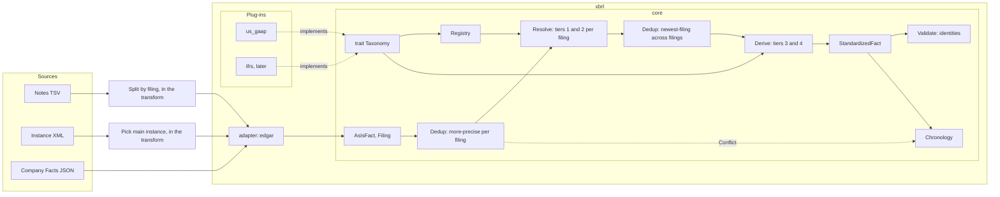
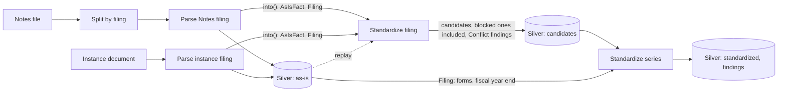

# XBRL Crate Design Document

## General Thoughts

The `xbrl` crate is the common core of reported financial data. The SEC is the first source. ESEF
and DART follow later. The crate validates and organizes company data. It makes no assumption about
the gold layer. Each load step shapes the data for its own target.

The crate has a core and taxonomy plug-ins:

- **The core** holds the fact model, dedup, chronology checks, provenance, and confidence levels.
  It knows nothing about US GAAP. It defines the `Taxonomy` trait and resolves facts through that
  trait only.
- **A plug-in** implements `Taxonomy` for one taxonomy, for example US GAAP. `us_gaap` is the first plug-in.
  `ifrs` follows for ESEF and DART. A large plug-in can move into its own crate, for example
  `xbrl-ifrs`.

The crate hands out two layers of facts:

- **As-is.** Every reported value, with the filing it came from. No mapping and no dedup, so a
  point-in-time read stays possible.
- **Standardized.** One value per standard concept, from our own concept set. Each value carries a
  confidence level, the ID of the rule that produced it, and the taxonomy release of that rule.

The taxonomy knowledge is code in the repository. A transform needs no call to the FASB or the SEC.

**Validation** checks three things in financial statements:
- Consistency
- Completeness
- Precision

## Crate Structure

```text
xbrl/
  taxonomy/us-gaap/2026/   <- vendored FASB files and a MANIFEST with the SHA-256 of each file
  src/
    core/
      concept.rs           <- ConceptName, NamespaceFamily, Namespace (parser input)
      fact.rs              <- AsIsFact, FactKey, FactValue, Decimals, Dimensions
      filing.rs            <- Filing, FilingId, EntityId
      finding.rs           <- Finding: what a step reports without failing the run
      form.rs              <- Form (open text)
      fiscal_period.rs     <- FiscalPeriod (open text)
      invalid_value.rs     <- InvalidValue, the error of each core value type
      unit.rs              <- Unit (open: numerator and denominator measures)
      period.rs            <- Instant | Duration
      elements/            <- CanonicalElementKind, our standard concept set, and the roll-up tree
      standardized.rs      <- StandardizedFact
      candidate.rs         <- Candidate: the value of one filing, before newest-filing
      confidence.rs        <- Exact | Synonym | Derived | Computed
      rule.rs              <- RuleId
      release.rs           <- TaxonomyRelease (ID and checksum)
      taxonomy/
        mod.rs             <- trait Taxonomy
        family.rs          <- FamilyDeclaration, UriPattern
        reference.rs       <- ConceptAliases, CalculationTree, ElementReference
        registry.rs        <- Registry, Plugin, RegistryError
        segment.rs         <- trait SegmentAxes, SegmentAxis, MemberRole
      fact_set.rs          <- working set of resolution for one entity and one period
      graph.rs             <- resolution and validation engine
      alias.rs             <- tiers 1 and 2 on one filing
      dedup.rs             <- dedup rules of the standardized layer
      period_identity.rs   <- core/period/q4-from-fy@1
      chronology.rs        <- order over time, gap check
      suspicious_period.rs <- periods that no filer means, and the filing that confirms the value
    us_gaap/
      mod.rs               <- UsGaap: impl Taxonomy, family declarations
      mappings.rs          <- aliases: standard concept -> US GAAP concepts (tiers 1 and 2)
      table.rs             <- ElementRow, CalculationRow: the rows of the generated tables
      taxonomy.rs          <- generated tables: calculation tree, element reference data
      generator/           <- feature `generator`: vendored files -> taxonomy.rs
    adapter/               <- one adapter per data source
      edgar/               <- the documents of EDGAR, the filing system of the SEC
        notes/             <- rows of one Notes filing -> AsIsFact, Filing, findings
          row.rs           <- SubRow, NumRow, TxtRow, DimRow, TagRow
        instance.rs        <- one instance document -> AsIsFact, Filing
        company_facts.rs   <- Company Facts JSON -> AsIsFact, Filing
        company_concept.rs <- Company Concept JSON -> AsIsFact, Filing
        frames.rs          <- Frames JSON -> AsIsFact, Filing
        frame.rs, quarter.rs <- the `frame` field of the SEC JSON APIs
```



Rules of the layout:

- `core` imports no plug-in and no adapter.
- A plug-in imports only `core`.
- `adapter::edgar` is an adapter. It imports `core` and maps the documents of EDGAR into as-is
  facts: the rows of one Notes filing, one instance document, and the Company Facts JSON. A later
  data source gets its own adapter next to it, for example `adapter::esef`.
- The Notes parser and the instance parser live in `adapter::edgar`. Their rules fill the fact
  model, and one test runs both parsers on the same filing.
- The transform keeps the I/O and the states. It opens the Notes ZIP. It reads `sub.tsv` and
  `dim.tsv` whole, streams `num.tsv` and `txt.tsv`, and splits them by `adsh`. It picks the main
  instance of a filing and skips the filing-fee exhibit. It reads the raw store, adds the ingestion
  provenance, and writes silver.
- `xbrl` defines the row types of the Notes tables. The transform fills them from the TSV text. It
  hands `adapter::edgar::notes` the rows of one filing: its `sub` row, its `num` and `txt` rows,
  the `dim` rows that its `num` and `txt` rows name through `dimh`, and the `tag` rows that its
  `num` rows name through `tag` and `version`. The parser reads only `tag.datatype`, to restore
  `/shares` (owner, 2026-11-08). In `2026_10`, 1,449 of 1,685 per-share tags are extension tags,
  so a taxonomy plug-in cannot give the data type.
- A parser returns `Finding` values next to its facts. `Finding::UnmappedRow` names a row that the
  parser dropped, and `Finding::UndeclaredFamily` names a family that no plug-in declares. Only a
  `sub` row that breaks a rule fails the filing.

**Crate boundary**: `xbrl::adapter::edgar` takes the XML text of one instance (`&str`), the rows of one Notes filing, or a raw JSON body (`&serde_json::Value`), NOT an `SecResponse`. The `sec` crate owns HTTP, rate limiting, and response handling. `xbrl` has zero network dependencies. Its XML parser is pure Rust and needs no system library.

### Types That Change

These places in the old code assumed the SEC or US GAAP. The design replaces each one. All
replacements are in the code:

| Today | Assumption | Replacement |
| ----- | ---------- | ----------- |
| `core::Namespace` | Closed enum of 6 SEC namespaces | Open `NamespaceFamily` on each concept. `Namespace { prefix, uri }` stays a parser input. Each plug-in declares its families, each with a `FamilyDeclaration` |
| `core::Unit` | Closed enum of 4 US units | Open `Unit` of numerator and denominator measures, for example `iso4217:EUR` |
| `core::RawObservation` | Value is `i64`, no dimensions, no `decimals` | `AsIsFact` |
| `core::Provenance` | SEC accession number and forms | `Filing` with an open `FilingId` |
| `core::Form` | Closed enum of 4 SEC forms | Open text on `Filing`, with `is_amendment` |
| `core::AccessionNumber` | SEC filing ID | Text inside `FilingId`, for example `sec:<accession>` |
| `core::FiscalPeriod` | `FY` and `Q1` to `Q3` only | Open text on `Filing`, as filed. ESEF filers report half years |
| `core::Frame`, `core::Quarter` | Field of the SEC JSON APIs | Move to `adapter::edgar`. No rule uses them |
| `core::EntityName` | One current name | A company attribute on `Filing`, as filed |
| Company Facts constants in `us_gaap::mappings` | Keys of one SEC JSON API | Move to `adapter::edgar` |

---

## 0) Data Model

Define the target model inside `xbrl::core`, outside any taxonomy-specific module, to contain core financial company data required for all companies.

Start with FASB Concepts Statement 8, Chapter 4.

Concepts Statement 8, Chapter 4 (December 2021) defines the 10 elements of financial statements.
The accounting identities connect the elements.

It gives you:
- **What to extract** — the 10 elements are the canonical set
- **How to validate** — the invariants are the correctness checks
- **How to derive** — if one element is missing, solve for it from the identity (e.g., missing Equity = Assets - Liabilities)

### 0.1) Balance Sheet

3 roll-up items:
- Assets
- Liabilities
- Equity

Invariant: `Assets = Liabilities + Equity`

### 0.2) Cash Flow Statement

3 roll-up items:
- Operating Cash Flow
- Cash Flow from Investing Activities
- Financing Cash Flow

### 0.3) Income Statement

A cascade of subtotals from revenue to net income:
- Revenue − Cost of Revenue = Gross Profit
- Gross Profit − Operating Expenses = Operating Income
- Operating Income − Interest Expense = Pretax Income
- Pretax Income − Income Tax Expense = Net Income
- Net Income + OCI = Comprehensive Income

Each step also has an "other" line. The elements of Concepts Statement 8 split
income into revenue, expenses, gains, and losses, but filers do not present these totals. See "Roll-Up Tree".

### 0.4) Changes in Equity

Links the other statements. Explains additional investment / payout of company substance.

`ΔEquity = Comprehensive Income + Investments by Owners - Distributions to Owners`

The MVP builds no statement of changes in equity. See "Roll-Up Tree", "Disclosures".

### CanonicalElementKind Enum

Decided. The concepts are the lines of the trees and the disclosures in "Roll-Up Tree".
`xbrl/src/core/elements/` holds the hierarchy.

### Standard Concept Set

`CanonicalElementKind` is our own concept set for the standardized layer. Its names are not US GAAP
names. Concepts Statement 8 defines its roots, and the IFRS Conceptual Framework defines assets, liabilities,
equity, income, and expenses in the same terms. So US GAAP and IFRS both map into it, each through
the aliases of its plug-in. Example: `us-gaap:Revenues` and `ifrs-full:Revenue` both map to
`Revenue`.

- The MVP freezes the top lines of the trees in "Roll-Up Tree". A new concept gets a placement in
  a tree or in a disclosure, by the checklist of the `xbrl-standardization` skill.
- A taxonomy concept with no faithful match stays an as-is fact. It never maps to the nearest
  element.
- For one entity, period, and dimensions, at most one concept fills each element. The alias
  order picks it.

### Roll-Up Tree

The standard concepts form one fixed tree per statement. The tree is the same for every company
and every source. It gives the layout of each statement, the "other" lines, the checks, and one
more Tier 3 rule. A concept outside every tree of a statement belongs to a disclosure.

#### Groups

A **group** is one sum: a parent and the concepts that add up to it. Each concept of a statement
has one **placement**:

- `Top`: a total or subtotal on the top level of its statement, such as `Assets` or
  `GrossProfit`.
- `Child { group, weight, zero_if_absent }`: a member of one group. The weight is `+1` or `−1`.
  `zero_if_absent` is `true` if a closed group uses zero for the child when it has no value.

A concept of a disclosure, such as `EarningsPerShareBasic`, has no placement. The statement or
disclosure of a concept is its place in the hierarchy of `CanonicalElementKind`. The `Placed`
trait gives the placement (see "Extension Model").

A group has one of two kinds:

- A **breakdown** splits a parent into its components: `CurrentAssets` into cash, receivables, and
  inventory. The children of a breakdown sit below the parent.
- A **step** makes a subtotal from a **start** line and items: `GrossProfit` = `Revenue` −
  `CostOfRevenue`. The start is the previous subtotal, so steps chain into the cascade of the income
  statement. The start can belong to another statement: `NetIncome` starts the cash flow step of
  `OperatingCashFlow`.

A concept is a child in at most one group. It can be the parent of more than one group and the
start of more than one step. For example, `NetIncome` is the result of the step from
`PretaxIncome`. It is also the parent of its split between the parent and the noncontrolling
interest, and the start of two steps.

The weight follows the sign convention of the `accounting` skill. A value keeps the sign of the
filing, and an expense or a payment is positive. So `CostOfRevenue`, `CapitalExpenditures`, and
`TreasuryStock` carry the weight `−1`.

A group is **closed** if its members equal the parent by definition, such as
`Assets` = `CurrentAssets` + `NonCurrentAssets`. Every other group is **open**: a filer reports
lines that no standard concept holds, so the children do not cover the parent.

A child of a closed group can count as **zero if absent**. Most filers have no temporary equity, no
noncontrolling interest, and no exchange rate effect, and they report no zero for it. If such a
child has no value for the period, the group uses zero. `ExchangeRateEffect` is an exception: with
no value, it counts as zero for the check, but the group derives nothing (see "Derivation From a Closed
Group"). The field `zero_if_absent` of `Placement::Child` records it
([ADR 0019](../docs/adr/0019-zero-if-absent-in-the-placement.md)).

#### "Other" Lines

Each open group gets one "other" line: the parent less the start and the weighted children.

```
other = parent − start − Σ(weight × child)
```

- The other line exists only if the parent has a value. A child with no value counts as zero, so
  its amount lands in the other line.
- If a parent has no value, it is transparent. Its children count in the group of the nearest
  ancestor with a value. For example, a bank reports no `CurrentAssets`, so `CashAndEquivalents`
  counts against `Assets`. In the cascade, a step whose start has no value starts from the previous
  subtotal. The items of the skipped step join it.
- If the start of a step has no value and the step has no previous subtotal, the step starts from
  zero. Its other line then holds the start as well. An example is `operating-cash-flow` with no
  `NetIncome`.
- A closed group gets no other line. Its members must add up, and the check of "Checks the Tree
  Gives" tests it.
- A group whose members have two exact starts gets no other line and reports a `MixedStarts`
  finding. The members include the start of a step, the members that stand for a start with no
  value, and the children of a transparent parent that join the group ([ADR 0025](../docs/adr/0025-exact-start-splits-copies.md)). The code does
  not hold this rule.
- If a member of a closed group has no value and is not zero if absent, the group gets no check.
  If the children of a transparent member count in a closed group, the group becomes open for that
  period and gets an other line. For example, a bank reports no `CurrentAssets` and no
  `NonCurrentAssets`. Then `assets` shows the children of both and an other line.
- **Silver does not store other lines.** The statement output type computes them at read time from
  the standardized facts and the table. An other line is a pure function of stored values and a
  fixed table. A stored copy goes stale whenever a child or the table changes, and it has no as-is
  inputs to name. The gold load builds statements with the output type, so it gets the same lines.

#### Balance Sheet

Instant values. Two top lines, `Assets` and `LiabilitiesAndEquity`, and the identity
`Assets` = `LiabilitiesAndEquity`. New concepts are in bold.

| Concept | Group | Parent | Weight | Closed | Zero if absent |
| ------- | ----- | ------ | ------ | ------ | -------------- |
| `Assets` | top | | | | |
| `CurrentAssets` | `assets` | `Assets` | +1 | yes | no |
| `NonCurrentAssets` | `assets` | `Assets` | +1 | yes | no |
| `CashAndEquivalents` | `current-assets` | `CurrentAssets` | +1 | no | |
| `ShortTermInvestments` | `current-assets` | `CurrentAssets` | +1 | no | |
| `AccountsReceivable` | `current-assets` | `CurrentAssets` | +1 | no | |
| `Inventory` | `current-assets` | `CurrentAssets` | +1 | no | |
| `PropertyPlantEquipment` | `non-current-assets` | `NonCurrentAssets` | +1 | no | |
| `Goodwill` | `non-current-assets` | `NonCurrentAssets` | +1 | no | |
| `IntangibleAssets` | `non-current-assets` | `NonCurrentAssets` | +1 | no | |
| **`LiabilitiesAndEquity`** | top | | | | |
| `Liabilities` | `liabilities-and-equity` | `LiabilitiesAndEquity` | +1 | yes | no |
| **`TemporaryEquity`** | `liabilities-and-equity` | `LiabilitiesAndEquity` | +1 | yes | yes |
| `Equity` | `liabilities-and-equity` | `LiabilitiesAndEquity` | +1 | yes | no |
| `CurrentLiabilities` | `liabilities` | `Liabilities` | +1 | yes | no |
| `NonCurrentLiabilities` | `liabilities` | `Liabilities` | +1 | yes | no |
| **`AccountsPayable`** | `current-liabilities` | `CurrentLiabilities` | +1 | no | |
| **`ShortTermDebt`** | `current-liabilities` | `CurrentLiabilities` | +1 | no | |
| `LongTermDebt` | `non-current-liabilities` | `NonCurrentLiabilities` | +1 | no | |
| **`EquityAttributableToParent`** | `equity` | `Equity` | +1 | yes | no |
| **`NoncontrollingInterest`** | `equity` | `Equity` | +1 | yes | yes |
| **`AdditionalPaidInCapital`** | `equity-attributable-to-parent` | `EquityAttributableToParent` | +1 | no | |
| `RetainedEarnings` | `equity-attributable-to-parent` | `EquityAttributableToParent` | +1 | no | |
| **`TreasuryStock`** | `equity-attributable-to-parent` | `EquityAttributableToParent` | −1 | no | |
| **`AccumulatedOtherComprehensiveIncome`** | `equity-attributable-to-parent` | `EquityAttributableToParent` | +1 | no | |

- `LiabilitiesAndEquity` holds temporary equity. Under SEC rules, redeemable stock sits between
  liabilities and equity. Without it, `Assets` = `Liabilities` + `Equity` fails for each filer with
  temporary equity.
- `CommitmentsAndContingencies` is also a child of `LiabilitiesAndStockholdersEquity` in the 2026
  calculation tree. Filers tag it with no value or zero. The group leaves it out. A filer that gives
  it a value fails the check, and the finding shows it.
- A classified balance sheet makes `assets` and `liabilities` closed. An unclassified balance
  sheet, such as of a bank or an insurer, reports no current subtotals. Then both subtotals are
  transparent, and the children count against `Assets` and `Liabilities`.

#### Income Statement

Duration values. The income statement is a cascade of steps, not a tree of components. The
balance sheet splits each total into parts. The income statement starts from revenue and adds or
subtracts items until it reaches net income. Each subtotal is the start of the next step.

| Concept | Group | Kind | Parent | Start | Weight | Closed |
| ------- | ----- | ---- | ------ | ----- | ------ | ------ |
| `Revenue` | top | | | | | |
| `CostOfRevenue` | `gross-profit` | step | `GrossProfit` | `Revenue` | −1 | yes |
| `GrossProfit` | top | | | | | |
| **`OperatingExpenses`** | `operating-income` | step | `OperatingIncome` | `GrossProfit` | −1 | no |
| `SellingGeneralAdmin` | `operating-expenses` | breakdown | `OperatingExpenses` | | +1 | no |
| `ResearchDevelopment` | `operating-expenses` | breakdown | `OperatingExpenses` | | +1 | no |
| `OperatingIncome` | top | | | | | |
| `InterestExpense` | `pretax-income` | step | `PretaxIncome` | `OperatingIncome` | −1 | no |
| **`PretaxIncome`** | top | | | | | |
| **`IncomeTaxExpense`** | `net-income` | step | `NetIncome` | `PretaxIncome` | −1 | no |
| `NetIncome` | top | | | | | |
| **`NetIncomeAttributableToParent`** | `net-income-attribution` | breakdown | `NetIncome` | | +1 | yes |
| **`NetIncomeAttributableToNoncontrollingInterest`** | `net-income-attribution` | breakdown | `NetIncome` | | +1 | yes, zero if absent |
| `OtherComprehensiveIncome` | `comprehensive-income` | step | `ComprehensiveIncome` | `NetIncome` | +1 | yes |
| `ComprehensiveIncome` | top | | | | | |

The other line of each open step has a name in the layout:

| Group | Other line | What it holds |
| ----- | ---------- | ------------- |
| `operating-income` | Other operating income (expense) | Gains on disposals, government assistance, and other operating lines |
| `operating-expenses` | Other operating expenses | Depreciation shown on its own line, restructuring, and other expense lines |
| `pretax-income` | Other non-operating income (expense) | Interest income, equity method income before tax, foreign exchange gains, and pension costs other than service cost |
| `net-income` | Other items after tax | Discontinued operations, and equity method income after tax |

- The cascade ends with comprehensive income: `ComprehensiveIncome` = `NetIncome` +
  `OtherComprehensiveIncome`. A filer can present it below net income or in a second statement.
  The layout always shows it at the end of the income statement. It is no statement of its own.
- The cascade has no `Expenses`, `Gains`, or `Losses`. Concepts Statement 8
  defines these elements, but no filer presents their totals, so no standard concept holds them.
  See "Placement of the Concepts".
- `NonoperatingIncomeExpense` is no standard concept. In the 2026 calculation tree it excludes
  interest expense. Many filers use it for a total that includes interest. The other line of
  `pretax-income` holds the same amount without that doubt.
- A single-step filer reports `CostsAndExpenses` and no gross profit. Then `GrossProfit` has no
  value, because `gross-profit` never derives its parent. `operating-income` starts from `Revenue`,
  and the cost of revenue counts in the step.
- Known limit: some filers tag their total costs, cost of revenue included, as
  `OperatingExpenses`. If such a filer also reports `CostOfRevenue`, the cascade counts the cost of
  revenue twice. The other line of `operating-income` then holds the cost of revenue with a positive sign. A measurement on real
  filings decides whether this needs a guard.

#### Cash Flow Statement

Duration values. The top line is `NetChangeInCash`.

| Concept | Group | Kind | Parent | Start | Weight | Closed |
| ------- | ----- | ---- | ------ | ----- | ------ | ------ |
| **`NetChangeInCash`** | top | | | | | |
| `OperatingCashFlow` | `net-change-in-cash` | breakdown | `NetChangeInCash` | | +1 | yes |
| `InvestingCashFlow` | `net-change-in-cash` | breakdown | `NetChangeInCash` | | +1 | yes |
| `FinancingCashFlow` | `net-change-in-cash` | breakdown | `NetChangeInCash` | | +1 | yes |
| **`ExchangeRateEffect`** | `net-change-in-cash` | breakdown | `NetChangeInCash` | | +1 | yes, zero if absent |
| `DepreciationAmortization` | `operating-cash-flow` | step | `OperatingCashFlow` | `NetIncome` | +1 | no |
| `ShareBasedCompensation` | `operating-cash-flow` | step | `OperatingCashFlow` | `NetIncome` | +1 | no |
| `CapitalExpenditures` | `investing-cash-flow` | breakdown | `InvestingCashFlow` | | −1 | no |
| `DividendsPaid` | `financing-cash-flow` | breakdown | `FinancingCashFlow` | | −1 | no |
| `ShareRepurchases` | `financing-cash-flow` | breakdown | `FinancingCashFlow` | | −1 | no |

- `operating-cash-flow` is a step from `NetIncome`, because the indirect method starts from net
  income. Its other line holds the other adjustments and the changes in working capital. A filer
  that uses the direct method reports no reconciliation in the statement. Then the other line holds
  the receipts and payments less net income.
- `NetIncome` in the cash flow statement is the same standardized fact as in the income statement.
  So the cross-statement check of "5) Validation" on net income always holds and needs no code.
- The cash balance at the start and the end of the period is not in the tree. A check of
  `NetChangeInCash` against two balances needs the balance at the start date. The Notes parser
  sets no exact start, so the design has no such check.

#### Disclosures

A disclosure is a set of concepts outside the trees of the statements. The concepts of `PerShare`
have no parent, no other line, and no roll-up check. EPS sits on the face of the income statement
(ASC 260-10-45-2), but it adds to no line, so it is a disclosure here. A disclosure with its own
sum implements the trait `Summed` (see "Extension Model").

- `PerShare`: `EarningsPerShareBasic` and `EarningsPerShareDiluted`. A per-share value does not add
  with other lines, and it does not add over periods. `core/period/q4-from-fy@1` already skips it.
- `DebtMaturities`: the maturity ladder and its total (see "Debt Maturities").
- Segments are not a disclosure. A segment value is a standard concept with a member of a segment
  axis, and "Segment Values" says how the tree applies to it.

A disclosure is a variant of `DisclosureConcept` with its own concept enum, such as
`PerShare(PerShareConcept)`. A new disclosure adds a variant and its concepts (see "Extension
Model"). It changes no placement, no group, and no check of the trees.

**Changes in equity** get no statement in the MVP. The statement of changes in equity is a roll
forward per component of equity, such as retained earnings and treasury stock. Filers tag each
column with a member of `StatementEquityComponentsAxis`. Tiers 1 and 2 give such a fact no
candidate, because the axis is no segment axis (see "Segment Values"). The balance sheet already holds the closing balance of each
component, and the cash flow statement holds the dividends and repurchases paid. A later design
adds the roll forward with the dimensions.

#### Extension Model

The concepts and the statements follow the shape of the `sec` error hierarchy in
`sec/src/lib/error/`. That hierarchy nests `#[non_exhaustive]` enums by level and gives each level
its own module. Each level converts up with `From` and down with `TryFrom`. A new case adds one
module and one variant, and its siblings do not change.

| `sec` errors | Standard concepts |
| ------------ | ----------------- |
| `ErrorKind` | `CanonicalElementKind` |
| `StateMachine` | `StatementConcept`, `DisclosureConcept` |
| `State`, `Transition` | `BalanceSheetConcept`, `IncomeStatementConcept`, `CashFlowConcept`, `PerShareConcept`, `DebtMaturityConcept` |
| a leaf error | a concept, such as `Assets` |

`CanonicalElementKind` is the top of the hierarchy. [ADR 0011](../docs/adr/0011-concept-hierarchy.md)
records why the concepts nest this way, and why the placement holds the parent and the weight.

```rust
#[non_exhaustive]
pub enum CanonicalElementKind {
    Statement(StatementConcept),
    Disclosure(DisclosureConcept),
}

#[non_exhaustive]
pub enum StatementConcept {
    BalanceSheet(BalanceSheetConcept),
    IncomeStatement(IncomeStatementConcept),
    CashFlow(CashFlowConcept),
}

#[non_exhaustive]
pub enum DisclosureConcept {
    PerShare(PerShareConcept),
    DebtMaturities(DebtMaturityConcept),
}

#[non_exhaustive]
pub enum BalanceSheetConcept { Assets, CurrentAssets, /* … */ }

impl From<BalanceSheetConcept> for StatementConcept { /* … */ }
impl From<StatementConcept> for CanonicalElementKind { /* … */ }
impl TryFrom<CanonicalElementKind> for BalanceSheetConcept {
    type Error = CanonicalElementKind; // gives back a concept of another statement or disclosure
    /* … */
}
```

```
xbrl/src/core/elements/
  mod.rs                         CanonicalElementKind, Concept, Placed, Summed, SumRole, Timed,
                                 Cadence, and the call of the middle macro: StatementConcept,
                                 DisclosureConcept, the conversions
  macros.rs                      the innermost macro and the middle macro
  roll_up.rs                     Placement, Weight, Group, GroupKind, GroupName
  statement/
    mod.rs                       the groups of every statement joined
    balance_sheet.rs             BalanceSheetConcept, its placements, BalanceSheetGroup, its groups
    income_statement.rs          IncomeStatementConcept, its placements, IncomeStatementGroup, its groups
    cash_flow.rs                 CashFlowConcept, its placements, CashFlowGroup, its groups
  disclosure/
    mod.rs                       the disclosure modules
    per_share.rs                 PerShareConcept
    debt_maturities.rs           DebtMaturityConcept, its roles and cadences
xbrl/src/core/statement/
  mod.rs                         FinancialStatement, StatementKind, Statement, StatementLine
  balance_sheet.rs               BalanceSheet view
  income_statement.rs            IncomeStatement view
  cash_flow.rs                   CashFlowStatement view
```

**Each statement module owns its part of the tree.** `balance_sheet.rs` holds the placement of
each balance sheet concept and the groups whose parent is a balance sheet concept. A group from
another statement, such as `operating-cash-flow` with its start `NetIncome`, belongs to the
module of its parent. Each module lists its groups in the order of its table. `statement/mod.rs`
joins the groups in the order balance sheet, income statement, cash flow. That order is the order
of "Derivation From a Closed Group".

Two traits describe a concept. Each innermost enum, such as `BalanceSheetConcept`, implements
`Concept`. Each enum of a statement also implements `Placed`:

```rust
pub trait Concept: Copy + Eq + 'static {
    /// Every variant, in the order of the enum.
    const ALL: &'static [Self];
    /// The name in silver, such as `NetIncome`.
    fn name(self) -> &'static str;
    /// The label for people, such as `Net Income`.
    fn label(self) -> &'static str;
}

/// A concept with a place in the tree of a statement.
pub trait Placed: Concept {
    /// The parent and the weight, or a top line.
    fn placement(self) -> Placement;
}
```

- `Placed` is a subtrait of `Concept`, because every concept with a placement also has a name and
  a label. A disclosure implements `Concept` only, so the hierarchy alone says that a concept is a
  disclosure. A disclosure whose values add up, such as `DebtMaturities`, also implements
  `Summed`, and `Timed` if a concept has values only at fiscal year ends (see "Debt Maturities").
- A declarative macro defines each innermost enum and its `ALL` from one list of variants, so the
  two cannot drift.
- A second macro defines each middle enum, `StatementConcept` and `DisclosureConcept`, from its
  list of innermost enums. The same macro builds `INNERMOST: &[&[CanonicalElementKind]]`, one entry
  per innermost enum, each built with `element()`. So a variant of a middle enum cannot miss
  `INNERMOST`. The parse from the name and the uniqueness test walk it. Each entry also lists the
  traits of the enum beyond `Concept`, such as `Summed` and `Timed` (see "Debt Maturities").
- A trait method cannot be a `const fn`. The alias lists and the part rules are `const` tables. So
  each innermost enum also has an inherent `const fn element(self) -> CanonicalElementKind`, and a
  list writes `BalanceSheetConcept::Assets.element()`. Run-time code converts with `From` one level
  at a time, as in `sec`, or calls `element()`.
- `Concept` and `Placed` are new traits next to the existing traits, so they change no trait (`AGENTS.md`,
  "Open-Closed Principle").
- A parent in the tree is a sum, not a container, so the nesting stops at the statement. A sum can
  start from another statement, as `operating-cash-flow` starts from `NetIncome`. `placement()`
  names the parent and the weight. A move to a new parent changes one arm of `placement()` and no
  type.
- The statement of a concept comes from its place in the hierarchy. The placement needs no
  statement.
- The name in silver stays the name of the innermost variant, such as `NetIncome`, not a path
  such as `Statement.IncomeStatement.NetIncome`. A test walks `INNERMOST` and checks that no two
  concepts share a name. So the parse from the name finds one concept, and every
  stored name stays valid.
- `Serialize` writes `name()`. A derived `Serialize` writes the path, so the implementation writes
  it by hand. The `api` crate derives its concept ID from this name.
- `Display` writes `label()`. The `api` crate shows it as the name of a concept.
- `Ord` sorts by statement first, then by concept.

A change touches these places, and no others:

| Change | Adds | Changes |
| ------ | ---- | ------- |
| A concept in an existing statement | a variant in the macro of its enum, an arm of each method of `Concept` and `Placed`, an alias list | nothing else |
| A group | an entry in the groups of the module of its parent | nothing else |
| A start of a step from another statement | an entry in `STARTS` of the view, and its accessor | nothing else |
| A disclosure, such as `PerShare` | a module with its enum and its `impl Concept`, a variant of `DisclosureConcept`, alias lists | nothing else |
| A disclosure with a sum, such as `DebtMaturities` | the same, an `impl Summed` with its name and tolerance, an `impl Timed` if a concept has values only at fiscal year ends, these traits in the macro entry of the disclosure, and the test of each trait | nothing else |
| A statement, such as changes in equity | a module in `elements/statement` with its enum, its `impl Concept` and `impl Placed`, and its groups, a variant of `StatementConcept`, `StatementKind`, and `FinancialStatement`, a view with `From` and `TryFrom` | nothing else |

Each enum is `#[non_exhaustive]`, so a `match` outside the crate keeps compiling when a variant
arrives. A new variant is outside the Open-Closed Principle, which covers traits only.

#### Checks the Tree Gives

The checks run in the series step, on the values without dimensions after
`core/dedup/newest-filing@1` and the period identities. Each failed check is a finding. A check never removes a value.

1. **Closed group.** The members of a closed group must equal the parent. This covers `assets`,
   `liabilities-and-equity`, `liabilities`, `equity`, `gross-profit`, `net-income-attribution`,
   `comprehensive-income`, and `net-change-in-cash`. A failure is a `RollUpMismatch` finding.
2. **Balance sheet identity.** `Assets` must equal `LiabilitiesAndEquity`. It is the check of
   `core/identity/balance-sheet@1`. A failure is a `RollUpMismatch` finding.
3. **Negative other.** The other line of `current-assets`, `non-current-assets`,
   `current-liabilities`, `non-current-liabilities`, and `operating-expenses` must not fall below
   zero. Each child of these groups is a part of the parent with the same sign. A negative other
   line means that two children overlap, or that an alias list holds a wider concept. A failure is a
   `NegativeOther` finding. Other lines of steps and of equity can be negative, so they get no
   check.

The tolerance is the one of "5) Validation": ±0.1% of the largest absolute value in the group,
not of the parent. For the balance sheet identity, the base is the larger of `Assets` and
`LiabilitiesAndEquity`. In a step, the parent can be near zero while its
members are large. Comprehensive income of 1 from net income of 10,000 and OCI of −9,999 is an example. Then a base of the parent
fails on the rounding of the members.

A value that `core/roll-up/<group>@1` derived from a group makes that group hold by construction.
So the check of that group is skipped for that period.

- `check_roll_ups` in `core/roll_up_check.rs` runs the checks on the series of one entity. It
  takes the facts of `core/period/q4-from-fy@1` and of `core/roll-up/<group>@1` next to the
  series.
- A closed group gets no check for a period if a member has no value and is not zero if absent,
  or if dedup blocks a member. `ExchangeRateEffect` counts as zero in the check.
- The values of one period end and length in quarters share a slot, which holds every group of
  that period. If two members of one group have different exact starts, such as a quarter and a
  4-month stub, that group gets no check, gives no derived value, gets no other line in the
  statement, and reports a `MixedStarts` finding. The members of a group are the values that the
  statement counts in it: the start of a step, the members that stand for a start with no value,
  and the children of a transparent parent that join the group. The other groups of the slot keep their checks. A value without an exact start
  joins the slot ([ADR 0025](../docs/adr/0025-exact-start-splits-copies.md)). The code does not hold
  this rule.
- The negative other check reads the other line of the statement output type (see "7) Financial
  Statement Output Types"). It computes no other line of its own.

#### Derivation From a Closed Group

A closed group with exactly one unknown member gives that member as a Tier 3 value. Only values
without dimensions count. The unknown can
be the parent, the start, or a child. A child that is zero if absent counts as known, except
`ExchangeRateEffect` (see below).

- `derive_from_closed_groups` in `core/closed_group.rs` applies the rule to the series of one
  entity.
- The rule ID is `core/roll-up/<group>@1`, for example `core/roll-up/liabilities@1`. The balance
  sheet identity keeps `core/identity/balance-sheet@1`.
- The rule runs after `core/period/q4-from-fy@1` and fills only a period that has no value.
- The rule repeats until no group gives a new value. For example, `Liabilities` comes from
  `liabilities-and-equity`, and then `NonCurrentLiabilities` comes from `liabilities`.
- Every member must have the same unit. The confidence is `Derived`, or the weakest confidence of
  an input.
- Open groups give no derivation. Their other line is unknown.
- `gross-profit` never derives its parent. A single-step filer chooses not to present gross
  profit, and its cost of revenue can leave out depreciation. The group can still derive
  `Revenue` or `CostOfRevenue`.
- If `ExchangeRateEffect` has no value, `net-change-in-cash` derives nothing, and its check uses
  zero. Filings before 2018 report the exchange rate effect under
  `EffectOfExchangeRateOnCashAndCashEquivalents`. That concept leaves out restricted cash, so it is
  no alias. If it counted as zero, the rule would derive a wrong `NetChangeInCash` for every
  multinational before 2018.
- In each pass, the rule visits the groups in the order in which they first appear in the tables
  of "Roll-Up Tree". The first group that gives a value wins. The rule still checks every other
  group that holds the member, so a disagreement is a `RollUpMismatch` finding.
  [ADR 0013](../docs/adr/0013-order-of-the-groups.md) records the order.
- The series key (`period_end`, `quarters`) does not tell a three-month value from a four-month
  value in Notes. If one concept has only a three-month copy and another has only a four-month
  copy, no dedup conflict arises, and the rule can combine them. In the fixture of "Worked
  Example", the series gets operating cash flow of four months and no net income, because dedup
  blocks net income.

This rule fills common gaps. In CY2025, 5,564 filers reported `Liabilities`, and 6,090 reported
`LiabilitiesAndStockholdersEquity`. Only 781 reported `AssetsNoncurrent`, against 4,908 for
`AssetsCurrent` (SEC frames API).

Risk: a zero-if-absent child that a filer reports under a concept outside its alias list counts as
zero. Then the derived value absorbs it. The balance sheet identity still holds, so no check
catches it.

#### Placement of the Concepts

The concepts of `CanonicalElementKind` take these places in the trees and disclosures.

| Concept | Placement |
| ------- | --------- |
| `Assets` | top of the balance sheet |
| `Liabilities` | child of `liabilities-and-equity` |
| `Equity` | child of `liabilities-and-equity` |
| `Revenue` | top of the income statement, start of `gross-profit` |
| `NetIncome` | top of the income statement |
| `OtherComprehensiveIncome` | item of `comprehensive-income` |
| `ComprehensiveIncome` | top of the income statement, last subtotal of the cascade |
| `OperatingCashFlow` | child of `net-change-in-cash` |
| `InvestingCashFlow` | child of `net-change-in-cash` |
| `FinancingCashFlow` | child of `net-change-in-cash` |
| `CurrentAssets` | child of `assets` |
| `NonCurrentAssets` | child of `assets` |
| `CashAndEquivalents` | child of `current-assets` |
| `ShortTermInvestments` | child of `current-assets` |
| `AccountsReceivable` | child of `current-assets` |
| `Inventory` | child of `current-assets` |
| `PropertyPlantEquipment` | child of `non-current-assets` |
| `Goodwill` | child of `non-current-assets` |
| `IntangibleAssets` | child of `non-current-assets` |
| `CurrentLiabilities` | child of `liabilities` |
| `NonCurrentLiabilities` | child of `liabilities` |
| `LongTermDebt` | child of `non-current-liabilities` |
| `RetainedEarnings` | child of `equity-attributable-to-parent` |
| `CostOfRevenue` | item of `gross-profit` |
| `GrossProfit` | top of the income statement |
| `SellingGeneralAdmin` | child of `operating-expenses` |
| `ResearchDevelopment` | child of `operating-expenses` |
| `InterestExpense` | item of `pretax-income` |
| `OperatingIncome` | top of the income statement |
| `EarningsPerShareBasic` | disclosure `PerShare` |
| `EarningsPerShareDiluted` | disclosure `PerShare` |
| `DepreciationAmortization` | item of `operating-cash-flow` |
| `CapitalExpenditures` | child of `investing-cash-flow` |
| `DividendsPaid` | child of `financing-cash-flow` |
| `ShareRepurchases` | child of `financing-cash-flow` |
| `ShareBasedCompensation` | item of `operating-cash-flow` |
| `OperatingExpenses` | item of `operating-income` |
| `PretaxIncome` | top of the income statement |
| `IncomeTaxExpense` | item of `net-income` |
| `NetIncomeAttributableToParent` | child of `net-income-attribution` |
| `NetIncomeAttributableToNoncontrollingInterest` | child of `net-income-attribution` |
| `NetChangeInCash` | top of the cash flow statement |
| `ExchangeRateEffect` | child of `net-change-in-cash` |
| `LongTermDebtIncludingCurrentMaturities` | disclosure `DebtMaturities`, total |
| `DebtDueInYearOne` to `DebtDueInYearFive`, `DebtDueAfterYearFive` | disclosure `DebtMaturities`, parts |

No standard concept holds expenses, gains, or losses. No US GAAP concept holds their totals, no
rule fills them, and no filer presents them. The cascade holds them in `OperatingExpenses`,
`InterestExpense`, `IncomeTaxExpense`, and the other lines. Concepts Statement 8, Chapter 4,
keeps them as elements, and the identity in "Three Layers" names them.

#### Concepts to Add

Each concept below is a line of filers' statements. The count is the number of filers that
reported the first concept of the alias list in the SEC frames API. The frames are `CY2025Q4I` for
instants and `CY2025` for durations, read on 2026-11-09. For comparison, 6,206 filers reported `Assets` and
5,795 reported `NetCashProvidedByUsedInOperatingActivities`.

| Concept | Alias list | Parts | Filers |
| ------- | ---------- | ----- | ------ |
| `LiabilitiesAndEquity` | `LiabilitiesAndStockholdersEquity` | | 6,090 |
| `TemporaryEquity` | `TemporaryEquityCarryingAmountIncludingPortionAttributableToNoncontrollingInterests` | `TemporaryEquityCarryingAmountAttributableToParent` (448) and `RedeemableNoncontrollingInterestEquityCarryingAmount` (311). Each blocks the other | 130 |
| `AccountsPayable` | `AccountsPayableCurrent` | | 3,615 |
| `ShortTermDebt` | `DebtCurrent` | `LongTermDebtAndCapitalLeaseObligationsCurrent` (354) and `ShortTermBorrowings` (756). Each blocks the other | 365 |
| `EquityAttributableToParent` | `StockholdersEquity` | | 5,810 |
| `NoncontrollingInterest` | `MinorityInterest` | | 1,543 |
| `AdditionalPaidInCapital` | `AdditionalPaidInCapital` | `AdditionalPaidInCapitalCommonStock` (1,972), other part `AdditionalPaidInCapitalPreferredStock` | 3,505 |
| `TreasuryStock` | `TreasuryStockValue` | `TreasuryStockCommonValue` (1,056), other part `TreasuryStockPreferredValue` | 854 |
| `AccumulatedOtherComprehensiveIncome` | `AccumulatedOtherComprehensiveIncomeLossNetOfTax` | | 3,821 |
| `OperatingExpenses` | `OperatingExpenses` | | 2,929 |
| `PretaxIncome` | `IncomeLossFromContinuingOperationsBeforeIncomeTaxesExtraordinaryItemsNoncontrollingInterest` | `IncomeLossFromContinuingOperationsBeforeIncomeTaxesMinorityInterestAndIncomeLossFromEquityMethodInvestments` (382), other part `IncomeLossFromEquityMethodInvestments` and the concept below it | 4,561 |
| `IncomeTaxExpense` | `IncomeTaxExpenseBenefit` | | 4,848 |
| `NetIncomeAttributableToParent` | `NetIncomeLoss` | | 5,707 |
| `NetIncomeAttributableToNoncontrollingInterest` | `NetIncomeLossAttributableToNoncontrollingInterest` | | 1,471 |
| `NetChangeInCash` | `CashCashEquivalentsRestrictedCashAndRestrictedCashEquivalentsPeriodIncreaseDecreaseIncludingExchangeRateEffect` | `CashCashEquivalentsRestrictedCashAndRestrictedCashEquivalentsPeriodIncreaseDecreaseExcludingExchangeRateEffect` (1,324), other part the alias list of `ExchangeRateEffect` | 4,511 |
| `ExchangeRateEffect` | `EffectOfExchangeRateOnCashCashEquivalentsRestrictedCashAndRestrictedCashEquivalentsIncludingDisposalGroupAndDiscontinuedOperations` | `EffectOfExchangeRateOnCashCashEquivalentsRestrictedCashAndRestrictedCashEquivalents` (1,747), other part `EffectOfExchangeRateOnCashCashEquivalentsRestrictedCashAndRestrictedCashEquivalentsDisposalGroupIncludingDiscontinuedOperations` | 857 |

- Each list follows the rules of "`us_gaap`": it holds only concepts that equal the whole total.
  The FEATURE ticket of each statement checks the other parts against the 2026 calculation tree,
  as `PART_CONCEPTS` does today.
- `AccountsPayableAndAccruedLiabilitiesCurrent` (965) is wider than `AccountsPayable`. It is not
  in the list.
- `DebtCurrent` holds the current finance lease obligations. `LongTermDebt` leaves out the
  noncurrent ones. No US GAAP concept holds current debt without leases. So the two differ in scope, as
  "Decided Points" records. A net debt figure can subtract `FinanceLeaseLiabilityCurrent`.
  On 2026-11-15, 126 of the 368 filers of `DebtCurrent` in the frame `CY2025Q4I` also reported
  `FinanceLeaseLiabilityCurrent`. 121 of them reported a value other than zero (SEC frames API).
- `StockholdersEquity` stays the part of `Equity` and becomes the alias of
  `EquityAttributableToParent`. `NetIncomeLoss` stays the part of `NetIncome` and becomes the alias
  of `NetIncomeAttributableToParent`. A concept in two lists is allowed, as "`us_gaap`" says.
- The rule IDs follow the existing form, for example `us-gaap/alias/accounts-payable@1` and
  `us-gaap/part/treasury-stock@1`.

The count after the change: 39 − 3 + 16 = 52 standard concepts.

#### Concepts Not Added

These lines are common but stay in an other line for now. A later round can add each one as a
child, with no change to the groups above.

| Line | Concept | Filers | Lands in |
| ---- | ------- | ------ | -------- |
| Operating lease right-of-use assets | `OperatingLeaseRightOfUseAsset` | 4,331 | other non-current assets |
| Operating lease liabilities | `OperatingLeaseLiabilityCurrent`, `OperatingLeaseLiabilityNoncurrent` | 3,590, 3,528 | other current and non-current liabilities |
| Accrued liabilities | `AccruedLiabilitiesCurrent` | 2,558 | other current liabilities |
| Deferred revenue | `ContractWithCustomerLiabilityCurrent` | 1,925 | other current liabilities |
| Deferred income taxes | `DeferredIncomeTaxLiabilitiesNet` | 1,988 | other non-current liabilities |
| Common stock at par | `CommonStockValue` | 4,591 | other equity attributable to parent |
| Interest income | `InvestmentIncomeInterest` | 1,612 | other non-operating income |
| Acquisitions | `PaymentsToAcquireBusinessesNetOfCashAcquired` | 1,328 | other investing cash flow |
| Debt issued and repaid | `ProceedsFromIssuanceOfLongTermDebt`, `RepaymentsOfLongTermDebt` | 898, 1,132 | other financing cash flow |
| Weighted average shares | `WeightedAverageNumberOfSharesOutstandingBasic` | 5,218 | disclosure `PerShare`, later |

#### Alias Lists After the Tree

Every alias list and part rule of `mappings.rs` stays. No list moves to another standard concept.
The changes are to comments and to the new lists.

| List | Verdict |
| ---- | ------- |
| `Revenue`, `OperatingIncome`, `Assets`, `Liabilities`, `OperatingCashFlow`, `InvestingCashFlow`, `FinancingCashFlow` | stays |
| `NetIncome`, `Equity` | stays. The part rule stays. `NetIncomeLoss` and `StockholdersEquity` also start the new lists |
| `CurrentAssets`, `CashAndEquivalents`, `ShortTermInvestments`, `AccountsReceivable`, `Inventory`, `PropertyPlantEquipment`, `Goodwill`, `IntangibleAssets`, `CurrentLiabilities`, `LongTermDebt`, `RetainedEarnings` | stays |
| `NonCurrentAssets`, `NonCurrentLiabilities` | stays. The comment changes: `core/roll-up/assets@1` and `core/roll-up/liabilities@1` fill most filings, not Tier 4 |
| `CostOfRevenue`, `GrossProfit`, `SellingGeneralAdmin`, `ResearchDevelopment`, `InterestExpense` | stays |
| `EarningsPerShareBasic`, `EarningsPerShareDiluted` | stays. The concepts belong to the disclosure `PerShare` |
| `DepreciationAmortization`, `CapitalExpenditures`, `DividendsPaid`, `ShareRepurchases`, `ShareBasedCompensation` | stays |
| `OtherComprehensiveIncome`, `ComprehensiveIncome` | stays |

The flag `required` stays as it is. The completeness check of "5) Validation" reads it.

#### Names in Silver

The `concept` column of `standardized_facts` stores the variant name, such as `NetIncome`, not the
label of `Display`. `Concept::name()` gives this name, and `FromStr` on `CanonicalElementKind`
parses it.

- The name of a concept is its variant name, so a stored row keeps its key.
- The 16 new concepts add new names. Their name is their variant name.
- A placement is not part of the name. Silver stores no placement and no group.
- Other lines and statements have no name in silver. They are not stored.
- The derived values of `core/roll-up/<group>@1` are rows of `standardized_facts`, with
  confidence `Derived` and the rule ID in `rule`.
- `RollUpMismatch` and `NegativeOther` are new values of `findings.kind`. For a group,
  `concepts` holds the parent first, then the start of a step, then the other members in the order
  of the tables of "Roll-Up Tree". It holds only the members with a value. `reason` holds the name of the group, such as `liabilities`. For the balance sheet identity, `concepts` holds `Assets`, then
  `LiabilitiesAndEquity`, and `reason` holds `balance-sheet`. `confidence` holds the weakest
  confidence of the inputs of the check (see "Layer 3").
- `MixedStarts` is a value of `findings.kind`. `concepts` holds the members of the group with a
  value, in the order of `RollUpMismatch`. The members that stand for a start with no value take
  the place of the start, in the order of their own table. `periods` holds the period end and length of the slot.
  `reason` holds the name of the group, such as `operating-cash-flow`
  ([ADR 0025](../docs/adr/0025-exact-start-splits-copies.md)). The code does not hold this kind.

#### Worked Example

The 10-Q fixture `0001628280-26-068246`, as-is values with no dimensions, in millions of USD.

Balance sheet on 2026-09-30:

| Line | Value | Source |
| ---- | ----- | ------ |
| Assets | 7,216 | `Assets` |
| Current assets | 1,846 | `AssetsCurrent` |
| Cash and equivalents | 388 | `Cash`, part rule |
| Other current assets | 1,458 | other line: receivables of 1,262 and prepaid expenses of 196 |
| Non-current assets | 5,370 | `core/roll-up/assets@1` |
| Goodwill | 602 | `Goodwill` |
| Other non-current assets | 4,768 | other line |
| Liabilities and equity | 7,216 | `LiabilitiesAndStockholdersEquity` |
| Liabilities | 7,468 | `core/roll-up/liabilities-and-equity@1`. The filing reports no total |
| Current liabilities | 1,136 | `LiabilitiesCurrent` |
| Accounts payable | 210 | `AccountsPayableCurrent` |
| Short-term debt | 45 | `LongTermDebtAndCapitalLeaseObligationsCurrent`, part rule |
| Other current liabilities | 881 | other line: accrued and employee liabilities, and current operating leases |
| Non-current liabilities | 6,332 | `LiabilitiesNoncurrent` |
| Equity | −252 | `StockholdersEquity`, part rule |
| Equity attributable to parent | −252 | `StockholdersEquity` |
| Retained earnings | −280 | `RetainedEarningsAccumulatedDeficit` |
| Additional paid-in capital | 19 | `AdditionalPaidInCapitalCommonStock`, part rule |
| Accumulated OCI | −6 | `AccumulatedOtherComprehensiveIncomeLossNetOfTax` |
| Other equity attributable to parent | 15 | other line: `CommonStockValue` of 15 |

The derived `Liabilities` of 7,468 equals `LiabilitiesCurrent` + `LiabilitiesNoncurrent`, so the
group `liabilities` holds. `LongTermDebt` has no value: the filing reports `LongTermDebt`, which
also holds the current maturities, and that concept is not in the list.

Cash flow statement, the four-month copy that ends on 2026-09-30 (`qtrs` 1, `durp` −0.326). The
filing reports its cash flow lines only for this period:

| Line | Value | Source |
| ---- | ----- | ------ |
| Net income | 230 | `NetIncomeLoss`, part rule |
| Depreciation and amortization | 152 | `DepreciationDepletionAndAmortization` |
| Share-based compensation | 16 | `ShareBasedCompensation` |
| Other operating cash flow | −8 | other line |
| Operating cash flow | 390 | `NetCashProvidedByUsedInOperatingActivities` |
| Capital expenditures | 151 | `PaymentsToAcquireProductiveAssets`, weight −1 |
| Other investing cash flow | 13 | other line: proceeds from the sale of equipment |
| Investing cash flow | −138 | |
| Financing cash flow | −114 | |
| Exchange rate effect | −1 | |
| Net change in cash | 137 | 390 − 138 − 114 − 1. The closed group holds |

Net income and D&A have a three-month and a four-month fact under one value key. The exact start
tells them apart, so dedup takes the three-month fact (see "Dedup Rules"). The cash flow lines
have only the four-month fact, so the series stores them under `quarters` 1. The example takes
every line from the four-month fact to show the arithmetic only. In the series,
`operating-cash-flow` mixes the three-month net income with four-month lines, so that group
reports `MixedStarts`, and the statement shows no other operating cash flow. `net-change-in-cash` holds only four-month values and keeps
its check.

#### Decided Points

The owner decided these on 2026-11-14.

1. **No standard concept holds expenses, gains, or losses.** The MVP freezes the top lines of the
   trees. No US GAAP concept holds these totals, no rule fills them, and silver holds no row of
   them. A concept with no placement sits outside the hierarchy (ADR 0011).
2. **`ShortTermDebt` holds current finance leases**, through `DebtCurrent`. `LongTermDebt` leaves
   them out. The part rule alone gives most filers no value. Widening `LongTermDebt` instead
   reverses the decision to drop wider aliases.
3. **The tolerance base is the largest absolute value in the group**, not the parent. In a step, the
   parent can be near zero while its members are large.
4. **Layer 3 checks the cascade and the cash flow, with the exchange rate effect.** No standard
   concept holds expenses, gains, or losses, so no check names them. The cash flow check matches
   the `accounting` skill.

### Debt Maturities

The disclosure `DebtMaturities` holds the maturity ladder. The ladder is the principal of
long-term debt that falls due in each of the next five fiscal years and after them. The
disclosure also holds the total long-term debt that the check compares the ladder with.
[ADR 0027](../docs/adr/0027-debt-maturity-buckets-as-concepts.md) records the form of the values.
[ADR 0028](../docs/adr/0028-debt-maturity-check-tolerance.md) records the tolerance of the check.

#### Concepts of the Ladder

`DebtMaturityConcept` holds seven concepts. The filer count is the number of filers with a value
of the first concept in the frame `CY2024Q4I`, without dimensions (SEC frames API, read on
2026-11-15). For a bucket, it counts only a value from an annual report at its period of report.
The SEC submissions API gives the form and the report date of the accession of each value.

| Concept | Role | Alias list | Filers |
| ------- | ----- | ---------- | ------ |
| `LongTermDebtIncludingCurrentMaturities` | total | `LongTermDebt` | 2,219 |
| `DebtDueInYearOne` | part | `LongTermDebtMaturitiesRepaymentsOfPrincipalInNextTwelveMonths`, `LongTermDebtMaturitiesRepaymentsOfPrincipalInNextRollingTwelveMonths` | 1,487 |
| `DebtDueInYearTwo` | part | `LongTermDebtMaturitiesRepaymentsOfPrincipalInYearTwo`, `LongTermDebtMaturitiesRepaymentsOfPrincipalInRollingYearTwo` | 1,495 |
| `DebtDueInYearThree` | part | `LongTermDebtMaturitiesRepaymentsOfPrincipalInYearThree`, `LongTermDebtMaturitiesRepaymentsOfPrincipalInRollingYearThree` | 1,434 |
| `DebtDueInYearFour` | part | `LongTermDebtMaturitiesRepaymentsOfPrincipalInYearFour`, `LongTermDebtMaturitiesRepaymentsOfPrincipalInRollingYearFour` | 1,330 |
| `DebtDueInYearFive` | part | `LongTermDebtMaturitiesRepaymentsOfPrincipalInYearFive`, `LongTermDebtMaturitiesRepaymentsOfPrincipalInRollingYearFive` | 1,188 |
| `DebtDueAfterYearFive` | part | `LongTermDebtMaturitiesRepaymentsOfPrincipalAfterYearFive`, `LongTermDebtMaturitiesRepaymentsOfPrincipalInRollingAfterYearFive` | 973 |

- The 2026 calculation tree makes `us-gaap:LongTermDebt` the parent of the six buckets
  (`us-gaap-stm-sfp-dbo1-cal-2026.xml`). The years two to five sit below the subtotals
  `LongTermDebtMaturingInYearsTwoAndThree` and `LongTermDebtMaturingInYearsFourAndFive`.
- `us-gaap:LongTermDebt` holds the current maturities. The balance sheet concept `LongTermDebt`
  leaves them out, because its alias is `LongTermDebtNoncurrent`. So the total of the ladder is a
  concept of its own. Neither concept holds finance leases.
- A rolling bucket counts from the balance sheet date. A bucket without "rolling" counts in fiscal
  years. At a fiscal year end, the two are the same amount, so the rolling concept is the second
  alias. The rolling aliases add 52 filers that tag no bucket without "rolling".
- These concepts are in no list, and they stay as-is facts:
  - `LongTermDebtMaturingInYearsTwoAndThree` (14 filers), `LongTermDebtMaturingInYearsFourAndFive`
    (13), and `LongTermDebtMaturitiesRepaymentsOfPrincipalInRollingYearTwoAndThree` (3). Each
    covers two buckets.
  - The ladder of `LongTermDebtAndCapitalLeaseObligations`, such as
    `LongTermDebtAndCapitalLeaseObligationsRepaymentsOfPrincipalInNextTwelveMonths` (17). It holds
    finance leases.
  - `LongTermDebtMaturitiesRepaymentsOfPrincipalRemainderOfFiscalYear` (86). Only an interim
    report has it.
- The rule IDs follow the existing form, for example `us-gaap/alias/debt-due-in-year-one@1`.
- With the ladder, `CanonicalElementKind` holds 59 standard concepts.

#### Period of a Bucket

Each value is an instant at the fiscal year end. The bucket is part of the concept, not a future
period. So `DebtDueInYearTwo` of the 10-K for 2024 is a row of `standardized_facts` with
`period_end` 2024-12-31 and `quarters` 0.

- The standardize filing step gives a candidate of a bucket only for an instant that is the
  period of report of a filing with the fiscal period `FY`. An interim ladder stays an as-is fact.
  In an interim report, a bucket without "rolling" counts from the fiscal year end, and a rolling
  bucket counts from the balance sheet date. So the two hold different amounts there.
- A filter after `resolve_aliases` drops the other candidates of a bucket. It reads the `Filing`
  and the trait `Timed`. `resolve_aliases` and the `Taxonomy` trait do not change.
- The total `LongTermDebtIncludingCurrentMaturities` is a balance sheet value. It gets a candidate
  at every balance sheet date, as `LongTermDebt` does.
- Each annual report gives a new ladder. The series of `DebtDueInYearOne` shows, for each year,
  the debt due in the next year.
- The gap check expects only fiscal year ends on the timeline of a bucket. Otherwise every 10-Q
  filer gets three `Gap` findings for each bucket and year. The timeline of the total expects
  every period.
- The instant is the balance sheet date, so "Suspicious Periods" never flags a bucket. The ends
  10 to 100 years away belong to the facts of single notes, such as `DebtInstrumentMaturityDate`.
  These stay as-is facts.

#### Not Reported Against Zero

- A bucket that the filer tags with zero is a row with the value 0. The annual ladders of the
  frame `CY2024Q4I` hold 1,082 bucket values of zero.
- A bucket that the filer does not tag has no row. Silver never writes a zero for it, and no rule
  derives it.
- A reader shows a bucket with no row as "not reported in machine-readable form". It never shows
  zero for it. A missing row can mean no debt, or a schedule that the filer did not tag. Silver
  cannot tell the two apart.

#### Sum Check

`core/sum/debt-maturities@1` compares the sum of the six buckets with
`LongTermDebtIncludingCurrentMaturities`.

- The check runs only if all seven concepts have a value at the instant. A missing bucket is not
  reported, so it never counts as zero.
- The tolerance is ±5% of the largest absolute value in the group (ADR 0028). The buckets hold
  principal. The total holds the carrying amount, net of discounts, premiums, and issuance costs.
- All seven values must have the same unit. Otherwise the check does not run. The derivation
  from a closed group has the same rule.
- A failure is a `SumMismatch` finding. `concepts` holds the total first, then the buckets in
  the order of the table. `periods` holds the instant. `reason` holds the `SUM_NAME` of the sum,
  here `debt-maturities`.
  `confidence` holds the weakest confidence of the inputs.
- The check derives no value, and the ladder has no other line. The gap between principal and
  carrying amount is no line that the filer presents.
- `check_sums` in `core/sum_check.rs` runs the check on the series of one entity, next to
  `check_roll_ups`. It reads the role, the name, and the tolerance from the trait `Summed`. It
  holds nothing that belongs to the ladder alone. `check_all_sums` calls it (see "The Traits
  `Summed` and `Timed`").

Measured on 2026-11-15 in the frame `CY2024Q4I`, without dimensions, on annual ladders only. A
bucket value counts if its accession is a 10-K, 10-KT, 20-F, or 40-F, or an amendment of one, and
the report date equals the instant. This drops 678 values of interim reports. The bucket concept
is the first alias, or the rolling alias if the filer tags only that. 1,634 filers tag a bucket.
1,252 of them also tag `LongTermDebt` at the same instant.

| Group | Base | Filers | Findings at ±0.1% | At ±1% | At ±5% |
| ----- | ---- | ------ | ----------------- | ------ | ------ |
| All six buckets | `LongTermDebt` | 723 | 446 (62%) | 230 (32%) | 65 (9%) |
| Any bucket, a missing bucket as zero | `LongTermDebt` | 1,252 | 772 (62%) | 494 (39%) | 223 (18%) |

The base `LongTermDebt` fits the ladder best. For the 1,161 filers with the years one to five, the
sum agrees within 0.1% with these bases:

| Base | Filers with the base | Within 0.1% |
| ---- | -------------------- | ----------- |
| `LongTermDebt` | 874 | 329 |
| `LongTermDebt` + `FinanceLeaseLiability` | 376 | 37 |
| `LongTermDebtNoncurrent` + `LongTermDebtCurrent` | 544 | 78 |
| `LongTermDebtNoncurrent` | 647 | 12 |

Of the 545 filers outside 0.1% of `LongTermDebt`, 276 tag a net discount or issuance cost. Adding
it brings 136 of them within 0.1%.

#### The Traits `Summed` and `Timed`

```rust
/// The role of a concept in the sum of its disclosure.
#[non_exhaustive]
pub enum SumRole {
    /// The total that the parts add up to.
    Total,
    /// A part of the total.
    Part,
}

/// A concept of a disclosure whose values add up to a total of the same disclosure.
pub trait Summed: Concept {
    /// The name of the sum, such as `debt-maturities`: the `reason` of its finding.
    const SUM_NAME: &'static str;
    /// The tolerance of the check in basis points of the largest absolute value in the group.
    const TOLERANCE_BASIS_POINTS: u32;
    /// Returns whether the concept is the total or a part.
    fn role(self) -> SumRole;
}

/// The dates at which a concept has values.
#[non_exhaustive]
pub enum Cadence {
    /// Every period that the entity reports.
    EveryPeriod,
    /// Only the fiscal year ends.
    FiscalYearEnd,
}

/// A concept whose values can exist at fewer dates than the periods the entity reports.
pub trait Timed: Concept {
    /// Returns the dates at which the concept has values.
    fn cadence(self) -> Cadence;
}
```

- `DebtMaturityConcept` implements `Concept`, `Summed`, and `Timed`. `SUM_NAME` is
  `debt-maturities`, and `TOLERANCE_BASIS_POINTS` is 500. The six buckets have the cadence
  `FiscalYearEnd`, and the total has `EveryPeriod`. `PerShareConcept` implements `Concept` only.
- The middle macro registers the traits of each innermost enum, as in
  `DebtMaturities(DebtMaturityConcept): Summed + Timed`. From this list it generates
  `CanonicalElementKind::cadence`, which gives `EveryPeriod` for an enum without `Timed`. It also
  generates `check_all_sums`, which calls `check_sums` once for each enum with `Summed`.
- The filter after `resolve_aliases` and the gap check call `CanonicalElementKind::cadence`. The
  series step calls `check_all_sums`. A second disclosure with a sum, such as lease maturities,
  adds its enum, its impls, and its macro entry. None of the three callers changes.
- A test in each module with `impl Timed` walks `ALL` and compares
  `c.element().cadence()` with `c.cadence()`. A test in each module with
  `impl Summed` shows that `check_all_sums` gives a `SumMismatch` for a sum that does not add up.
  So a missing macro entry fails a test.
- `SumMismatch` is the finding of every sum. Its `reason` holds the `SUM_NAME`, so a reader
  filters on the kind and the reason.
- `Summed` and `Timed` are subtraits of `Concept`, because every such concept also has a name and
  a label. `Timed` is not a subtrait of `Summed`, because a concept can have a cadence without a
  sum.
- `Summed` is not `Placed`. A group of the roll-up tree has a tolerance of ±0.1%, an other line,
  and Tier 3 derivation. The ladder has none of these.

#### Other Financing Values

Financing data, as this section uses the term, is the ladder, the notes, the average interest
rates, share classes, buybacks, and dividends. No type of the crate groups them. The MVP holds
these in the standardized layer:

| Value | In the MVP | Why |
| ----- | ---------- | --- |
| Maturity ladder | yes, `DebtMaturities` | 1,634 filers with an annual ladder in `CY2024Q4I` |
| Buybacks | yes, `ShareRepurchases` of the cash flow statement | |
| Dividends paid | yes, `DividendsPaid` of the cash flow statement | |
| Average interest rates | no, as-is facts | `LongtermDebtWeightedAverageInterestRate` has 87 filers and `ShortTermDebtWeightedAverageInterestRate` 187, of 2,219 filers of `LongTermDebt` |
| Dividends per share declared | no, as-is facts | `CommonStockDividendsPerShareDeclared` has 1,245 filers in `CY2024`. A later round can add it to `PerShare` |
| Notes, with amount and coupon | no, as-is facts | Each note is a member of `DebtInstrumentAxis` that the company defines. `DebtInstrumentAxis` is no segment axis (see "Segment Values") |
| Share classes | no, as-is facts | Each class is a member of `StatementClassOfStockAxis` |

The as-is layer keeps every value of the table. A view can show the as-is values per company.

#### Fit With the Segments Design

- The ladder has no dimensions. A ladder per legal entity, such as a bank that splits its debt
  between the parent and its subsidiaries, stays as-is.
- A fact on `DebtInstrumentAxis` is no segment fact (see "Segment Values"). So the notes per
  company stay as-is facts in the MVP.
- A later design for values per note adds its own trait next to `SegmentAxes`, as "Segment Values"
  says. The ladder concepts and `Summed` do not change for it.

#### Other Taxonomies

- The seven concepts belong to `CanonicalElementKind`, not to US GAAP. A plug-in maps its own
  concepts to them through `Taxonomy::aliases()`. `Summed`, `Timed`, the filter, and the sum check
  then apply with no new code. The filter reads the fiscal period of `Filing`, which every adapter
  fills.
- A plug-in maps a concept to a bucket only if the concept holds the principal of long-term debt
  due in that span. Otherwise the concept stays an as-is fact (see "Standard Concept Set").
- The 5% tolerance rests on US GAAP filings only (ADR 0028). A plug-in maps no ladder alias until
  its design measures its own filings against this tolerance.

### Segment Values

A segment value is the value of a standard concept for one part of the company, such as a business
segment, a region, or a product line. The standardized layer holds it as a `StandardizedFact` whose
`dimensions` hold the axis and member pairs as filed. A value without dimensions is the consolidated
value. [ADR 0029](../docs/adr/0029-segment-values-keep-their-dimensions.md) records why segment
values keep their dimensions and stay out of the tree.
[ADR 0030](../docs/adr/0030-segment-reconciliation-per-report.md) records why the reconciliation
runs per report. The code does not hold the rules of this section.

#### Segment Axes

The plug-in of a concept names the axes whose members split the company, through the trait
`SegmentAxes` (see "The `SegmentAxes` Trait"). A fact is a **segment fact** if it has dimensions
and the plug-in that resolves its concept names each of its axes. `core` names no axis and no
member. It reads the kind of each axis:

| Kind | What the members are |
| ---- | -------------------- |
| `BusinessSegment` | Business segments |
| `Geography` | Countries and regions |
| `Product` | Products and services |
| `ConsolidationItems` | The role of a value in the reconciliation |
| `Subsegment` | Parts of one segment |
| `SubsegmentConsolidationItems` | Eliminations below one segment |

The segment axes of `us_gaap`, written as in `dimensions`, without prefix (see "Decisions for the
Transform Design"):

| Axis in `dimensions` | Axis in the taxonomy | Kind |
| -------------------- | -------------------- | ---- |
| `BusinessSegments` | `us-gaap:StatementBusinessSegmentsAxis` | `BusinessSegment` |
| `SegmentReportingInformationBySegment` | `us-gaap:SegmentReportingInformationBySegmentAxis`, in filings of 2011 | `BusinessSegment` |
| `Geographical` | `srt:StatementGeographicalAxis` | `Geography` |
| `ProductOrService` | `srt:ProductOrServiceAxis` | `Product` |
| `ConsolidationItems` | `srt:ConsolidationItemsAxis` | `ConsolidationItems` |
| `Subsegments` | `us-gaap:SubsegmentsAxis` | `Subsegment` |
| `SubsegmentsConsolidationItems` | `us-gaap:SubsegmentsConsolidationItemsAxis` | `SubsegmentConsolidationItems` |

- A fact with any other axis, such as `LegalEntity` or `DebtInstrument`, is no segment fact. It
  stays an as-is fact.
- Members stay as filed, with no mapping. `US` from the `country` namespace and a company member
  such as `AmazonWebServices` both keep their names.
- A company that reports its segments only on an axis of its own gets no segment values.
- A fact whose concept routes to a plug-in without `SegmentAxes` gives no segment value. An `ifrs`
  plug-in names the axes of `ifrs-full` in the same way (see "What `ifrs` Needs on Top").
- A design that needs another axis for its own concepts, such as values per debt note, adds its
  own trait next to `SegmentAxes`.

#### Concepts a Segment Can Carry

A segment value can carry every standard concept of a statement, with the alias lists of the
consolidated value. It carries no concept of a disclosure. A per-share value counts the shares of
the whole company, so `EarningsPerShareBasic` with a segment member gives no candidate.

In the Notes file `2026_10_notes.zip`, 665 of 978 10-K and 10-Q filings report a value on
`BusinessSegments` (2026-11-15). The concepts that most filings use:

| Concept | Filings | Standard concept |
| ------- | ------- | ---------------- |
| `RevenueFromContractWithCustomerExcludingAssessedTax` | 371 | `Revenue` |
| `OperatingIncomeLoss` | 267 | `OperatingIncome` |
| `Assets` | 259 | `Assets` |
| `SegmentReportingOtherItemAmount` | 237 | None |
| `Goodwill` | 234 | `Goodwill` |
| `Revenues` | 218 | `Revenue` |
| `SegmentExpenditureAdditionToLongLivedAssets` | 208 | None |
| `DepreciationDepletionAndAmortization` | 207 | `DepreciationAmortization` |
| `CostOfGoodsAndServicesSold` | 189 | `CostOfRevenue` |
| `SellingGeneralAndAdministrativeExpense` | 160 | `SellingGeneralAdmin` |

`SegmentReportingOtherItemAmount` and `SegmentExpenditureAdditionToLongLivedAssets` exist only for
segments. No standard concept holds them, so they stay as-is facts.

#### Resolution of a Segment Value

- **Tiers 1 and 2** run on each segment fact as on a fact without dimensions. A filing gives at
  most one candidate per standard concept, period, and set of dimensions. The rule IDs and the
  confidence levels are the same.
- A fact with an axis that the plug-in of its concept does not name gives no candidate.
- The part rule stays as it is. An other part in any dimension blocks a part.
- A conflict on a segment fact blocks the candidate of its own dimensions. The candidate of the
  consolidated value stays.
- **`core/dedup/newest-filing@1`** keys on the dimensions already. A segment series is one entity,
  standard concept, period end, length in quarters, unit, and set of dimensions.
- **The tree, the identities, the period identity, and Tier 4** run only on values without
  dimensions: `core/roll-up/<group>@1`, `core/identity/balance-sheet@1`, `core/period/q4-from-fy@1`,
  the sums along the calculation tree of a plug-in, and the checks of "Checks the Tree Gives". A
  segment value gets no derived or computed value, no check, no other line, and no `MixedStarts`
  finding.
- **Chronology** runs only on values without dimensions. A segment value still gets `restated`.
- `FactSet` and the statement output types take only values without dimensions. A segment value
  enters no statement.

#### Reconciliation

The reconciliation shows how the business segments add up to the consolidated value. It runs on
the candidates of one filing, for one standard concept, period, and unit. A **business-segment
axis** is an axis of kind `BusinessSegment`. The plug-in that resolved a candidate gives the role of
each member of its axis of kind `ConsolidationItems`. Each value takes a role from its dimensions:

| Role | Dimensions | Role rule ID |
| ---- | ---------- | ------------ |
| Segment | A business-segment axis = *m* alone, or with a member of role `Segment` | None |
| Elimination | A member of role `Elimination`, alone | `core/segment/elimination@1` |
| Corporate | A member of role `Corporate`, alone | `core/segment/corporate@1` |
| Unreconciled | None, a line of the reconciliation | `core/segment/unreconciled@1` |

A member with a role sits on an axis of kind `ConsolidationItems`.

The roles of `us_gaap`, all on `ConsolidationItems`:

| Member | Role |
| ------ | ---- |
| `OperatingSegments` | `Segment` |
| `IntersegmentElimination`, `ConsolidationEliminations` | `Elimination` |
| `CorporateNonSegment`, `MaterialReconcilingItems` | `Corporate` |

```
unreconciled = consolidated − Σ segment − Σ elimination − Σ corporate
```

- A segment, elimination, or corporate line is a reported candidate. It keeps the rule that
  resolved it, such as `us-gaap/alias/revenue@1`. An elimination or corporate line carries its role
  rule ID next to it. A segment line carries none.
- The unreconciled line has no candidate. Its role rule ID is its only rule. So a reader tells the
  derived line from a reported one by the role rule ID `core/segment/unreconciled@1`.
- Each role has the weight `+1`, and each value keeps the sign of the filing. An elimination is
  mostly negative.
- If a segment *m* has both forms, the value without a pair on an axis of kind `ConsolidationItems`
  counts, even if it is blocked.
- A plug-in gives a role only to a member of its own taxonomies. A value with a member of the
  company on `ConsolidationItems`, such as `CorporateAndEliminations`, has no role. Its amount lands
  in the unreconciled line.
- The unreconciled line exists only if the filing has the consolidated candidate and at least one
  segment candidate, and neither the consolidated candidate nor a candidate with a role is blocked.
  A blocked candidate shows as blocked, so a reader tells a block from an untagged item.
- The unreconciled line holds every reconciling item that the filer does not tag with a role.
- A segment value with any other pair, such as `ConsolidationItems` = `IntersegmentElimination`
  (the inter-segment revenue of *m*), has no role. "Values With Two Axes" shows it below *m*.
- A single-segment company gets the same reconciliation with one segment.
- Axes of kind `Geography` and `Product` get no reconciliation. Their members can overlap, such as
  `US`, `NonUs`, and `Americas` in one filing, so a sum counts an amount twice. A reader shows their
  values as reported.
- An unreconciled line other than zero gives no finding. The line itself shows the difference.
- **Silver stores no line of the reconciliation**, as for the other lines. A read type in `core`
  computes the lines from the candidates of one filing.

Measured on `2026_10_notes.zip` on 2026-11-15. A group is one filing, concept, period, and unit
with two or more segments on `BusinessSegments`. A group adds up if the difference is within 0.1%
of the larger absolute value:

| Concept | Groups | Segments alone add up | Add up with elimination and corporate | Do not add up | No elimination or corporate tagged |
| ------- | ------ | --------------------- | ------------------------------------- | ------------- | ---------------------------------- |
| `Revenue` | 1,817 | 1,246 (69%) | 243 (13%) | 328 (18%) | 1,014 (56%) |
| `OperatingIncome` | 851 | 204 (24%) | 189 (22%) | 458 (54%) | 509 (60%) |
| `Assets` | 479 | 131 (27%) | 222 (46%) | 126 (26%) | 201 (42%) |

- Operating income fails to add up in 54% of the groups, so the unreconciled line holds a value in
  most filings. A check would give a finding for most filers.
- Of the 590 revenue values with an elimination role alone, 444 are negative, 88 positive, and 58
  zero. A flip of the sign of the positive ones closes 7 more groups. So the sign stays as filed.
- Of 6,819 cases of one filing, concept, period, and unit with a corporate role, 343 carry both
  `CorporateNonSegment` and `MaterialReconcilingItems`. In 49 of them the two values are equal, so
  the corporate role likely counts one amount twice. The unreconciled line then holds that amount
  with the opposite sign.
- Of 1,750 segment values filed in both forms, 1,103 are equal. Plain values close more revenue
  groups than values with `OperatingSegments`: 1,489 against 1,430.
- Of 456 cases of one filing, revenue, period, and unit with one segment, 425 (93%) equal the
  consolidated value.

#### Values With Two Axes

`Dimensions` holds a set of pairs. No axis comes first in storage. A value with two segment axes,
such as segment × product, is a series of its own. It takes no role in the reconciliation, except
the segment form with a member of role `Segment`. A reader shows it below the value whose
dimensions are its own less the axis whose kind comes last in the table of kinds in "Segment
Axes". `BusinessSegments` = `Cloud` and `ProductOrService` = `Software` sit below
`BusinessSegments` = `Cloud`.

Of 142,142 values in `2026_10_notes.zip` whose axes are all segment axes, 73,383 have two or more
axes. Most pair a segment with a role: 46,452 values are `BusinessSegments` × `ConsolidationItems`.
Segment × product has 6,776 values, and segment × geography 2,983.

#### Renamed and Merged Segments

- **Per report.** The reconciliation and the segment view of a report read the candidates of its
  filing. ASC 280 requires a company to recast its earlier years when its segments change. So one
  report shows every year under one structure.
- **As a series.** A segment series is keyed on the member. A renamed member starts a new series,
  and the series of the old name ends. The newest filing recasts its comparative years under the
  new name, so the new series reaches back two or three years.
- A merged segment ends the series of the old members. The series of the new member starts with
  the recast comparative years.
- No table links an old member to a new one. A member name that a company reuses for another
  structure keeps one series. The newest filing replaces the values of the years it covers and sets
  `restated`. Earlier years keep the old structure.

---

## 1) Taxonomy Plug-ins

### The `Taxonomy` Trait

The core resolves facts through this trait only. A plug-in implements it with static data that is
compiled into the binary.

```rust
pub trait Taxonomy: Send + Sync {
    /// The release that the tables of this plug-in come from, for example `us-gaap/2026`.
    fn release(&self) -> &TaxonomyRelease;
    /// Every family this plug-in declares: its URI patterns, its Notes `version` prefix, and
    /// whether the plug-in resolves its facts.
    fn families(&self) -> &[FamilyDeclaration];
    /// Per standard concept, the taxonomy concepts in priority order, with the alias rule ID.
    fn aliases(&self) -> &[ConceptAliases];
    /// The parent, child, and weight arcs of the calculation linkbase.
    fn calculation_tree(&self) -> &CalculationTree;
    /// The reference data of one element: label, data type, balance, period type.
    fn element(&self, concept: &ConceptName) -> Option<&ElementReference>;
    /// The reference data of every element of the release, and of every retired element.
    /// Each `ElementReference` names the release it comes from.
    fn elements(&self) -> &[ElementReference];
}

pub struct TaxonomyRelease {
    id: TaxonomyReleaseId,   // "us-gaap/2026"
    checksum: Sha256,        // SHA-256 of the MANIFEST files of the vendored folders
}
```

Accounting identities and period identities are not part of the trait. They are core rules, the same
for every taxonomy.

**Registry.** The core holds a list of plug-ins. Each one is a `&dyn Taxonomy`, or a
`&dyn SegmentAxes` (see "The `SegmentAxes` Trait"). The caller owns the plug-ins, and the
registry borrows them. The
registry routes each as-is fact to the plug-in that resolves the namespace family of its concept. A
filing can mix families, for example a 20-F with `ifrs-full` and `dei`, so the routing works per
fact. The registry checks these rules when it starts. A test checks each one:

- At most one plug-in resolves a family. Two resolvers fail with `DuplicateFamilyResolver`.
- Every declaration of a family agrees with the others. Two declarations agree only if both the
  URI patterns and the Notes `version` prefix match. If one of them differs, the split of a URI
  would depend on the order of the plug-ins, so the registry fails with
  `InconsistentFamilyDeclaration`. Whether a plug-in resolves the family does not count.
- Two different families do not overlap. They share no Notes `version` prefix, and no URI can
  match a pattern of each. Otherwise the split would depend on the order of the families, so the
  registry fails with `OverlappingFamilyDeclaration`.
- A plug-in declares each family once. Otherwise it fails with `RepeatedFamilyDeclaration`.

So one plug-in can declare, without resolving, a family that another plug-in resolves, if the two
declarations agree. For example, an `ifrs` plug-in and `us_gaap` can both declare `country`, and
`ifrs` can declare `dei` while a `dei` plug-in resolves it.

Alternatives:

| Option | Pro | Con |
| ------ | --- | --- |
| Trait object in a registry (chosen) | One fact set can hold facts of several taxonomies | Methods must be object safe |
| Generic `Resolver<T: Taxonomy>` | No dynamic call | One pass per taxonomy and a merge for a mixed filing |
| Enum of all taxonomies in the core | Simple match | The core names every taxonomy |

### The `SegmentAxes` Trait

A plug-in that knows the segment axes of its taxonomy implements this trait next to `Taxonomy`.
"Segment Values" gives the rules that read it.

```rust
/// The axes whose members split a company, and the role of each member in the reconciliation.
pub trait SegmentAxes: Taxonomy {
    /// Each segment axis, as written in `dimensions`, with its kind.
    fn segment_axes(&self) -> &[SegmentAxis];
    /// Each member of an axis of kind `ConsolidationItems` that has a role.
    fn member_roles(&self) -> &[MemberRole];
}

pub struct SegmentAxis {
    name: &'static str,          // "BusinessSegments"
    kind: SegmentAxisKind,       // BusinessSegment | Geography | Product | ConsolidationItems | …
}

pub struct MemberRole {
    axis: &'static str,          // "ConsolidationItems"
    member: &'static str,        // "IntersegmentElimination"
    role: ReconciliationRole,    // Segment | Elimination | Corporate
}
```

- `SegmentAxes` is a subtrait of `Taxonomy`. The registry routes a fact to the plug-in that
  resolves its concept, so a segment axis without a resolving plug-in has no fact to apply to.
- `Taxonomy` does not change (`AGENTS.md`, "Open-Closed Principle"). A plug-in without segment data
  implements only `Taxonomy`.
- The registry reaches the segment axes through a second constructor. `Registry::new` keeps its
  signature, so none of its 90 calls changes:

  ```rust
  pub enum Plugin<'a> {
      Taxonomy(&'a dyn Taxonomy),
      WithSegmentAxes(&'a dyn SegmentAxes),
  }

  impl<'a> Registry<'a> {
      /// Takes plug-ins with or without segment axes. `new` wraps each plug-in in `Plugin::Taxonomy`.
      pub fn with_plugins(plugins: Vec<Plugin<'a>>) -> Result<Self, RegistryError>;
      /// The plug-in that resolves the family, as `&dyn Taxonomy`, by trait upcasting.
      pub fn resolver(&self, family: &NamespaceFamily) -> Option<&'a dyn Taxonomy>;
      /// The segment axes of the plug-in that resolves the family, or `None`.
      pub fn segment_axes(&self, family: &NamespaceFamily) -> Option<&'a dyn SegmentAxes>;
  }
  ```

- The transform builds its registry with `with_plugins` and `Plugin::WithSegmentAxes(&us_gaap)`. A
  registry from `new` gives no segment values and no finding. So every caller that standardizes
  facts moves to `with_plugins` in the PR that admits segment facts: the transform, the test
  fixtures of the two adapters, and the integration tests on real filings.
- Each `MemberRole` names an axis of `segment_axes` of kind `ConsolidationItems`. A test of each
  plug-in checks this, so a typo in an axis name cannot send every elimination to the unreconciled
  line.
- `SegmentAxisKind` and `ReconciliationRole` are `#[non_exhaustive]` enums in `core`. The names of
  axes and members are data of the plug-in.
- A name in `dimensions` has no prefix. So the axes of a fact come from the plug-in of its concept,
  never from a search over all plug-ins.

### Namespace

`Namespace` is an open value type: a prefix and a URI, as an instance declares it. Every filer adds
its own extension namespace, so no closed set exists. The URI is the identity, as XBRL defines it.
`Namespace` is a parser input only. Each fact holds a family and a version instead.

Each US GAAP release has its own URI, for example `http://fasb.org/us-gaap/2017-01-31` and
`http://fasb.org/us-gaap/2026`. So a plug-in cannot own one URI. It owns a namespace family:

- A `NamespaceFamily` is the part of the URI without the release, for example `us-gaap` for every
  `http://fasb.org/us-gaap/<date>` URI. The release part goes to `taxonomy_version`.
- A `ConceptName` is a family and a local name. The registry routes on the family. The alias lists
  and `element()` match on the family and the local name, so one plug-in resolves the concepts of
  every release.
- The Notes data set has no URI. Its `tag` table gives the prefix and a `version`, for example
  `us-gaap/2017`.

The split of a URI into a family and a version:

- Each plug-in declares, per family, one or more URI patterns and where the release sits in each,
  for example `http://fasb.org/us-gaap/{release}` and
  `https://xbrl.ifrs.org/taxonomy/{release}/ifrs-full`. It also declares the `version` prefix that
  the Notes data set uses for the family.
- A plug-in can also declare a family that it does not resolve. The split then works, and the
  registry routes no fact of that family to a plug-in. `us_gaap` declares the other SEC taxonomies
  this way, for example `ecd`, `country`, and `currency`.
- The parser asks the registry to split each URI, or each Notes `version`. The plug-ins own the
  patterns, and the core owns the lookup.
- `taxonomy_version` holds the family and the year of the release, for example `us-gaap/2017`,
  whether the URI says `2017-01-31` or `2017`. This is the form of the Notes `tag` table, so both
  sources give the same value key.
- A URI that the schema of the filing defines is an extension. Its family is the filing ID, and so
  is its `taxonomy_version`. In the Notes data set, a `version` equal to the accession number marks
  an extension tag. The parser adds the `sec:` prefix, so both sources write the same filing ID.
- A URI or a Notes `version` that is neither declared nor an extension keeps its fact. The full URI
  or `version` becomes the family and the version, and the parser returns a finding that names the
  family. So a new SEC taxonomy shows up as a finding in both sources, and the as-is layer keeps
  every fact.
- The instance writes the full URI, for example `http://xbrl.sec.gov/xyz/2027`, and Notes writes
  `xyz/2027`. So until a plug-in declares the family, its facts do not join between sources or
  across releases. The fix is to declare the family.
- The `tag` table of the Notes data set has the key `tag` and `version`, and an extension tag has
  the accession number as its `version`. So the filing ID is enough as the family of all extension
  concepts of a filing.

An enum per plug-in was the alternative. It makes the fact type generic, and an extension concept
has no plug-in at all.

### Taxonomy Data in Code

A generator reads the vendored FASB and SEC files and writes Rust tables into `us_gaap/taxonomy.rs`. The
generated file is checked in. A developer runs the generator once per new release, with
`cargo run -p xbrl --features generator --bin generate_us_gaap`.

- The generator is the module `us_gaap::generator`, behind the cargo feature `generator`. A
  normal build of `xbrl`, or of a crate that depends on it, leaves the module out. No container
  runs it. It reads XML with `roxmltree`, the XML library of the instance parser. rustdoc
  compiles the module without the feature, so the doc check of CI covers it.
- `xbrl` lists itself as a dev-dependency with the `generator` feature, so every test build,
  CI included, runs the tests of the generator.
- A concept is a top-level `xs:element` with a `substitutionGroup`. The `us-gaap` 2026 schema has
  17,182 declarations and 17,179 concepts. The other 3 are domain helpers of typed dimensions.
  The `srt` 2026 schema has 620 concepts, and the `dei` 2026 schema has 207.
- The SEC puts the `dei` label linkbase into the `xs:appinfo` of a schema file. So the generator
  reads every `link:linkbase` of a file, at the root or nested.
- The data type of a concept is the text of the schema, for example `xbrli:monetaryItemType`.
- The generator resolves each arc of a linkbase through the labels of the locators and resources
  of its link. It never guesses a concept from the text of a label.
- Some calculation arcs point to `srt` concepts, so each arc names the family of both ends.
- Each calculation arc keeps the role of its calculation link, its network. A concept can sum
  different children in different networks. `Revenues` has 20 children in the income statement,
  2 in the statement of other comprehensive income, and 2 in the first alternative income
  statement. A sum over all its arcs counts revenue more than once, so a sum takes the arcs of
  one role.
- `ELEMENTS` holds one row per concept of the `us-gaap`, `srt`, and `dei` schemas: family, name,
  standard label, data type, balance, and period type. The rows are sorted by family and name.
- `CALCULATION_ARCS` holds the summation arcs of the statement groups in `stm/`, sorted by role,
  parent, and child. Each row names its role. Within one role, an arc appears once. The
  calculation linkbases of the disclosure groups are not vendored.
- The generator fails if two arcs of one role join the same concepts with different weights.
- `us_gaap/table.rs` defines the row types. The rows hold `&'static str`, so the tables need no
  initialization at program start.
- `mod.rs` marks the generated module `#[rustfmt::skip]`, so `cargo fmt` keeps the bytes that
  the generator writes.
- A test in the generator crate runs the generator and compares its output with the checked-in
  file. If the vendored files or the generator change the output and nobody runs the generator,
  the test fails.

- A new release is a reviewable diff of arcs and labels.
- The build does not parse XML.
- The checksum is the SHA-256 of the `MANIFEST` files of `taxonomy/us-gaap/<year>/`,
  `taxonomy/srt/<year>/`, and `taxonomy/dei/<year>/`, joined in that order. A `MANIFEST` has one
  line per vendored file, sorted by path, with the SHA-256 of the file. A test recomputes the
  checksum and compares it with the value in the generated code.

Alternatives: a `build.rs` that parses the XML at build time (slower builds, build logic is hard
to test), or `include_bytes!` and a parse on first use (14 MB of labels parsed at each start, a bad
file fails at run time).

### Release in Use Today

- `us_gaap/mappings.rs` names no release. Its 150 tags are picked by hand from filings. 147 of them
  are in the 2026 release. `SalesRevenueNet` (deprecated), `IncomeLossFromOperations`, and
  `EarningsPerShareBasicAndDiluted` are not.
  The unit test
  `should_find_reference_data_for_every_alias_and_part_except_the_removed_ones_when_created`
  checks that the other 137, and each concept below a root of `other_part_trees`, are in the 2026
  schema. An alias list bridges renames across releases,
  so it does not come from one release.
- `us_gaap/taxonomy.rs` holds the generated tables of the 2026 release (see "Taxonomy Data in
  Code").
- The US GAAP 2026 release lives in `xbrl/taxonomy/us-gaap/2026/`. The files come from the FASB
  release zip `https://xbrl.fasb.org/us-gaap/2026/us-gaap-2026.zip`, published 2026-01-31, and
  keep its bytes and its folder names:
  - `elts/us-gaap-2026.xsd`: the element schema, with data type, balance, and period type.
  - `elts/us-gaap-lab-2026.xml`: the label linkbase.
  - `elts/us-gaap-depcon-def-2026.xml` and `elts/us-gaap-depcon-pre-2026.xml`: the deprecated
    concepts of the release (see "Releases Over Time").
  - `stm/`: all 26 statement groups, each with its entry schema and its linkbases. The release
    has no unclassified balance sheet for all industries. Its unclassified balance sheets are per
    industry (`sfp-dbo`, `sfp-ibo`, `sfp-sbo`, `sfp-ucreo`).
  - `MANIFEST`: one line per vendored file, sorted by path, in the format of `sha256sum`. A test
    in `tests/us_gaap_manifest.rs` recomputes the `MANIFEST` of every release folder.
- The files keep the CRLF line ends of the FASB. `.gitattributes` marks the folder `-text`, so Git
  never changes a byte.
- The US GAAP 2026 release imports the `srt` 2026 and the `dei` 2026 releases. Each lives in
  its own folder, with a `MANIFEST`, and keeps the bytes of its publisher:
  - `xbrl/taxonomy/srt/2026/elts/`: `srt-2026.xsd` and `srt-lab-2026.xml`, from the FASB zip
    `https://xbrl.fasb.org/srt/2026/srt-2026.zip`, with its folder names.
  - `xbrl/taxonomy/dei/2026/`: `dei-2026.xsd` and its label linkbase `dei-2026_lab.xsd`, from
    `https://xbrl.sec.gov/dei/2026/`. The SEC publishes no zip for `dei`.
- The release ID `us-gaap/2026` names the US GAAP release. It also stands for the `srt` and `dei`
  releases that the US GAAP release imports, so they get no release ID of their own. The
  checksum covers the files of all three folders. So a changed `srt` or `dei` file changes the
  checksum, and the release ID stays the same.
- Missing for the reference data: the elements that the FASB removed before 2026 (see "Releases
  Over Time").

### Releases Over Time

A taxonomy changes in two ways, and the design handles each one separately:

- **Renamed or retired concepts.** The as-is fact keeps the concept and the `taxonomy_version` of
  its filing. The alias lists of a plug-in map the old and the new names to one standard concept,
  so an alias list spans releases. Our own concept set does not change with a release.
- **A new release each year.** It gets its own folder, `xbrl/taxonomy/us-gaap/<year>/`, and the
  `srt` and `dei` releases that it imports get theirs. The
  generator rebuilds the tables, the PR shows the changed arcs and labels, and the release ID and
  checksum change. A new release changes the release ID on each fact, not the rule version. A rule
  version goes up only when we change the rule itself. The standardized layer is built again from
  the as-is layer, with no new download and no new parse.

Which release resolves an old filing (decided by the owner on 2026-11-07):

| Option | Pro | Con |
| ------ | --- | --- |
| A. The newest release only | One set of tables | Retired concepts have no reference data. Old filings use today's tree |
| B. Every release, picked by the `taxonomy_version` of the filing | Exact for every filing | 18 yearly releases (2009 to 2026) to vendor and generate |
| C. The newest release, plus the retired elements with the schema of the last release that defined each (chosen for the MVP) | Retired concepts get their reference data | Old filings use today's tree |

- B and C differ only in tier 4, the sums along the calculation tree. Tiers 1 to 3 do not use the
  tree.
- Where a tree changed, mostly with a new standard such as revenue in 2018 or leases in 2019, the
  newest tree names concepts that an old filing does not use. So C gives no tier 4 value for most
  such filings. The share of wrong values is not measured.
- The difference is not measured. Measure it once the transform produces standardized facts. If it
  matters, move to B. B adds release folders and needs no change to the design, because each fact
  names its release.

How option C gets the reference data of a retired element. The FASB publishes no separate list
of retired elements. A check of the releases 2011 to 2026 on 2026-11-08 found two kinds:

- **Deprecated, still defined.** A release keeps a deprecated element in its schema for some
  years. The 2026 schema holds the elements deprecated in 2024, 2025, and 2026. Their standard
  label ends with the year, for example `(Deprecated 2026)`. The `depcon` definition linkbase links
  each one to the concept that replaces it, and the `depcon` presentation linkbase lists them.
  These elements come from `us-gaap-2026.xsd`, so `elements()` covers them with the 2026 release.
- **Removed.** The FASB drops a deprecated element from the schema in a later release.
  `SalesRevenueNet` is deprecated in 2018 (label `Revenue, Net (Deprecated 2018-01-31)`) and last
  defined in the 2020 schema. 6,628 elements of the schemas 2011 to 2025 are missing from 2026.
  Their last definitions spread over 14 releases, 2012 to 2025.

The fields that the FASB files hold for a retired element:

| Field | Source |
| ----- | ------ |
| Name, data type, balance, period type | The schema of the last release that defines it |
| Label, deprecation date | The label linkbase of that release, as text at the end of the label |
| Replacement concept | The `depcon` definition linkbase of that release, for some elements |

The release that retires an element is not a field. It is the date in the label, or the first
release whose schema no longer defines the element.

Vendoring the removed elements needs the 14 schemas (about 4.5 MB each) and their label linkbases
(about 14 MB each), about 260 MB in Git. The owner decided on 2026-11-08 to ship the 2026 release
first. `elements()` covers the elements of the 2026 schema, including the deprecated ones. A later
ticket decides where the removed elements live.

### `us_gaap`

- Owns the namespace families `us-gaap` and `srt`. For the MVP it also owns `dei`. It declares,
  without resolving, the other SEC taxonomies: `country`, `currency`, `cyd`, `ecd`, `exch`, `ffd`,
  `invest`, `naics`, `rxp`, `sic`, `snj`, `spac`, and `stpr`. A family missing from this list
  shows up as a finding of the parser, and the fix is to declare it.
- Its URI patterns name the FASB (`http://fasb.org/<family>/{release}`), the SEC
  (`http://xbrl.sec.gov/<family>/{release}`), and XBRL US (`http://xbrl.us/<family>/{release}`),
  which published the `us-gaap` and `dei` releases of 2009 and 2010.
- `UsGaap::new` builds the release, the calculation tree, and the element reference data from the
  generated tables. `element()` finds a concept of `us-gaap`, `srt`, or `dei` by a binary search
  on the elements, which are sorted by family and name. It returns `None` for an element that a
  release before 2026 removed.
- The calculation tree holds the arcs of every role. Each arc names its role.
- `aliases()` returns one alias list per definition of `mappings.rs`. `UsGaap::new` builds the
  lists from the definitions, so the `xbrl` crate holds each list once. Each definition names its rule ID as a
  const next to the list. The rule name is the kebab case of the standard concept, at version 1,
  for example `us-gaap/alias/operating-cash-flow@1`.
- An alias list holds only concepts that equal the whole standard concept, such as the names of
  one total across releases. It holds no concept that is wider than its standard concept, and no
  part of the total. Such a concept gives the standard concept a different meaning per filer, and
  the `Synonym` confidence does not show it. For example, `ReceivablesNetCurrent` also holds
  receivables that are not from customers, so it is not an alias of `AccountsReceivable`.
- A part stands for the whole only through the part rule, `us-gaap/part/<standard concept>@1`.
  `PART_CONCEPTS` in `mappings.rs` names the parts of a standard concept and its other parts. The
  other parts are the concepts that sum to the total with the part: the siblings of the part, and
  the siblings of each concept between the part and the total, in the 2026 calculation tree.
  - An other part in `other_part_trees` also counts with each concept below it, because filers
    often report those concepts instead. Of the concepts below `NoninterestIncome`,
    `NetInvestmentIncome`, and `InterestIncomeExpenseAfterProvisionForLoanLoss`, only
    `RevenueNotFromContractWithCustomerExcludingInterestIncome` counts. It is the sibling of both
    parts below `NoninterestIncome`. The rest holds interest expense and gains that most filers
    report outside revenue.
  - For `InterestExpense`, the 2026 calculation tree has no arc to its parts. Its label, "Interest
    Expense, Operating and Nonoperating", names the two parts, `InterestExpenseNonoperating` and
    `InterestExpenseOperating`. The bank lines below `InterestExpenseOperating` also count, and
    `InterestExpenseDeposits` counts with each concept below it. `InterestExpenseBorrowings` does
    not count. Commercial filers report its children in the debt note, as parts of
    `InterestExpenseNonoperating`.
  - For `DepreciationAmortization`, the concepts below `AdjustmentForAmortization` that amortize
    an operating asset also count, and `Depletion` counts with each concept below it. The accretion of investment discounts, the amortization of
    financing costs, deferred hedge gains, and loan origination fees do not count. Filers report
    them outside D&A as their own add-back.
  - A concept can sit in two alias lists, as `EarningsPerShareBasicAndDiluted` does. A conflict
    finding then names the first of the two standard concepts, in the order of `aliases()`.
  - The part rule runs only if no concept of the alias list resolves. Of the parts that the filing
    reports, the first that no other part blocks wins, with confidence `Synonym`.
  - An other part in the same period and unit blocks the part, in any dimension. Then the
    standard concept gets no value from tiers 1 and 2. A value of zero does not block, because
    then the part equals the whole.
  - Two parts that are siblings, such as `ShortTermBorrowings` and
    `LongTermDebtAndCapitalLeaseObligationsCurrent` below `DebtCurrent`, are each an other part of
    the other. A part never blocks itself. So a part of zero loses to a sibling with a value. The
    concepts below the two parts do not count, because filers report them in the notes next to
    the part.
  - For example, `StockholdersEquity` stands for `Equity` only if the filing reports no
    `MinorityInterest`. `Cash` stands for `CashAndEquivalents` only if the filing reports no cash
    equivalents.
  - For `Equity`, `NetIncome`, `OtherComprehensiveIncome`, and `ComprehensiveIncome`, the total is
    also an other part. A filer can tag the total only with a member, such as the noncontrolling
    interest. Then the parent part is not the whole.
  - The other parts leave out a sibling that filers also report outside the total, such as
    `GainsLossesOnSalesOfAssets` below `Revenues`. Its fact does not show a second part of the
    total, so it blocks the part with no cause. `IncomeLossFromEquityMethodInvestments` is the
    exception for `PretaxIncome`. Some filers report it after income tax, and then the part gives
    no value. Without it, a filer that reports this income before income tax gets a pretax value
    that leaves the income out.
  - A wider concept gets no such rule. A filer picks a wider concept because its line mixes the
    parts. So the filing reports no other part, and the check passes with the wrong value.
- `NetIncome` is `ProfitLoss`, the net income with the noncontrolling interest, so it matches the
  `Equity` of `Assets = Liabilities + Equity`. `NetIncomeLoss`, the part of the parent, stands for
  it only if the filing reports no `NetIncomeLossAttributableToNoncontrollingInterest`.
- `OtherComprehensiveIncome` and `ComprehensiveIncome` hold the noncontrolling interest, as
  `NetIncome` and `Equity` do. The part of the parent stands for each only through the part rule.
- No standard concept holds the expenses, gains, or losses of Concepts Statement 8, so they have
  no alias list. No US GAAP concept holds them. `CostsAndExpenses` holds only the cost of revenue
  and the operating expenses.
- The alias lists of `Revenue` and `Equity` hold only totals. The customer-contract revenue
  concepts and `StockholdersEquity` are parts.

### What `ifrs` Needs on Top

- **Its own release line.** `ifrs-full` has one release per year. ESEF adds `esef_cor`.
- **Anchors.** ESEF requires each extension concept to name the IFRS concept it is wider or
  narrower than, in the definition linkbase of the filing. The resolver reads these anchors per
  filing, next to the plug-in. An anchor resolves with confidence `Synonym`.
- **`dei` in its own plug-in.** A 20-F filer at the SEC uses `ifrs-full` and `dei`. So `dei` moves
  out of `us_gaap`.
- **Labels in more languages.** `ElementReference` holds the English standard label. Other
  languages stay out of the MVP.
- **Segment axes.** `ifrs` implements `SegmentAxes` with the segment axis of IFRS 8 and its members
  for eliminations and unallocated amounts. Its design names them from the `ifrs-full` release.
- **No debt maturity aliases.** The maturity analysis of IFRS 7 (paragraphs 39 and B11) covers all
  financial liabilities, holds undiscounted cash flows with interest, and uses time bands that the
  company chooses. It is no faithful match for the buckets of `DebtMaturities`, so `ifrs` maps no
  alias to them (see "Debt Maturities").

The open `NamespaceFamily` and `Unit` cover new namespaces and currencies. No new core type is needed.

---

## 2) Contract Types and Parsing

### Input / Output

**Input**: a source document. `adapter::edgar` takes the rows of one Notes filing, one instance
document, or the raw JSON body of an SEC API answer. The transform reads and splits the documents,
and `adapter::edgar` parses them. The pipeline reads the Notes data set and the daily filings
first. Company Facts is a secondary source.

**Output**: `AsIsFact` values, one per reported value, and one `Filing` per filing. Nothing is
resolved to standard concepts yet.

### `AsIsFact`

```text
AsIsFact {
    source: FilingSource {               // where the fact comes from
        filing:        FilingId          // "sec:0000320193-26-000001"
        filed:         NaiveDate
        accepted:      Option<DateTime<Utc>>
    }
    context: Context {                   // what the fact is about, the XBRL context
        entity:        EntityId          // XBRL entity identifier: scheme and id (CIK, LEI)
        period:        Period            // Instant { end } | Duration { start: Option, end, quarters }
        dimensions:    Dimensions        // sorted axis and member pairs, legal entity axis included
    }
    concept:           ConceptName       // namespace family and local name
    taxonomy_version:  Option<TaxonomyVersion> // "us-gaap/2026", the filing for an extension, None from adapter::edgar
    unit:              Option<Unit>      // None for text
    value:             FactValue         // Numeric(Decimal) | Text(String) | Nil
    decimals:          Option<Decimals>  // Finite(i32) | Infinite, None for text
    copy_rank:         u16               // 0 for the first copy of a fact in one filing
    footnotes:         Vec<String>
}
```

- `Period` says whether a fact is an instant or a duration, so no separate period type field
  exists.
- `Decimal` is `bigdecimal::BigDecimal`. It holds every digit the source writes. Silver stores
  `decimal128(38, 10)`, and measured values have up to 24 digits before the point and up to 8
  after it. `rust_decimal` holds 28 significant digits, too few for 24 and 8 digits.
- A duration holds its length in quarters, because the value key and the series key use it. The
  instance parser computes it as `round(days(end - start) / 91.3125)`, the
  rule that matched `qtrs` on the 622 filings of the Notes against instance comparison. The Notes
  parser computes the exact start from `durp` and uses the same rule (see "Value Key"). If `start`
  is set, the constructor of `Period` computes `quarters` from it, so the two cannot disagree.
- The element reference data holds the period type that the taxonomy declares. If the plug-in has
  reference data for the concept, validation compares the two. A mismatch gives a finding and
  keeps the fact. A concept with no reference data, such as an extension concept, skips the check.
- `filed` and `accepted` are on every fact, because a point-in-time read filters on them. The Notes
  data set gives `accepted` to the minute. The new-filing path gives `filed` only.
- `FilingId` uses the same text as `source_ref` in the storage design, for example
  `sec:<accession>`.
- `adapter::edgar` gives no taxonomy version and no `iprx`, because the SEC JSON APIs carry neither. It
  writes `taxonomy_version` as `None`, and `copy_rank` in the order of the JSON. So its keys never
  join keys from Notes or the instance. The as-is store loads only the Notes data set and the
  instance XML. The SEC JSON APIs feed today's `sec` pipeline only.
- The ingestion provenance (ingestion mode, source document and its SHA-256, execution ID, load
  time, parser version) is not on `AsIsFact`. Silver stores it next to the fact, in the columns of
  `as_is_facts` ([`silver_layer.md`](../sec/design/pipeline/silver_layer.md)).
  `IngestionMode` lives in `storage`, and `xbrl` does not depend on `storage`.

### Value Key

The value key of an as-is fact:

`filing`, `concept`, `taxonomy_version`, exact period end, length in quarters (0 for an instant or a duration under about 45 days),
`unit`, `dimensions`, `copy_rank`.

The key has two requirements. It gives the same value for a Notes row and an instance fact of the
same filing. It is unique within one filing. The measurement of 2026-10-31 on 622 filings in both
sources decides the fields. The summary is in `sec/design/pipeline/ingestion_paths.md`, "Measured
Result". The figures below and the `iprx` order come from its
[findings](https://linear.app/state-machine/document/notes-rows-vs-instance-xml-findings-5d8b4e5d0abf),
section 4.

| Key option | Same in both sources? | Unique in one filing? |
| ---------- | --------------------- | --------------------- |
| Month-end date and quarters | Yes | No: 395 keys hold two values |
| Exact start and end | No: Notes misses the exact start in 29,761 of 100,303 durations. The start from `durp` closes the gap (ADR 0025) | No: 266 keys differ only in `decimals` |
| Exact end, quarters, copy rank (chosen) | Yes: Notes `ddate` with `datp` gives the exact end, and the parser numbers the copies in `iprx` order | Yes, by construction: the parser numbers the copies (see "Decisions for the Transform Design") |

- The instance parser computes `copy_rank` in the order of the SEC for `iprx`: higher precision
  first, then the distance of the end to a month end, then the distance of the length to a full
  quarter. A test on filings in both sources checks that the two ranks agree.
- The exact start stays on the fact. It is not part of the key
  ([ADR 0025](../docs/adr/0025-exact-start-splits-copies.md)). The instance gives `startDate`. The
  Notes parser computes the start as the exact end less `round((qtrs − durp) × 91.25)` days. On
  2026-11-15, the two starts agreed for 7,173 of 7,173 Notes durations in 14 filings. The Notes
  parser does not compute the start.
- The rank makes the key unique, but it does not make two ranks one fact. Of the 395 measured
  collisions, 266 are one period with two precisions, which are copies. 129 are two exact periods
  with the same end and length, which are two facts. The exact start tells the two cases apart in
  `core/dedup/more-precise@1`, see "Dedup Rules".
- `taxonomy_version` adds no uniqueness, because the filing fixes the version of each family. It
  stays in the key because the Notes data set gives it on every row, and `as_is_facts` keys on it.
- The key names the fields only. [`silver_layer.md`](../sec/design/pipeline/silver_layer.md), "Current Facts", decides the rule for a fact from two
  sources. The write rule of gold is open for a later gold design.

### `Filing`

`Filing` is a struct, and `FilingId` is a value type that holds a source and an ID, for example
`sec:0000320193-26-000001`. Neither is a trait. One `Filing` per filing: `FilingId`, `EntityId`, form as open text (`10-K/A`), `is_amendment`,
`filed`, `accepted`, the period of report, the fiscal year and period as filed, and the company
attributes as filed in `CompanyAttributes`: name, industry code, ticker, exchange, fiscal year end.
The attributes belong to the company. A filing records them as of its filing, so a later filing
with another value is a change over time, not a conflict. The industry code holds a scheme and a
code, for example `sic:3571` or `nace:26.20`. SIC is the scheme of the SEC. A filing with another
regulator, such as an ESEF filing, uses another scheme, so the code names its scheme.

### Key Design Decisions

**Period type** — The SEC JSON doesn't explicitly label instant vs duration, but you can distinguish them: if a data point has only `end` (no `start`), it's an instant (balance sheet). If it has both `start` and `end`, it's duration (income statement, cash flow). The `frame` field also encodes this — frames ending in `I` are instants. This distinction is critical because it maps directly to which financial statement a fact belongs to.

**Namespaces** — A parser keeps every namespace it finds: `us-gaap`, `dei`, `srt`, `ifrs-full`, and the extension namespace of the filer. Resolution routes each fact to the plug-in that owns its namespace family (see "Namespace"). A fact in a family that no plug-in owns stays an as-is fact.

**Amendments and restatements** — The parser emits every value of every filing, including an amendment and the comparatives of a later filing. Dedup is a concern of the standardized layer, not of parsing.

**Concept name instability** — Concept names shift over time due to FASB taxonomy updates. Example: Apple's Revenue was `SalesRevenueNet` (2009-2017), `Revenues` (2018), then `RevenueFromContractWithCustomerExcludingAssessedTax` (2019-2025). The alias system handles this — each canonical element has a prioritized alias list. First alias that matches wins. When two aliases both exist for the same period (overlapping transition years), the first alias in the priority list wins.

### Handling Different SEC API Schemas

The SEC has three relevant JSON APIs:
1. **Company Facts** (`/companyfacts/CIK{n}.json`) — all facts for one company
2. **Company Concept** (`/companyconcept/CIK{n}/{taxonomy}/{concept}.json`) — one concept for one company
3. **Frames** (`/frames/{taxonomy}/{concept}/{unit}/{period}.json`) — one concept across all companies

All three serve data points with the same 9 keys: `accn`, `end`, `filed`, `form`, `fp`, `frame`, `fy`, `start`, `val`. The JSON envelope differs but the data points are identical.

Handle with separate deserializers that all produce the same output:

```
xbrl::adapter::edgar::company_facts    -> Vec<AsIsFact>, Vec<Filing>
xbrl::adapter::edgar::company_concept  -> Vec<AsIsFact>, Vec<Filing>
xbrl::adapter::edgar::frames           -> Vec<AsIsFact>, Vec<Filing>
```

The resolution engine does not know which API an as-is fact came from.

---

## 3) Resolution

### `StandardizedFact`

`StandardizedFact` is one value of one standard concept. It replaced `ResolvedFact`.

```text
StandardizedFact {
    entity:      EntityId
    concept:     CanonicalElementKind
    period:      Period
    unit:        Unit
    dimensions:  Dimensions        // empty, or the pairs of a segment fact (see "Segment Values")
    value:       Decimal
    confidence:  Confidence        // Exact | Synonym | Derived | Computed
    rule:        RuleId            // "us-gaap/alias/revenue@1"
    release:     TaxonomyRelease   // ID and checksum
    inputs:      Vec<FactKey>      // the value keys of the as-is facts it came from
    restated:    bool              // an earlier filing reported another value for this value or an input
}
```

- `rule` and `inputs` replace `resolution_path: Vec<String>`. The trace is typed and joins back to
  the as-is facts.
- `inputs` replaces `sources: Vec<FilingSource>`. The input facts name their filings.
- The release and its checksum are on every fact, so a fact proves its release without a join. In a
  Parquet column, dictionary encoding stores one entry per release.
- The label, data type, and balance of an element are not on the fact. They live once per release
  in a reference table, from `Taxonomy::elements()`.

**`FactSet`** holds one entity, named by `EntityId`, one period, and one `StandardizedFact` per
standard concept. Resolution fills it, and validation checks it. It is a working set, not a storage
type. The fact store stores rows of facts.

`FactSet::insert` returns a `FactSetError` and leaves the set unchanged if a fact does not belong to
the set. It checks in this order: the entity of the fact, its period, and its dimensions. Two
periods are the same if they are of one kind and have the same end and length, and the same exact
start if both give one. So an instant fact never belongs to a set of a duration, and a fiscal year
needs one set for its duration and one for the instant at its end. A fact with dimensions never
belongs to the set (see "Segment Values"). A fact of a standard
concept that the set holds replaces the held fact.

### Rule IDs

A `RuleId` has the form `<owner>/<kind>/<name>@<version>`:

- `us-gaap/alias/revenue@1`: the alias list of a plug-in.
- `us-gaap/part/equity@1`: the parts of a standard concept that stand for the whole if the filing
  reports no other part.
- `core/identity/balance-sheet@1`: an accounting identity.
- `core/roll-up/liabilities@1`: a closed group of the roll-up tree.
- `core/period/q4-from-fy@1`: a period identity.
- `core/dedup/newest-filing@1`: a dedup rule.
- `core/sum/debt-maturities@1`: the check of a sum of a disclosure, `core/sum/<SUM_NAME>@1`. It
  gives findings and no value. Its own kind keeps the names of sums apart from other checks.
- `core/segment/elimination@1`, `core/segment/corporate@1`, `core/segment/unreconciled@1`: the
  roles of the segment reconciliation (see "Segment Values").

The version goes up when we change the rule itself. A new release changes the release on the fact,
not the version. A core rule carries the release of the plug-in that resolved the concept.

> **Note:** until the MVP ships, we ignore the version rule above. Every rule stays at version 1,
> even when it changes (decided by the owner on 2026-11-09). A standardized fact stored before the
> MVP does not need to name the form of the rule that made it. The as-is layer keeps every input, so
> the standardized layer can be built again from it.

### Three Layers

**Layer 1 — Canonical Elements (Concepts Statement 8)**

The root elements are the target. Everything resolves down to these.

```
Assets = Liabilities + Equity
Comprehensive Income = Revenue - Expenses + Gains - Losses
ΔEquity = Comprehensive Income + Investments by Owners - Distributions to Owners
```

**Layer 2 — Resolution (how to populate each element)**

Each element has a tiered resolution chain:

| Tier | Confidence | Mechanism |
| ---- | ---------- | --------- |
| 1 | `Exact` | The first concept of the alias list of a plug-in |
| 2 | `Synonym` | A later concept of the alias list, a part with no other part reported, or an ESEF anchor |
| 3 | `Derived` | An identity the core knows: an accounting identity or a period identity |
| 4 | `Computed` | A sum along the calculation tree of a plug-in |

```
Element: "Revenue"
  Tier 1  Exact:     Revenues                               -> confidence: Exact
  Tier 2  Synonym:   SalesRevenueNet                        -> confidence: Synonym

Element: "Total Assets"
  Tier 1  Exact:     Assets                                 -> confidence: Exact
  Tier 3  Derived:   Liabilities + Equity                   -> confidence: Derived
  Tier 4  Computed:  AssetsCurrent + AssetsNoncurrent       -> confidence: Computed
```

First tier that resolves wins. Every resolved value carries which tier produced it.

The level of a derived or computed fact is the weakest of its own level and the levels of its
inputs. `Confidence` orders from `Exact` to `Computed`, so this is the maximum.

**Period identities.** A 10-Q reports Q1 to Q3 and year-to-date values. A 10-K reports the fiscal
year. `core/period/q4-from-fy@1` derives Q4 = FY − 9-month YTD, which is the same as
FY − Q1 − Q2 − Q3. The YTD form also works for the cash flow statement, which a 10-Q reports as
year-to-date only. The result has confidence `Derived`.

- The rule applies only to duration concepts in one currency, with no per-share unit and no dimensions. EPS, share counts,
  and ratios get no Q4 derivation, because they do not add over periods.
- Both inputs come from one fiscal year, after `core/dedup/newest-filing@1`.
- If an input has `restated`, the Q4 value has `restated` too, and chronology reports it.
- `core::period_identity::derive_q4` runs on the output of `core::dedup::newest_filing`. A nine-month value belongs to a
  fiscal year if its end lies one quarter before the end of the year. If both periods have an exact
  start, the starts must be equal. The Q4 period runs from the day after the nine-month end to the
  year end.
- A unit is a currency if it is one ISO 4217 code and divides by nothing (`Unit::is_currency`).
  The measures carry no prefix. Two tables compiled into the binary tell a currency from a custom
  measure such as `BOE`. `core::currency_codes::iso_4217::CURRENCY_CODES` comes from List One of
  the maintenance agency SIX. `HISTORIC_CURRENCY_CODES` comes from List Three. The withdrawn codes
  count, because a series reaches back to 2009 and an old filing reports in a currency such as
  `HRK`. The tables leave out the codes that are not money: fund codes, and units of account,
  metals, `XTS`, and `XXX`.
- The year must end 47 to 137 days after the nine-month end, so that the Q4 rounds to one quarter.
  If several nine-month values fit, the rule takes the latest end.
- The rule derives nothing for a Q4 that the series already holds or that a conflict blocks.
- The rule derives nothing from a short year, such as a first fiscal year from inception or a
  transition period. Its Q4 is not FY − 9-month YTD. `derive_q4` takes the filings of the entity,
  as `check_chronology` does, and treats a year as short in these cases:
  - The year has an exact start and spans under 357 days, 51 weeks. A 52-53 week year spans 363 or
    370 days from start to end. The day count decides alone when the start is known.
  - The year has no exact start, and a `10-KT` of the entity has the year end as its period of
    report.
  - The year has no exact start, and it ends under 357 days after the previous annual report of
    the entity (`10-K`, `10-KT`, `20-F`, or `40-F`). This catches a change of the fiscal year end
    from the dates alone. The `fye` field of a filing can lag the change by several filings, so
    the rule does not read it.
- The Notes parser sets no exact start (see "Value Key"), so a short first fiscal year in Notes
  with no `10-KT` and no earlier annual report still gets a Q4.
- The Q4 value carries the release of the fiscal year value, and the inputs of both values.
- A separate level for period derivations was the alternative. It changes every consumer filter,
  and its order against `Derived` and `Computed` is not clear. The rule ID already tells the two
  apart.

**Layer 3 — Validation (invariants as constraints)**

Once elements are populated, enforce the identities:

```
Check:  Assets == LiabilitiesAndEquity == Liabilities + TemporaryEquity + Equity
Check:  NetChangeInCash == Operating CF + Investing CF + Financing CF + ExchangeRateEffect
Check:  every closed group of the roll-up tree adds up
```

"Roll-Up Tree", "Checks the Tree Gives", lists every check. The cascade of the income statement
replaces the check Net Income = Revenue − Expenses + Gains − Losses.

The weakest confidence of the inputs of a failed check tells what the failure means:

- All inputs `Exact`: the filing is inconsistent.
- At least one input `Synonym`, and none weaker: check the alias list first, then the filing.
- At least one input `Derived` or `Computed`: check the derivation first, then the filing.

The finding of a failed check carries the weakest confidence of its inputs.

### The Key Insight

Resolution and validation are the same graph. The accounting identities define edges between elements. When resolving, you traverse edges to derive unknowns. When validating, you check that the edges hold. Same structure, two modes.

```
Nodes  = Elements       (what you extract)
Edges  = Invariants       (how they relate)
Mode 1 = Resolve          (fill unknowns from knowns)
Mode 2 = Validate         (verify all edges hold)
```

### Graph Structure

Decided: static tables of weighted edges in `xbrl::core`, the same for every plug-in. Each
statement module holds its part, as "Extension Model" describes.

- `Placed::placement()` gives each concept of a statement its placement. A placement is a top line
  or a child of one group with a weight of +1 or −1. A disclosure has none. Each statement module lists its
  groups: the parent, the start of a step, and whether the group is closed. "Roll-Up Tree" holds
  both.
- Resolution and validation share the table. Tier 3 derives the one unknown member of a closed
  group. Validation checks that each closed group adds up. The statement output type reads the
  same table for the layout and the other lines.
- The calculation tree of a plug-in stays a separate structure. It links taxonomy concepts, not
  standard concepts, and Tier 4 reads it.
- No trait for the graph. It has one implementation, and a plug-in adds no edges. `Concept` and
  `Placed` describe one concept, not the graph.
- `CanonicalElementKind` nests by statement, as "Extension Model" describes. The placement holds
  the parent and the weight, because a parent is a sum and not a container.
- The identity `Assets` = `LiabilitiesAndEquity` links two top lines. It stays a named
  check, `core/identity/balance-sheet@1`, next to the table.

---

## 4) Dedup and Chronology

### Dedup Rules

The as-is layer keeps every copy of every fact. The standardized layer applies two rules:

| Rule ID | Scope | Rule |
| ------- | ----- | ---- |
| `core/dedup/more-precise@1` | Facts of one filing with the same value key except `copy_rank`, whose values agree with rank 0 (see "Agreement of copies") | Take `copy_rank` 0 |
| `core/dedup/newest-filing@1` | One standard concept across filings: the same entity, standard concept, exact period end, length in quarters, unit, and dimensions | Take the value of the filing with the latest `filed`, then the latest `accepted` (a filing with `accepted` ranks above one without), then the highest filing ID. The filing ID gives a fixed order, not a time order |

Agreement of copies:

- Every rank must agree with rank 0 within the precision of the less precise of the two. Only the
  pairs with rank 0 count, so the result does not depend on the order of the checks.
- If either copy has no `decimals`, as with `adapter::edgar` facts, the values agree only if they are
  equal.
- A rank is a copy of rank 0 only if both have the same exact start. A rank with another exact
  start is another fact, such as a 4-month stub next to a quarter. The rule does not compare it
  with rank 0 or with another rank, and gives it no candidate. It reports a `Conflict` only by the
  next rule. Rank 0 enters the series. If either rank has no exact start, the ranks compare as copies
  ([ADR 0025](../docs/adr/0025-exact-start-splits-copies.md)). The code does not hold this rule.
- A rank with another exact start whose length lies nearer to its whole number of quarters than
  the length of rank 0 (`Period::distance_to_full_quarters`) is a `Conflict`, as for disagreeing
  copies. So a stub never enters the series in place of
  the quarter. The parsers rank by precision first, so a more precise stub can be rank 0.
- For `adapter::edgar` facts, rank 0 is the first copy in the JSON, not the most precise one.

The order of resolution and dedup, per entity and period. A period here is an exact period end
and a length in quarters, as in the value key:

1. `core/dedup/more-precise@1` on the as-is facts of each filing.
2. Tiers 1 and 2 on each filing: at most one candidate per standard concept, set of dimensions,
   and filing.
3. `core/dedup/newest-filing@1` across filings, on the standard concept. A newer filing wins over
   the alias order, so a restatement under a renamed concept wins.
4. Tiers 3 and 4 on the values that remain, only on values without dimensions (see "Segment
   Values").

**Conflict.** If a copy disagrees with rank 0, the ranks are two or more facts with one exact
period.
`core/dedup/more-precise@1` keeps all ranks and returns a `Conflict` finding to chronology. The
finding names the as-is concept, and the standard concept if a plug-in maps it.

```text
Finding::Conflict {
    entity:            EntityId
    key:               FactKey                   // rank 0: filing, as-is concept, period end, quarters
    ranks:             Vec<u16>                  // the ranks that disagree with rank 0, ascending
    standard_concept:  Option<CanonicalElementKind>  // None if no plug-in maps the as-is concept
}
```

- If tiers 1 and 2 would pick the conflicting concept, that filing gives a blocked candidate for
  the standard concept. A conflict on a lower alias, on a concept no plug-in maps, or on a fact
  with dimensions that is no segment fact blocks nothing. A conflict on a segment fact blocks only the
  candidate of its own dimensions (see "Segment Values").
- Step 3 ranks a blocked candidate with the others. If it wins, the standard concept has no value
  for that entity and period. Step 3 does not fall back to an older filing, because the newer
  filing can hold the restatement. Step 4 derives no value for the blocked concept.
- If a newer filing has a candidate for the standard concept, that candidate wins, and the older
  conflict blocks nothing.

**Candidates.** Steps 1 and 2 give a `Candidate` per standard concept, period, and filing:
`core::dedup::more_precise`, then `core::alias::resolve_aliases`. A candidate holds the fields of
`StandardizedFact` without `restated`, plus its `FilingSource` and a value that is either reported
or blocked. A reported value keeps its `decimals`, so step 3 can tell a restatement from a repeated
comparative. Step 3 is `core::dedup::newest_filing`. It returns the facts and the series keys whose
newest candidate is blocked, so step 4 derives no value for a blocked concept.

Rules the code fixes where the table above leaves a choice:

- The order of filings is total: `filed`, then `accepted`, then the filing ID. A filing with an
  `accepted` time ranks above a filing of the same day without one. "Only if both have it" gives no
  total order: with three filings of one day, the comparison can run in a circle.
- A fact gets `restated` if an older candidate of its series reports a value that disagrees with it,
  by the rule of "Agreement of copies". A blocked older candidate sets nothing.
- In tiers 1 and 2, a fact counts only if it has a unit and a numeric value, and only if the
  registry routes its family to the plug-in of the alias list. A fact with dimensions gives a
  candidate only if it is a segment fact (see "Segment Values"). Every fact with dimensions still
  counts as an other part in the part rule, and its conflict still gives a `Finding::Conflict`. If two plug-ins map one standard concept, the plug-in of the first family in
  name order wins.
- If no concept of an alias list resolves, the part rule runs on its `PartAliases`. Of the parts
  that the filing reports, the first that no other part blocks wins, with `Synonym`. An other part
  in the same period and unit blocks a part, in any dimension. A value of zero does not block. A
  conflict does.

Other cases:

- An amendment is filed later than its original, so `core/dedup/newest-filing@1` covers it.
- A point-in-time read "as of D" applies the same two rules to the filings known at D. It needs no
  third rule. `core::dedup::newest_filing_as_of` takes D as a time in UTC.
  A filing with an `accepted` time counts if it was accepted at or before D. A filing without one
  counts if it was filed before the date of D in UTC, because a filing of that date can still be in
  the future.
- The `frame` field exists only in the Company Facts API. No rule uses it.

### Restatement and Repeated Comparative

Both are the same fact in a later filing. The value tells them apart:

- **Repeated comparative:** the two values agree within the precision of the less precise copy.
  Example: `68000000` at `decimals = -6` and `68106000` at `decimals = 0` agree.
- **Restatement:** the two values differ beyond that precision.

The as-is layer keeps both in either case. The standardized layer takes the newest value. For a
restatement, it sets `restated`, and chronology reports it.

### Gap Check

The gap check runs on the standardized series of one entity and one concept. It reports findings.
It never fails. Chronology reads only values without dimensions (see "Segment Values").

- **Expected periods** come from the forms the entity files. A 10-Q filer expects Q1, Q2, Q3, and
  FY. A filer of only 10-K, 20-F, or 40-F expects FY.
- **A gap** is an expected period with no value, between the first and the last period of the
  series. The time before the first period and after the last period is never a gap. So an IPO or a
  delisting makes no gap.
- **A change of fiscal year** shows as a new fiscal year end in `Filing`. A gap or a short period
  next to it gets the reason `FiscalYearChange`.
- **A finding** has a kind (`Gap`, `Overlap`, `Restatement`, `Conflict`, `SuspiciousPeriod`,
  `RollUpMismatch`, `NegativeOther`, `MixedStarts`, `SumMismatch`), the entity, the
  concept or concepts (see "Conflict"), the periods, and a reason if one is known. A finding is
  not an error type.
- **Report:** chronology returns its own `Gap`, `Overlap`, `Restatement`, and `SuspiciousPeriod` findings next to the
  series, together with the `Conflict` findings of `core/dedup/more-precise@1`. Chronology derives
  `Restatement` from the `restated` flag of `StandardizedFact`.
- **A blocked period** (see "Conflict") has no value, so it is a gap with the reason `Conflict`.
  A blocked period after the last value is no gap. Only its `Conflict` finding reports it.
  `Conflict` wins over `FiscalYearChange` as the reason.

`core::chronology::check_chronology` fixes these rules where the list above leaves a choice:

- **Timeline.** One entity, standard concept, unit, and dimensions. Values of every length belong
  to it. A value of any length fills an expected period if its end lies within 7 days of the
  expected end. A 52-53 week year ends up to 6 days away from the end of its month.
- **Forms.** The form counts without its `/A` suffix. `10-Q` and `10-QT` make a quarterly filer.
  `10-K`, `10-KT`, `20-F`, and `40-F` are annual reports. A `T` form reports a transition period.
  An entity with neither expects no period.
- **Expected ends.** The period of report of each annual report is a fiscal year end. Between two
  fiscal year ends, the check steps back from the later end while the step lies more than 7 days
  after the earlier end. The step is 3 months if the annual report for the later end is a `10-K` or
  `10-KT` and the entity filed a quarterly report before that end, otherwise 12 months. So an issuer
  that moves from 20-F to 10-K and 10-Q expects quarters only from the year of its first quarterly
  report on. A 10-Q filer that skips the 10-Q filings of a whole year still expects its quarters. A
  filer that moves to 20-F or 40-F expects only fiscal years again. After the last fiscal year end,
  the check steps forward up to the latest period of report. The step is 3 months if the last annual
  report is a `10-K` or `10-KT` and the entity filed any quarterly report, otherwise 12 months.
  Before the first fiscal year end, only the quarterly reports give expected ends. The period of
  report of a quarterly report replaces an expected end within 7 days of it, or adds one. The fiscal
  period that the report names replaces the computed one. So a filing that never came still leaves
  an expected period.
- **Length.** `Finding::Gap` names the length of the expected period in `quarters`, as in the
  value key. A Q4 value and a fiscal year value share `period_end`, so the length is part of the
  key.
  - A step of 3 months gives 1 quarter, a step of 12 months 4 quarters.
  - A quarterly report gives 1 quarter, a `10-QT` included.
  - A fiscal year end gives 4 quarters, except at a `10-KT`.
  - A `10-KT` reports a transition period, which is shorter than a year. Its length runs from the
    previous fiscal year end, rounded as `Duration::from_dates` rounds, and is limited to 4
    quarters. So a `10-KT` within 45 days of the previous fiscal year end gives 0 quarters, as its
    value key does. A `10-KT` more than a year after the previous fiscal year end gives 4
    quarters, because a fiscal year report between them is missing. A `10-KT` with no previous
    fiscal year end gives 4 quarters.
  - If no value of the timeline is a duration, as on a balance sheet, the gap has 0 quarters.
- **Same periods for every timeline.** Every timeline of an entity expects the same periods. So a
  concept that a 10-Q filer reports only in its 10-K gets a gap for each quarter. This follows
  "A 10-Q filer expects Q1, Q2, Q3, and FY" above. A concept with the cadence `FiscalYearEnd` of
  the trait `Timed` is the exception: its timeline expects only the fiscal year ends (see "Debt
  Maturities").
- **Fiscal year change.** The filings count in the order they were filed, because a filing
  states its fiscal year end as of its filing date. An amendment does not count, because it can
  state the end of the year it amends. The text `0930` of the Notes data set and
  `--09-30` of an instance document give the same end. Two ends more than 7 days apart around the
  year are a change. A gap in the 12 months after the latest period of report under the old end
  gets the reason `FiscalYearChange`. A short period gets no finding: no finding kind exists for it.
- **Overlap.** Two values of one timeline and the same length overlap if their ends lie closer
  than that length less 7 days. An instant has no length, so it never overlaps.
- **Order.** The gaps and overlaps of each timeline, then the restatements, then the suspicious
  periods (see "Suspicious Periods"), then the findings of dedup in the order the caller gives
  them.

### Suspicious Periods

Some Notes periods are typos of the filer. For example, a 10-Q of 2024 reports revenue for 3,603
quarters that end on 2923-06-30. The filer meant 2023-06-30. The as-is layer keeps every value as
filed. The series step flags the value with `Finding::SuspiciousPeriod` and keeps its period as
filed. `core::suspicious_period::suspicious_periods` runs inside `check_chronology`.

```text
Finding::SuspiciousPeriod {
    entity:            EntityId
    key:               FactKey            // the first input: filing, as-is concept, period end, quarters
    standard_concept:  CanonicalElementKind
    signals:           Vec<PeriodSignal>  // StartBeforeEarliestYear, EndFarFromReport, or both
    confirmed_by:      Option<FilingId>   // the newest other filing with the same value, or None
}
```

**Signals.** A value that hits a signal gets one finding. The finding names every signal the value
hits, so an instant before 1900 names both. A value whose period differs from the period of its
first input, such as a Q4 of `core/period/q4-from-fy@1`, gets no finding. The finding on the
input names the typo.

| Signal | Rule |
| ------ | ---- |
| `StartBeforeEarliestYear` | The period starts before 1900. For an instant, the date counts. Without an exact start, the start is the end less the length of 91.3125 days per quarter |
| `EndFarFromReport` | The end lies more than 100 years before or after the period of report of the filing of the value |

**Confirmation.** Another value confirms a flagged value if it meets each condition:

- It has the same entity, concept, unit, dimensions, and value.
- It hits no signal.
- It ends on the same month and day as the flagged value, in a year at most 3 from the year of the
  period of report of the flagged filing.
- It comes from another filing.

The limit of 3 years keeps a common value, such as 0, of another year from confirming by chance.
Every confirmation in the measurement ends within 2 years. A typo in a comparative has its
original in an earlier filing. A typo in a new value has its comparative in a later filing. So
both directions count. If several filings confirm, the finding names the newest, in the order of
`core/dedup/newest-filing@1`.

#### Measurement

The thresholds come from a measurement over 23 Notes files, `2023q1` to `2025q3` and `2025_10`
to `2026_10`. It counts rows of copy rank 0 in filings of 2023-10-01 to 2026-10-30, so every hit
has 9 months of earlier filings that can confirm it. The window holds 305,793 filings of 10,211
entities. The first filing of an entity comes from the SEC submissions JSON. A confirmation uses
the rule above on the as-is rows of every concept, not only standard concepts.

| Signal candidate | Rows | Filings | Entities | Confirmed |
| ---------------- | ---- | ------- | -------- | --------- |
| Start or instant before 1900 | 22 | 18 | 11 | 4 |
| End more than 100 years after the period of report | 28 | 10 | 7 | 21 (11 by a later filing, 18 by an earlier one, 8 by both) |
| End 10 to 100 years after the period of report | 365 | 203 | 61 | 15 |
| End 10 to 100 years before the period of report | 42,681 | 10,977 | 2,316 | 2,157 |
| Start before the first filing of the entity | 1,411,980 | 13,838 | 2,949 | not counted |
| Start more than 3 years before the first filing | 13,797 | 2,253 | 610 | 45 |

- **Before 1900.** Every hit is a typo, such as `0205` for `2025`, except 7 rows of one filer that
  tag the area of a property on 1870-12-31.
- **More than 100 years away.** 21 of 28 hits are confirmed. The `qtrs` of 4,007 in `2024q1`
  belongs here: its end is 3024-07-31, and its start of 2022 is plausible. Ends 10 to 100 years
  ahead are mostly real, such as debt terms, carbon prices, and health cost trend rates. Their 15
  confirmations are equal values by chance, such as a gas price of 3.0. So the limit is 100 years.
  No end in this window lies more than 100 years back and after 1899.
- **Start before the first filing.** The check leaves this signal out. 1,068,973 of the rows
  belong to 1,184 new registrants whose first filing is from 2023 or later, such as the fixture
  filer FedEx Freight with 493 rows. With 3 years for comparatives, 13,797 rows stay, and only
  0.3% of them are confirmed. The rest are values since inception and the history of the
  operating company after a SPAC merger or a reverse merger. The signal needs its own design.
- **Comparatives.** Of the 25 confirmed hits of the first two signals, 15 are comparatives whose
  original came first, and 10 are new values that a later comparative repeats.

#### Cases Next to the Signals

The measurement also counted four cases that the signals do not catch. Each has a ticket.

| Case | Count | Decision |
| ---- | ----- | -------- |
| Short fiscal year: 320 to 349 days, USD, no dimensions, with a 9-month value of the same filer and concept that ends 46 to 136 days earlier | 95 years of 93 entities | `core/period/q4-from-fy@1` derived a wrong fourth quarter from them. The rule now skips a short year ("Period identities" in "Three Layers"). In Notes it catches only the years with a `10-KT` or an annual report less than 357 days earlier |
| Transition reports and fiscal year changes | 41 `10-KT` and 6 `10-QT` filings, 276 changes of `fye` of 184 entities | Detection sources for the guard above |
| Duration under 46 days, which rounds to 0 quarters like an instant | 595,875 rows in 52,253 filings of 7,517 entities, 1.4% of all durations | A design decision: keep, drop, or flag |
| Copies of one value key whose lengths differ by at least 0.1 quarters and whose values disagree, such as a 4-month stub and a quarter | 3,291 keys in 510 filings of 311 entities | The exact start splits them into two facts ("Dedup Rules", "Agreement of copies") |

Notes `durp` is `qtrs` less the true length in quarters, where a quarter is 91.25 days. June
alone, 29 days from its start to its end, has `qtrs` 0 and `durp` −0.32. The description of the
SEC gives the opposite sign.

---

## 4a) Transform Integration

The `xbrl` crate holds the types and the rules. The transform runs them as states of the state
machine. This section gives the proposed shape and lists what the transform design must decide.

### Proposed Shape



- **One state per step, one filing per run.** A parse state outputs `Vec<AsIsFact>` and one
  `Filing`. It calls `adapter::edgar::instance` on one instance document, or
  `adapter::edgar::notes` on the rows of one filing that a split step cut from a Notes file. The standardize state takes the parse output as its
  input.
- **The transition only moves data.** `From<ParseOutput> for StandardizeInput` hands over the as-is
  facts, as the existing transitions of the `sec` crate do. Parsing and resolution run in
  `compute_output_data` of their state, because they can fail and they return findings. `From`
  cannot fail.
- **As-is is an output of its own.** The parse output goes to the as-is layer before
  standardization starts. A replay of a rule starts from the as-is layer and needs no parse.
- **The registry comes in through the context.** The context of the standardize state holds the
  registry. The state does not name a taxonomy, and a test can pass a fake registry. The
  transform design picks the lifetime.

The order of "Dedup Rules" splits the work at the filing boundary:

| Steps | Needs | Runs in |
| ----- | ----- | ------- |
| 1. `core/dedup/more-precise@1`, 2. tiers 1 and 2 | One filing | The standardize filing state |
| 3. `core/dedup/newest-filing@1`, 4. tiers 3 and 4, chronology | Every filing of one entity | A series step over the stored candidates |

So the standardize filing state outputs candidates, not final standardized facts.

### Decisions for the Transform Design

Parsers. The transform owns the split of a Notes file and the choice of the main instance. The
tickets of `adapter::edgar::notes` and `adapter::edgar::instance` decide the units, the value-key
rules, the drop of equal rows, and the copy ranks. The transform design decides the run unit of the standardize filing state. The
ticket of the instance parser adds the cross-source test.

- How the split step cuts a Notes file into filings, and how it streams a file larger than the
  memory of one task.
- How the transform picks the main instance of a filing and skips the filing-fee exhibit.
- How each parser fills the value key: the exact end from `ddate` and `datp`, the copy rank from
  `iprx` or the SEC order, dimension pairs without prefixes, and the legal entity axis from `coreg`.
- How the Notes parser restores `/shares` on per-share units and drops rows that are equal in value,
  in `decimals`, and in every key field except `copy_rank`, before it numbers the copies, such as the rows that the filing-fee exhibit repeats.
- How each parser numbers the copies of one key. The parser assigns `copy_rank` itself, in the
  `iprx` order where Notes gives it. If two rows still share a key and differ in value, for
  example after the parser strips dimension prefixes, the second row gets the next free rank. So
  the key stays unique, and `core/dedup/more-precise@1` compares the rows.
- Whether the standardize filing state runs once per filing or once per source. A read takes one
  source per filing, the instance over Notes ([`silver_layer.md`](../sec/design/pipeline/silver_layer.md), "Current Facts"). The same rule picks one
  `candidates` unit per filing, so step 3 needs no tie-break inside one `FilingId`.
- A test that runs both parsers on filings in both sources and compares their as-is facts.
  `xbrl/tests/parser_comparison.rs` runs them on one 10-Q. Both give the same value keys, and the
  same content after the Notes losses that the test lists.

The parsers take seven rules from the segment findings of 2026-10-18. The rules make a Notes row
equal to an instance fact. The as-is layer keeps every value and leaves dedup to the standardized
layer, so some rules change:

| # | Rule in the findings | In the as-is row |
| - | -------------------- | ---------------- |
| 1 | Shorten axis and member names the way the SEC does | `dimensions` holds the pairs without prefixes, as above |
| 2 | Keep a typed member as written | `dimensions` keeps the content of the typed member |
| 3 | Notes drops `/shares` from a per-share unit | The Notes parser restores `/shares`. `unit` holds the full unit |
| 4 | The exact end date is `ddate` minus `datp` days | `period` holds the exact end. The start is set only if the source gives it |
| 5 | A fact reported twice is two rows, keep the higher `dcml` | Both rows stay. The parser numbers them in `copy_rank`, in the `iprx` order. `decimals` holds `dcml`, and 32767 becomes `Infinite` |
| 6 | Skip a nil fact | A nil fact stays, as `FactValue::Nil` |
| 7 | Drop a value with a `coreg`. Keep a value only if every axis is on the list | Every value stays. `coreg` becomes the legal entity axis in `dimensions`. The list of segment axes is a read rule |

Where each field of `AsIsFact` comes from:

| Field | Notes data set | Instance path |
| ----- | -------------- | ------------ |
| `filing` | `sub.adsh` | The accession number of the filing |
| `entity` | `sub.cik` | The entity identifier of the context |
| `concept` | `tag` with the namespace of `version`, from `num` or `txt` | The element name |
| `taxonomy_version` | `num.version` or `txt.version` | The registry split of the namespace URI. The namespace whose prefix names the schema file, as `fdxf` names `fdxf-20260930.xsd`, is the extension |
| `period` | The end is `ddate` minus `datp`. The start is the end minus `round((qtrs − durp) × 91.25)` days, which the parser does not compute. `qtrs` 0 is an instant only if `durp` is 0 | The period of the context |
| `unit` | `num.uom`, with `/shares` restored if `tag.datatype` is `perShare`. `None` for a `txt` row | The unit of the fact |
| `dimensions` | `dim.segments` through `dimh`, and `coreg`. A lowercase prefix before a capitalized name is stripped. A typed member such as `abc:Def` loses its prefix too. A row with `segt` 1 is cut and gives a finding | The members of the context, without prefixes. An explicit axis loses a leading `Statement` and a trailing `Axis`, and its member loses a trailing `Member` or `Domain`. A typed axis loses only a trailing `Axis`. A typed member keeps its content, and loses a prefix by the Notes rule |
| `value` | `num.value` or `txt.value`. An empty `num.value` is nil. An empty `txt.value` is nil only if `txt.srclen` is 0, else an empty text. The parser drops `txt.lang`, which is not part of the key of `txt`. Every `txt` row of `2026_10` is `en-US` | The content of the fact, or `xsi:nil` |
| `decimals` | `num.dcml`. 32767 is `Infinite`. -32768, which only nil rows carry, is `None`. `None` for a `txt` row | The `decimals` attribute |
| `copy_rank` | Assigned by the parser in the order of `iprx`, over the `num` and `txt` rows | Assigned by the parser in the SEC order of `iprx`: higher `decimals` first, then the length nearer a full quarter, then document order. The facts of one key share one exact end, so the distance to a month end never decides |
| `footnotes` | `num.footnote` or `txt.footnote` | The footnote links, with the text of each footnote and its whitespace collapsed |
| `filed`, `accepted` | `sub.filed`, `sub.accepted` in the time of New York, converted to UTC | The filed date of the daily index. `accepted` is empty |

The instance parser reads the dimension rule and the extension rule from data, not from a
standard:

- The readme of the Notes data set says that `dim.segments` drops a leading `Statement`, a trailing
  `Axis`, and a trailing `Member` or `Domain`. The data of `2026_10_notes.zip` shows that a typed
  axis keeps `Statement`: `StatementOfIncomeLocationBalance` and
  `StatementOfFinancialPositionLocationBalance` are typed, and explicit axes such as
  `StatementBusinessSegmentsAxis` become `BusinessSegments`.
- An instance names its schema file, but not the namespace that the schema defines. The SEC names
  the schema file `<prefix>-<date>.xsd`, so the parser takes the namespace of that prefix as the
  extension. A filing whose prefix differs from the file name gives its extension facts an
  undeclared family and a finding.

The instance parser maps the cover facts in the `dei` namespace into the `Filing`:
`dei:DocumentType` gives the form and, through its context, the entity. `dei:AmendmentFlag`,
`dei:DocumentPeriodEndDate`, `dei:DocumentFiscalYearFocus`, `dei:DocumentFiscalPeriodFocus`,
`dei:EntityRegistrantName`, `dei:CurrentFiscalYearEndDate`, `dei:TradingSymbol`, and
`dei:SecurityExchangeName` give the rest. A cover fact other than `dei:DocumentType` with empty
text, such as a nil fact, gives no value, as an empty Notes field does. The instance has no industry
code. Its period of report
is the exact date, where Notes `sub.period` is the month end.

States and errors:

- The names of the states, their inputs, outputs, and contexts, and the super-state around them.
- The error types of each state, in the format of `AGENTS.md`, "Error Display Format".
- Where the ingestion provenance joins each as-is fact.
- The state that loads as-is facts from silver for a replay.

Series step:

- Whether the series step runs as a state per entity or as a batch over silver.
- Which filings trigger a new run of the series step for an entity.
- The storage in the diagram is a proposal. The
  [silver layer design](../sec/design/pipeline/silver_layer.md) fixes the datasets, including
  where the `Conflict`, `Gap`, `Overlap`, `Restatement`, and `SuspiciousPeriod` findings live.

---

## 5) Validation

Data quality checks to validate that parsed data makes sense.

Three levels, applied in order of strictness:

1. **Completeness** — Are all required canonical elements present? Can't validate what's missing.
2. **Consistency** — Do the accounting identities hold? A structural violation (e.g., `Assets != Liabilities + Equity`).
3. **Precision** — Do sub-items sum exactly to their reported parent totals? A rounding or classification issue.

Specific checks include:
- Balance Sheet Identity holds (`Assets == LiabilitiesAndEquity`)
- Each closed group of the roll-up tree adds up, and no other line of a breakdown falls below zero
  (see "Roll-Up Tree", "Checks the Tree Gives")
- The debt maturity ladder adds up to the total long-term debt within ±5% (see "Debt Maturities")
- Sign checks (Assets > 0, Liabilities > 0, Revenue > 0 for non-loss companies)
- Cross-statement consistency (Net Income in IS == Net Income in CF reconciliation)
- Rules inspired by DQC Rules (https://github.com/DataQualityCommittee/dqc_us_rules)

### Precision Threshold

For values computed by the resolution engine (Tiers 3 and 4), precision must be exactly 100% — our math must be exact.

When cross-checking a company's own reported values (e.g., their reported `Assets` vs the sum of their reported `AssetsCurrent + AssetsNoncurrent`), allow a small tolerance. Companies report in thousands or millions, introducing ±1 rounding differences. Threshold: ±0.1% of the largest absolute value in the group of the check, as "Roll-Up Tree", "Checks the Tree Gives", explains. The debt maturity ladder uses ±5%, because its parts hold principal and its total holds the carrying amount ([ADR 0028](../docs/adr/0028-debt-maturity-check-tolerance.md)).

Rule: **our math must be exact, their math gets a tolerance.**

---

## 6) Error Handling

Uses `thiserror` with `#[error("...")]`. Follows the same conventions as the `sec` crate:
- `[BracketedName]` prefix on every printed segment
- `Caused by:` chains to an inner error, with no quotes around it. `InvalidDataPointValue` uses it.
- `Reason:` for leaf errors with free-form descriptions (quoted)
- No periods between segments — commas separate description from `Caused by:` / `Reason:`
- A layer prints a segment only if it adds a fact: an action, an object, a cause, or an ID. `ErrorKind::Xbrl`, `XbrlErrorKind::FailedParsing`, and `XbrlErrorKind::FailedValidation` add none, so they pass through with `#[error(transparent)]`. The leaf names the failure. To tell parsing from validation, match on the variant.

### Error Hierarchy

```
ErrorKind
  ::Xbrl(XbrlErrorKind)
    ::FailedParsing(ParseErrorKind)
      ::InvalidJson { reason: String }
      ::UnexpectedJsonSchema { reason: String }
      ::MissingTopLevelKey { key: String }
      ::InvalidDataPoint { concept: String, reason: String }
      ::InvalidDataPointValue { concept: String, source: InvalidValue }
      ::InvalidSubmissionRow { adsh: String, source: InvalidValue }
    ::FailedValidation(ValidationErrorKind)
      ::IncompleteData { missing_elements: Vec<CanonicalElementKind> }
      ::InconsistentIdentity { invariant: Invariant, left_value: BigDecimal, right_value: BigDecimal }
```

Every error is a value type: it derives `Clone`, `PartialEq`, `Eq`, `PartialOrd`, `Ord`, and
`Hash` ([ADR 0015](../docs/adr/0015-error-hierarchy.md), Amendment 1). A failed check of the
roll-up tree is a finding, not an error (see "Roll-Up Tree", "Checks the Tree Gives").

### Error Severity

- **`FailedParsing`** — Fatal. Bad input, cannot proceed.
- **`IncompleteData`** — Fatal. Missing required elements, cannot validate or produce statements.
- **`InconsistentIdentity`** — Hard error. A financial identity is broken.

### Types

```rust
#[derive(Debug, Clone, PartialEq, Eq, PartialOrd, Ord, Hash, thiserror::Error)]
pub enum ErrorKind {
    #[error(transparent)]
    Xbrl(XbrlErrorKind),
}

#[derive(Debug, Clone, PartialEq, Eq, PartialOrd, Ord, Hash, thiserror::Error)]
pub enum XbrlErrorKind {
    #[error(transparent)]
    FailedParsing(ParseErrorKind),

    #[error(transparent)]
    FailedValidation(ValidationErrorKind),
}

#[derive(Debug, Clone, PartialEq, Eq, PartialOrd, Ord, Hash, thiserror::Error)]
pub enum ParseErrorKind {
    #[error("[InvalidJson] Failed to parse JSON body, Reason: '{reason}'")]
    InvalidJson { reason: String },

    #[error("[UnexpectedJsonSchema] Unexpected JSON schema, Reason: '{reason}'")]
    UnexpectedJsonSchema { reason: String },

    #[error("[MissingTopLevelKey] Expected key '{key}' in response")]
    MissingTopLevelKey { key: String },

    #[error("[InvalidDataPoint] Invalid data point for concept '{concept}', Reason: '{reason}'")]
    InvalidDataPoint { concept: String, reason: String },

    #[error("[InvalidDataPointValue] Invalid value in a data point of concept '{concept}', Caused by: {source}")]
    InvalidDataPointValue { concept: String, #[source] source: InvalidValue },

    #[error("[InvalidSubmissionRow] Invalid sub row of the Notes filing '{adsh}', Caused by: {source}")]
    InvalidSubmissionRow { adsh: String, #[source] source: InvalidValue },
}

#[derive(Debug, Clone, PartialEq, Eq, PartialOrd, Ord, Hash, thiserror::Error)]
pub enum ValidationErrorKind {
    #[error("[IncompleteData] Missing required elements: {missing_elements}")]
    IncompleteData {
        missing_elements: Vec<CanonicalElementKind>,
    },

    #[error("[InconsistentIdentity] Invariant '{invariant}' violated, left={left_value}, right={right_value}")]
    InconsistentIdentity {
        invariant: Invariant,
        left_value: BigDecimal,
        right_value: BigDecimal,
    },
}
```

### Invariant Enum

All financial relationships are invariants — the only difference is whether they must hold exactly or within a tolerance. `is_exact()` distinguishes the two.

A violation of an invariant produces `InconsistentIdentity`. An exact invariant must hold with zero
tolerance. A non-exact invariant must hold within the tolerance of "Precision Threshold".

The series step does not fail on a broken identity. It records each failed check of the roll-up tree
as a finding (see "Roll-Up Tree", "Checks the Tree Gives"). These errors and `is_exact()` are for a
caller that validates one statement, such as a publish gate.

```rust
#[derive(Debug, Clone, Copy, PartialEq, Eq, PartialOrd, Ord, Hash)]
pub enum Invariant {
    // Exact — accounting identities, must hold with zero tolerance
    BalanceSheetIdentity,        // Assets = LiabilitiesAndEquity
    ComprehensiveIncomeIdentity, // Comprehensive Income = Net Income + OCI
    EquityChangeIdentity,        // ΔEquity = CompIncome + Investments - Distributions

    // Non-exact — must hold within tolerance
    CashFlowReconciliation,     // Operating + Investing + Financing + FX ≈ NetChangeInCash
}

impl Invariant {
    pub const fn is_exact(&self) -> bool {
        matches!(
            self,
            Self::BalanceSheetIdentity
                | Self::ComprehensiveIncomeIdentity
                | Self::EquityChangeIdentity
        )
    }
}
```

### Example Error Output

```
[InconsistentIdentity] Invariant 'BalanceSheetIdentity' violated, left=500000000, right=490000000
```

---

## 7) Financial Statement Output Types

Decided: a generic statement built from the roll-up table, and a typed view for each statement on
top of it. There are three statements: the balance sheet, the income statement with comprehensive
income at its end, and the cash flow statement.

### Generic Statement

```rust
#[non_exhaustive]
pub enum StatementKind {
    BalanceSheet,
    IncomeStatement,
    CashFlow,
}

pub struct Statement {
    kind: StatementKind,
    entity: EntityId,
    period_end: NaiveDate,
    quarters: u16, // 0 for the balance sheet
    lines: Vec<StatementLine>,
}

pub enum Line {
    Standard(CanonicalElementKind),
    Other { group: GroupName },
}

pub struct StatementLine {
    line: Line,
    depth: u8,
    value: Option<BigDecimal>,
    fact: Option<StandardizedFact>, // the fact of a standard line with a value
}
```

- `Statement::build(kind, facts)` takes the current standardized facts of one entity, one period
  end, and one length in quarters. It orders the lines by the table, computes the other lines, and skips a parent with no
  value as "Roll-Up Tree" describes.
- A breakdown shows its parent first, then its children one level deeper. A step shows its items
  one level deeper, then its parent. A step whose start belongs to another statement shows the
  start first, at the depth of the parent.
- If the start of a step has no value, the step uses the members of the step that makes the start.
  So `ComprehensiveIncome` with no `NetIncome` starts from `PretaxIncome` less `IncomeTaxExpense`.
  [ADR 0020](../docs/adr/0020-missing-start-uses-the-step.md) records why the step wins over the
  split of `NetIncome`.
- A line of `Line::Standard` with a value holds its standardized fact, so a reader can see its
  confidence, rule, and inputs.
- `build` rejects an empty input, two facts of one concept, and two facts that differ in entity,
  period end, length in quarters, period type, unit, or dimensions. Facts whose periods differ
  only in the exact start build one statement. A group whose members have two exact starts gets
  no other line ([ADR 0025](../docs/adr/0025-exact-start-splits-copies.md)). The statement
  marks no such group. The `MixedStarts` finding names it, and the fact of each line shows its
  start. The code rejects two starts and does not hold this rule.
- The kind fixes the period type: instant for the balance sheet, duration for the rest. `build`
  takes the concepts of its statement, and the start of a step from another statement, such as
  `NetIncome` in the cash flow statement. It rejects every other fact.
- The layout, the other lines, and the checks all come from the table. A new concept adds a row to
  the table and a variant to the concept enum of its statement.
- The fields are private, so a `Statement` cannot change its kind after a check. Getters give
  `kind()`, `entity()`, `period_end()`, `quarters()`, and `lines()`. `StatementLine` has a getter
  for each field.

### Typed Views

```rust
#[non_exhaustive]
pub enum FinancialStatement {
    BalanceSheet(BalanceSheet),
    IncomeStatement(IncomeStatement),
    CashFlow(CashFlowStatement),
}

pub struct BalanceSheet(Statement);

impl BalanceSheet {
    pub fn line(&self, concept: BalanceSheetConcept) -> Option<&StatementLine> { /* … */ }
    pub fn as_statement(&self) -> &Statement { /* … */ }
}

impl TryFrom<Statement> for BalanceSheet {
    type Error = Statement; // gives back a Statement of another kind
    /* … */
}
```

- `BalanceSheet`, `IncomeStatement`, and `CashFlowStatement` each wrap one `Statement` of their
  kind. They hold no data of their own.
- `line` takes the concept enum of its statement, such as `BalanceSheetConcept`. So the compiler
  rejects a concept of another statement, and no list of accessors can drift from the table. If a
  concept moves to another statement, its variant moves to another enum, and each caller that asks
  the old view for it fails to compile.
- A step can start from a line of another statement. `NetIncome` in the cash flow statement is the
  only one. A view with such starts lists them in a `const`, such as `CashFlowStatement::STARTS`,
  and gives each one an accessor, such as `net_income()`. A unit test of each view checks the starts
  from another statement of the groups in the module of its statement, such as `cash_flow.rs`, in
  their order. A new start fails the test until it lands in the `const` of its view, and that change
  adds its accessor. The balance sheet and the income statement have no such start, so their tests
  expect none.
- `line` returns `None` if the statement has no line for the concept: a parent with no value, which
  is transparent. A child with no value has a line with `value: None`.
- `as_statement` gives the generic `Statement`, so a caller also reaches the period and the other
  lines.
- `From<Statement> for FinancialStatement` wraps a statement in the view of its kind, and
  `FinancialStatement::as_statement` gives the generic `Statement` of any view.
- `TryFrom<Statement>` checks the kind. A function that takes a `&BalanceSheet` cannot receive an
  income statement, so the compiler catches a wrong statement and a wrong period type.
- `FinancialStatement` holds any of the three. It has `#[non_exhaustive]`, so a later statement,
  such as the changes in equity, adds a variant, a `StatementKind`, and a view. No existing view
  changes.
- Each view converts up with `From<BalanceSheet> for FinancialStatement`, and down with
  `TryFrom<FinancialStatement> for BalanceSheet`, as the `sec` error hierarchy does. Unlike `sec`,
  the downward conversion gives the value back if it holds another statement. "Extension Model" lists the
  modules.
- Disclosures need no layout. A reader takes their values from the standardized facts.
- Silver stores no statement. The gold load builds statements with these types.

---

## 8) Data Modeling — Concepts Below the Top Lines

A concept has a placement in a tree of one statement, or in a disclosure ("Roll-Up Tree"). Each
concept keeps the tiered resolution: exact, synonym, derived, computed.

---

## Open Questions

### Resolved

**Fact sets** — One entity and one period form one fact set. The parser emits as-is facts. Resolution groups them into fact sets in the order of "Dedup Rules" and fills one standardized fact per standard concept.

**Roll-ups** — Not a parsing concern. The parser emits flat as-is facts. The tree structure is in `xbrl::us_gaap::taxonomy` and applied during resolution.

**Period vs point-in-time** — Solved at parse time by the `Period` type. Every as-is fact carries `Instant { end }` or `Duration { start: Option, end, quarters }`.

**Member aggregations / segments** — The SEC JSON APIs serve only consolidated, undimensioned facts of standard taxonomies. The Notes data set and the instance XML carry dimensions and extension concepts. `AsIsFact` holds both, so one fact model covers every source. The as-is layer keeps every fact with its dimensions. In tiers 1 and 2, a fact with dimensions gives a candidate only if every axis is a segment axis. "Segment Values" gives the rules.

**Coregistrants** — A coregistrant is a second registrant, with its own CIK, that files the same report as the main filer. An example is a subsidiary in the combined report of a utility group. Its facts carry a member of the legal entity axis, which the instance XML gives as `dei:LegalEntityAxis` and Notes as `coreg`. A filer can also tag other entities on that axis, such as its parent. Both parsers write the member into `dimensions` on the `LegalEntity` axis. So tiers 1 and 2 give a coregistrant fact no candidate, and the standardized layer holds only facts of the main filer.

**Overlapping concept names** — First alias in the priority list wins. Already how `ConceptDefinition` works.

**Crate boundary** — `xbrl::adapter::edgar` takes `&str` or `&serde_json::Value`. The `sec` crate owns HTTP.

### Deferred (not needed for Phase 1)

**Filing amendments to existing data storage** — The as-is layer keeps the original and the amendment side by side. The standardized layer picks one value with `core/dedup/newest-filing@1`. The write rule of the store is a fact store concern.

**Adjustments (change in accounting policy / correction of error)** — Companies restate prior periods when policies change. A restated value arrives as a new fact of a later filing. The as-is layer keeps both values. The standardized layer takes the newest value and sets `restated`. See "Restatement and Repeated Comparative".

**Variance (budgeted vs actual)** — Not applicable. SEC filings contain actuals only, not budgets. Not needed.

**Fragments** — Not applicable for the JSON API pipeline. Fragments are an XBRL instance document concept relevant only to Phase 2 (raw XBRL parsing).

**Roll forwards** — Relevant for Changes in Equity statement. Deferred until that statement type is implemented.

---

## Decisions Needed Before Implementation

1. **Standard concepts** — Decided: the hierarchy of `CanonicalElementKind`. See "Roll-Up Tree", "Extension Model", "Placement of the Concepts", and "Concepts to Add"
2. **Graph structure** — Decided: a static table in `xbrl::core`. See "Graph Structure"
3. **Financial statement output types** — Decided: a generic `Statement` and a typed view per statement. See "7) Financial Statement Output Types"

The `AsIsFact` and `StandardizedFact` types and the `Taxonomy` trait are decided above.

---

## Follow-Up: Migrate `sec` Crate to Consume `xbrl` Types

`sec/src/lib/shared/financial` holds a fact model of its own, and the state `ParseCompanyFacts`
parses the Company Facts JSON with its own code. `sec` moves onto the types of `xbrl` and imports
them at each call site, with no re-export and no wrapper.
[ADR 0026](../docs/adr/0026-sec-uses-xbrl-fact-types.md) holds the reasons and the options.
The table in "Order of the Pull Requests" names the ticket of each step.

### The Types of `sec::shared::financial`

| `sec` type | Plan | Type that replaces it |
| ---------- | ---- | --------------------- |
| `AccessionNumber` | Keep. In `sec::shared::accession_number` | None |
| `Form` | Keep. In `sec::shared::form` | None |
| `CompanyData` | Keep. Change its fields | None |
| `CompanyFact` | Delete | The `AsIsFact` values of one concept |
| `ConceptDefinition` and its constants | Delete | `xbrl::us_gaap::mappings::ConceptDefinition`, `REQUIRED_CONCEPTS`, `OPTIONAL_CONCEPTS` |
| `EntityName` | Replace | `xbrl::core::entity_name::EntityName` |
| `FilingSource` | Replace | `xbrl::core::fact::FilingSource` and `xbrl::core::filing::Filing` |
| `FiscalPeriod` | Replace | `xbrl::core::fiscal_period::FiscalPeriod` |
| `FiscalYear` | Replace | `xbrl::core::fiscal_year::FiscalYear` |
| `Frame`, `Quarter` | Delete | None. `parse` keeps no `frame` field |
| `Observation` | Replace | `xbrl::core::fact::AsIsFact` |
| `Period` | Replace | `xbrl::core::period::Period` |
| `Unit` | Replace | `xbrl::core::unit::Unit` |

`AccessionNumber` and `Form` are extraction types. On `main` at `dee3756`, 35 files of `sec/src`
outside `sec::shared::financial` name `AccessionNumber`.

### `CompanyData`

`CompanyData` holds four fields:

```text
CompanyData {
    cik:         sec::shared::cik::Cik
    entity_name: xbrl::core::entity_name::EntityName
    facts:       Vec<AsIsFact>   // from CompanyFacts::facts
    filings:     Vec<Filing>     // from CompanyFacts::filings
}
```

The `Cik` stays, because the context of each `sec` state holds a `Cik`. Each fact also carries the
CIK as its `EntityId`, with the scheme `CIK_SCHEME`. The map keyed by `&'static ConceptDefinition`
goes away. A later state resolves the as-is facts with `resolve_aliases` and keys each standardized
fact by `CanonicalElementKind`.

`CompanyData` stays the output of `ParseCompanyFacts` until `CreateFinancialStatements` emits
`FactSet` values. That later step retires `CompanyData`, as
`sec/design/data_model/hybrid_data_model.md`, "Migration From the Current (Immature) Skeleton",
step 5, says.

### `ParseCompanyFacts`

`compute_output_data_async` runs four steps:

1. Call `xbrl::adapter::edgar::company_facts::parse` on the JSON body. A `ParseErrorKind` becomes a
   state error.
2. Read the entity name with `company_facts::extract_entity_name`. Compare the CIK of the context
   with the `EntityId` of the facts. If they differ, return a state error.
3. Check each definition of `xbrl::us_gaap::mappings::REQUIRED_CONCEPTS`. A definition passes if a
   `us-gaap` fact has a local name in its `xbrl_keys`. If one fails, return
   `IncompleteCompanyFacts` with the names of the missing standard concepts. The check reads no
   unit.
4. Build `CompanyData` from the `CompanyFacts` of step 1.

`resolve_concept`, `parse_observation`, `build_period`, `build_filing_source`, and
`COMPANY_FACTS_FORMS` go away. `ParseCompanyFacts` keeps every form, amendment, unit, and
namespace. A later state applies the newest-filing dedup rule, which picks one value per period.

### `FilingId` From `AccessionNumber`

A `FilingId` of the SEC is `sec:<accession>`, for example `sec:0000320193-24-000123`:

```rust,ignore
let filing_id = FilingId::new(SEC_FILING_SOURCE, accession_number.value())?;
```

`SEC_FILING_SOURCE` is the constant of `xbrl::adapter::edgar::company_facts`. `FilingId::new`
fails on empty text or whitespace, and an `AccessionNumber` has neither. The other way can fail:
`parse` accepts any `accn` text with no whitespace, so `AccessionNumber::new(filing_id.id())`
rejects an `accn` of the wrong shape. `parse` builds the `FilingId`
from the `accn` text, so the migration needs no conversion. The first state that joins a filing of
the extraction to a fact adds `impl From<&AccessionNumber> for FilingId` in `sec`.

### Callers That Change

- `ParseCompanyFacts`, its output data, and its tests.
- `CreateFinancialStatements` and its input data. The state builds no statement yet, so only the
  type of its input changes.
- The transition from `ParseCompanyFacts` to `CreateFinancialStatements`, and the `Transform`
  super state.
- PR 2 updates the docs that describe the parse: `sec/README.md`, "ParseCompanyFacts", and
  `sec/design/data_model/hybrid_data_model.md`. PR 3 updates the docs that name
  `sec::shared::financial`, such as `sec/design/pipeline/ingestion_paths.md`.

PR 3 does not change the callers of `AccessionNumber` and `Form`. Both are in `sec::shared`.

No binary and no integration test names a fact-model type. The pipeline coverage test ends before
`Transform`.

### Order of the Pull Requests

Each PR keeps `main` compiling.

| # | Ticket | PR | Reviewable lines |
| - | ------ | -- | ---------------- |
| 1 | [STA-527](https://linear.app/state-machine/issue/STA-527) | Move `AccessionNumber` and `Form` to `sec::shared` | About 0. A move of 2 modules, and the new paths on 83 lines in 37 files |
| 2 | [STA-472](https://linear.app/state-machine/issue/STA-472) | `ParseCompanyFacts` delegates to `parse`, and `CompanyData` holds the `xbrl` types | About 250, an estimate |
| 3 | [STA-528](https://linear.app/state-machine/issue/STA-528) | Delete `sec::shared::financial` | About 0. A deletion of 12 modules |
| 4 | [STA-529](https://linear.app/state-machine/issue/STA-529) | Delete the `company_concept` and `frames` placeholders of `xbrl` | About 10 |

PR 3 needs PRs 1 and 2. PR 4 needs no other PR.

### Company Concept and Frames APIs

`sec` needs neither API. No request kind of `sec` fetches them. The Company Facts body holds every
concept of a company, so the Company Concept API adds no fact. The Frames API serves one concept of
many companies, and no state reads one concept across companies. PR 4 deletes the two placeholder
modules and their rows in "Crate Structure" and "Handling Different SEC API Schemas".

---

## Key Findings From Investigation

- All three SEC JSON APIs serve data points with identical 9-key schema
- No segment data, no dimensional context, no company extensions in any JSON API. The Notes data set and the instance XML carry them
- Concept names shift over time (FASB taxonomy updates) — alias lists must cover historical names
- 15-17 years of history available for most S&P 500 companies
- The FASB calculation linkbase is universal (one tree, same for every company)
- Sub-item data (COGS, SG&A, R&D, PP&E, etc.) is available in the JSON API — sufficient for the lines below the top lines
- Segment data requires the Notes data set or the instance XML
- No FASB release is behind `us_gaap/mappings.rs`. Its aliases span releases by design. 3 of its 150 tags are not in the 2026 release
- The FASB 2026 files in the repository lack the element schema, which holds the data type and balance of each element
