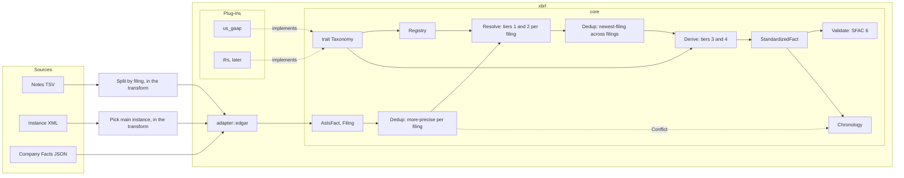
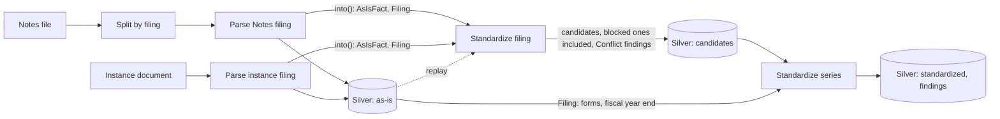

# XBRL Crate Design Document

## General Thoughts

The `xbrl` crate is the common core of reported financial data. The SEC is the first source. ESEF
and DART follow later. The crate validates and organizes company data. It makes no assumption about
the gold layer. Each load step shapes the data for its own target.

The crate has a core and taxonomy plug-ins:

- **The core** holds the fact model, dedup, chronology checks, provenance, and confidence levels.
  It knows nothing about US GAAP. It defines the `Taxonomy` trait and resolves facts through that
  trait only.
- **A plug-in** implements `Taxonomy` for one taxonomy, for example US GAAP. `us_gaap` is the first plug-in.
  `ifrs` follows for ESEF and DART. A large plug-in can move into its own crate, for example
  `xbrl-ifrs`.

The crate hands out two layers of facts:

- **As-is.** Every reported value, with the filing it came from. No mapping and no dedup, so a
  point-in-time read stays possible.
- **Standardized.** One value per standard concept, from our own concept set. Each value carries a
  confidence level, the ID of the rule that produced it, and the taxonomy release of that rule.

The taxonomy knowledge is code in the repository. A transform needs no call to the FASB or the SEC.

**Validation** checks three things in financial statements:
- Consistency
- Completeness
- Precision

## Crate Structure

```text
xbrl/
  taxonomy/us-gaap/2026/   <- vendored FASB files and a MANIFEST with the SHA-256 of each file
  src/
    core/
      concept.rs           <- ConceptName, NamespaceFamily, Namespace (parser input)
      fact.rs              <- AsIsFact, FactKey, FactValue, Decimals, Dimensions
      filing.rs            <- Filing, FilingId, EntityId
      finding.rs           <- Finding: what a step reports without failing the run
      form.rs              <- Form (open text)
      fiscal_period.rs     <- FiscalPeriod (open text)
      invalid_value.rs     <- InvalidValue, the error of each core value type
      unit.rs              <- Unit (open: numerator and denominator measures)
      period.rs            <- Instant | Duration
      elements.rs          <- CanonicalElement, our standard concept set, SFAC 6 invariants
      standardized.rs      <- StandardizedFact
      candidate.rs         <- Candidate: the value of one filing, before newest-filing
      confidence.rs        <- Exact | Synonym | Derived | Computed
      rule.rs              <- RuleId
      release.rs           <- TaxonomyRelease (ID and checksum)
      taxonomy/
        mod.rs             <- trait Taxonomy
        family.rs          <- FamilyDeclaration, UriPattern
        reference.rs       <- ConceptAliases, CalculationTree, ElementReference
        registry.rs        <- Registry, RegistryError
      fact_set.rs          <- working set of resolution for one entity and one period
      graph.rs             <- resolution and validation engine
      alias.rs             <- tiers 1 and 2 on one filing
      dedup.rs             <- dedup rules of the standardized layer
      period_identity.rs   <- core/period/q4-from-fy@1
      chronology.rs        <- order over time, gap check
      suspicious_period.rs <- periods that no filer means, and the filing that confirms the value
    us_gaap/
      mod.rs               <- UsGaap: impl Taxonomy, family declarations
      mappings.rs          <- aliases: standard concept -> US GAAP concepts (tiers 1 and 2)
      table.rs             <- ElementRow, CalculationRow: the rows of the generated tables
      taxonomy.rs          <- generated tables: calculation tree, element reference data
      generator/           <- feature `generator`: vendored files -> taxonomy.rs
    adapter/               <- one adapter per data source
      edgar/               <- the documents of EDGAR, the filing system of the SEC
        notes/             <- rows of one Notes filing -> AsIsFact, Filing, findings
          row.rs           <- SubRow, NumRow, TxtRow, DimRow, TagRow
        instance.rs        <- one instance document -> AsIsFact, Filing
        company_facts.rs   <- Company Facts JSON -> AsIsFact, Filing
        company_concept.rs <- Company Concept JSON -> AsIsFact, Filing
        frames.rs          <- Frames JSON -> AsIsFact, Filing
        frame.rs, quarter.rs <- the `frame` field of the SEC JSON APIs
```



Rules of the layout:

- `core` imports no plug-in and no adapter.
- A plug-in imports only `core`.
- `adapter::edgar` is an adapter. It imports `core` and maps the documents of EDGAR into as-is
  facts: the rows of one Notes filing, one instance document, and the Company Facts JSON. A later
  data source gets its own adapter next to it, for example `adapter::esef`.
- The Notes parser and the instance parser live in `adapter::edgar`. Their rules fill the fact
  model, and one test runs both parsers on the same filing.
- The transform keeps the I/O and the states. It opens the Notes ZIP. It reads `sub.tsv` and
  `dim.tsv` whole, streams `num.tsv` and `txt.tsv`, and splits them by `adsh`. It picks the main
  instance of a filing and skips the filing-fee exhibit. It reads the raw store, adds the ingestion
  provenance, and writes silver.
- `xbrl` defines the row types of the Notes tables. The transform fills them from the TSV text. It
  hands `adapter::edgar::notes` the rows of one filing: its `sub` row, its `num` and `txt` rows,
  the `dim` rows that its `num` and `txt` rows name through `dimh`, and the `tag` rows that its
  `num` rows name through `tag` and `version`. The parser reads only `tag.datatype`, to restore
  `/shares` (owner, 2026-11-08). In `2026_10`, 1,449 of 1,685 per-share tags are extension tags,
  so a taxonomy plug-in cannot give the data type.
- A parser returns `Finding` values next to its facts. `Finding::UnmappedRow` names a row that the
  parser dropped, and `Finding::UndeclaredFamily` names a family that no plug-in declares. Only a
  `sub` row that breaks a rule fails the filing.

**Crate boundary**: `xbrl::adapter::edgar` takes the XML text of one instance (`&str`), the rows of one Notes filing, or a raw JSON body (`&serde_json::Value`), NOT an `SecResponse`. The `sec` crate owns HTTP, rate limiting, and response handling. `xbrl` has zero network dependencies. Its XML parser is pure Rust and needs no system library.

### Types That Change

These places in the old code assumed the SEC or US GAAP. The design replaces each one. All
replacements are in the code:

| Today | Assumption | Replacement |
| ----- | ---------- | ----------- |
| `core::Namespace` | Closed enum of 6 SEC namespaces | Open `NamespaceFamily` on each concept. `Namespace { prefix, uri }` stays a parser input. Each plug-in declares its families, each with a `FamilyDeclaration` |
| `core::Unit` | Closed enum of 4 US units | Open `Unit` of numerator and denominator measures, for example `iso4217:EUR` |
| `core::RawObservation` | Value is `i64`, no dimensions, no `decimals` | `AsIsFact` |
| `core::Provenance` | SEC accession number and forms | `Filing` with an open `FilingId` |
| `core::Form` | Closed enum of 4 SEC forms | Open text on `Filing`, with `is_amendment` |
| `core::AccessionNumber` | SEC filing ID | Text inside `FilingId`, for example `sec:<accession>` |
| `core::FiscalPeriod` | `FY` and `Q1` to `Q3` only | Open text on `Filing`, as filed. ESEF filers report half years |
| `core::Frame`, `core::Quarter` | Field of the SEC JSON APIs | Move to `adapter::edgar`. No rule uses them |
| `core::EntityName` | One current name | A company attribute on `Filing`, as filed |
| Company Facts constants in `us_gaap::mappings` | Keys of one SEC JSON API | Move to `adapter::edgar` |

---

## 0) Data Model

Define the target model inside `xbrl::core`, outside any taxonomy-specific module, to contain core financial company data required for all companies.

Start with SFAC 6.

SFAC 6 is the authoritative definition of what financial data exists and how it relates. It describes 10 elements as well as the invariants that connect them. Unchanged since 1985.

It gives you:
- **What to extract** — the 10 elements are the canonical set
- **How to validate** — the invariants are the correctness checks
- **How to derive** — if one element is missing, solve for it from the identity (e.g., missing Equity = Assets - Liabilities)

### 0.1) Balance Sheet

3 roll-up items:
- Assets
- Liabilities
- Equity

Invariant: `Assets = Liabilities + Equity`

### 0.2) Cash Flow Statement

3 roll-up items:
- Operating Cash Flow
- Cash Flow from Investing Activities
- Financing Cash Flow

### 0.3) Income Statement

Roll-up items:
- Revenue
- Expenses
- Gains
- Losses
- Net Income (= Revenue - Expenses + Gains - Losses)
- Comprehensive Income (= Net Income + OCI items)

### 0.4) Changes in Equity

Links the other statements. Explains additional investment / payout of company substance.

`ΔEquity = Comprehensive Income + Investments by Owners - Distributions to Owners`

### CanonicalElement Enum

> **[DECISION NEEDED]** Enumerate the full set before implementation. Draft below.

```rust
enum CanonicalElement {
    // --- SFAC 6 Level 1 (root invariants) ---
    Assets, Liabilities, Equity,
    Revenue, Expenses, Gains, Losses, NetIncome,
    OtherComprehensiveIncome, ComprehensiveIncome,
    OperatingCashFlow, InvestingCashFlow, FinancingCashFlow,

    // --- Level 2: Balance Sheet sub-elements ---
    CurrentAssets, NonCurrentAssets,
    CashAndEquivalents, ShortTermInvestments,
    AccountsReceivable, Inventory,
    PropertyPlantEquipment, Goodwill, IntangibleAssets,
    CurrentLiabilities, NonCurrentLiabilities,
    LongTermDebt, RetainedEarnings,

    // --- Level 2: Income Statement sub-elements ---
    CostOfRevenue, GrossProfit,
    SellingGeneralAdmin, ResearchDevelopment,
    InterestExpense, OperatingIncome,
    EarningsPerShareBasic, EarningsPerShareDiluted,

    // --- Level 2: Cash Flow sub-elements ---
    DepreciationAmortization, CapitalExpenditures,
    DividendsPaid, ShareRepurchases,
    ShareBasedCompensation,
}
```

These are all standard US-GAAP taxonomy concepts served by the SEC JSON API. Verified against Apple and Alphabet company facts data.

### Standard Concept Set

`CanonicalElement` is our own concept set for the standardized layer. Its names are not US GAAP
names. SFAC 6 defines its roots, and the IFRS Conceptual Framework defines assets, liabilities,
equity, income, and expenses in the same terms. So US GAAP and IFRS both map into it, each through
the aliases of its plug-in. Example: `us-gaap:Revenues` and `ifrs-full:Revenue` both map to
`Revenue`.

- The MVP freezes the 13 Level-1 roots. Level 2 grows by the checklist of the `xbrl-standardization`
  skill.
- A taxonomy concept with no faithful match stays an as-is fact. It never maps to the nearest
  element.
- For one entity, period, and dimensions, at most one concept fills each element. The alias
  order picks it.

---

## 1) Taxonomy Plug-ins

### The `Taxonomy` Trait

The core resolves facts through this trait only. A plug-in implements it with static data that is
compiled into the binary.

```rust
pub trait Taxonomy: Send + Sync {
    /// The release that the tables of this plug-in come from, for example `us-gaap/2026`.
    fn release(&self) -> &TaxonomyRelease;
    /// Every family this plug-in declares: its URI patterns, its Notes `version` prefix, and
    /// whether the plug-in resolves its facts.
    fn families(&self) -> &[FamilyDeclaration];
    /// Per standard concept, the taxonomy concepts in priority order, with the alias rule ID.
    fn aliases(&self) -> &[ConceptAliases];
    /// The parent, child, and weight arcs of the calculation linkbase.
    fn calculation_tree(&self) -> &CalculationTree;
    /// The reference data of one element: label, data type, balance, period type.
    fn element(&self, concept: &ConceptName) -> Option<&ElementReference>;
    /// The reference data of every element of the release, and of every retired element.
    /// Each `ElementReference` names the release it comes from.
    fn elements(&self) -> &[ElementReference];
}

pub struct TaxonomyRelease {
    id: TaxonomyReleaseId,   // "us-gaap/2026"
    checksum: Sha256,        // SHA-256 of the MANIFEST files of the vendored folders
}
```

SFAC 6 identities and period identities are not part of the trait. They are core rules, the same
for every taxonomy.

**Registry.** The core holds a list of `&dyn Taxonomy`. The caller owns the plug-ins, and the
registry borrows them. The
registry routes each as-is fact to the plug-in that resolves the namespace family of its concept. A
filing can mix families, for example a 20-F with `ifrs-full` and `dei`, so the routing works per
fact. The registry checks these rules when it starts. A test checks each one:

- At most one plug-in resolves a family. Two resolvers fail with `DuplicateFamilyResolver`.
- Every declaration of a family agrees with the others. Two declarations agree only if both the
  URI patterns and the Notes `version` prefix match. If one of them differs, the split of a URI
  would depend on the order of the plug-ins, so the registry fails with
  `InconsistentFamilyDeclaration`. Whether a plug-in resolves the family does not count.
- Two different families do not overlap. They share no Notes `version` prefix, and no URI can
  match a pattern of each. Otherwise the split would depend on the order of the families, so the
  registry fails with `OverlappingFamilyDeclaration`.
- A plug-in declares each family once. Otherwise it fails with `RepeatedFamilyDeclaration`.

So one plug-in can declare, without resolving, a family that another plug-in resolves, if the two
declarations agree. For example, an `ifrs` plug-in and `us_gaap` can both declare `country`, and
`ifrs` can declare `dei` while a `dei` plug-in resolves it.

Alternatives:

| Option | Pro | Con |
| ------ | --- | --- |
| Trait object in a registry (chosen) | One fact set can hold facts of several taxonomies | Methods must be object safe |
| Generic `Resolver<T: Taxonomy>` | No dynamic call | One pass per taxonomy and a merge for a mixed filing |
| Enum of all taxonomies in the core | Simple match | The core names every taxonomy |

### Namespace

`Namespace` is an open value type: a prefix and a URI, as an instance declares it. Every filer adds
its own extension namespace, so no closed set exists. The URI is the identity, as XBRL defines it.
`Namespace` is a parser input only. Each fact holds a family and a version instead.

Each US GAAP release has its own URI, for example `http://fasb.org/us-gaap/2017-01-31` and
`http://fasb.org/us-gaap/2026`. So a plug-in cannot own one URI. It owns a namespace family:

- A `NamespaceFamily` is the part of the URI without the release, for example `us-gaap` for every
  `http://fasb.org/us-gaap/<date>` URI. The release part goes to `taxonomy_version`.
- A `ConceptName` is a family and a local name. The registry routes on the family. The alias lists
  and `element()` match on the family and the local name, so one plug-in resolves the concepts of
  every release.
- The Notes data set has no URI. Its `tag` table gives the prefix and a `version`, for example
  `us-gaap/2017`.

The split of a URI into a family and a version:

- Each plug-in declares, per family, one or more URI patterns and where the release sits in each,
  for example `http://fasb.org/us-gaap/{release}` and
  `https://xbrl.ifrs.org/taxonomy/{release}/ifrs-full`. It also declares the `version` prefix that
  the Notes data set uses for the family.
- A plug-in can also declare a family that it does not resolve. The split then works, and the
  registry routes no fact of that family to a plug-in. `us_gaap` declares the other SEC taxonomies
  this way, for example `ecd`, `country`, and `currency`.
- The parser asks the registry to split each URI, or each Notes `version`. The plug-ins own the
  patterns, and the core owns the lookup.
- `taxonomy_version` holds the family and the year of the release, for example `us-gaap/2017`,
  whether the URI says `2017-01-31` or `2017`. This is the form of the Notes `tag` table, so both
  sources give the same value key.
- A URI that the schema of the filing defines is an extension. Its family is the filing ID, and so
  is its `taxonomy_version`. In the Notes data set, a `version` equal to the accession number marks
  an extension tag. The parser adds the `sec:` prefix, so both sources write the same filing ID.
- A URI or a Notes `version` that is neither declared nor an extension keeps its fact. The full URI
  or `version` becomes the family and the version, and the parser returns a finding that names the
  family. So a new SEC taxonomy shows up as a finding in both sources, and the as-is layer keeps
  every fact.
- The instance writes the full URI, for example `http://xbrl.sec.gov/xyz/2027`, and Notes writes
  `xyz/2027`. So until a plug-in declares the family, its facts do not join between sources or
  across releases. The fix is to declare the family.
- The `tag` table of the Notes data set has the key `tag` and `version`, and an extension tag has
  the accession number as its `version`. So the filing ID is enough as the family of all extension
  concepts of a filing.

An enum per plug-in was the alternative. It makes the fact type generic, and an extension concept
has no plug-in at all.

### Taxonomy Data in Code

A generator reads the vendored FASB and SEC files and writes Rust tables into `us_gaap/taxonomy.rs`. The
generated file is checked in. A developer runs the generator once per new release, with
`cargo run -p xbrl --features generator --bin generate_us_gaap`.

- The generator is the module `us_gaap::generator`, behind the cargo feature `generator`. A
  normal build of `xbrl`, or of a crate that depends on it, leaves the module out. No container
  runs it. It reads XML with `roxmltree`, the XML library of the instance parser. rustdoc
  compiles the module without the feature, so the doc check of CI covers it.
- `xbrl` lists itself as a dev-dependency with the `generator` feature, so every test build,
  CI included, runs the tests of the generator.
- A concept is a top-level `xs:element` with a `substitutionGroup`. The `us-gaap` 2026 schema has
  17,182 declarations and 17,179 concepts. The other 3 are domain helpers of typed dimensions.
  The `srt` 2026 schema has 620 concepts, and the `dei` 2026 schema has 207.
- The SEC puts the `dei` label linkbase into the `xs:appinfo` of a schema file. So the generator
  reads every `link:linkbase` of a file, at the root or nested.
- The data type of a concept is the text of the schema, for example `xbrli:monetaryItemType`.
- The generator resolves each arc of a linkbase through the labels of the locators and resources
  of its link. It never guesses a concept from the text of a label.
- Some calculation arcs point to `srt` concepts, so each arc names the family of both ends.
- Each calculation arc keeps the role of its calculation link, its network. A concept can sum
  different children in different networks. `Revenues` has 20 children in the income statement,
  2 in the statement of other comprehensive income, and 2 in the first alternative income
  statement. A sum over all its arcs counts revenue more than once, so a sum takes the arcs of
  one role.
- `ELEMENTS` holds one row per concept of the `us-gaap`, `srt`, and `dei` schemas: family, name,
  standard label, data type, balance, and period type. The rows are sorted by family and name.
- `CALCULATION_ARCS` holds the summation arcs of the statement groups in `stm/`, sorted by role,
  parent, and child. Each row names its role. Within one role, an arc appears once. The
  calculation linkbases of the disclosure groups are not vendored.
- The generator fails if two arcs of one role join the same concepts with different weights.
- `us_gaap/table.rs` defines the row types. The rows hold `&'static str`, so the tables need no
  initialization at program start.
- `mod.rs` marks the generated module `#[rustfmt::skip]`, so `cargo fmt` keeps the bytes that
  the generator writes.
- A test in the generator crate runs the generator and compares its output with the checked-in
  file. If the vendored files or the generator change the output and nobody runs the generator,
  the test fails.

- A new release is a reviewable diff of arcs and labels.
- The build does not parse XML.
- The checksum is the SHA-256 of the `MANIFEST` files of `taxonomy/us-gaap/<year>/`,
  `taxonomy/srt/<year>/`, and `taxonomy/dei/<year>/`, joined in that order. A `MANIFEST` has one
  line per vendored file, sorted by path, with the SHA-256 of the file. A test recomputes the
  checksum and compares it with the value in the generated code.

Alternatives: a `build.rs` that parses the XML at build time (slower builds, build logic is hard
to test), or `include_bytes!` and a parse on first use (14 MB of labels parsed at each start, a bad
file fails at run time).

### Release in Use Today

- `us_gaap/mappings.rs` names no release. Its 140 tags are picked by hand from filings. 137 of them
  are in the 2026 release. `SalesRevenueNet` (deprecated), `IncomeLossFromOperations`, and
  `EarningsPerShareBasicAndDiluted` are not.
  The unit test
  `should_find_reference_data_for_every_alias_and_part_except_the_removed_ones_when_created`
  checks that the other 137, and each concept below a root of `other_part_trees`, are in the 2026
  schema. An alias list bridges renames across releases,
  so it does not come from one release.
- `us_gaap/taxonomy.rs` holds the generated tables of the 2026 release (see "Taxonomy Data in
  Code").
- The US GAAP 2026 release lives in `xbrl/taxonomy/us-gaap/2026/`. The files come from the FASB
  release zip `https://xbrl.fasb.org/us-gaap/2026/us-gaap-2026.zip`, published 2026-01-31, and
  keep its bytes and its folder names:
  - `elts/us-gaap-2026.xsd`: the element schema, with data type, balance, and period type.
  - `elts/us-gaap-lab-2026.xml`: the label linkbase.
  - `elts/us-gaap-depcon-def-2026.xml` and `elts/us-gaap-depcon-pre-2026.xml`: the deprecated
    concepts of the release (see "Releases Over Time").
  - `stm/`: all 26 statement groups, each with its entry schema and its linkbases. The release
    has no unclassified balance sheet for all industries. Its unclassified balance sheets are per
    industry (`sfp-dbo`, `sfp-ibo`, `sfp-sbo`, `sfp-ucreo`).
  - `MANIFEST`: one line per vendored file, sorted by path, in the format of `sha256sum`. A test
    in `tests/us_gaap_manifest.rs` recomputes the `MANIFEST` of every release folder.
- The files keep the CRLF line ends of the FASB. `.gitattributes` marks the folder `-text`, so Git
  never changes a byte.
- The US GAAP 2026 release imports the `srt` 2026 and the `dei` 2026 releases. Each lives in
  its own folder, with a `MANIFEST`, and keeps the bytes of its publisher:
  - `xbrl/taxonomy/srt/2026/elts/`: `srt-2026.xsd` and `srt-lab-2026.xml`, from the FASB zip
    `https://xbrl.fasb.org/srt/2026/srt-2026.zip`, with its folder names.
  - `xbrl/taxonomy/dei/2026/`: `dei-2026.xsd` and its label linkbase `dei-2026_lab.xsd`, from
    `https://xbrl.sec.gov/dei/2026/`. The SEC publishes no zip for `dei`.
- The release ID `us-gaap/2026` names the US GAAP release. It also stands for the `srt` and `dei`
  releases that the US GAAP release imports, so they get no release ID of their own. The
  checksum covers the files of all three folders. So a changed `srt` or `dei` file changes the
  checksum, and the release ID stays the same.
- Missing for the reference data: the elements that the FASB removed before 2026 (see "Releases
  Over Time").

### Releases Over Time

A taxonomy changes in two ways, and the design handles each one separately:

- **Renamed or retired concepts.** The as-is fact keeps the concept and the `taxonomy_version` of
  its filing. The alias lists of a plug-in map the old and the new names to one standard concept,
  so an alias list spans releases. Our own concept set does not change with a release.
- **A new release each year.** It gets its own folder, `xbrl/taxonomy/us-gaap/<year>/`, and the
  `srt` and `dei` releases that it imports get theirs. The
  generator rebuilds the tables, the PR shows the changed arcs and labels, and the release ID and
  checksum change. A new release changes the release ID on each fact, not the rule version. A rule
  version goes up only when we change the rule itself, and only after the MVP (see "Rule IDs").
  The standardized layer is built again from
  the as-is layer, with no new download and no new parse.

Which release resolves an old filing (decided by the owner on 2026-11-07):

| Option | Pro | Con |
| ------ | --- | --- |
| A. The newest release only | One set of tables | Retired concepts have no reference data. Old filings use today's tree |
| B. Every release, picked by the `taxonomy_version` of the filing | Exact for every filing | 18 yearly releases (2009 to 2026) to vendor and generate |
| C. The newest release, plus the retired elements with the schema of the last release that defined each (chosen for the MVP) | Retired concepts get their reference data | Old filings use today's tree |

- B and C differ only in tier 4, the sums along the calculation tree. Tiers 1 to 3 do not use the
  tree.
- Where a tree changed, mostly with a new standard such as revenue in 2018 or leases in 2019, the
  newest tree names concepts that an old filing does not use. So C gives no tier 4 value for most
  such filings. The share of wrong values is not measured.
- The difference is not measured. Measure it once the transform produces standardized facts. If it
  matters, move to B. B adds release folders and needs no change to the design, because each fact
  names its release.

How option C gets the reference data of a retired element. The FASB publishes no separate list
of retired elements. A check of the releases 2011 to 2026 on 2026-11-08 found two kinds:

- **Deprecated, still defined.** A release keeps a deprecated element in its schema for some
  years. The 2026 schema holds the elements deprecated in 2024, 2025, and 2026. Their standard
  label ends with the year, for example `(Deprecated 2026)`. The `depcon` definition linkbase links
  each one to the concept that replaces it, and the `depcon` presentation linkbase lists them.
  These elements come from `us-gaap-2026.xsd`, so `elements()` covers them with the 2026 release.
- **Removed.** The FASB drops a deprecated element from the schema in a later release.
  `SalesRevenueNet` is deprecated in 2018 (label `Revenue, Net (Deprecated 2018-01-31)`) and last
  defined in the 2020 schema. 6,628 elements of the schemas 2011 to 2025 are missing from 2026.
  Their last definitions spread over 14 releases, 2012 to 2025.

The fields that the FASB files hold for a retired element:

| Field | Source |
| ----- | ------ |
| Name, data type, balance, period type | The schema of the last release that defines it |
| Label, deprecation date | The label linkbase of that release, as text at the end of the label |
| Replacement concept | The `depcon` definition linkbase of that release, for some elements |

The release that retires an element is not a field. It is the date in the label, or the first
release whose schema no longer defines the element.

Vendoring the removed elements needs the 14 schemas (about 4.5 MB each) and their label linkbases
(about 14 MB each), about 260 MB in Git. The owner decided on 2026-11-08 to ship the 2026 release
first. `elements()` covers the elements of the 2026 schema, including the deprecated ones. A later
ticket decides where the removed elements live.

### `us_gaap`

- Owns the namespace families `us-gaap` and `srt`. For the MVP it also owns `dei`. It declares,
  without resolving, the other SEC taxonomies: `country`, `currency`, `cyd`, `ecd`, `exch`, `ffd`,
  `invest`, `naics`, `rxp`, `sic`, `snj`, `spac`, and `stpr`. A family missing from this list
  shows up as a finding of the parser, and the fix is to declare it.
- Its URI patterns name the FASB (`http://fasb.org/<family>/{release}`), the SEC
  (`http://xbrl.sec.gov/<family>/{release}`), and XBRL US (`http://xbrl.us/<family>/{release}`),
  which published the `us-gaap` and `dei` releases of 2009 and 2010.
- `UsGaap::new` builds the release, the calculation tree, and the element reference data from the
  generated tables. `element()` finds a concept of `us-gaap`, `srt`, or `dei` by a binary search
  on the elements, which are sorted by family and name. It returns `None` for an element that a
  release before 2026 removed.
- The calculation tree holds the arcs of every role. Each arc names its role.
- `aliases()` returns one alias list per definition of `mappings.rs`. `UsGaap::new` builds the
  lists from the definitions, so the `xbrl` crate holds each list once. Each definition names its rule ID as a
  const next to the list. The rule name is the kebab case of the standard concept, at version 1,
  for example `us-gaap/alias/operating-cash-flow@1`.
- An alias list holds only concepts that equal the whole standard concept, such as the names of
  one total across releases. It holds no concept that is wider than its standard concept, and no
  part of the total. Such a concept gives the standard concept a different meaning per filer, and
  the `Synonym` confidence does not show it. For example, `ReceivablesNetCurrent` also holds
  receivables that are not from customers, so it is not an alias of `AccountsReceivable`.
- A part stands for the whole only through the part rule, `us-gaap/part/<standard concept>@1`.
  `PART_CONCEPTS` in `mappings.rs` names the parts of a standard concept and its other parts. The
  other parts are the concepts that sum to the total with the part: the siblings of the part, and
  the siblings of each concept between the part and the total, in the 2026 calculation tree.
  - An other part in `other_part_trees` also counts with each concept below it, because filers
    often report those concepts instead. Of the concepts below `NoninterestIncome`,
    `NetInvestmentIncome`, and `InterestIncomeExpenseAfterProvisionForLoanLoss`, only
    `RevenueNotFromContractWithCustomerExcludingInterestIncome` counts. It is the sibling of both
    parts below `NoninterestIncome`. The rest holds interest expense and gains that most filers
    report outside revenue.
  - For `InterestExpense`, the 2026 calculation tree has no arc to its parts. Its label, "Interest
    Expense, Operating and Nonoperating", names the two parts, `InterestExpenseNonoperating` and
    `InterestExpenseOperating`. The bank lines below `InterestExpenseOperating` also count, and
    `InterestExpenseDeposits` counts with each concept below it. `InterestExpenseBorrowings` does
    not count. Commercial filers report its children in the debt note, as parts of
    `InterestExpenseNonoperating`.
  - For `DepreciationAmortization`, the concepts below `AdjustmentForAmortization` that amortize
    an operating asset also count, and `Depletion` counts with each concept below it. The accretion of investment discounts, the amortization of
    financing costs, deferred hedge gains, and loan origination fees do not count. Filers report
    them outside D&A as their own add-back.
  - A concept can sit in two alias lists, as `EarningsPerShareBasicAndDiluted` does. A conflict
    finding then names the first of the two standard concepts, in the order of `aliases()`.
  - The part rule runs only if no concept of the alias list resolves. The first part that the
    filing reports wins, with confidence `Synonym`.
  - An other part in the same period and unit blocks the part, in any dimension. Then the
    standard concept gets no value from tiers 1 and 2. A value of zero does not block, because
    then the part equals the whole.
  - For example, `StockholdersEquity` stands for `Equity` only if the filing reports no
    `MinorityInterest`. `Cash` stands for `CashAndEquivalents` only if the filing reports no cash
    equivalents.
  - For `Equity`, `NetIncome`, `OtherComprehensiveIncome`, and `ComprehensiveIncome`, the total is
    also an other part. A filer can tag the total only with a member, such as the noncontrolling
    interest. Then the parent part is not the whole.
  - The other parts leave out a sibling that filers also report outside the total, such as
    `GainsLossesOnSalesOfAssets` below `Revenues`. Its fact does not show a second part of the
    total, so it blocks the part with no cause.
  - A wider concept gets no such rule. A filer picks a wider concept because its line mixes the
    parts. So the filing reports no other part, and the check passes with the wrong value.
- `NetIncome` is `ProfitLoss`, the net income with the noncontrolling interest, so it matches the
  `Equity` of `Assets = Liabilities + Equity`. `NetIncomeLoss`, the part of the parent, stands for
  it only if the filing reports no `NetIncomeLossAttributableToNoncontrollingInterest`.
- `OtherComprehensiveIncome` and `ComprehensiveIncome` hold the noncontrolling interest, as
  `NetIncome` and `Equity` do. The part of the parent stands for each only through the part rule.
- `Expenses`, `Gains`, and `Losses` have no alias list. No US GAAP concept holds the expenses,
  gains, or losses of SFAC 6. `CostsAndExpenses` holds only the cost of revenue and the operating
  expenses. The SFAC 6 identity gives only their net amount, not each one. No rule fills them
  yet.
- The alias lists of `Revenue` and `Equity` hold only totals. The customer-contract revenue
  concepts and `StockholdersEquity` are parts.

### What `ifrs` Needs on Top

- **Its own release line.** `ifrs-full` has one release per year. ESEF adds `esef_cor`.
- **Anchors.** ESEF requires each extension concept to name the IFRS concept it is wider or
  narrower than, in the definition linkbase of the filing. The resolver reads these anchors per
  filing, next to the plug-in. An anchor resolves with confidence `Synonym`.
- **`dei` in its own plug-in.** A 20-F filer at the SEC uses `ifrs-full` and `dei`. So `dei` moves
  out of `us_gaap`.
- **Labels in more languages.** `ElementReference` holds the English standard label. Other
  languages stay out of the MVP.

The open `NamespaceFamily` and `Unit` cover new namespaces and currencies. No new core type is needed.

---

## 2) Contract Types and Parsing

### Input / Output

**Input**: a source document. `adapter::edgar` takes the rows of one Notes filing, one instance
document, or the raw JSON body of an SEC API answer. The transform reads and splits the documents,
and `adapter::edgar` parses them. The pipeline reads the Notes data set and the daily filings
first. Company Facts is a secondary source.

**Output**: `AsIsFact` values, one per reported value, and one `Filing` per filing. Nothing is
resolved to standard concepts yet.

### `AsIsFact`

```text
AsIsFact {
    source: FilingSource {               // where the fact comes from
        filing:        FilingId          // "sec:0000320193-26-000001"
        filed:         NaiveDate
        accepted:      Option<DateTime<Utc>>
    }
    context: Context {                   // what the fact is about, the XBRL context
        entity:        EntityId          // XBRL entity identifier: scheme and id (CIK, LEI)
        period:        Period            // Instant { end } | Duration { start: Option, end, quarters }
        dimensions:    Dimensions        // sorted axis and member pairs, legal entity axis included
    }
    concept:           ConceptName       // namespace family and local name
    taxonomy_version:  Option<TaxonomyVersion> // "us-gaap/2026", the filing for an extension, None from adapter::edgar
    unit:              Option<Unit>      // None for text
    value:             FactValue         // Numeric(Decimal) | Text(String) | Nil
    decimals:          Option<Decimals>  // Finite(i32) | Infinite, None for text
    copy_rank:         u16               // 0 for the first copy of a fact in one filing
    footnotes:         Vec<String>
}
```

- `Period` says whether a fact is an instant or a duration, so no separate period type field
  exists.
- `Decimal` is `bigdecimal::BigDecimal`. It holds every digit the source writes. Silver stores
  `decimal128(38, 10)`, and measured values have up to 24 digits before the point and up to 8
  after it. `rust_decimal` holds 28 significant digits, too few for 24 and 8 digits.
- A duration holds its length in quarters, because the Notes data set gives the length but often
  no exact start. The instance parser computes it as `round(days(end - start) / 91.3125)`, the
  rule that matched `qtrs` on the 622 filings of the Notes against instance comparison. If `start`
  is set, the constructor of `Period` computes `quarters` from it, so the two cannot disagree.
- The element reference data holds the period type that the taxonomy declares. If the plug-in has
  reference data for the concept, validation compares the two. A mismatch gives a finding and
  keeps the fact. A concept with no reference data, such as an extension concept, skips the check.
- `filed` and `accepted` are on every fact, because a point-in-time read filters on them. The Notes
  data set gives `accepted` to the minute. The new-filing path gives `filed` only.
- `FilingId` uses the same text as `source_ref` in the storage design, for example
  `sec:<accession>`.
- `adapter::edgar` gives no taxonomy version and no `iprx`, because the SEC JSON APIs carry neither. It
  writes `taxonomy_version` as `None`, and `copy_rank` in the order of the JSON. So its keys never
  join keys from Notes or the instance. The as-is store loads only the Notes data set and the
  instance XML. The SEC JSON APIs feed today's `sec` pipeline only.
- The ingestion provenance (ingestion mode, source document and its SHA-256, execution ID, load
  time, parser version) is not on `AsIsFact`. Silver stores it next to the fact, in the columns of
  `as_is_facts` ([`silver_layer.md`](../sec/design/pipeline/silver_layer.md)).
  `IngestionMode` lives in `storage`, and `xbrl` does not depend on `storage`.

### Value Key

The value key of an as-is fact:

`filing`, `concept`, `taxonomy_version`, exact period end, length in quarters (0 for an instant or a duration under about 45 days),
`unit`, `dimensions`, `copy_rank`.

The key has two requirements. It gives the same value for a Notes row and an instance fact of the
same filing. It is unique within one filing. The measurement of 2026-10-31 on 622 filings in both
sources decides the fields. The summary is in `sec/design/pipeline/ingestion_paths.md`, "Measured
Result". The figures below and the `iprx` order come from its
[findings](https://linear.app/state-machine/document/notes-rows-vs-instance-xml-findings-5d8b4e5d0abf),
section 4.

| Key option | Same in both sources? | Unique in one filing? |
| ---------- | --------------------- | --------------------- |
| Month-end date and quarters | Yes | No: 395 keys hold two values |
| Exact start and end | No: Notes misses the exact start in 29,761 of 100,303 durations | No: 266 keys differ only in `decimals` |
| Exact end, quarters, copy rank (chosen) | Yes: Notes `ddate` with `datp` gives the exact end, and the parser numbers the copies in `iprx` order | Yes, by construction: the parser numbers the copies (see "Decisions for the Transform Design") |

- The instance parser computes `copy_rank` in the order of the SEC for `iprx`: higher precision
  first, then the distance of the end to a month end, then the distance of the length to a full
  quarter. A test on filings in both sources checks that the two ranks agree.
- The exact start stays on the fact when the source has it. It is not part of the key.
- The rank makes the key unique, but it does not make two ranks one fact. Of the 395 measured
  collisions, 266 are one period with two precisions, which are copies. 129 are two exact periods
  with the same end and length, which can be two facts. `core/dedup/more-precise@1` handles both
  cases, see "Dedup Rules".
- `taxonomy_version` adds no uniqueness, because the filing fixes the version of each family. It
  stays in the key because the Notes data set gives it on every row, and `as_is_facts` keys on it.
- The key names the fields only. [`silver_layer.md`](../sec/design/pipeline/silver_layer.md), "Current Facts", decides the rule for a fact from two
  sources. The write rule of gold is open for a later gold design.

### `Filing`

`Filing` is a struct, and `FilingId` is a value type that holds a source and an ID, for example
`sec:0000320193-26-000001`. Neither is a trait. One `Filing` per filing: `FilingId`, `EntityId`, form as open text (`10-K/A`), `is_amendment`,
`filed`, `accepted`, the period of report, the fiscal year and period as filed, and the company
attributes as filed in `CompanyAttributes`: name, industry code, ticker, exchange, fiscal year end.
The attributes belong to the company. A filing records them as of its filing, so a later filing
with another value is a change over time, not a conflict. The industry code holds a scheme and a
code, for example `sic:3571` or `nace:26.20`. SIC is the scheme of the SEC. A filing with another
regulator, such as an ESEF filing, uses another scheme, so the code names its scheme.

### Key Design Decisions

**Period type** — The SEC JSON doesn't explicitly label instant vs duration, but you can distinguish them: if a data point has only `end` (no `start`), it's an instant (balance sheet). If it has both `start` and `end`, it's duration (income statement, cash flow). The `frame` field also encodes this — frames ending in `I` are instants. This distinction is critical because it maps directly to which financial statement a fact belongs to.

**Namespaces** — A parser keeps every namespace it finds: `us-gaap`, `dei`, `srt`, `ifrs-full`, and the extension namespace of the filer. Resolution routes each fact to the plug-in that owns its namespace family (see "Namespace"). A fact in a family that no plug-in owns stays an as-is fact.

**Amendments and restatements** — The parser emits every value of every filing, including an amendment and the comparatives of a later filing. Dedup is a concern of the standardized layer, not of parsing.

**Concept name instability** — Concept names shift over time due to FASB taxonomy updates. Example: Apple's Revenue was `SalesRevenueNet` (2009-2017), `Revenues` (2018), then `RevenueFromContractWithCustomerExcludingAssessedTax` (2019-2025). The alias system handles this — each canonical element has a prioritized alias list. First alias that matches wins. When two aliases both exist for the same period (overlapping transition years), the first alias in the priority list wins.

### Handling Different SEC API Schemas

The SEC has three relevant JSON APIs:
1. **Company Facts** (`/companyfacts/CIK{n}.json`) — all facts for one company
2. **Company Concept** (`/companyconcept/CIK{n}/{taxonomy}/{concept}.json`) — one concept for one company
3. **Frames** (`/frames/{taxonomy}/{concept}/{unit}/{period}.json`) — one concept across all companies

All three serve data points with the same 9 keys: `accn`, `end`, `filed`, `form`, `fp`, `frame`, `fy`, `start`, `val`. The JSON envelope differs but the data points are identical.

Handle with separate deserializers that all produce the same output:

```
xbrl::adapter::edgar::company_facts    -> Vec<AsIsFact>, Vec<Filing>
xbrl::adapter::edgar::company_concept  -> Vec<AsIsFact>, Vec<Filing>
xbrl::adapter::edgar::frames           -> Vec<AsIsFact>, Vec<Filing>
```

The resolution engine does not know which API an as-is fact came from.

---

## 3) Resolution

### `StandardizedFact`

`StandardizedFact` is one value of one standard concept. It replaced `ResolvedFact`.

```text
StandardizedFact {
    entity:      EntityId
    concept:     CanonicalElement
    period:      Period
    unit:        Unit
    dimensions:  Dimensions        // empty in the MVP
    value:       Decimal
    confidence:  Confidence        // Exact | Synonym | Derived | Computed
    rule:        RuleId            // "us-gaap/alias/revenue@1"
    release:     TaxonomyRelease   // ID and checksum
    inputs:      Vec<FactKey>      // the value keys of the as-is facts it came from
    restated:    bool              // an earlier filing reported another value for this value or an input
}
```

- `rule` and `inputs` replace `resolution_path: Vec<String>`. The trace is typed and joins back to
  the as-is facts.
- `inputs` replaces `sources: Vec<FilingSource>`. The input facts name their filings.
- The release and its checksum are on every fact, so a fact proves its release without a join. In a
  Parquet column, dictionary encoding stores one entry per release.
- The label, data type, and balance of an element are not on the fact. They live once per release
  in a reference table, from `Taxonomy::elements()`.

**`FactSet`** stays. It holds one entity, one period, and one `StandardizedFact` per standard
concept. Resolution fills it, and validation checks it. It is a working set, not a storage type.
The fact store stores rows of facts.

### Rule IDs

A `RuleId` has the form `<owner>/<kind>/<name>@<version>`:

- `us-gaap/alias/revenue@1`: the alias list of a plug-in.
- `us-gaap/part/equity@1`: the parts of a standard concept that stand for the whole if the filing
  reports no other part.
- `core/sfac6/balance-sheet@1`: an SFAC 6 identity.
- `core/period/q4-from-fy@1`: a period identity.
- `core/dedup/newest-filing@1`: a dedup rule.

From the MVP on, the version goes up when we change the rule itself. Until then, every rule stays
at version 1, even when it changes (decided by the owner on 2026-11-09). A standardized fact stored
before the MVP does not need to name the form of the rule that made it. The as-is layer keeps every
input, so the standardized layer can be built again from it.

A new release changes the release on the fact, not the version. A core rule carries the release of
the plug-in that resolved the concept.

### Three Layers

**Layer 1 — Canonical Elements (SFAC 6)**

The root elements are the target. Everything resolves down to these.

```
Assets = Liabilities + Equity
Comprehensive Income = Revenue - Expenses + Gains - Losses
ΔEquity = Comprehensive Income + Investments by Owners - Distributions to Owners
```

**Layer 2 — Resolution (how to populate each element)**

Each element has a tiered resolution chain:

| Tier | Confidence | Mechanism |
| ---- | ---------- | --------- |
| 1 | `Exact` | The first concept of the alias list of a plug-in |
| 2 | `Synonym` | A later concept of the alias list, a part with no other part reported, or an ESEF anchor |
| 3 | `Derived` | An identity the core knows: an SFAC 6 identity or a period identity |
| 4 | `Computed` | A sum along the calculation tree of a plug-in |

```
Element: "Revenue"
  Tier 1  Exact:     Revenues                               -> confidence: Exact
  Tier 2  Synonym:   SalesRevenueNet                        -> confidence: Synonym

Element: "Total Assets"
  Tier 1  Exact:     Assets                                 -> confidence: Exact
  Tier 3  Derived:   Liabilities + Equity                   -> confidence: Derived
  Tier 4  Computed:  AssetsCurrent + AssetsNoncurrent       -> confidence: Computed
```

First tier that resolves wins. Every resolved value carries which tier produced it.

The level of a derived or computed fact is the weakest of its own level and the levels of its
inputs. `Confidence` orders from `Exact` to `Computed`, so this is the maximum.

**Period identities.** A 10-Q reports Q1 to Q3 and year-to-date values. A 10-K reports the fiscal
year. `core/period/q4-from-fy@1` derives Q4 = FY − 9-month YTD, which is the same as
FY − Q1 − Q2 − Q3. The YTD form also works for the cash flow statement, which a 10-Q reports as
year-to-date only. The result has confidence `Derived`.

- The rule applies only to duration concepts in one currency, with no per-share unit. EPS, share counts,
  and ratios get no Q4 derivation, because they do not add over periods.
- Both inputs come from one fiscal year, after `core/dedup/newest-filing@1`.
- If an input has `restated`, the Q4 value has `restated` too, and chronology reports it.
- `core::period_identity::derive_q4` runs on the output of `core::dedup::newest_filing`. A nine-month value belongs to a
  fiscal year if its end lies one quarter before the end of the year. If both periods have an exact
  start, the starts must be equal. The Q4 period runs from the day after the nine-month end to the
  year end.
- A unit is a currency if it is one ISO 4217 code and divides by nothing (`Unit::is_currency`).
  The measures carry no prefix. Two tables compiled into the binary tell a currency from a custom
  measure such as `BOE`. `core::currency_codes::iso_4217::CURRENCY_CODES` comes from List One of
  the maintenance agency SIX. `HISTORIC_CURRENCY_CODES` comes from List Three. The withdrawn codes
  count, because a series reaches back to 2009 and an old filing reports in a currency such as
  `HRK`. The tables leave out the codes that are not money: fund codes, and units of account,
  metals, `XTS`, and `XXX`.
- The year must end 47 to 137 days after the nine-month end, so that the Q4 rounds to one quarter.
  If several nine-month values fit, the rule takes the latest end.
- The rule derives nothing for a Q4 that the series already holds or that a conflict blocks.
- The rule derives nothing from a short year, such as a first fiscal year from inception or a
  transition period. Its Q4 is not FY − 9-month YTD. `derive_q4` takes the filings of the entity,
  as `check_chronology` does, and treats a year as short in these cases:
  - The year has an exact start and spans under 357 days, 51 weeks. A 52-53 week year spans 363 or
    370 days from start to end. The day count decides alone when the start is known.
  - The year has no exact start, and a `10-KT` of the entity has the year end as its period of
    report.
  - The year has no exact start, and it ends under 357 days after the previous annual report of
    the entity (`10-K`, `10-KT`, `20-F`, or `40-F`). This catches a change of the fiscal year end
    from the dates alone. The `fye` field of a filing can lag the change by several filings, so
    the rule does not read it.
- Notes gives no exact start, and the guard reads no `durp`, because the as-is layer does not keep
  it. So a short first fiscal year in Notes with no `10-KT` and no earlier annual report still gets
  a Q4.
- The Q4 value carries the release of the fiscal year value, and the inputs of both values.
- A separate level for period derivations was the alternative. It changes every consumer filter,
  and its order against `Derived` and `Computed` is not clear. The rule ID already tells the two
  apart.

**Layer 3 — Validation (invariants as constraints)**

Once elements are populated, enforce the identities:

```
Check:  Assets == Liabilities + Equity
Check:  Net Income == Revenue - Expenses + Gains - Losses
Check:  Operating CF + Investing CF + Financing CF ≈ ΔCash
```

A validation failure with all Tier 1 values = the company filed inconsistent data.
A validation failure with Tier 3 or 4 values = your derivation logic has a bug.

### The Key Insight

Resolution and validation are the same graph. The SFAC 6 identities define edges between elements. When resolving, you traverse edges to derive unknowns. When validating, you check that the edges hold. Same structure, two modes.

```
Nodes  = SFAC 6 Elements (what you extract)
Edges  = Invariants       (how they relate)
Mode 1 = Resolve          (fill unknowns from knowns)
Mode 2 = Validate         (verify all edges hold)
```

### Graph Structure

> **[DECISION NEEDED]** Define the graph data structure before implementation.
>
> Options:
> - Adjacency list with weighted edges (+1.0, -1.0) matching FASB linkbase format
> - Trait-based: both SFAC 6 invariants and FASB linkbase implement a common `ResolutionGraph` trait
> - Hardcoded invariant functions for Level 1, linkbase-driven for Level 2+
>
> This determines whether resolution and validation share actual code or just a conceptual model.

---

## 4) Dedup and Chronology

### Dedup Rules

The as-is layer keeps every copy of every fact. The standardized layer applies two rules:

| Rule ID | Scope | Rule |
| ------- | ----- | ---- |
| `core/dedup/more-precise@1` | Facts of one filing with the same value key except `copy_rank`, whose values agree with rank 0 (see "Agreement of copies") | Take `copy_rank` 0 |
| `core/dedup/newest-filing@1` | One standard concept across filings: the same entity, standard concept, exact period end, length in quarters, unit, and dimensions | Take the value of the filing with the latest `filed`, then the latest `accepted` (a filing with `accepted` ranks above one without), then the highest filing ID. The filing ID gives a fixed order, not a time order |

Agreement of copies:

- Every rank must agree with rank 0 within the precision of the less precise of the two. Only the
  pairs with rank 0 count, so the result does not depend on the order of the checks.
- If either copy has no `decimals`, as with `adapter::edgar` facts, the values agree only if they are
  equal.
- For `adapter::edgar` facts, rank 0 is the first copy in the JSON, not the most precise one.

The order of resolution and dedup, per entity and period. A period here is an exact period end
and a length in quarters, as in the value key, because the Notes data set has no exact start:

1. `core/dedup/more-precise@1` on the as-is facts of each filing.
2. Tiers 1 and 2 on each filing: at most one candidate per standard concept and filing.
3. `core/dedup/newest-filing@1` across filings, on the standard concept. A newer filing wins over
   the alias order, so a restatement under a renamed concept wins.
4. Tiers 3 and 4 on the values that remain.

**Conflict.** If one rank disagrees with rank 0, the ranks are two or more facts.
`core/dedup/more-precise@1` keeps all ranks and returns a `Conflict` finding to chronology. The
finding names the as-is concept, and the standard concept if a plug-in maps it.

```text
Finding::Conflict {
    entity:            EntityId
    key:               FactKey                   // rank 0: filing, as-is concept, period end, quarters
    ranks:             Vec<u16>                  // the ranks that disagree with rank 0, ascending
    standard_concept:  Option<CanonicalElement>  // None if no plug-in maps the as-is concept
}
```

- If tiers 1 and 2 would pick the conflicting concept, that filing gives a blocked candidate for
  the standard concept. A conflict on a lower alias, on a concept no plug-in maps, or on a fact
  with dimensions blocks nothing.
- Step 3 ranks a blocked candidate with the others. If it wins, the standard concept has no value
  for that entity and period. Step 3 does not fall back to an older filing, because the newer
  filing can hold the restatement. Step 4 derives no value for the blocked concept.
- If a newer filing has a candidate for the standard concept, that candidate wins, and the older
  conflict blocks nothing.

**Candidates.** Steps 1 and 2 give a `Candidate` per standard concept, period, and filing:
`core::dedup::more_precise`, then `core::alias::resolve_aliases`. A candidate holds the fields of
`StandardizedFact` without `restated`, plus its `FilingSource` and a value that is either reported
or blocked. A reported value keeps its `decimals`, so step 3 can tell a restatement from a repeated
comparative. Step 3 is `core::dedup::newest_filing`. It returns the facts and the series keys whose
newest candidate is blocked, so step 4 derives no value for a blocked concept.

Rules the code fixes where the table above leaves a choice:

- The order of filings is total: `filed`, then `accepted`, then the filing ID. A filing with an
  `accepted` time ranks above a filing of the same day without one. "Only if both have it" gives no
  total order: with three filings of one day, the comparison can run in a circle.
- A fact gets `restated` if an older candidate of its series reports a value that disagrees with it,
  by the rule of "Agreement of copies". A blocked older candidate sets nothing.
- In tiers 1 and 2, a fact counts only if it has a unit and a numeric value, and only if the
  registry routes its family to the plug-in of the alias list. A fact with dimensions gives no
  candidate. It still counts as an other part in the part rule, and its conflict still gives a
  `Finding::Conflict`. If two plug-ins map one standard concept, the plug-in of the first family in
  name order wins.
- If no concept of an alias list resolves, the first part of its `PartAliases` that the filing
  reports wins, with `Synonym`. An other part in the same period and unit blocks it, in any
  dimension. A value of zero does not block. A conflict does.

Other cases:

- An amendment is filed later than its original, so `core/dedup/newest-filing@1` covers it.
- A point-in-time read "as of D" applies the same two rules to the filings known at D. It needs no
  third rule. `core::dedup::newest_filing_as_of` takes D as a time in UTC.
  A filing with an `accepted` time counts if it was accepted at or before D. A filing without one
  counts if it was filed before the date of D in UTC, because a filing of that date can still be in
  the future.
- The `frame` field exists only in the Company Facts API. No rule uses it.

### Restatement and Repeated Comparative

Both are the same fact in a later filing. The value tells them apart:

- **Repeated comparative:** the two values agree within the precision of the less precise copy.
  Example: `68000000` at `decimals = -6` and `68106000` at `decimals = 0` agree.
- **Restatement:** the two values differ beyond that precision.

The as-is layer keeps both in either case. The standardized layer takes the newest value. For a
restatement, it sets `restated`, and chronology reports it.

### Gap Check

The gap check runs on the standardized series of one entity and one concept. It reports findings.
It never fails.

- **Expected periods** come from the forms the entity files. A 10-Q filer expects Q1, Q2, Q3, and
  FY. A filer of only 10-K, 20-F, or 40-F expects FY.
- **A gap** is an expected period with no value, between the first and the last period of the
  series. The time before the first period and after the last period is never a gap. So an IPO or a
  delisting makes no gap.
- **A change of fiscal year** shows as a new fiscal year end in `Filing`. A gap or a short period
  next to it gets the reason `FiscalYearChange`.
- **A finding** has a kind (`Gap`, `Overlap`, `Restatement`, `Conflict`, `SuspiciousPeriod`), the entity, the
  concept or concepts (see "Conflict"), the periods, and a reason if one is known. A finding is
  not an error type.
- **Report:** chronology returns its own `Gap`, `Overlap`, `Restatement`, and `SuspiciousPeriod` findings next to the
  series, together with the `Conflict` findings of `core/dedup/more-precise@1`. Chronology derives
  `Restatement` from the `restated` flag of `StandardizedFact`.
- **A blocked period** (see "Conflict") has no value, so it is a gap with the reason `Conflict`.
  A blocked period after the last value is no gap. Only its `Conflict` finding reports it.
  `Conflict` wins over `FiscalYearChange` as the reason.

`core::chronology::check_chronology` fixes these rules where the list above leaves a choice:

- **Timeline.** One entity, standard concept, unit, and dimensions. Values of every length belong
  to it. A value of any length fills an expected period if its end lies within 7 days of the
  expected end. A 52-53 week year ends up to 6 days away from the end of its month.
- **Forms.** The form counts without its `/A` suffix. `10-Q` and `10-QT` make a quarterly filer.
  `10-K`, `10-KT`, `20-F`, and `40-F` are annual reports. A `T` form reports a transition period.
  An entity with neither expects no period.
- **Expected ends.** The period of report of each annual report is a fiscal year end. Between two
  fiscal year ends, the check steps back from the later end while the step lies more than 7 days
  after the earlier end. The step is 3 months if the annual report for the later end is a `10-K` or
  `10-KT` and the entity filed a quarterly report before that end, otherwise 12 months. So an issuer
  that moves from 20-F to 10-K and 10-Q expects quarters only from the year of its first quarterly
  report on. A 10-Q filer that skips the 10-Q filings of a whole year still expects its quarters. A
  filer that moves to 20-F or 40-F expects only fiscal years again. After the last fiscal year end,
  the check steps forward up to the latest period of report. The step is 3 months if the last annual
  report is a `10-K` or `10-KT` and the entity filed any quarterly report, otherwise 12 months.
  Before the first fiscal year end, only the quarterly reports give expected ends. The period of
  report of a quarterly report replaces an expected end within 7 days of it, or adds one. The fiscal
  period that the report names replaces the computed one. So a filing that never came still leaves
  an expected period.
- **Length.** `Finding::Gap` names the length of the expected period in `quarters`, as in the
  value key. A Q4 value and a fiscal year value share `period_end`, so the length is part of the
  key.
  - A step of 3 months gives 1 quarter, a step of 12 months 4 quarters.
  - A quarterly report gives 1 quarter, a `10-QT` included.
  - A fiscal year end gives 4 quarters, except at a `10-KT`.
  - A `10-KT` reports a transition period, which is shorter than a year. Its length runs from the
    previous fiscal year end, rounded as `Duration::from_dates` rounds, and is limited to 4
    quarters. So a `10-KT` within 45 days of the previous fiscal year end gives 0 quarters, as its
    value key does. A `10-KT` more than a year after the previous fiscal year end gives 4
    quarters, because a fiscal year report between them is missing. A `10-KT` with no previous
    fiscal year end gives 4 quarters.
  - If no value of the timeline is a duration, as on a balance sheet, the gap has 0 quarters.
- **Same periods for every timeline.** Every timeline of an entity expects the same periods. So a
  concept that a 10-Q filer reports only in its 10-K gets a gap for each quarter. This follows
  "A 10-Q filer expects Q1, Q2, Q3, and FY" above.
- **Fiscal year change.** The filings count in the order they were filed, because a filing
  states its fiscal year end as of its filing date. An amendment does not count, because it can
  state the end of the year it amends. The text `0930` of the Notes data set and
  `--09-30` of an instance document give the same end. Two ends more than 7 days apart around the
  year are a change. A gap in the 12 months after the latest period of report under the old end
  gets the reason `FiscalYearChange`. A short period gets no finding: no finding kind exists for it.
- **Overlap.** Two values of one timeline and the same length overlap if their ends lie closer
  than that length less 7 days. An instant has no length, so it never overlaps.
- **Order.** The gaps and overlaps of each timeline, then the restatements, then the suspicious
  periods (see "Suspicious Periods"), then the findings of dedup in the order the caller gives
  them.

### Suspicious Periods

Some Notes periods are typos of the filer. For example, a 10-Q of 2024 reports revenue for 3,603
quarters that end on 2923-06-30. The filer meant 2023-06-30. The as-is layer keeps every value as
filed. The series step flags the value with `Finding::SuspiciousPeriod` and keeps its period as
filed. `core::suspicious_period::suspicious_periods` runs inside `check_chronology`.

```text
Finding::SuspiciousPeriod {
    entity:            EntityId
    key:               FactKey            // the first input: filing, as-is concept, period end, quarters
    standard_concept:  CanonicalElement
    signals:           Vec<PeriodSignal>  // StartBeforeEarliestYear, EndFarFromReport, or both
    confirmed_by:      Option<FilingId>   // the newest other filing with the same value, or None
}
```

**Signals.** A value that hits a signal gets one finding. The finding names every signal the value
hits, so an instant before 1900 names both. A value whose period differs from the period of its
first input, such as a Q4 of `core/period/q4-from-fy@1`, gets no finding. The finding on the
input names the typo.

| Signal | Rule |
| ------ | ---- |
| `StartBeforeEarliestYear` | The period starts before 1900. For an instant, the date counts. Without an exact start, the start is the end less the length of 91.3125 days per quarter |
| `EndFarFromReport` | The end lies more than 100 years before or after the period of report of the filing of the value |

**Confirmation.** Another value confirms a flagged value if it meets each condition:

- It has the same entity, concept, unit, dimensions, and value.
- It hits no signal.
- It ends on the same month and day as the flagged value, in a year at most 3 from the year of the
  period of report of the flagged filing.
- It comes from another filing.

The limit of 3 years keeps a common value, such as 0, of another year from confirming by chance.
Every confirmation in the measurement ends within 2 years. A typo in a comparative has its
original in an earlier filing. A typo in a new value has its comparative in a later filing. So
both directions count. If several filings confirm, the finding names the newest, in the order of
`core/dedup/newest-filing@1`.

#### Measurement

The thresholds come from a measurement over 23 Notes files, `2023q1` to `2025q3` and `2025_10`
to `2026_10`. It counts rows of copy rank 0 in filings of 2023-10-01 to 2026-10-30, so every hit
has 9 months of earlier filings that can confirm it. The window holds 305,793 filings of 10,211
entities. The first filing of an entity comes from the SEC submissions JSON. A confirmation uses
the rule above on the as-is rows of every concept, not only standard concepts.

| Signal candidate | Rows | Filings | Entities | Confirmed |
| ---------------- | ---- | ------- | -------- | --------- |
| Start or instant before 1900 | 22 | 18 | 11 | 4 |
| End more than 100 years after the period of report | 28 | 10 | 7 | 21 (11 by a later filing, 18 by an earlier one, 8 by both) |
| End 10 to 100 years after the period of report | 365 | 203 | 61 | 15 |
| End 10 to 100 years before the period of report | 42,681 | 10,977 | 2,316 | 2,157 |
| Start before the first filing of the entity | 1,411,980 | 13,838 | 2,949 | not counted |
| Start more than 3 years before the first filing | 13,797 | 2,253 | 610 | 45 |

- **Before 1900.** Every hit is a typo, such as `0205` for `2025`, except 7 rows of one filer that
  tag the area of a property on 1870-12-31.
- **More than 100 years away.** 21 of 28 hits are confirmed. The `qtrs` of 4,007 in `2024q1`
  belongs here: its end is 3024-07-31, and its start of 2022 is plausible. Ends 10 to 100 years
  ahead are mostly real, such as debt terms, carbon prices, and health cost trend rates. Their 15
  confirmations are equal values by chance, such as a gas price of 3.0. So the limit is 100 years.
  No end in this window lies more than 100 years back and after 1899.
- **Start before the first filing.** The check leaves this signal out. 1,068,973 of the rows
  belong to 1,184 new registrants whose first filing is from 2023 or later, such as the fixture
  filer FedEx Freight with 493 rows. With 3 years for comparatives, 13,797 rows stay, and only
  0.3% of them are confirmed. The rest are values since inception and the history of the
  operating company after a SPAC merger or a reverse merger. The signal needs its own design.
- **Comparatives.** Of the 25 confirmed hits of the first two signals, 15 are comparatives whose
  original came first, and 10 are new values that a later comparative repeats.

#### Cases Next to the Signals

The measurement also counted four cases that the signals do not catch. Each has a ticket.

| Case | Count | Decision |
| ---- | ----- | -------- |
| Short fiscal year: 320 to 349 days, USD, no dimensions, with a 9-month value of the same filer and concept that ends 46 to 136 days earlier | 95 years of 93 entities | `core/period/q4-from-fy@1` derived a wrong fourth quarter from them. The rule now skips a short year ("Period identities" in "Three Layers"). In Notes it catches only the years with a `10-KT` or an annual report less than 357 days earlier |
| Transition reports and fiscal year changes | 41 `10-KT` and 6 `10-QT` filings, 276 changes of `fye` of 184 entities | Detection sources for the guard above |
| Duration under 46 days, which rounds to 0 quarters like an instant | 595,875 rows in 52,253 filings of 7,517 entities, 1.4% of all durations | A design decision: keep, drop, or flag |
| Copies of one value key whose lengths differ by at least 0.1 quarters and whose values disagree, such as a 4-month stub and a quarter | 3,291 keys in 510 filings of 311 entities | A design decision: whether a known length splits the conflict |

Notes `durp` is `qtrs` less the true length in quarters. June alone has `qtrs` 0 and `durp`
-0.32. The description of the SEC gives the opposite sign.

---

## 4a) Transform Integration

The `xbrl` crate holds the types and the rules. The transform runs them as states of the state
machine. This section gives the proposed shape and lists what the transform design must decide.

### Proposed Shape



- **One state per step, one filing per run.** A parse state outputs `Vec<AsIsFact>` and one
  `Filing`. It calls `adapter::edgar::instance` on one instance document, or
  `adapter::edgar::notes` on the rows of one filing that a split step cut from a Notes file. The standardize state takes the parse output as its
  input.
- **The transition only moves data.** `From<ParseOutput> for StandardizeInput` hands over the as-is
  facts, as the existing transitions of the `sec` crate do. Parsing and resolution run in
  `compute_output_data` of their state, because they can fail and they return findings. `From`
  cannot fail.
- **As-is is an output of its own.** The parse output goes to the as-is layer before
  standardization starts. A replay of a rule starts from the as-is layer and needs no parse.
- **The registry comes in through the context.** The context of the standardize state holds the
  registry. The state does not name a taxonomy, and a test can pass a fake registry. The
  transform design picks the lifetime.

The order of "Dedup Rules" splits the work at the filing boundary:

| Steps | Needs | Runs in |
| ----- | ----- | ------- |
| 1. `core/dedup/more-precise@1`, 2. tiers 1 and 2 | One filing | The standardize filing state |
| 3. `core/dedup/newest-filing@1`, 4. tiers 3 and 4, chronology | Every filing of one entity | A series step over the stored candidates |

So the standardize filing state outputs candidates, not final standardized facts.

### Decisions for the Transform Design

Parsers. The transform owns the split of a Notes file and the choice of the main instance. The
tickets of `adapter::edgar::notes` and `adapter::edgar::instance` decide the units, the value-key
rules, the drop of equal rows, and the copy ranks. The transform design decides the run unit of the standardize filing state. The
ticket of the instance parser adds the cross-source test.

- How the split step cuts a Notes file into filings, and how it streams a file larger than the
  memory of one task.
- How the transform picks the main instance of a filing and skips the filing-fee exhibit.
- How each parser fills the value key: the exact end from `ddate` and `datp`, the copy rank from
  `iprx` or the SEC order, dimension pairs without prefixes, and the legal entity axis from `coreg`.
- How the Notes parser restores `/shares` on per-share units and drops rows that are equal in value,
  in `decimals`, and in every key field except `copy_rank`, before it numbers the copies, such as the rows that the filing-fee exhibit repeats.
- How each parser numbers the copies of one key. The parser assigns `copy_rank` itself, in the
  `iprx` order where Notes gives it. If two rows still share a key and differ in value, for
  example after the parser strips dimension prefixes, the second row gets the next free rank. So
  the key stays unique, and `core/dedup/more-precise@1` compares the rows.
- Whether the standardize filing state runs once per filing or once per source. A read takes one
  source per filing, the instance over Notes ([`silver_layer.md`](../sec/design/pipeline/silver_layer.md), "Current Facts"). The same rule picks one
  `candidates` unit per filing, so step 3 needs no tie-break inside one `FilingId`.
- A test that runs both parsers on filings in both sources and compares their as-is facts.
  `xbrl/tests/parser_comparison.rs` runs them on one 10-Q. Both give the same value keys, and the
  same content after the Notes losses that the test lists.

The parsers take seven rules from the segment findings of 2026-10-18. The rules make a Notes row
equal to an instance fact. The as-is layer keeps every value and leaves dedup to the standardized
layer, so some rules change:

| # | Rule in the findings | In the as-is row |
| - | -------------------- | ---------------- |
| 1 | Shorten axis and member names the way the SEC does | `dimensions` holds the pairs without prefixes, as above |
| 2 | Keep a typed member as written | `dimensions` keeps the content of the typed member |
| 3 | Notes drops `/shares` from a per-share unit | The Notes parser restores `/shares`. `unit` holds the full unit |
| 4 | The exact end date is `ddate` minus `datp` days | `period` holds the exact end. The start is set only if the source gives it |
| 5 | A fact reported twice is two rows, keep the higher `dcml` | Both rows stay. The parser numbers them in `copy_rank`, in the `iprx` order. `decimals` holds `dcml`, and 32767 becomes `Infinite` |
| 6 | Skip a nil fact | A nil fact stays, as `FactValue::Nil` |
| 7 | Drop a value with a `coreg`. Keep a value only if every axis is on the list | Every value stays. `coreg` becomes the legal entity axis in `dimensions`. The list of segment axes is a read rule |

Where each field of `AsIsFact` comes from:

| Field | Notes data set | Instance path |
| ----- | -------------- | ------------ |
| `filing` | `sub.adsh` | The accession number of the filing |
| `entity` | `sub.cik` | The entity identifier of the context |
| `concept` | `tag` with the namespace of `version`, from `num` or `txt` | The element name |
| `taxonomy_version` | `num.version` or `txt.version` | The registry split of the namespace URI. The namespace whose prefix names the schema file, as `fdxf` names `fdxf-20260930.xsd`, is the extension |
| `period` | `ddate` minus `datp`, and `qtrs`. `qtrs` 0 is an instant only if `durp` is 0 | The period of the context |
| `unit` | `num.uom`, with `/shares` restored if `tag.datatype` is `perShare`. `None` for a `txt` row | The unit of the fact |
| `dimensions` | `dim.segments` through `dimh`, and `coreg`. A lowercase prefix before a capitalized name is stripped. A typed member such as `abc:Def` loses its prefix too. A row with `segt` 1 is cut and gives a finding | The members of the context, without prefixes. An explicit axis loses a leading `Statement` and a trailing `Axis`, and its member loses a trailing `Member` or `Domain`. A typed axis loses only a trailing `Axis`. A typed member keeps its content, and loses a prefix by the Notes rule |
| `value` | `num.value` or `txt.value`. An empty `num.value` is nil. An empty `txt.value` is nil only if `txt.srclen` is 0, else an empty text. The parser drops `txt.lang`, which is not part of the key of `txt`. Every `txt` row of `2026_10` is `en-US` | The content of the fact, or `xsi:nil` |
| `decimals` | `num.dcml`. 32767 is `Infinite`. -32768, which only nil rows carry, is `None`. `None` for a `txt` row | The `decimals` attribute |
| `copy_rank` | Assigned by the parser in the order of `iprx`, over the `num` and `txt` rows | Assigned by the parser in the SEC order of `iprx`: higher `decimals` first, then the length nearer a full quarter, then document order. The facts of one key share one exact end, so the distance to a month end never decides |
| `footnotes` | `num.footnote` or `txt.footnote` | The footnote links, with the text of each footnote and its whitespace collapsed |
| `filed`, `accepted` | `sub.filed`, `sub.accepted` in the time of New York, converted to UTC | The filed date of the daily index. `accepted` is empty |

The instance parser reads the dimension rule and the extension rule from data, not from a
standard:

- The readme of the Notes data set says that `dim.segments` drops a leading `Statement`, a trailing
  `Axis`, and a trailing `Member` or `Domain`. The data of `2026_10_notes.zip` shows that a typed
  axis keeps `Statement`: `StatementOfIncomeLocationBalance` and
  `StatementOfFinancialPositionLocationBalance` are typed, and explicit axes such as
  `StatementBusinessSegmentsAxis` become `BusinessSegments`.
- An instance names its schema file, but not the namespace that the schema defines. The SEC names
  the schema file `<prefix>-<date>.xsd`, so the parser takes the namespace of that prefix as the
  extension. A filing whose prefix differs from the file name gives its extension facts an
  undeclared family and a finding.

The instance parser maps the cover facts in the `dei` namespace into the `Filing`:
`dei:DocumentType` gives the form and, through its context, the entity. `dei:AmendmentFlag`,
`dei:DocumentPeriodEndDate`, `dei:DocumentFiscalYearFocus`, `dei:DocumentFiscalPeriodFocus`,
`dei:EntityRegistrantName`, `dei:CurrentFiscalYearEndDate`, `dei:TradingSymbol`, and
`dei:SecurityExchangeName` give the rest. The instance has no industry code. Its period of report
is the exact date, where Notes `sub.period` is the month end.

States and errors:

- The names of the states, their inputs, outputs, and contexts, and the super-state around them.
- The error types of each state, in the format of `AGENTS.md`, "Error Display Format".
- Where the ingestion provenance joins each as-is fact.
- The state that loads as-is facts from silver for a replay.

Series step:

- Whether the series step runs as a state per entity or as a batch over silver.
- Which filings trigger a new run of the series step for an entity.
- The storage in the diagram is a proposal. The
  [silver layer design](../sec/design/pipeline/silver_layer.md) fixes the datasets, including
  where the `Conflict`, `Gap`, `Overlap`, `Restatement`, and `SuspiciousPeriod` findings live.

---

## 5) Validation

Data quality checks to validate that parsed data makes sense.

Three levels, applied in order of strictness:

1. **Completeness** — Are all required canonical elements present? Can't validate what's missing.
2. **Consistency** — Do the SFAC 6 identities hold? A structural violation (e.g., `Assets != Liabilities + Equity`).
3. **Precision** — Do sub-items sum exactly to their reported parent totals? A rounding or classification issue.

Specific checks include:
- Balance Sheet Identity holds (`Assets == Liabilities + Equity`)
- Roll-up items equal the sum of all sub-items
- Sign checks (Assets > 0, Liabilities > 0, Revenue > 0 for non-loss companies)
- Cross-statement consistency (Net Income in IS == Net Income in CF reconciliation)
- Rules inspired by DQC Rules (https://github.com/DataQualityCommittee/dqc_us_rules)

### Precision Threshold

For values computed by the resolution engine (Tiers 3 and 4), precision must be exactly 100% — our math must be exact.

When cross-checking a company's own reported values (e.g., their reported `Assets` vs the sum of their reported `AssetsCurrent + AssetsNoncurrent`), allow a small tolerance. Companies report in thousands or millions, introducing ±1 rounding differences. Threshold: ±0.1% of the parent value.

Rule: **our math must be exact, their math gets a tolerance.**

---

## 6) Error Handling

Uses `thiserror` with `#[error("...")]`. Follows the same conventions as the `sec` crate:
- `[BracketedName]` prefix on every printed segment
- `Caused by:` chains to an inner error, with no quotes around it. `InvalidDataPointValue` uses it.
- `Reason:` for leaf errors with free-form descriptions (quoted)
- No periods between segments — commas separate description from `Caused by:` / `Reason:`
- A layer prints a segment only if it adds a fact: an action, an object, a cause, or an ID. `ErrorKind::Xbrl`, `XbrlErrorKind::FailedParsing`, and `XbrlErrorKind::FailedValidation` add none, so they pass through with `#[error(transparent)]`. The leaf names the failure. To tell parsing from validation, match on the variant.

### Error Hierarchy

```
ErrorKind
  ::Xbrl(XbrlErrorKind)
    ::FailedParsing(ParseErrorKind)
      ::InvalidJson { reason: String }
      ::UnexpectedJsonSchema { reason: String }
      ::MissingTopLevelKey { key: String }
      ::InvalidDataPoint { concept: String, reason: String }
      ::InvalidDataPointValue { concept: String, source: InvalidValue }
      ::InvalidSubmissionRow { adsh: String, source: InvalidValue }
    ::FailedValidation(ValidationErrorKind)
      ::IncompleteData { missing_elements: Vec<CanonicalElement> }
      ::InconsistentIdentity { invariant: Invariant, left_value: i64, right_value: i64 }
      ::ImpreciseRollup { parent: CanonicalElement, parent_value: i64, children_sum: i64, deviation_pct: f64, threshold_pct: f64 }
```

### Error Severity

- **`FailedParsing`** — Fatal. Bad input, cannot proceed.
- **`IncompleteData`** — Fatal. Missing required elements, cannot validate or produce statements.
- **`InconsistentIdentity`** — Hard error. A financial identity is broken.
- **`ImpreciseRollup`** — Warning when within tolerance, error when exceeded.

### Types

```rust
#[derive(Debug, thiserror::Error)]
pub enum ErrorKind {
    #[error(transparent)]
    Xbrl(XbrlErrorKind),
}

#[derive(Debug, thiserror::Error)]
pub enum XbrlErrorKind {
    #[error(transparent)]
    FailedParsing(ParseErrorKind),

    #[error(transparent)]
    FailedValidation(ValidationErrorKind),
}

#[derive(Debug, thiserror::Error)]
pub enum ParseErrorKind {
    #[error("[InvalidJson] Failed to parse JSON body, Reason: '{reason}'")]
    InvalidJson { reason: String },

    #[error("[UnexpectedJsonSchema] Unexpected JSON schema, Reason: '{reason}'")]
    UnexpectedJsonSchema { reason: String },

    #[error("[MissingTopLevelKey] Expected key '{key}' in response")]
    MissingTopLevelKey { key: String },

    #[error("[InvalidDataPoint] Invalid data point for concept '{concept}', Reason: '{reason}'")]
    InvalidDataPoint { concept: String, reason: String },

    #[error("[InvalidDataPointValue] Invalid value in a data point of concept '{concept}', Caused by: {source}")]
    InvalidDataPointValue { concept: String, #[source] source: InvalidValue },

    #[error("[InvalidSubmissionRow] Invalid sub row of the Notes filing '{adsh}', Caused by: {source}")]
    InvalidSubmissionRow { adsh: String, #[source] source: InvalidValue },
}

#[derive(Debug, thiserror::Error)]
pub enum ValidationErrorKind {
    #[error("[IncompleteData] Missing required elements: {missing_elements}")]
    IncompleteData {
        missing_elements: Vec<CanonicalElement>,
    },

    #[error("[InconsistentIdentity] Invariant '{invariant}' violated, left={left_value}, right={right_value}")]
    InconsistentIdentity {
        invariant: Invariant,
        left_value: i64,
        right_value: i64,
    },

    #[error("[ImpreciseRollup] Roll-up mismatch for '{parent}', reported={parent_value}, computed={children_sum}, Reason: 'Deviation of {deviation_pct:.4}% exceeds threshold of {threshold_pct:.4}%'")]
    ImpreciseRollup {
        parent: CanonicalElement,
        parent_value: i64,
        children_sum: i64,
        deviation_pct: f64,
        threshold_pct: f64,
    },
}
```

### Invariant Enum

All financial relationships are invariants — the only difference is whether they must hold exactly or within a tolerance. `is_exact()` distinguishes the two.

Exact invariant violations produce `InconsistentIdentity` (hard error). Non-exact invariant violations produce `ImpreciseRollup` (tolerance-based).

```rust
#[derive(Debug, Clone, PartialEq, Eq)]
pub enum Invariant {
    // Exact — SFAC 6 identities, must hold with zero tolerance
    BalanceSheetIdentity,        // Assets = Liabilities + Equity
    NetIncomeIdentity,           // Net Income = Revenue - Expenses + Gains - Losses
    ComprehensiveIncomeIdentity, // Comprehensive Income = Net Income + OCI
    EquityChangeIdentity,        // ΔEquity = CompIncome + Investments - Distributions

    // Non-exact — must hold within tolerance
    CashFlowReconciliation,     // Operating + Investing + Financing ≈ ΔCash
}

impl Invariant {
    pub const fn is_exact(&self) -> bool {
        matches!(
            self,
            Self::BalanceSheetIdentity
                | Self::NetIncomeIdentity
                | Self::ComprehensiveIncomeIdentity
                | Self::EquityChangeIdentity
        )
    }
}
```

### Example Error Output

```
[InconsistentIdentity] Invariant 'BalanceSheetIdentity' violated, left=500000000, right=490000000

[ImpreciseRollup] Roll-up mismatch for 'Assets', reported=500000000, computed=499998000, Reason: 'Deviation of 0.0004% exceeds threshold of 0.0000%'
```

---

## 7) Financial Statement Output Types

> **[DECISION NEEDED]** Define output types. One generic `FinancialStatement` or typed per-statement?
>
> Option A — Typed:
> ```
> BalanceSheet      { entity, period: Instant,  facts: HashMap<CanonicalElement, StandardizedFact> }
> IncomeStatement   { entity, period: Duration, facts: HashMap<CanonicalElement, StandardizedFact> }
> CashFlowStatement { entity, period: Duration, facts: HashMap<CanonicalElement, StandardizedFact> }
> ```
>
> Option B — Generic:
> ```
> FinancialStatement { entity, period, statement_type, facts: HashMap<CanonicalElement, StandardizedFact> }
> ```
>
> Option A catches period-type mismatches at compile time (BS is always instant, IS/CF always duration).
> Option B is simpler and more extensible.

---

## 8) Data Modeling — Level 2 Sub-Elements

SFAC 6 gives top-level identities. A useful financial dataset needs the breakdown beneath them.

**Level 1 — SFAC 6 backbone:**
Assets, Liabilities, Equity, Revenue, Expenses, Gains, Losses, Net Income, Other Comprehensive Income, Comprehensive Income, Operating CF, Investing CF, Financing CF

**Level 2 — Key sub-elements:**

Balance Sheet:
- Cash & Cash Equivalents
- Short-term Investments
- Accounts Receivable
- Inventory
- Current Assets (subtotal)
- PP&E (Property, Plant & Equipment)
- Goodwill & Intangibles
- Current Liabilities (subtotal)
- Long-term Debt
- Retained Earnings

Income Statement:
- Cost of Goods Sold / Cost of Revenue
- Gross Profit
- SG&A (Selling, General & Administrative)
- R&D Expense
- Interest Expense
- EPS Basic / Diluted

Cash Flow:
- Depreciation & Amortization
- Capital Expenditures
- Dividends Paid
- Share Repurchases

These are all standard base taxonomy concepts. The same FASB calculation linkbase defines how they sum into the SFAC 6 parents. The SEC JSON API reports them — verified with Apple and Alphabet data.

The model stays the same — just more nodes in the graph. Each sub-element gets the same tiered resolution (exact -> synonym -> derived -> computed).

---

## Open Questions

### Resolved

**Fact sets** — One entity and one period form one fact set. The parser emits as-is facts. Resolution groups them into fact sets in the order of "Dedup Rules" and fills one standardized fact per standard concept.

**Roll-ups** — Not a parsing concern. The parser emits flat as-is facts. The tree structure is in `xbrl::us_gaap::taxonomy` and applied during resolution.

**Period vs point-in-time** — Solved at parse time by the `Period` type. Every as-is fact carries `Instant { end }` or `Duration { start: Option, end, quarters }`.

**Member aggregations / segments** — The SEC JSON APIs serve only consolidated, undimensioned facts of standard taxonomies. The Notes data set and the instance XML carry dimensions and extension concepts. `AsIsFact` holds both, so one fact model covers every source. The standardized layer uses facts with no dimensions in the MVP: in tiers 1 and 2, a fact with dimensions gives no candidate. The legal entity axis is a dimension, so a fact of a coregistrant gives no candidate either. The as-is layer keeps every fact with its dimensions.

**Overlapping concept names** — First alias in the priority list wins. Already how `ConceptDefinition` works.

**Crate boundary** — `xbrl::adapter::edgar` takes `&str` or `&serde_json::Value`. The `sec` crate owns HTTP.

### Deferred (not needed for Phase 1)

**Filing amendments to existing data storage** — The as-is layer keeps the original and the amendment side by side. The standardized layer picks one value with `core/dedup/newest-filing@1`. The write rule of the store is a fact store concern.

**Adjustments (change in accounting policy / correction of error)** — Companies restate prior periods when policies change. A restated value arrives as a new fact of a later filing. The as-is layer keeps both values. The standardized layer takes the newest value and sets `restated`. See "Restatement and Repeated Comparative".

**Variance (budgeted vs actual)** — Not applicable. SEC filings contain actuals only, not budgets. Not needed.

**Fragments** — Not applicable for the JSON API pipeline. Fragments are an XBRL instance document concept relevant only to Phase 2 (raw XBRL parsing).

**Roll forwards** — Relevant for Changes in Equity statement. Deferred until that statement type is implemented.

---

## Decisions Needed Before Implementation

1. **CanonicalElement enum** — Finalize the Level-2 enumeration. The MVP freezes the 13 Level-1 roots (see "Standard Concept Set")
2. **Graph structure** — Adjacency list vs trait-based vs hardcoded functions
3. **Financial statement output types** — Typed per-statement vs generic

The `AsIsFact` and `StandardizedFact` types and the `Taxonomy` trait are decided above.

---

## Follow-Up: Migrate `sec` Crate to Consume `xbrl` Types

The `sec` crate currently has its own financial domain types (`CompanyData`, `CompanyFact`,
`Observation`, `sec::shared::financial::FilingSource`, `ConceptDefinition`) that duplicate what `xbrl`
now provides.

This requires two follow-up tickets:

### Ticket 1: Design the integration pathway (SPIKE)

Research and decide:
- How `Cik` (sec-specific) interacts with `EntityName` (xbrl) in `CompanyData`
- Whether `CompanyData.facts` key becomes `CanonicalElement` or stays as a definition reference
- Whether `sec` types become re-exports of `xbrl` types or thin wrappers with `From` impls
- How to handle the `&'static ConceptDefinition` reference pattern (sec's constants vs xbrl's)
- Migration strategy that keeps the `sec` crate compiling at every step
- Impact on downstream consumers (`CreateFinancialStatements`, pipeline tests, binaries)

Output: a design doc section or ADR with the recommended approach.

### Ticket 2: Implement the migration

Based on the design from Ticket 1:
1. Replace `sec::shared::financial::Observation` with `xbrl::core::fact::AsIsFact`, and
   `sec::shared::financial::FilingSource` with `xbrl::core::fact::FilingSource` (filing ID and
   dates) and `Filing` (form, fiscal year, fiscal period). The two `FilingSource` types share a
   name, not their fields
2. Replace `sec::shared::financial::ConceptDefinition` with `xbrl::us_gaap::mappings::ConceptDefinition`
3. Update `CompanyData` to use xbrl types for its key and value types
4. Update `ParseCompanyFacts::compute_output_data_async()` to delegate to `xbrl::adapter::edgar::company_facts::parse()`
5. Remove the inline `resolve_concept`, `parse_observation`, `build_period`, `build_filing_source` from `sec`
6. Remove duplicated type definitions from `sec::shared::financial/`

**Blocker for Ticket 2**: `CompanyData` uses `Cik` (sec-specific) and `&'static ConceptDefinition` as
HashMap keys (pointing to sec's constants). Both need to change before the delegation works.
This touches the `sec` crate's public API and downstream consumers.

---

## Key Findings From Investigation

- All three SEC JSON APIs serve data points with identical 9-key schema
- No segment data, no dimensional context, no company extensions in any JSON API. The Notes data set and the instance XML carry them
- Concept names shift over time (FASB taxonomy updates) — alias lists must cover historical names
- 15-17 years of history available for most S&P 500 companies
- The FASB calculation linkbase is universal (one tree, same for every company)
- Sub-item data (COGS, SG&A, R&D, PP&E, etc.) is available in the JSON API — sufficient for Level 2
- Segment data requires the Notes data set or the instance XML
- No FASB release is behind `us_gaap/mappings.rs`. Its aliases span releases by design. 3 of its 140 tags are not in the 2026 release
- The FASB 2026 files in the repository lack the element schema, which holds the data type and balance of each element
